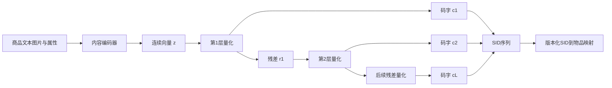
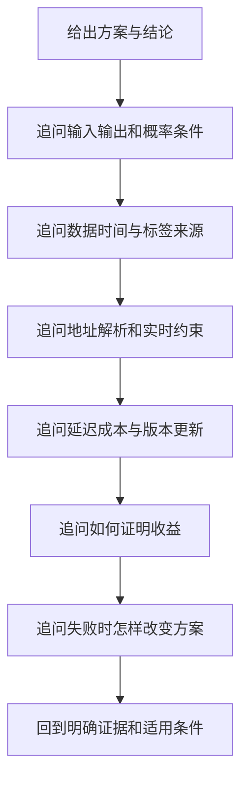

# 生成式搜广推面试题库：答案、解析与回答角度

> 知识与资料检索截止：**2026 年 11 月 5 日**。面向算法工程师、研究工程师与搜广推架构岗位。本文将公开论文、基础理论与工程推演整理为 240 道主问题，覆盖搜索、广告、推荐；题目不是声称采集到的全部公司私有面试原题，也不以未经核验的“面试出现频率”排序。论文自己的结论标注“单源”，工程建议和教学推导不冒充原文实验结果。
>
> 阅读方式：先沿“表示 → 建模 → 训练 → 生成 → 业务约束 → 评测 → 部署”理解闭环，再按岗位跳读。P0/P1/P2 表示建议学习顺序；难度表示回答所需深度，与真实招聘频率无关。每题包含参考答案、解析、回答角度、追问与易错点。公式中的概率必须明确条件、动作空间与版本。

## 阅读导航与知识主线

| 章节 | 题号 | 核心问题 |
|---|---|---|
| [01 范式与传统基础](#chapter-01) | Q001—Q012 | 生成式究竟改变了什么，保留了什么 |
| [02 概率、序列与目标函数](#chapter-02) | Q013—Q024 | 从 next-token 到 next-item 的数学边界 |
| [03 Semantic ID 与残差量化](#chapter-03) | Q025—Q036 | 商品地址如何进入模型词表 |
| [04 编码诊断、冷启动与更新](#chapter-04) | Q037—Q048 | 编码是否真的可用、可更新、可召回 |
| [05 生成式检索与搜索](#chapter-05) | Q049—Q060 | query 如何直接指向文档或商品 |
| [06 搜索答案、推理与对话](#chapter-06) | Q061—Q072 | 检索、答案生成、推理蒸馏的关系 |
| [07 推荐模型与用户行为](#chapter-07) | Q073—Q084 | 兴趣、候选感知、长序列与多模态 |
| [08 列表、探索与长期价值](#chapter-08) | Q085—Q096 | 从单物品概率到整页用户效用 |
| [09 广告价值建模](#chapter-09) | Q097—Q108 | 点击、转化、价值与生成如何对齐 |
| [10 广告约束与拍卖](#chapter-10) | Q109—Q120 | 预算、资格、计费、公平与机制 |
| [11 训练数据与损失](#chapter-11) | Q121—Q132 | 日志如何成为可信的学习信号 |
| [12 偏好学习与强化学习](#chapter-12) | Q133—Q144 | DPO、PPO、GRPO、奖励与策略 |
| [13 解码与候选生成](#chapter-13) | Q145—Q156 | 合法性、beam、并行化与概率一致 |
| [14 架构、算力与推理效率](#chapter-14) | Q157—Q168 | MoE、KV、Attention 与成本核算 |
| [15 工业部署与生命周期](#chapter-15) | Q169—Q180 | 从离线训练到可回滚的线上服务 |
| [16 评测、因果与实验](#chapter-16) | Q181—Q192 | 离线分数何时能解释线上收益 |
| [17 截至 2026-11 的论文辨析](#chapter-17) | Q193—Q204 | 新方法改变的具体环节与证据边界 |
| [18 系统设计题](#chapter-18) | Q205—Q216 | 搜索、推荐、广告的完整设计 |
| [19 代码、推导与排障题](#chapter-19) | Q217—Q228 | 用实现和证据检验理解 |
| [20 面试表达与项目复盘](#chapter-20) | Q229—Q240 | 如何回答取舍、失败和开放问题 |

附录跳转：[逐题索引](#appendix-index) · [术语速查](#appendix-glossary) · [公式速查](#appendix-formulas) · [论文对比](#appendix-papers) · [岗位与复习路线](#appendix-study) · [回答评分与自测](#appendix-rubric) · [参考资料与版本](#appendix-references)


同一术语经常指向不同系统：**生成物品标识符**、**把行为建模为序列的推荐模型**、**生成搜索答案**、**生成广告素材**不能混为一谈。所有章节都以“输入是什么、输出是什么、优化什么、上线还需要什么”为辨析轴。

<a id="chapter-01"></a>
## 01 范式与传统基础

<a id="q001"></a>
### Q001. 什么是生成式搜广推？与传统判别式系统的根本区别是什么？

适用：通用｜难度：基础｜优先级：P0

**参考答案**：传统匹配系统通常先取得候选，再估计每个候选的相关性或价值；生成式检索把候选标识符的条件分布直接建模为序列，由用户或 query 生成物品地址。广义生成式推荐还包括把用户行为和目标预测统一为序列转导的架构。搜索答案与广告素材生成则输出自然语言或媒体内容，属于另一条任务线。生成改变了候选产生和模型共享方式，不自动消除资格检查、拍卖、校准与实验。[cite:1](#ref-1) [cite:2](#ref-2) [cite:40](#ref-40)

**解析**：判别式核心可写为 \(s_\theta(x,i)\)，ID 生成核心为 \(p_\theta(c_1,\ldots,c_L\mid x)\)。后者能共享词表和前缀，但仍要把地址映射到真实物品，并证明生成概率与业务目标一致。不能仅凭用了 Transformer 就宣布是生成式召回。

**回答角度**：先定义输出空间，再比较候选产生、训练目标和在线成本，最后指出生成与判别可以在同一系统协作。

**追问与易错点**：问“是不是不需要排序了？”答：只有当生成目标、列表效用与业务价值充分对齐并有线上证据时，才可能减少某些排序阶段；否则需要物品级价值头或后排。

<a id="q002"></a>
### Q002. 为什么传统搜广推要采用多阶段漏斗？

适用：通用｜难度：基础｜优先级：P0

**参考答案**：候选规模、单候选计算量和响应时间构成约束。召回以低成本覆盖大量候选，粗排压缩集合，精排使用丰富交叉特征，重排处理列表效用与约束。广告还要读取实时预算和执行拍卖。多阶段允许不同算力层服务不同集合，但容易出现目标割裂、上游截断与特征重复建设。生成式统一模型希望减少这些损失，却仍须满足算力和业务制度限制。

**解析**：若精排每候选成本为 \(C\)，全库规模为 \(N\)，直接评分约为 \(NC\)。召回截断后成本降低，但最终可选物品已受上游支持集限制。所谓“端到端”必须说清是参数共享、损失联合还是整个服务链路合一。

**回答角度**：用“规模与延迟 → 漏斗合理性 → 阶段割裂 → 生成式尝试”的顺序回答，避免把传统架构描述成无意义历史包袱。

**追问与易错点**：问“共享一个模型是否没有截断损失？”答：解码 beam 仍会截断候选，生成系统同样存在搜索误差和覆盖损失。

<a id="q003"></a>
### Q003. 双塔召回、交叉编码器和生成式召回如何比较？

适用：搜/推｜难度：基础｜优先级：P0

**参考答案**：双塔独立编码请求与物品，便于预计算物品向量和 ANN 检索；交叉编码器让请求与候选充分交互，质量潜力高但逐候选成本大；生成式召回把请求映射到候选 ID 序列，在模型中共享候选结构。选择取决于库规模、更新速度、用户个性化深度、有效候选率与延迟，而不是哪个范式名字更先进。[cite:41](#ref-41) [cite:1](#ref-1)

**解析**：双塔通常以点积为匹配近似，复杂交互需后排补足。生成式成本与输出长度、词表、beam、解析器有关，并非只和物品总数无关。新增物品可否立刻被召回，是模型索引与外部索引的重要差异。

**回答角度**：给出三者输入输出、是否可缓存、更新成本和交互能力四个比较维度，再建议混合方案。

**追问与易错点**：问“生成式一定比 ANN 快？”答：不一定。多个自回归步骤、宽 beam 和低合法率可能超过一次 ANN 的成本，需要同硬件、同候选数比较。

<a id="q004"></a>
### Q004. 生成式检索与 RAG 有什么区别？

适用：搜｜难度：基础｜优先级：P0

**参考答案**：生成式检索输出语料中可定位的文档或物品标识符，解决“取哪些证据”；RAG 在检索到证据后生成答案，解决“如何利用证据回答”。RAG 的检索器可以是 BM25、双塔、生成式检索或混合检索，所以两者可组合。生成答案流畅不说明检索正确，输出合法 docid 也不说明答案有事实支持。[cite:3](#ref-3) [cite:40](#ref-40)

**解析**：至少拆成检索 Recall、证据质量、答案正确性、引用支持率四层评测。模型参数中的知识与外部实时语料的更新机制不同，不能把模型“记住了”当成有可审计证据。

**回答角度**：用流程“query → 文档 → 有引用的答案”定位二者；高级回答补充权限过滤、证据时效和无答案处理。

**追问与易错点**：问“把 RAG 改成生成式检索可否消除幻觉？”答：只能改变检索器，无法保证答案忠于证据，还需 grounding、拒答和事实验证。

<a id="q005"></a>
### Q005. 生成式推荐、LLM 推荐与 AIGC 推荐是一回事吗？

适用：推｜难度：基础｜优先级：P0

**参考答案**：生成式推荐通常生成推荐对象的标识符或列表；LLM 推荐描述使用语言模型做表示、理解、打分、解释或生成，可以只承担一个局部模块；AIGC 推荐常指推荐 AI 生成内容，也可能指为用户创作内容。三个概念按模型、输出、对象定义，彼此有交集但不能互相替代。[cite:7](#ref-7) [cite:1](#ref-1)

**解析**：预训练语言知识帮助理解文本，但用户协同信号、实时反馈、曝光分布和商业目标需要额外学习。自然语言物品名称还存在歧义与幻觉，必须绑定目录。

**回答角度**：面对模糊问题先给出自己的任务定义，然后用一个“LLM 只做 query 改写”的例子说明它不必是生成式召回。

**追问与易错点**：问“直接让聊天模型推荐十个商品行不行？”答：可以作为原型，但生产环境需确保商品存在、可售、符合用户与合规约束，并评测 item-level 指标。

<a id="q006"></a>
### Q006. 搜索、推荐和广告能否统一成一个 next-item 任务？

适用：通用｜难度：进阶｜优先级：P0

**参考答案**：可以统一部分表示和条件生成形式：输入用户、query、场景与历史，输出物品；但业务目标和约束不同。搜索首先满足显式意图和相关性，推荐偏重兴趣与长期体验，广告还涉及付费目标、预算、资格、价格与机制。统一模型应显式使用任务或目标条件，并保留独立价值校准和约束执行，不能只训练下一次点击就声称三者目标等价。[cite:14](#ref-14) [cite:18](#ref-18) [cite:20](#ref-20)

**解析**：形式统一不意味着标签分布统一。查询条件下的商品选择与无查询浏览有不同噪声、候选集和负例口径；广告价值还依赖出价及转化成熟度。

**回答角度**：先承认共享的概率接口，再说明目标、支持集、数据和线上制度四项差异。

**追问与易错点**：问“用 task token 是否就能解决冲突？”答：它提供条件信息，不能保证梯度不冲突或校准正确，仍需采样、损失解耦与分任务实验。

<a id="q007"></a>
### Q007. 为什么工业界开始探索生成式统一模型？

适用：通用｜难度：进阶｜优先级：P0

**参考答案**：动机主要是减少召回与排序目标错位、整合重复的用户行为建模、利用规模化序列学习、共享多任务与多模态知识，以及降低多个模型和特征服务的维护成本。公开研究呈现多条路线：TIGER 强调语义 ID 检索，HSTU 强调行为序列转导，OneRec 和广告统一模型探索候选生成与价值对齐。动机成立不代表任何新模型都会产生线上收益。[cite:1](#ref-1) [cite:2](#ref-2) [cite:11](#ref-11) [cite:18](#ref-18)

**解析**：统一可提高信息利用效率，也会扩大故障范围和训练耦合。必须同时比较效果、GPU 请求成本、更新延迟及维护收益；工程简化本身可以是价值，但要与统计显著业务增长分开报告。

**回答角度**：从实际痛点出发，选两三个可量化目标，避免泛泛说“大模型更智能”。

**追问与易错点**：问“多阶段替换得越多越好吗？”答：不是；可先替换薄弱召回源，保留强源与安全后排，依增量实验逐步推进。

<a id="q008"></a>
### Q008. 怎样判断一篇论文的“端到端”到底覆盖了哪些环节？

适用：通用｜难度：进阶｜优先级：P0

**参考答案**：读四张清单：模型输入、训练标签与损失、模型输出、线上剩余模块。再确认是否仍有外部候选、SID 解析器、价值排序、资格过滤、重排、拍卖与回退。一个模型可能联合生成和打分，却没有共同训练编码器；也可能替代召回与粗排，但未替代精排。应按实际链路描述，而不是按标题猜测。[cite:19](#ref-19) [cite:21](#ref-21)

**解析**：参数共享是架构属性，端到端梯度是训练属性，全链路替代是部署属性。这三项可以分别成立或不成立。离线端到端目标也不自动包含上线不可微的业务规则。

**回答角度**：先说明自己会画边界图，再逐项定位，体现对论文和工程的双重理解。

**追问与易错点**：问“有共同 encoder 是否就叫联合优化？”答：只有各任务损失实际更新共享参数才能这么说；冻结模块或单向蒸馏需要另行表述。

<a id="q009"></a>
### Q009. 传统排序里的相关性、点击率与价值有何区别？

适用：通用｜难度：基础｜优先级：P0

**参考答案**：相关性描述候选对意图或兴趣的匹配，pCTR 是特定曝光条件下点击的预测概率，价值则将点击、转化、金额、体验与约束纳入决策。点击率会受位置、封面和人群影响；高相关内容也可能不点击，高点击内容也可能低满意度。生成概率通常拟合历史选择分布，更不能直接当成这些量。

**解析**：必须区分 \(P(\mathrm{click}\mid x,i,\mathrm{exposed})\)、\(P(\mathrm{item}=i\mid x,\mathrm{logged\ choice})\) 与决策效用 \(U(x,i)\)。分母、标签空间和条件不同，数值无法随意互换。

**回答角度**：用“标题党点击高但满意度低”的例子起手，再写条件概率；广告回答进一步区分 pCVR 与 pCTCVR。

**追问与易错点**：问“排序只需要相对顺序，为什么要校准？”答：广告计价、多模型融合、阈值和跨场景分配依赖概率尺度，相同 AUC 不保证同样的决策质量。

<a id="q010"></a>
### Q010. 协同信号与内容语义分别提供什么？

适用：搜/推/广｜难度：基础｜优先级：P0

**参考答案**：内容语义来自文本、图片、音视频和属性，帮助理解“物品是什么”，支持未交互物品的泛化；协同信号来自共同浏览、点击、购买与用户序列，帮助理解“哪些人会一起选择什么”。内容相似不必然共同消费，协同相近也可能内容不同。好的 SID 或表示应结合任务目标，不能只优化通用 embedding 重建。[cite:8](#ref-8) [cite:9](#ref-9)

**解析**：内容与协同数据的噪声、时效和覆盖不同。热物品可能从协同获益更多，冷物品更依赖内容；融合效果要分别看冷热分桶，避免平均指标掩盖损失。

**回答角度**：先给两个反例，再说联合训练、对比对齐或多目标 tokenizer 的实现选择。

**追问与易错点**：问“内容 embedding 很强，是否无需交互训练？”答：无法保证偏好、价格敏感与替代关系已编码，仍需真实行为和业务评测。

<a id="q011"></a>
### Q011. 生成式模型能天然解决长尾与冷启动吗？

适用：通用｜难度：进阶｜优先级：P0

**参考答案**：不能。共享语义 token 能让冷物品继承已有前缀知识，但解码器是否认识新地址、叶子概率是否足够、合法目录是否更新、解析器是否偏向热门物品仍会决定可召回性。冷用户又是另一个问题，需要上下文、显式意图或探索。公开复现研究要求区分 user/item 冷启动，并控制划分与编码训练协议。[cite:30](#ref-30) [cite:24](#ref-24)

**解析**：先区分“无交互但已有内容”“训练后新入库”“用户无历史”三种冷启动。若评测编码器提前看过未来内容，应说明这是 transductive 设置，不能冒充完全归纳泛化。

**回答角度**：用条件式结论：“有语义迁移潜力，但需要地址可达、模型适配和曝光机会共同成立。”

**追问与易错点**：问“给新商品分配 SID 就能召回？”答：目录合法只解决可寻址，模型不一定给新叶子足够概率。

<a id="q012"></a>
### Q012. 一个完整的生成式搜广推项目应包含哪些模块？

适用：通用｜难度：进阶｜优先级：P0

**参考答案**：至少包含事件与标签管道、内容/协同表示、SID 或原子 ID 目录、用户序列模型、生成与价值目标、合法解码、物品解析、业务过滤/重排/拍卖、在线反馈、实验监控与版本回滚。模型只是链路中的一个模块。初期可复用已有价值后排与资格服务，先验证生成候选是否有独立增益。

**解析**：关键依赖是用户特征、量化器、解码器、trie、SID→item 映射和目录状态的版本一致。单点正确不足以保证系统正确，尤其是新物品、删除、预算消耗和延迟转化。

**回答角度**：以请求与反馈两条链路作答，再给最小可上线版本与演进路线。

**追问与易错点**：问“最先做哪个 baseline？”答：在同时间划分和同预算下比较成熟双塔或序列召回、简单 SID 生成和融合方案，先确定收益来自模型还是数据升级。

<a id="chapter-02"></a>
## 02 概率、序列与目标函数

<a id="q013"></a>
### Q013. 如何把一个物品的生成概率写成 token 概率？

适用：通用｜难度：基础｜优先级：P0

**参考答案**：若物品地址 \(c(i)=(c_1,\ldots,c_L)\) 唯一且固定，则链式法则给出 \(p_\theta(c(i)\mid x)=\prod_{\ell=1}^{L}p_\theta(c_\ell\mid x,c_{<\ell})\)，对数概率是逐步 log-prob 之和。若多个物品共享地址，地址概率还需解析分布 \(p(i\mid c,x)\)；若一个物品有多个合法别名，则物品概率应对别名路径求和，不能取任一条路径就当完整物品概率。

**解析**：EOS、长度、非法路径处理与 token mask 都影响概率口径。只有“唯一地址 + 完整合法归一化 + 无截断”的条件下，地址空间才容易对应全物品分布；beam 输出只是该分布的近似候选。

**回答角度**：先写链式法则，再补一对多、多对一的边界，体现 item 与 token 层的区分。

**追问与易错点**：问“每步最高概率相乘一定得到全局最佳 item 吗？”答：不一定，早期贪心选择可能排除后续累计概率更高的路径。

<a id="q014"></a>
### Q014. Next-token NLL 为什么不等价于推荐效用最大化？

适用：通用｜难度：进阶｜优先级：P0

**参考答案**：NLL 最小化训练分布与模型分布的交叉熵，通常学习历史已选择物品的条件频率。历史数据受到曝光策略、位置、热度和用户选择影响，因此拟合得更好不保证推荐更多高价值候选，更不保证提升长期满意度。需要加入价值监督、偏好数据、反事实校正或在线策略优化，并分别验证各自效果。

**解析**：若训练正例来自日志 \(p_{\log}(i\mid x)\)，最优模型在足够容量下逼近该分布。业务要优化的是 \(\mathbb E_{\pi}[R(x,i)]\)，除非奖励与日志分布有特定一致关系，两者没有一般等价性。

**回答角度**：从“学到的是谁产生的数据”解释，再给热物品占优或点击短视的例子，最后谈目标修正。

**追问与易错点**：问“降低 perplexity 是否一定提升 Recall@K？”答：不一定，概率质量可以改善尾部而不改变前 K，也可能与物品碰撞和解码策略相互作用。

<a id="q015"></a>
### Q015. Teacher forcing 与 exposure bias 是什么？

适用：通用｜难度：基础｜优先级：P0

**参考答案**：Teacher forcing 在训练时用真实前缀预测下一 token；服务时模型使用自己的前缀。一旦前面生成错误，后续条件分布进入训练较少见的区域，形成 exposure bias。SID 通常较短，错误仍可能在早层剪掉整个正确子树；生成整页列表时还会出现物品之间的误差累积。

**解析**：可用更好的 beam、前缀扰动、列表级训练或 on-policy 采样减轻，但都存在成本和偏差取舍。Scheduled sampling 不是无条件一致的最大似然估计，不能当成万能修复。

**回答角度**：用“训练看真前缀，线上看自己生成的前缀”一句话起手，再解释 SID 首层错误为何影响大。

**追问与易错点**：问“teacher forcing 同时预测所有位置，所以线上也并行？”答：训练已知全部前缀可以并行算 loss；自回归推理未知前缀，仍有顺序依赖。

<a id="q016"></a>
### Q016. 为什么前缀概率高的路径不一定包含最优物品？

适用：搜/推｜难度：进阶｜优先级：P0

**参考答案**：一个前缀概率等于其所有后代地址的概率质量之和。热门大簇可以拥有很高总概率，但簇内每个物品都不突出；小簇总质量较低，却可能有一个高价值叶子。窄 beam 按前缀累计概率剪枝会产生搜索误差，且概率最佳叶子本身也未必是价值最佳物品。

**解析**：分开看“前缀存活”“叶子检索”“物品级评分”三项。可以增加 beam、优化编码前缀、加入价值引导或使用后验 rerank，但每种措施会改变成本或训练目标。

**回答角度**：画一个大簇与小簇的树，解释概率质量与最佳叶子不同，再谈诊断而不是直接加 beam。

**追问与易错点**：问“首层 Recall 高是否代表召回好？”答：只说明正确簇没有被剪掉；后续细分、碰撞解析和资格过滤仍会丢失目标。

<a id="q017"></a>
### Q017. 温度、label smoothing 和概率校准分别改变什么？

适用：通用｜难度：进阶｜优先级：P1

**参考答案**：温度 \(T\) 将 logits 变为 \(z/T\)，在单步固定词表下调节分布尖锐程度；label smoothing 改变训练标签，将部分质量分配到其他类别；校准则用验证数据使预测概率与实际事件频率匹配。SID token 概率的温度变化不等价于物品级 CTR 校准，非法 token 上的 smoothing 还可能浪费学习质量。

**解析**：单步温度不改变该步 logits 的排序，但通过不同前缀的归一化常数可改变序列排序和 beam 搜索。校准数据必须与服务场景一致，尤其是曝光与位置条件。

**回答角度**：分别按推理操作、训练操作、统计性质回答，再指出 token 和 item 层的差别。

**追问与易错点**：问“温度只影响采样、不影响 top-k？”答：对单步排序是这样；多步累计概率及剪枝的结果可能变化。

<a id="q018"></a>
### Q018. 长度偏差为什么会影响生成式检索？

适用：搜/推｜难度：进阶｜优先级：P1

**参考答案**：累乘概率一般随 token 数增加而减小，自然语言名称或多长度地址可能偏好短路径。固定长度 SID 可减少这一问题，但整页列表、EOS 和可变长度别名仍受影响。长度归一化是搜索启发式，会改变优化目标，不能再把调整后的分数解释为原始序列概率。

**解析**：常用分数如 \(\log p(y\mid x)/|y|^\alpha\)，其中 \(\alpha\) 应由验证任务选择。若业务输出固定 K 个物品，可通过格式与合法 mask 明确长度，而不是允许模型提前停。

**回答角度**：先说明何时有问题，再说固定 SID、EOS 管理与归一化的取舍。

**追问与易错点**：问“平均 token log-prob 能公平比较所有 item 吗？”答：仍依赖分词和地址设计；两个别名长度不同会引入非业务差异。

<a id="q019"></a>
### Q019. Pointwise、pairwise、listwise 目标如何选择？

适用：通用｜难度：基础｜优先级：P0

**参考答案**：Pointwise 学单候选事件概率或数值，利于校准；pairwise 学同请求下两个候选的相对偏好，利于排序；listwise 直接依赖列表内候选及位置，能表达整体排序或列表效用。生成式 NLL 是序列级似然目标，不自动拥有 listwise 业务意义。可以联合生成 NLL、物品价值 loss 与偏好目标，但需明确每项标签来源。

**解析**：Pairwise 的 pair 采样决定训练分布，listwise 的集合也可能只覆盖曝光或召回结果。对不同候选集合定义的 loss，数值大小不可直接比较。CTR 概率头通常不能只靠相对排序 loss 获得校准。

**回答角度**：以“需要概率、需要相对顺序、需要整页效用”三个需求选择目标。

**追问与易错点**：问“listwise 一定优于 pairwise？”答：不一定，列表标签更难可靠收集，数据稀疏与高方差可能抵消结构收益。

<a id="q020"></a>
### Q020. 为什么未曝光物品不能直接当负例？

适用：通用｜难度：基础｜优先级：P0

**参考答案**：未曝光只说明日志没有观察到用户对该物品的反馈，不代表用户不喜欢。曝光未点也受位置、可见性、时间和竞争影响。召回训练的 in-batch negatives 是对比学习的采样候选，不能被解释成确定的业务负标签。需要排除已知多正例、控制热度采样，并在适用场景考虑曝光倾向校正。

**解析**：缺失反馈通常不是随机缺失。模型若把全部未曝光样本标为负，会学到旧策略的候选支持集，抑制探索。负采样校正能修正采样分布，不自动修正曝光因果偏差。

**回答角度**：明确“未知”和“观察到的负反馈”区别，再给曝光未点、主动不喜欢两个强度不同的标签。

**追问与易错点**：问“同 batch 的其他正物品为什么能当负？”答：这是计算可行的训练近似；存在 false negatives，需多正例 mask 或去重。

<a id="q021"></a>
### Q021. In-batch negatives 与 sampled softmax 有哪些陷阱？

适用：通用｜难度：进阶｜优先级：P1

**参考答案**：Batch 分布通常不是均匀物品分布，热门物品反复出现，跨用户候选可能实际上相关；同物品重复会形成自相矛盾标签。Sampled softmax 若要近似全词表目标，需要按采样机制处理概率修正，并保证目标和负例采样的实现一致。对 SID，每层类别共享后代，随意采“负 token”可能破坏语义条件。

**解析**：常见修正与 \(-\log q(i)\) 有关，但具体形式依有无放回、期望计数与目标包含方式，不能照搬一个公式。最终还要在完整合法候选空间评测。

**回答角度**：从采样分布、重复、多正例和条件词表四方面检查，再解释吞吐与统计目标之间的折中。

**追问与易错点**：问“负例越多越好？”答：更多负例可能提升区分度，也可能增加伪负例和热度偏差，要看有效难负例比例与训练稳定性。

<a id="q022"></a>
### Q022. 从单步推荐到序列决策，状态和动作如何定义？

适用：推/广｜难度：进阶｜优先级：P0

**参考答案**：状态可以包含用户上下文、历史、当前会话和实时业务状态；动作可定义为一个 token、一个 item 或整张 slate；转移包含用户响应与后续状态。Token 级生成过程常是一个有限长度内部决策，而用户长期行为是外部业务过程。两者的 horizon 与折扣不能混为一谈。

**解析**：若把 SID 的四个 token 当四步 RL，最后一次奖励代表该 item 效用，并不等价于优化四天的用户留存。预算、库存、频控若影响可执行动作，应进入状态或合法动作集合。

**回答角度**：先选择与你的训练和服务一致的动作粒度，再说明奖励何时到达、是否存在跨请求影响。

**追问与易错点**：问“只做 token RL 就能优化长期价值？”答：除非奖励包含可信的长期估计且因果识别成立，否则只是对短序列生成做策略改进。

<a id="q023"></a>
### Q023. 多目标优化为什么不能只把所有指标加权相加？

适用：通用｜难度：进阶｜优先级：P0

**参考答案**：加权和是有用基线，但指标尺度、冲突、非线性和硬约束会影响结果。收入、满意度、广告主 ROI 与公平不是同一量纲，权重还会随场景变化。可将主要目标最大化、其他指标设为约束，或训练目标条件策略，评估 Pareto 前沿；资格、预算和合规通常必须由服务强校验。

**解析**：约束式可写为 \(\max_\pi \mathbb E_\pi[R]\)，满足 \(\mathbb E_\pi[C_j]\le b_j\)。Lagrangian 能提供训练近似，但线上逐请求硬约束与平均约束不同，不能由一个 reward penalty 保证。

**回答角度**：先说业务优先级与不可违反项，再介绍权重或条件策略如何实现软取舍。

**追问与易错点**：问“把违规奖励设得很负就够了吗？”答：探索、分布漂移和模型误差仍可能违规，必须在执行前过滤。

<a id="q024"></a>
### Q024. 离线策略学习为什么容易被旧曝光策略限制？

适用：通用｜难度：进阶｜优先级：P0

**参考答案**：日志只包含旧策略实际选择动作的反馈。新策略偏好的未曝光动作没有可观察奖励，且若旧策略对其概率为零，无法用重要性采样识别其价值。离线偏好训练、价值模型与生成器都可能继承这一支持集限制。解决依赖合理探索、已知或可估倾向概率、保守优化与在线随机实验。[cite:44](#ref-44) [cite:45](#ref-45)

**解析**：IPS 需要重叠条件 \( \pi(a\mid x)>0 \Rightarrow \mu(a\mid x)>0 \)。确定性排序日志常不具备足够 overlap。模型泛化给出的是假设驱动预测，不是可识别的无偏反事实事实。

**回答角度**：先解释“没有观察就不能凭空验证”，再谈数据收集而不仅是换 loss。

**追问与易错点**：问“用 LLM 给未曝光候选打分是否解决支持问题？”答：它提供额外先验或伪标签，仍不能替代真实随机反馈与因果假设。

<a id="chapter-03"></a>
## 03 Semantic ID 与残差量化



<a id="q025"></a>
### Q025. Semantic ID 是什么？与原始 item ID 有何区别？

适用：搜/推/广｜难度：基础｜优先级：P0

**参考答案**：原始 item ID 是目录中的身份标识，通常不表达物品关系；Semantic ID 将内容或协同表示离散化为多层码字，让不同物品共享部分 token。它既是模型输入表示，也可以作为生成输出地址。好处是有限词表、结构共享与潜在泛化；代价是碰撞、前缀剪枝、映射维护及编码与目标错位。SID 也可作为判别排序特征，并非只用于生成。[cite:1](#ref-1) [cite:10](#ref-10)

**解析**：地址身份与语义相似要分别处理。SID 不保证各层对应类别、品牌、价格，也不保证相同前缀就对用户可替代。是否唯一取决于量化和消歧机制。

**回答角度**：用“原子编号与共享子词地址”的类比起手，再补容量、更新和解析的工程负担。

**追问与易错点**：问“能用商品类目路径直接做 SID 吗？”答：可以作为层次标签基线，但类目粒度、跨类兴趣和大叶子碰撞可能限制质量。

<a id="q026"></a>
### Q026. RQ-VAE 如何逐层生成 SID？核心损失是什么？

适用：通用｜难度：进阶｜优先级：P0

**参考答案**：先将物品特征 \(x\) 编为 \(z=f_\phi(x)\)。令 \(r_0=z\)，第 \(\ell\) 层选择最接近残差的码字 \(c_\ell=\arg\min_k\|r_{\ell-1}-e_k^{(\ell)}\|^2\)，更新 \(r_\ell=r_{\ell-1}-e_{c_\ell}^{(\ell)}\)。量化表示 \(\hat z=\sum_{\ell=1}^L e_{c_\ell}^{(\ell)}\) 再由 decoder 重建特征。典型目标包含重建误差、码本更新和 commitment loss，最近邻选择通常用 straight-through 或 EMA 等方法训练。[cite:1](#ref-1)

**解析**：一组教学约定下，VQ 项为
\[
\mathcal L_{\mathrm{VQ}}=\sum_{\ell=1}^{L}\left[
\|\operatorname{sg}(r_{\ell-1})-e_{c_\ell}^{(\ell)}\|^2+
\beta\|r_{\ell-1}-\operatorname{sg}(e_{c_\ell}^{(\ell)})\|^2\right].
\]
第一项将码字拉向残差，第二项让编码表示承诺于码字；\(\operatorname{sg}\) 表示停止梯度。不同实现对残差梯度、重建空间和 EMA 约定不同，不能把这个通式当成所有论文的逐字公式。名字带 VAE 也不代表必然采用标准高斯 KL 目标。各层补偿剩余误差，比只用一层大码本更易控制词表，但重建好不意味着前缀适合召回。

**回答角度**：按“编码 → 最近邻 → 残差 → 重建 → 梯度近似”讲一遍，再讨论业务目标与量化目标的差距。

**追问与易错点**：问“argmin 不可导如何训练？”答：前向用离散码，反向用 STE 近似或独立码本更新；要检查哪些参数接收重建与 commitment 梯度。

<a id="q027"></a>
### Q027. 如何选择 SID 的层数 L 与每层码本大小 K？

适用：通用｜难度：进阶｜优先级：P0

**参考答案**：从物品规模、碰撞容忍度、内容结构、词表成本和解码预算联合选择。等大小码本的组合容量上限为 \(K^L\)，但实际可用地址远少于理论上限。增大 K 提高每步区分度，也扩大 softmax 和数据稀疏；增大 L 降低单层词表压力，却增加自回归步骤和前缀错误。应同时看重建、碰撞、前缀存活、item Recall、延迟及冷启动。

**解析**：输出投影开销常近似为 \(LKd\) 的累计量级，而服务还乘上活跃 beam 与批处理因素；词表若按层共享或分离，参数量不同。容量设计最好预留增长空间，不能只满足当前 \(N\)。

**回答角度**：先给约束变量，再给网格实验与多指标选点，避免只按 \(K^L>N\) 下结论。

**追问与易错点**：问“容量超过物品数是否一定零碰撞？”答：不保证；量化分布不均、特征重复和码本塌缩都可能造成集中分配。

<a id="q028"></a>
### Q028. 为什么残差量化的前缀不必然是“从粗到细的类别”？

适用：通用｜难度：进阶｜优先级：P0

**参考答案**：第一层拟合连续表示中最主要的重建结构，后层拟合剩余误差；这些结构由 embedding、距离度量、训练数据和 loss 决定，不必与人工类目一致。即便内容上较粗到细，对特定用户的偏好顺序也可能不同。要用前缀聚类语义、同前缀协同行为和目标存活率实测，而不是仅看可视化样例。

**解析**：若输入 embedding 更重视觉风格，首层可能先区分画面而非商品用途。可引入关键词、协同或前缀对比目标使结构更适合任务，但会牺牲部分纯重建最优性。[cite:14](#ref-14) [cite:25](#ref-25)

**回答角度**：区分“几何残差的层次”与“业务意义的层次”，再谈诊断与监督。

**追问与易错点**：问“首层一定承载最多推荐信息吗？”答：未必；重建方差与用户选择互信息不是同一个目标。

<a id="q029"></a>
### Q029. SID 碰撞为什么会影响生成与排序？

适用：通用｜难度：进阶｜优先级：P0

**参考答案**：多个物品共享同一 SID 时，生成器只能给这个地址总体分配概率，无法仅凭地址区分物品。服务必须使用 resolver，例如附加唯一 token、候选属性过滤或物品级打分。热门成员可能持续挤压同地址的冷物品，使 SID Recall 看起来好而真实 item Recall 差。碰撞还会使日志训练标签聚合，价值标签难以准确归属。[cite:19](#ref-19) [cite:24](#ref-24)

**解析**：定义 \(p(i\mid x)=p(c(i)\mid x)p(i\mid c(i),x)\) 仅在每物品一个地址且 resolver 对桶内归一化时成立。若 resolver 是启发式 top-K，就应把生成分数和解析分数分别报告，不冒充完整概率。

**回答角度**：从“模型输出的是桶还是物品”解释，再说唯一化与共享泛化之间的取舍。

**追问与易错点**：问“碰撞率很低是否可忽略？”答：需看请求加权影响；少数高流量大桶可能贡献大部分线上损失。

<a id="q030"></a>
### Q030. 用唯一后缀消除碰撞会带来什么代价？

适用：通用｜难度：进阶｜优先级：P1

**参考答案**：唯一后缀保证目录地址可区分，但可能引入没有语义的最后一层、增加生成长度与冷 item 学习难度。若后缀依桶内编号，重新分桶会改变旧地址；若使用全局大词表又接近原子 ID 的存储成本。可以只对冲突桶增加后缀，或用 item-level resolver，但须明确服务格式与可达性。

**解析**：消碰撞解决身份问题，未解决模型能否学习叶子概率的问题。后缀若在数据划分之后构造，应避免读取未来交互；如果只是目录内容可见，需要声明评测假设。

**回答角度**：讲清唯一性、共享、长度和版本四项，不把追加 token 当成免费的修补。

**追问与易错点**：问“最后一层随机 ID 会破坏前几层语义吗？”答：不必然，但会增加末层估计难度，并可能通过联合训练影响前缀分布。

<a id="q031"></a>
### Q031. Codebook collapse 与热门物品偏置有什么区别？

适用：通用｜难度：进阶｜优先级：P0

**参考答案**：码本塌缩是编码器把大量物品分配到少量码字，其余码字很少或从不使用；热门偏置是生成器、采样或解析器倾向高交互物品。前者主要是表示分配问题，后者主要是训练与决策分布问题，两者可相互放大。应分别看物品均匀统计的码使用率和曝光/请求加权的生成频率。

**解析**：可诊断死码、各层熵、残差能量、桶大小、热门分桶曝光。重初始化死码、EMA、均衡分配正则能缓解塌缩，但强均衡可能破坏有意义的非均匀结构。

**回答角度**：先辨认故障发生在 tokenizer 还是 generator，再提出针对性措施。

**追问与易错点**：问“把每个码字使用次数强行相等最好吗？”答：不一定，真实语义与需求本来可能不均衡；要验证均衡带来的业务收益与重建损失。

<a id="q032"></a>
### Q032. LETTER 与 LC-Rec 对 SID 学习带来哪些启发？

适用：推｜难度：进阶｜优先级：P1

**参考答案**：LC-Rec 强调语言与协同语义对齐，提醒内容知识需要连接真实交互；LETTER 探索可学习 tokenization，结合语义、协同和码分配多样性，并采用 ranking-guided generation 思路。共同启发是：编码接口必须服务推荐目标，而不只是压缩通用向量。具体机制和收益分别属于各自论文结论。[cite:8](#ref-8) [cite:9](#ref-9)

**解析**：联合目标会增加超参数与优化耦合，需要消融区分是更好的 embedding、更均匀的码还是更合适的生成 loss 带来收益。同团队或相似数据上的多篇论文不能自动算独立证据。

**回答角度**：按“要修复哪种错位 → 加什么监督 → 怎么验证”回答，不仅背方法缩写。

**追问与易错点**：问“协同正则是否一定利于冷启动？”答：无交互物品可能缺少监督，需内容迁移与专门冷启动 protocol 验证。

<a id="q033"></a>
### Q033. 层次聚类 ID、RQ-VAE ID 与自然语言 ID 如何取舍？

适用：搜/推｜难度：进阶｜优先级：P1

**参考答案**：层次聚类构造树状地址，结构直观但聚类更新和不均衡会影响前缀；RQ-VAE 学残差组合码，容量灵活且可结合目标，但碰撞和码本训练更复杂；自然语言名称利用语言知识、可解释性强，却有歧义、长度差异和命名更新。选择取决于任务、目录和服务约束，最好比较同表示、同预算下的效果。[cite:4](#ref-4) [cite:1](#ref-1) [cite:5](#ref-5)

**解析**：可解释地址不必然更高可检索性。一个物品多种名称需要别名归并；树分叉过大有 softmax 成本，过深则推理步数增加。ID 设计同时是学习接口和索引接口。

**回答角度**：列出唯一性、语义共享、长度、更新和合法约束五项，再给任务条件下的选择。

**追问与易错点**：问“自然语言 ID 不需要索引吗？”答：仍需名称到实体的目录、合法前缀结构与消歧，否则会生成不存在的实体。

<a id="q034"></a>
### Q034. 为什么原子 ID 有时能超过 Semantic ID？

适用：推/广｜难度：进阶｜优先级：P0

**参考答案**：若对象规模可控且每对象有足够训练样本，原子 token 可直接学习对象特定偏好，避免量化信息损失、碰撞、前缀剪枝和解析器误差。SID 的结构共享并非总能弥补这些损失。2026 年 ACT 在 creator 级规模探索双射原子词表，提供了需要比较原子基线的反例，但不能推广成亿级商品 SID 全面无效。[cite:23](#ref-23)

**解析**：原子输出层约有 \(Nd\) 参数和全词表评分成本，新增对象与低频对象学习也是难点。creator 与 item 的数量、内容更新频率、交互密度不同，跨对象粒度结论必须谨慎。

**回答角度**：承认强基线的适用条件，然后说自己会按规模和交互密度分桶比较。

**追问与易错点**：问“原子 top-K 无自回归，是否天然更优？”答：简化解码是优势，但大词表算力、更新和数据稀疏仍可能主导成本。

<a id="q035"></a>
### Q035. 为什么 SID 重建误差低，推荐 Recall 仍可能低？

适用：通用｜难度：进阶｜优先级：P0

**参考答案**：重建优化的是输入表示的几何保真，不是用户对物品的选择。低误差仍可能伴随热门大桶、对偏好无关的首层划分、目标前缀被剪枝、碰撞解析错误或模型无法识别冷叶子。需要把 tokenizer 指标与 generator 指标分开，并用统一的 item-level 评测串起来。

**解析**：可以固定 generator 替换 tokenizer，或固定 tokenizer 比较不同生成器与 oracle resolver，定位损失来源。重建空间若包含噪声，保真度越高未必任务越好。

**回答角度**：先指出目标错位，再给分层消融实验；高级回答提及候选可达性是 Recall 的上限。

**追问与易错点**：问“把 decoder 做强，重建更好会提升 SID 吗？”答：强重建 decoder 可能掩盖编码质量，必须直接评估离散接口与下游召回。

<a id="q036"></a>
### Q036. 如何设计 tokenizer 与推荐模型的联合训练？

适用：通用｜难度：高阶｜优先级：P1

**参考答案**：可采用预训练 tokenizer 后冻结、交替更新、软分配联合优化或蒸馏稳定旧编码。联合目标包含内容保真、协同结构、分配多样性和生成/排序效用，但离散分配变化会使已有标签与在线目录失效。生产设计通常需要控制更新频率、保存旧新映射并整体版本化，而不是每个训练步动态改地址。

**解析**：离散 argmin 的梯度近似和编码切换形成双重不稳定。要测 churn rate、旧码迁移准确率、解码分布漂移与新物品收益；loss 权重不仅影响模型，也影响目录迁移成本。

**回答角度**：先给稳定可上线方案，再讨论更激进联合优化的收益条件和监控。

**追问与易错点**：问“端到端更新一定最优？”答：理论可优化下游目标，但训练稳定性、版本迁移和线上时效可能使冻结或交替方案更实用。

<a id="chapter-04"></a>
## 04 编码诊断、冷启动与更新

<a id="q037"></a>
### Q037. 如何系统诊断一个 SID 接口是否健康？

适用：通用｜难度：高阶｜优先级：P0

**参考答案**：沿五层检查：分配是否塌缩；物品是否有合法地址；正确前缀是否被模型保留；SID 是否正确解析到 item；更新后模型与目录是否适配。SIDScope 将 allocation、addressability、prefix alignment、item resolution、refresh/model adaptation 分开，适合用作故障树，具体框架为单源论文结论。[cite:24](#ref-24)

**解析**：对应指标包括码使用率、唯一地址覆盖、目标逐层存活、oracle/实际解析 Recall、编码 churn 和版本 mismatch。只报告总 Recall 难以知道哪里损失；只报告码本均衡也无法证明每物品可召回。

**回答角度**：给出一条数据流，然后每层配一个可观察指标和一个消融实验。

**追问与易错点**：问“怎样确认 resolver 是瓶颈？”答：在相同 SID 候选上用 oracle 桶内解析计算上限，与实际 resolver 比较 item Recall。

<a id="q038"></a>
### Q038. 码利用率、perplexity、唯一率与可达率如何计算？

适用：通用｜难度：进阶｜优先级：P0

**参考答案**：层 \(\ell\) 的利用率是使用过的码字数除以 \(K_\ell\)；若分配频率为 \(p_k\)，熵 perplexity 为 \(\exp(-\sum_k p_k\log p_k)\)。唯一地址率可报告 distinct SID 数除以物品数，也应补 singleton item 覆盖。可达率指目录中可通过合法路径和解析器返回的物品比例，不能由前两项推断。

**解析**：同一个“碰撞率”可能表示 \(1-\#\mathrm{distinct}/N\)、非 singleton 物品比例或随机物品对相撞概率，必须明确口径。码字每层都充分使用，联合组合仍可能高度集中。

**回答角度**：先逐项定义分母，再说明物品均匀统计和流量加权统计都需要。

**追问与易错点**：问“perplexity 接近 K 是否就不存在碰撞？”答：只是边缘层分布均匀，联合地址分布与 N 决定碰撞。

<a id="q039"></a>
### Q039. 什么是 prefix survival curve？如何用于调 beam？

适用：搜/推｜难度：进阶｜优先级：P0

**参考答案**：对每个真实目标地址，统计到第 \(\ell\) 层时其前缀仍在 beam 中的比例，得到逐层存活曲线。首层陡降说明粗粒度结构或模型前缀排序有问题；末层陡降可能是细粒度稀疏、碰撞或 beam 分配不足。用不同 beam 的曲线、延迟和 item Recall 联合选择配置。

**解析**：存活率是检索上限的一部分，不等同于最终真实物品命中。可以再分热门/冷门、query 类型、桶大小和目录年龄。增加 beam 若只保留更多同桶分支，独立候选数可能不增加。

**回答角度**：从“目标在哪一步消失”定位，比只展示 Recall 对 beam 的一条曲线更有解释力。

**追问与易错点**：问“首层存活差是否一定 tokenizer 有问题？”答：也可能是用户编码或生成器训练不足，需固定编码的模型消融和理想前缀上限。

<a id="q040"></a>
### Q040. 冷用户与冷物品应该如何分别评测？

适用：通用｜难度：进阶｜优先级：P0

**参考答案**：冷用户按训练可见历史长度和是否见过用户划分；冷物品按训练期交互、内容可见性、入库时间和编码器可见性划分。至少区分全新、少样本和热物品，并确保评测时该物品已上线可用。使用时间划分，声明是否允许量化器读取测试期物品内容，避免随机 split 混入未来协同信息。[cite:30](#ref-30)

**解析**：冷启动收益需要同时测覆盖和精度，曝光探索会改变可观察标签。用未来训练过的 item embedding 编码“新物品”，可能制造不真实的归纳能力。

**回答角度**：先定义“冷”的操作标准，再说训练、编码和目录三个时间边界。

**追问与易错点**：问“新物品只缺交互，能否提前编码？”答：若业务允许预上线内容可见可以，但要明确条件，不能与训练后完全新物品混报。

<a id="q041"></a>
### Q041. 新物品上线后，如何让生成模型尽快认识它？

适用：通用｜难度：高阶｜优先级：P0

**参考答案**：内容编码分配合法 SID 后，更新目录与约束索引；通过内容/协同迁移、增量 SFT、query 合成或新叶子适配提升生成概率；上线初期可用 ANN、新品召回与探索通道补充覆盖。监控从入库到可编码、可达、可生成、可曝光的各阶段延迟，不能只记 trie 发布时间。

**解析**：如果新地址的 token 已存在，模型仍未必学到该组合；如果需要新 token，还涉及输出层扩展与初始化。新增目录改变合法 mask 的归一化，也可能影响旧物品序列排序。

**回答角度**：分“地址注册”和“模型学习”两步回答，再给过渡期混合召回。

**追问与易错点**：问“冻结 tokenizer 能否保证新物品性能？”答：只保证编码规则稳定，不能保证内容分布外表示、概率覆盖和 resolver 质量。

<a id="q042"></a>
### Q042. 全量重建 SID 时，怎样避免线上地址错配？

适用：通用｜难度：高阶｜优先级：P0

**参考答案**：把量化器、物品编码快照、训练标签、token 词表、trie、SID→item 映射与模型绑定为一致的发布包。先做旧新码迁移校验和离线回放，再影子运行与小流量实验；切换应原子或显式按请求版本路由，并保留旧包回滚。不同版本即使 token 数字相同，也不能假设含义相同。

**解析**：旧模型配新映射可能把一个合法 SID 解析成错误商品，合法率依旧很高，因此必须验证 item 身份而非仅语法合法。双写日志需保存编码版本以便反馈归因。

**回答角度**：先讲可复现发布单元，再讲切换与回滚；这是系统一致性问题，不只是模型 checkpoint 管理。

**追问与易错点**：问“只保留新旧映射转换表足够吗？”答：若码发生多对多变化或内容漂移，转换不能恢复旧模型概率结构，还需重新适配。

<a id="q043"></a>
### Q043. 删除、下架与违规物品如何从生成系统移除？

适用：通用｜难度：进阶｜优先级：P0

**参考答案**：在在线 eligibility 侧立即拦截，更新解析器与合法目录，并在后续训练中刷新数据；无需等待模型“忘掉”物品才能停止曝光。若同 SID 桶还有合法物品，不能粗暴删整个地址；若所有成员不可用，可剪枝路径。服务需支持紧急黑名单并监控过滤后候选不足。

**解析**：模型概率与执行权限分离，强规则在最后展示前仍应再检查。不同地区、用户年龄或时间窗口下的资格不同，静态 trie 无法完全表达实时权限。

**回答角度**：强调即时执行层与慢速模型更新两条通道，再补候选回填与审计日志。

**追问与易错点**：问“训练里删了数据是否就不会再生成？”答：不能保证模型忘记；线上强拦截是正确性边界。

<a id="q044"></a>
### Q044. 内容变化与兴趣漂移应如何分开处理？

适用：通用｜难度：进阶｜优先级：P1

**参考答案**：内容变化影响物品表示和地址，兴趣漂移影响请求条件分布。价格、标题或视频封面变化不一定要重分 SID，可以保留稳定身份并把动态属性放到价值与资格头；用户兴趣可通过实时短序列、时间衰减和增量模型适配。应分开监控 embedding 漂移、编码 churn 和用户行为分布漂移。

**解析**：过于敏感的 tokenizer 会频繁改地址，破坏生成器学习；完全冻结则可能无法适应内容域变化。可按语义大变更、展示小变更和实时属性选择不同更新策略。

**回答角度**：先划分变的是对象还是条件，再确定是目录更新、特征更新还是模型训练。

**追问与易错点**：问“价格变化后 SID 是否必须变化？”答：只有编码设计把价格视为稳定语义时才可能；通常动态价值特征独立更稳。

<a id="q045"></a>
### Q045. 如何评估 SID 对长尾的帮助，而不是只看平均 Recall？

适用：推/广｜难度：进阶｜优先级：P0

**参考答案**：按交互频率、目录年龄、创作者规模、内容领域和桶大小分桶，比较 item Recall、曝光覆盖、有效命中与线上满意度。再看长尾新增曝光是否来自真实相关候选，是否损害主流请求。需要同等候选数、时延和后排，并控制流量与新品探索策略。

**解析**：覆盖增加可能只是把低质量物品分散曝光；热门下降也不一定是坏事，要结合效用。宏平均与微平均描述不同人群，均应说明分母；零曝光对象无法仅靠日志精确识别质量。

**回答角度**：先定义长尾和公平比较，再提出多维分桶与探索实验。

**追问与易错点**：问“catalog coverage 高就说明长尾体验好？”答：只说明系统触达更多对象，需看用户反馈、可售性与持续消费。

<a id="q046"></a>
### Q046. 多模态 SID 如何融合文本、图片和协同特征？

适用：通用｜难度：进阶｜优先级：P1

**参考答案**：可先将模态投影到统一尺度再融合量化，也可分别编码后用多流 token 或分层码表达。文本偏意图与属性，图像偏视觉与风格，协同偏共同消费；训练应处理缺失模态、噪声与模态权重，并防止高维或高方差模态支配距离。具体方案需按检索任务验证。

**解析**：归一化不只是数值稳定，还影响近邻分配与首层结构。模态 dropout 可提升缺失鲁棒性；目录编码和在线 request 特征应遵守相同预处理。多模态码越长，解码和维护成本越高。

**回答角度**：先说各模态贡献，再说融合位置、量化目标和缺失测试。

**追问与易错点**：问“拼接越多模态越好？”答：噪声、冗余和尺度问题可能伤害表示，需要消融及域外评测。

<a id="q047"></a>
### Q047. 如何建立“编码版本—模型版本—候选版本”的追踪体系？

适用：通用｜难度：高阶｜优先级：P0

**参考答案**：每次请求记录模型版本、tokenizer 版本、目录快照或增量水位、解码 mask 版本、resolver 版本与特征时间。输出保留生成地址、真实 item、过滤原因和最终展示位置；训练样本继承这些标记。线上报错可复现到同样条件，而不是只保留一个总分。

**解析**：对于 RL，behavior policy 的 log-prob 还须使用当时合法动作集合；重放到新目录重新算概率并不等价。版本日志也支持下架审计、回滚与 delayed reward 归因。

**回答角度**：从一次错误推荐能否还原全链路讲起，再设计最小必要日志，兼顾隐私和存储。

**追问与易错点**：问“记录 checkpoint hash 足够吗？”答：不够，目录、mask、动态预算和特征状态也会改变动作。

<a id="q048"></a>
### Q048. 如何证明一个新 tokenizer 的收益来自编码本身？

适用：通用｜难度：高阶｜优先级：P0

**参考答案**：固定训练窗口、内容 embedding、用户模型容量、训练预算、解码预算和后排，只替换 tokenizer；再做重建、前缀、碰撞与 resolver 的分层消融。比较同候选数与同成本两种口径，必要时设置 oracle resolver 或更宽 beam 上限。若同时换数据与大模型，只能说明整体方案收益，不能归因于编码。

**解析**：新 SID 往往改变有效词表和标签熵，等 epoch 不等于等训练计算量；等 beam 不等于等候选覆盖与推理开销。冷启动测试还需控制内容可见窗口。

**回答角度**：先提出单变量对照，再补计算与时间公平性，最后说明因果归因的限度。

**追问与易错点**：问“新方法 NLL 更低就是编码更好？”答：不同 tokenization 的 NLL 尺度和序列长度不可直接比，应转为同 item 任务与服务预算评估。

<a id="chapter-05"></a>
## 05 生成式检索与搜索

<a id="q049"></a>
### Q049. DSI 如何把检索转化为生成？它面临什么更新问题？

适用：搜｜难度：进阶｜优先级：P0

**参考答案**：DSI 将 query→docid 视为 seq2seq，同时通过文档内容→docid 的 indexing 训练把语料信息写入参数。其核心探索是可微的模型索引，区别于仅对外部向量做匹配。目录变化后既要注册标识符，也要使模型吸收新文档与查询关联，训练记忆、容量和增量维护成为重要问题；具体方法属于单源论文。[cite:3](#ref-3)

**解析**：模型权重中的索引与外部检索索引的更新方式不同。文档 ID 设计影响泛化；仅在小库证明检索能力，不能自然推出百万或更大规模服务可行。

**回答角度**：按输入输出、两种训练、与 ANN 的区别、更新代价四步回答。

**追问与易错点**：问“模型记住 docid 是否说明理解了 query？”答：不一定，记忆训练文档与泛化到新查询是不同评测，需要 query 分割和域外测试。

<a id="q050"></a>
### Q050. NCI 为什么使用层次化文档标识符？

适用：搜｜难度：进阶｜优先级：P1

**参考答案**：NCI 探索通过层次聚类构建结构化 docid，使相近文档共享前缀，帮助模型将大候选空间分解为多步决策。相比随机编号，结构为学习和搜索提供关联；但树的均衡、聚类质量与更新稳定性决定前缀是否适合 query 检索。方法机制为单源结论。[cite:4](#ref-4)

**解析**：文档 embedding 相近不代表对所有查询都同等相关；高频 query 目标可能跨多个簇。应测目标逐层存活与同前缀 query 分布，而非只看聚类轮廓系数。

**回答角度**：先说为什么需要结构，再说结构来自什么、在哪些条件下会错配。

**追问与易错点**：问“层次 k-means 可以随时加入新文档吗？”答：可以分配到已有路径，但容量、叶子拥挤和原聚类漂移会影响质量；重聚类还需地址迁移。

<a id="q051"></a>
### Q051. GENRE 的实体名称生成与 trie 约束有什么意义？

适用：搜｜难度：进阶｜优先级：P1

**参考答案**：GENRE 将实体检索表述为生成实体名称，利用语言模型的名称知识，并通过 trie 限制解码只沿合法实体名称前缀。它展示了生成语言序列也可以得到目录内实体，而不只产生自由文本。名称别名、歧义和多语言变化需要实体归并，不能把字符串正确当成身份正确。[cite:5](#ref-5)

**解析**：Trie 为每个前缀提供合法下一 token；它解决语法与目录合法性，不能保证相关性。多个别名路径属于一个实体时，实体级评测应去重并说明概率聚合。

**回答角度**：用“语言知识帮助生成，目录结构约束执行”解释二者协作。

**追问与易错点**：问“约束后是不是完全没有幻觉？”答：不会输出目录外名称，但仍可能生成不相关实体或选错同名实体。

<a id="q052"></a>
### Q052. SEAL 为什么生成语料子串而不是唯一 docid？

适用：搜｜难度：进阶｜优先级：P1

**参考答案**：SEAL 生成来自语料的 n-gram 子串，利用 FM-index 约束合法生成并把子串映射到文档。一个文档可以由多个子串定位，同一子串也可能指向多个文档。这种接口更贴近自然语言，减少人为唯一编号依赖，但要处理多标识符聚合、候选消歧和常见子串的区分度。[cite:6](#ref-6)

**解析**：它不同于“每 item 一个 SID”的地址假设。若把多个子串得分相加或选最大值，需要说明统计意义与启发式，不能直接套唯一地址概率公式。

**回答角度**：先指出检索地址的多对多关系，再讲语料合法性与映射索引。

**追问与易错点**：问“FM-index 与 trie 区别在哪里？”答：前者支持语料子串检索及压缩索引，后者常表示预设名称/地址前缀树；适合的标识符空间不同。

<a id="q053"></a>
### Q053. 电商生成式搜索的输入应如何组织？

适用：搜｜难度：进阶｜优先级：P0

**参考答案**：输入至少包含 query、当前上下文、用户近期搜索/点击/购买与长期偏好，并区分强意图和弱个性化。商品内容提供语义地址，动态库存、地域、价格与促销进入候选资格或价值模型。对“某品牌某型号”精确 query，要优先尊重显式约束，不能被历史兴趣覆盖。

**解析**：行为发生时间应早于请求时刻，后续成交与点击不能泄漏进 query 表示。多视角历史可分别编码后融合，避免长日志淹没 query。OneSearch 探索关键词增强量化与多视角行为，是具体单源实现。[cite:14](#ref-14)

**回答角度**：按 query 主导、个性化补充、动态约束独立三层说明。

**追问与易错点**：问“用户喜欢运动鞋，搜索正装鞋时还推运动鞋吗？”答：历史只应帮助排序符合 query 的候选，不能替代明确意图。

<a id="q054"></a>
### Q054. 生成式搜索如何处理精确匹配、数字与型号？

适用：搜｜难度：进阶｜优先级：P0

**参考答案**：保留结构化 query 解析和词法匹配通道，对品牌、型号、尺寸、数字与否定词建立显式约束；生成器负责语义泛化与偏好候选。可以融合 BM25、属性索引或倒排结果，并通过 relevance gate 排除不满足强约束的商品。仅靠连续语义或 SID 前缀可能混淆相近型号。

**解析**：embedding 更偏相似性，而用户可能要求严格相等或区间条件。评测需拆分精确 query、组合约束、拼写噪声和开放意图，整体平均分无法证明尾部正确性。

**回答角度**：先讲失败例，再给混合检索与约束执行，不强求一个模型覆盖所有信息处理。

**追问与易错点**：问“端到端不应去掉倒排吗？”答：保留小成本精确通道可能显著降低错误，架构选择以业务可靠性为准。

<a id="q055"></a>
### Q055. 多意图 query 为什么难？如何生成更全面的候选？

适用：搜｜难度：进阶｜优先级：P1

**参考答案**：短 query 可能对应多个品类或购买阶段，历史个性化又会把分布推向单一意图。可先形成意图分布，再给各意图分配候选预算，或使用多条件生成和列表多样性目标；精排结合 query 相关性与用户信号确定展示。要避免 beam 全部集中在高概率同一前缀。

**解析**：多样性应沿真实意图维度衡量，而不是随机生成不同类目。候选集可能需要确保尾意图覆盖，展示页再取舍；“候选覆盖”与“最终页多样性”是不同指标。

**回答角度**：先解释意图不确定性，再讲预算分配和后续验证。

**追问与易错点**：问“调高温度就能获得有效多样性？”答：可能只增加噪声；需要相关性约束与意图覆盖指标。

<a id="q056"></a>
### Q056. Query synthesis 如何帮助生成式检索？有哪些泄漏风险？

适用：搜｜难度：进阶｜优先级：P1

**参考答案**：从文档或商品生成多样 query，补充 query→ID 监督，提高模型学习可搜索表达的覆盖。应控制生成质量、真实性和重复，并与真实 query 训练混合。历史扩展研究表明 query 合成在规模化生成检索中很重要，但这是特定研究条件，不能直接宣称当前所有系统都依赖它。[cite:31](#ref-31)

**解析**：合成 query 可能包含真实用户不知道的答案、标题拷贝或未来商品属性，导致过于容易的训练。必须隔离测试 query、文档更新窗口与生成器可见数据，并评测自然流量与域外 query。

**回答角度**：说清合成解决覆盖、质量过滤解决噪声、独立测试解决自洽高分。

**追问与易错点**：问“合成 query 越多越好吗？”答：低质量或高度重复数据会偏移分布，采样权重和有效多样性比数量更关键。

<a id="q057"></a>
### Q057. 搜索相关性标签怎样与点击、购买标签结合？

适用：搜｜难度：进阶｜优先级：P0

**参考答案**：人工或规则相关性表达 query 是否被满足，点击购买提供真实行为但受到位置、价格与曝光影响。可共享表示，分别训练相关性、点击和价值头，再将强相关性设为门槛或约束。行为偏好能提高业务适配，但不能让高点击的不相关候选越过相关性底线。

**解析**：标签不一致常反映不同目标，不应简单多数投票。购买稀疏且延迟，需要成熟窗口与未转化样本口径。训练中应区分展示后行为与未曝光候选伪标签。

**回答角度**：以“相关性是进入比赛的资格，行为决定符合意图候选的优先级”说明，但实际阈值需分 query 类型设置。

**追问与易错点**：问“转化高就代表相关性高？”答：可能受低价、品牌与旧曝光策略影响，不能替代独立相关性评测。

<a id="q058"></a>
### Q058. 生成式搜索如何处理大规模索引与频繁更新？

适用：搜｜难度：高阶｜优先级：P0

**参考答案**：把“模型知识更新”和“目录可执行更新”拆开。模型通过周期训练、增量适配与蒸馏更新；目录通过增量 SID 映射和资格状态实时刷新。高更新率语料可保留外部索引与新内容通道，并让生成模型检索稳定主体。规模扩展需同时测覆盖、训练成本、查询尾部与新增文档可达时间。[cite:31](#ref-31) [cite:32](#ref-32)

**解析**：模型索引容量与搜索深度会随规模变化，2023 的规模限制结论不能当成 2026 的普遍定论。需要用当前任务的数据与服务预算建立 scaling 曲线。

**回答角度**：先讲更新分层，再给混合索引和增长实验，而不是承诺彻底取消索引。

**追问与易错点**：问“全量重训周期较长是否无法上线？”答：可以为新增与高时效内容保留外部候选源，但须记录不同源的覆盖与收益。

<a id="q059"></a>
### Q059. 搜索中的 hard negatives 应怎样构造？

适用：搜｜难度：进阶｜优先级：P1

**参考答案**：从词法近似、语义近邻、同类目但属性不符和真实曝光未选择中采样，形成不同错误类型。必须过滤多正例、同款别名与未成熟转化，并避免把用户没有看到的候选标为确定负例。对 SID，可特别构造同前缀但不相关候选，检验细粒度区分。

**解析**：最难负例常伴标签噪声，过量会伤害泛化；过易负例则不能训练型号、否定词和细属性差异。采样分布与训练目标需要一致，尤其是使用 sampled softmax。

**回答角度**：按业务错误类型组织负例，比只说“用 ANN 找最近邻”更完整。

**追问与易错点**：问“未购买的相似商品都算负吗？”答：可能都是用户可接受替代品，应使用分级相关性或多正例目标。

<a id="q060"></a>
### Q060. 一个生成式搜索 baseline 的评测闭环是什么？

适用：搜｜难度：高阶｜优先级：P0

**参考答案**：建立时间切分的 query—候选—标签数据，固定目录可见性和生成预算；比较词法、双塔、生成与融合方案。报告 item Recall/NDCG、相关性、非法率、去重后候选数、冷启动分桶、延迟与成本。接入同样后排做随机实验，观察搜索成功、转化、改革查询和负反馈，并监控精确 query 的回退。

**解析**：候选指标改善可能被强后排吸收或过滤，线上收益也可能来自目录变化。应记录每层流失和增量独有候选贡献，区分模型预测误差与 beam 搜索误差。

**回答角度**：说清数据公平、指标分层、线上实验和错误保护四项。

**追问与易错点**：问“Recall 提升但线上无变化如何解释？”答：新增候选可能低价值、与已有源重复或被过滤；先看最终展示和用户响应链路。

<a id="chapter-06"></a>
## 06 搜索答案、推理与对话


<a id="q061"></a>
### Q061. 生成搜索答案时，如何保证回答有证据支持？

适用：搜｜难度：进阶｜优先级：P0

**参考答案**：先检索可信、适时且有权限的证据，重排并控制上下文；生成时要求事实对应来源，之后核对引用是否真实支持具体断言。证据缺失、冲突或过期时应澄清、说明范围或拒答。答案正确、来源权威和引用支持是不同维度，不能只用一个 LLM 总分替代。[cite:40](#ref-40)

**解析**：检索到了正确文档仍可能截断关键条件，生成器也可能混合多个来源形成无依据结论。可评测 evidence recall、claim support、答案完整性与时效；安全权限必须在检索和输出两处约束。

**回答角度**：先说证据链，再说错误分类与验证指标。

**追问与易错点**：问“附上链接是否就算有 grounding？”答：不算，链接内容必须支持相邻结论，而且不能引用未读或无权限内容。

<a id="q062"></a>
### Q062. 对话式推荐应怎样维护用户状态？

适用：搜/推｜难度：进阶｜优先级：P1

**参考答案**：把长期偏好、当前任务、显式约束、候选反馈和已展示列表分开存储；用户最新明确要求具有更高优先级。对话模型负责解析和澄清，检索模型负责目录内候选，状态更新记录用户是否接受、拒绝及原因。不要把一次临时需求永久写入长期画像。

**解析**：自由文本历史过长时需要结构化摘要，但摘要必须保留否定、预算和时间。对话响应质量与推荐列表效果分别评测；还需防止模型擅自推断敏感偏好。

**回答角度**：用“长期喜欢什么”和“这次要什么”的区别起手，再画状态读写链路。

**追问与易错点**：问“用户改变预算如何处理已有候选？”答：更新任务约束并重新检查候选，不仅修改自然语言解释。

<a id="q063"></a>
### Q063. Query rewriting 有什么收益？怎样防止意图漂移？

适用：搜｜难度：进阶｜优先级：P1

**参考答案**：改写可补同义表达、纠正拼写、解析对话省略和形成多个检索视角；风险是添加用户未说的品牌、价格或属性，改变强约束。保留原 query 通道，记录改写差异，对数字、否定和型号做一致性检查，按 query 类型决定是否启用。

**解析**：改写质量应通过检索与最终任务效果评估，文本流畅度不是目标。生成多个 query 会增加计算预算，需比较同延迟下的增量覆盖；不能把改写后的更容易测试集当作原任务收益。

**回答角度**：先说在哪类 query 有收益，再给强约束保护和双通道融合。

**追问与易错点**：问“所有 query 都扩写更详细是否更好？”答：精确 query 可能被扩写引入噪声，应保持原始约束并选择性改写。

<a id="q064"></a>
### Q064. 显式推理与隐式推理蒸馏有何差别？

适用：搜/推｜难度：进阶｜优先级：P0

**参考答案**：显式推理让模型在请求时生成额外中间文本或步骤，成本与延迟更高，且文本解释未必忠实；隐式蒸馏利用教师的推理增强目标或表示训练学生，服务时不一定输出推理文本。OneSearch-V2 探索复杂 query 的 thought-augmented 理解和 reasoning-internalized self-distillation，属于单源方法证据。[cite:15](#ref-15)

**解析**：蒸馏可以传递行为分布、候选排序或隐藏表示，但教师错误和偏好偏差也会迁移。需要比较“教师有推理”“教师无推理”“学生蒸馏”的控制实验与在线成本。

**回答角度**：先分训练期与服务期，再解释为何工业延迟约束偏好内化知识。

**追问与易错点**：问“模型给出推理链说明因果正确吗？”答：不说明；解释可后验生成，需独立检验结论、证据与干预效果。

<a id="q065"></a>
### Q065. 如何蒸馏检索教师，而不只蒸馏 top-1？

适用：搜/推｜难度：进阶｜优先级：P1

**参考答案**：可蒸馏候选分布、pairwise 排序、完整列表或 prefix 概率，让学生获得教师对备选项的知识。教师候选要去重、检查目录合法与价值标签，并记录教师搜索预算。若把候选列表作为自回归输出目标，学生一次轨迹仍需要逐 token 生成，不能称为全并行。[cite:22](#ref-22)

**解析**：只蒸馏 top-1 容易损失多意图与尾部；全分布蒸馏又有词表和支持集成本。教师离线宽 beam 的收益应与学生在线成本分别统计，不能隐藏教师训练数据生成开销。

**回答角度**：先讲信息量，再讲目标形式、教师噪声和公平预算。

**追问与易错点**：问“教师 beam 分数可直接当真实奖励吗？”答：它是模型分数，未必与相关性、转化或长期价值一致，需校验或加入真实反馈。

<a id="q066"></a>
### Q066. 推荐解释应该如何生成与评测？

适用：推/广｜难度：进阶｜优先级：P1

**参考答案**：解释应只使用真实商品属性、可授权的用户信号与合理的匹配理由，不编造用户行为、商品效果或因果关系。可以让解释模型读取已经选定的候选和证据，输出可验证理由；解释是否提升理解与决策需要用户实验，不能只评文本流畅。

**解析**：模型选择候选的实际计算原因与适合用户阅读的理由不是同一个概念。若声称“因为你买过 X”，必须有真实且允许使用的记录；广告效果与医疗等属性更需要事实约束。

**回答角度**：区分忠实性、事实性与有用性，再讲生成输入和验证。

**追问与易错点**：问“解释好能证明推荐好？”答：不能，解释可提高说服力却掩盖错误，需要独立评估候选质量与用户权益。

<a id="q067"></a>
### Q067. 广告素材生成与广告匹配生成分别怎么评测？

适用：广｜难度：进阶｜优先级：P0

**参考答案**：素材生成输出文案、图片或视频，评测品牌一致性、事实准确、版权与合规、可读性及创意增量；匹配生成输出广告候选 ID，评测价值、覆盖、资格、延迟与广告主目标。CTR 可受素材与选择共同影响，应分离候选策略与创意实验，避免把素材更新收益归因于召回模型。

**解析**：素材必须绑定真实商品和落地页，不可虚构价格、效果或库存。生成广告 ID 不意味着生成素材，也不意味着决定最终赢家。GEM 官方材料讨论广告模型知识与蒸馏，不能简单读成素材生成工具。[cite:35](#ref-35)

**回答角度**：先明确输出对象，再分别列质量与业务指标。

**追问与易错点**：问“CTR 提升是否素材更好？”答：可能是人群或位置变化，需同候选与同投放条件下的随机对照。

<a id="q068"></a>
### Q068. 长上下文 RAG 是否可以替代检索？

适用：搜｜难度：进阶｜优先级：P1

**参考答案**：长上下文可放更多证据，但全库通常仍超出成本与权限边界，而且无关内容会增加注意力噪声和错误定位。检索负责筛选适时、相关、有权限的证据；长上下文帮助保留跨文档关系。应按有效证据覆盖、答案质量、延迟和 token 成本比较，不能只看窗口上限。

**解析**：窗口容量与可靠利用能力不同，证据位置、重复和截断影响结果。搜索场景还需动态语料更新、权限与来源审计，不能只靠参数或大上下文解决。

**回答角度**：先给语料规模与预算，再说明检索和上下文可以互补。

**追问与易错点**：问“把 top-100 文档都放进去最稳吗？”答：噪声与成本可能增加，应检验增量证据价值并选择或压缩。

<a id="q069"></a>
### Q069. LLM-as-a-judge 怎样用于搜广推，怎样防止偏差？

适用：通用｜难度：进阶｜优先级：P1

**参考答案**：可用于相关性、解释事实性、query 改写与偏好预标注，但需明确 rubric、盲化模型身份、交换候选顺序、抽样人工校验并报告一致性。Judge 可能偏好长文本、某种语言风格或自身模型输出，不能代替真实点击、成交和长期反馈。

**解析**：不同 prompt 和模型版本会改变标签；用于训练又用于评测会产生闭环自偏好。应保留独立人工集和线上结果，并对分歧及弱证据样本降低权重。

**回答角度**：先把它定位为辅助测量与伪标签，再讲校准、独立性和业务验证。

**追问与易错点**：问“两个 judge 一致就可靠？”答：可能共享训练和偏差，需要独立人类标注或可核验事实交叉检查。

<a id="q070"></a>
### Q070. 外部文档中的 prompt injection 如何影响搜索助手？

适用：搜｜难度：进阶｜优先级：P1

**参考答案**：检索文档、网页或商品说明可能包含“忽略用户要求”“读取秘密”等恶意指令。系统应把外部内容视为待分析数据，明确与工具权限和系统指令隔离；限制工具执行与敏感信息读取，并对异常来源、无关操作请求和输出泄漏做检查。生成式检索的合法文档 ID 也不能保证文档内容安全。

**解析**：风险不只在答案文本，还可能影响代理调用工具或修改候选策略。权限最小化、动作白名单和高影响操作确认比只加一句防注入 prompt 更可靠。

**回答角度**：用“外部证据不能取得指令权限”解释边界，再描述从检索到执行的隔离。

**追问与易错点**：问“对文档做摘要能消除注入吗？”答：摘要模型也可能受注入影响，仍需来源与权限隔离。

<a id="q071"></a>
### Q071. 对话搜索何时应该澄清，何时直接返回候选？

适用：搜/推｜难度：进阶｜优先级：P1

**参考答案**：当关键约束缺失、不同解释会导致明显不同结果且错误代价高时澄清；当能够提供安全、相关的多意图候选时可直接返回并允许用户细化。澄清有交互成本，要衡量任务成功、弃用率与响应时间，不是问题越多越专业。

**解析**：可基于意图不确定性、候选分歧、规则风险与预期信息增益决策，但模型置信度需校验。对于预算、型号等显式冲突，优先询问，不擅自覆盖用户原要求。

**回答角度**：围绕错误代价与澄清收益给判断标准，再给一个可直接答和一个必须问的例子。

**追问与易错点**：问“熵高就一定问用户？”答：高熵可能意味着合理多样需求，若可以给有用候选，澄清未必值得。

<a id="q072"></a>
### Q072. 如何衡量生成答案对搜索业务的真实贡献？

适用：搜｜难度：高阶｜优先级：P0

**参考答案**：先看答案正确、证据覆盖、引用支持与拒答质量，再看任务完成、重复查询、满意度、转化或后续有效操作。答案可能减少点击但提高任务成功，所以不能用页面 CTR 单独判断。通过随机实验区分检索器、答案生成与 UI 改动，并观察不同 query 类型和安全错误。

**解析**：用户不再点击外部结果会改变训练标签，旧 click-based metric 不再代表相同目标。需定义新反馈与实验单位，考虑对内容提供者和商业生态的长期影响。

**回答角度**：先说明业务目标改变，再设计分层指标与组件消融。

**追问与易错点**：问“答案停留时间越长越好吗？”答：可能是阅读价值，也可能是困惑；需结合任务成功、满意度和重复操作判断。

<a id="chapter-07"></a>
## 07 推荐模型与用户行为

<a id="q073"></a>
### Q073. TIGER 的完整数据流和主要假设是什么？

适用：推｜难度：进阶｜优先级：P0

**参考答案**：TIGER 先用内容表示与 RQ-VAE 得到物品的多码字 SID，将用户历史物品转为 SID 序列，再用序列到序列模型预测下一物品 SID，服务端解码并映射回 item。核心假设是内容离散结构可为推荐提供有用共享，且目标地址能在有限搜索预算中找回。这是单源方法描述，不等价于已统一广告拍卖或整个平台排序。[cite:1](#ref-1)

**解析**：三处关键上限是编码信息损失、生成分布与目标错位、解码/解析截断。复现必须记录 SID 冲突处理、历史长度、负例与时间切分，不能只搭一个 T5 就认为复现完成。

**回答角度**：从离线编码与在线生成两条链路回答，再说为什么需要 item-level 指标。

**追问与易错点**：问“预测用户下一个点击是否等于实时推荐最优物品？”答：日志选择受到旧曝光影响，下一点击分布不直接等于干预后的最优效用。

<a id="q074"></a>
### Q074. HSTU 与“生成 SID 的 seq2seq”有哪些不同？

适用：推/广｜难度：进阶｜优先级：P0

**参考答案**：HSTU 强调大规模异构用户行为的 sequential transduction，以高基数特征和流式非平稳行为为背景，设计序列模型结构和工业扩展方式。它的“generative recommendations”不能缩减为 RQ-VAE 地址生成，输出接口和训练任务要按论文具体设置理解。参数总量也不能被解释为每次请求全激活的稠密参数量。[cite:2](#ref-2)

**解析**：比较应看行为 token 化、序列单元、目标条件、候选评分与服务优化，而不是只看 encoder-decoder 名称。HSTU 的计算与 attention 设计具有特定结构，不能机械套标准 LLM 每 token FLOPs。

**回答角度**：先解释广义生成式的语义，再列输入、输出和工业约束差异。

**追问与易错点**：问“论文说万亿参数，为何还能在线服务？”答：高基数稀疏参数、计算结构和服务优化要分别核算，总参数不是单请求计算量。

<a id="q075"></a>
### Q075. SASRec 与生成式序列推荐的联系和区别是什么？

适用：推｜难度：基础｜优先级：P0

**参考答案**：SASRec 用自注意力建模用户历史，预测下一物品，提供序列兴趣建模的经典基线。生成式 SID 推荐同样利用序列条件，但将 item 输出进一步分解为 token 序列，带来结构共享、搜索过程与地址维护。两者不能只因都预测下一物品就认为完全相同，也不能因为有自注意力就把 SASRec 等同于自然语言 LLM。[cite:47](#ref-47) [cite:1](#ref-1)

**解析**：可在同历史、同标签与同训练预算下比较原子物品输出和 SID 输出，定位收益是否来自编码。用户模型增强与输出范式改变应独立消融。

**回答角度**：用“用户序列建模”和“候选输出分解”两个维度定位方法。

**追问与易错点**：问“更强用户 Transformer 就代表生成式更优？”答：可能只是 backbone 更强，需使用同 backbone 的判别或原子基线。

<a id="q076"></a>
### Q076. Target-awareness 是什么？为什么召回阶段难做到？

适用：推/广｜难度：进阶｜优先级：P0

**参考答案**：Target-awareness 指用户兴趣表示或交互权重随当前候选变化，例如 DIN 用目标相关局部激活选择历史兴趣。对每个候选都进行深度交互成本高，所以大库召回常使用候选无关用户表示，后排补候选感知。生成路径前缀可逐步条件化用户表示，但前缀不是完整 item，碰撞时还需 item-level 交互。[cite:48](#ref-48)

**解析**：同用户可能同时有工作和娱乐兴趣，不同候选应激活不同历史。统一生成排序模型可共享缓存，再在候选阶段做更轻交互；OneRanker 的隐式与显式 target-awareness 是具体单源方案。[cite:18](#ref-18)

**回答角度**：先用多兴趣例子说明必要性，再说全库计算限制与分阶段实现。

**追问与易错点**：问“把候选 ID 输入模型就足够吗？”答：必须通过注意力或交叉结构实际影响相关历史与价值计算，输入存在不证明有效交互。

<a id="q077"></a>
### Q077. 长短期兴趣如何在生成模型中结合？

适用：推/搜｜难度：进阶｜优先级：P0

**参考答案**：短期序列反映当前会话、任务和突然变化，长期序列反映稳定偏好与重复消费；可分别编码后通过门控、分层注意力或多视角融合。模型需保留时间、行为类型与强度，避免把浏览和购买等价处理。搜索时 query 主导权更强，推荐中近期信号也不能完全覆盖长期稳定需求。

**解析**：长序列不仅有算力问题，还有噪声、重复和时间泄漏。消融应看短期突发、低频用户、回访用户与跨场景表现，不能只靠全局平均。

**回答角度**：按两类信号、融合方式、分桶实验回答。

**追问与易错点**：问“最近行为一定更重要吗？”答：可能是误点或临时任务，需要行为强度与上下文判断。

<a id="q078"></a>
### Q078. 多行为序列应如何 token 化？

适用：推/广｜难度：进阶｜优先级：P0

**参考答案**：一个事件可包含 item 地址、行为类型、时间差、时长、金额、场景和曝光位置。可用独立类型 embedding、结构化 token 或事件级融合，保证行为顺序和字段对应。点击、购买、收藏、跳过与不喜欢具有不同语义，不能简单复制同一个 item token 而忽略行为类型。

**解析**：字段展开为多个 token 会增加长度，事件融合则可能损失细粒度互动。标签只来自预测时刻之后，输入特征只能来自之前；时长与转化成熟后再进入训练目标，不能提前读最终值。

**回答角度**：先定义事件 schema，再说明 token 粒度、序列长度和 causal mask。

**追问与易错点**：问“用户看完一个视频的时长能用于开始播放时推荐吗？”答：该次完整时长不可作为当时输入，只能作为后验标签或未来请求已知历史。

<a id="q079"></a>
### Q079. 千级或万级行为历史怎样压缩才不丢关键兴趣？

适用：推/广｜难度：高阶｜优先级：P1

**参考答案**：可做分层时间摘要、兴趣聚类、候选相关 history selection、稀疏注意力或 learned memory；保留近期细节和长期代表事件。压缩目标应服务检索与价值，不只重建日志。候选相关压缩效果可能更好，但无法对全库候选逐一做同成本处理，需要复用请求缓存或分阶段选择。

**解析**：总 FLOPs 下降不说明质量损失可接受。评测需包括稀有但高意图行为、周期兴趣与长间隔重复消费；摘要必须保留事件时间、类型和否定反馈。

**回答角度**：先定长度与延迟约束，再给保留策略和压缩损失验证。

**追问与易错点**：问“只取最近 N 个历史够吗？”答：是强基线，但可能丢失周期兴趣与低频高价值信号，应按用户分桶比较。

<a id="q080"></a>
### Q080. 连续行为与非平稳分布为什么挑战通用 LLM 架构？

适用：推/广｜难度：进阶｜优先级：P1

**参考答案**：用户事件高频增长，内容和兴趣快速漂移，特征高基数且异构，反馈目标多样。通用语言语料的静态 token 分布与行为流不相同；需要适合事件的表示、时间处理、在线缓存和持续更新。大模型知识可以帮助语义理解，但不能替代快速响应真实流量变化。[cite:2](#ref-2)

**解析**：序列长度、稀疏特征和更新频率共同决定训练与服务成本。旧缓存失效、用户转场和热点爆发应有监控；仅用固定 prompt 拼日志可能效率低且信息损失大。

**回答角度**：从数据特点推导架构需求，而不是把通用 LLM 当默认最佳方案。

**追问与易错点**：问“每日微调能解决热点吗？”答：热点时效可能在分钟级，需要实时特征、新品通道与缓存刷新配合。

<a id="q081"></a>
### Q081. 重复消费、重复曝光和重复点击如何处理？

适用：推/广｜难度：进阶｜优先级：P1

**参考答案**：重复不总是坏事：音乐重听、复购补货可能有价值，新闻与已看视频通常需去重，广告需频控。训练要保留重复消费的时序意义，同时控制重复日志权重；服务按业务定义用户、item、创作者、活动等去重与频率窗口。列表内去重与跨请求去重分开执行。

**解析**：完全删除重复事件会损失强偏好，全部保留又可能让高频物品支配 loss。应针对任务设置事件压缩、权重和冷却时间，并在目录解析后按真实 item 身份去重。

**回答角度**：先举合理重复与无效重复两类，再给训练和服务两套策略。

**追问与易错点**：问“按 SID 去重足够吗？”答：碰撞会误删不同 item，别名会漏删相同 item，应该在真实对象层处理。

<a id="q082"></a>
### Q082. 如何把时间信息加入序列模型？

适用：通用｜难度：进阶｜优先级：P1

**参考答案**：可使用时间差分桶、绝对时间周期特征、行为衰减、时间相关注意力或事件位置与时间双编码。位置告诉顺序，时间告诉间隔和周期；同样相邻两次行为可能相隔秒或月，语义不同。时间特征必须以请求发生时可知信息构造，跨时区和夏令时需统一。

**解析**：衰减尺度应按行为类型与业务选择，过强会丢长期兴趣，过弱会保留过时噪声。批处理与补数容易把 ingestion time 当 event time，引入顺序错位。

**回答角度**：先区分顺序与间隔，再说特征和防泄漏校验。

**追问与易错点**：问“position embedding 就能表示时间吗？”答：只能近似事件序位，不能表达不规则时间间隔。

<a id="q083"></a>
### Q083. 候选生成与物品价值评分怎样共享模型？

适用：推/广｜难度：高阶｜优先级：P0

**参考答案**：可共享用户 encoder 或 decoder 隐状态，生成 SID 候选后用物品级评分头估计点击、时长或转化；候选特征与用户进行交互，解决生成概率与价值错位。共享 KV 或表示降低重复计算，但要区分哪些缓存对所有候选相同、哪些依赖候选。Gryphon 与 OneRanker 分别提供了具体架构证据。[cite:19](#ref-19) [cite:18](#ref-18)

**解析**：共享可以带来梯度冲突，也可能使价值头过拟合生成候选分布。需要训练时覆盖足够候选、保持生成与评分分布一致，并监控校准。共享不意味着评分阶段没有额外成本。

**回答角度**：从接口错位问题推到共享架构，再说缓存与训练一致性。

**追问与易错点**：问“共享一个 hidden state 就能区分碰撞物品吗？”答：还需物品本身的身份与内容特征，否则同地址内成员仍无法区分。

<a id="q084"></a>
### Q084. 如何判断模型学到了用户兴趣，而不是物品流行度？

适用：推｜难度：高阶｜优先级：P0

**参考答案**：与热门排序、随机用户历史、去用户特征和时间段热榜等基线比较；分析同一候选对不同用户的分数、个性化增益与冷热用户分桶。若打乱用户历史仍有相近 Recall，模型可能主要拟合流行度。再用有控制的在线实验看个性化带来的增量价值。

**解析**：热门基线强是数据特性，不等同模型失败；关键在于个性化新增收益。离线候选采样可能让流行度显得特别有效，需真实候选空间和时间切分。

**回答角度**：先提出可证伪的消融，再解释流行度与个性化可以共存。

**追问与易错点**：问“模型 attention 落在相关历史上就证明学会兴趣吗？”答：注意力可视化是线索，不是因果证据，需干预与性能消融。

<a id="chapter-08"></a>
## 08 列表、探索与长期价值

<a id="q085"></a>
### Q085. 为什么 top-K 单物品分数不等价于最优 slate？

适用：推/广｜难度：进阶｜优先级：P0

**参考答案**：列表中存在重复、替代、互补、位置与上下文效应。把单物品分数最高的 K 个拼起来可能全是同类内容，边际效用递减；整页效用应写为 \(U(x,S)\)，不必等于 \(\sum_{i\in S}U(x,i)\)。生成列表可以显式条件化已选物品，但仍需要可靠的列表监督与业务约束。

**解析**：Slate 的排列和集合不同，位置会影响用户反应。若 reward 只有逐 item 点击求和，模型未必学到跨物品互补。训练和评测应明确列表长度、位置与展示机制。

**回答角度**：用十个相似视频的例子说明相互影响，再谈列表模型与重排。

**追问与易错点**：问“生成顺序能直接作为展示顺序吗？”答：只有目标和训练数据支持时才合适；否则需物品级价值与列表排序校验。

<a id="q086"></a>
### Q086. Session-wise 和 slate-wise 生成怎样训练？

适用：推｜难度：进阶｜优先级：P1

**参考答案**：可以将一个会话或目标列表序列化，让后续物品条件化前面已生成物品，并在序列 NLL 外加入列表偏好、兴趣一致性和多样性目标。会话日志反映真实时间消费，而展示 slate 是同一次系统动作，两者标签含义不同。OneRec 与 HiGR 探索了相关列表路线，但具体目标不能互相混用。[cite:11](#ref-11) [cite:25](#ref-25)

**解析**：会话后续行为也受用户选择与旧策略影响，直接把消费顺序作为理想展示顺序可能有偏。需明确分隔 token、物品边界、EOS 与固定 K。

**回答角度**：先分会话序列和展示列表，再给格式、目标与偏差。

**追问与易错点**：问“listwise 输出就一定优化多样性？”答：没有相应监督或奖励时，序列模型仍可能重复高概率主题。

<a id="q087"></a>
### Q087. 多样性、新颖性与相关性怎样平衡？

适用：推/搜｜难度：进阶｜优先级：P0

**参考答案**：相关性是基础，新颖性是相对用户历史的未见信息，多样性是列表内部差异。可采用边际相关性重排、类别/创作者配额、条件生成或多目标列表奖励，并对低质量随机差异设置相关性约束。权重应按场景和用户设置，通过实验观察满意度与长期行为。

**解析**：教学上的 MMR 可写为 \(\lambda s(x,i)-(1-\lambda)\max_{j\in S}\mathrm{sim}(i,j)\)，它是可解释的贪心基线，不保证任意真实效用的全局最优。语义距离与用户感知多样性也可能不同。

**回答角度**：先定义三项，再说基线、约束和评测。

**追问与易错点**：问“不同 SID 首层就是多样吗？”答：仅是编码差异，需用内容、创作者和用户体验验证。

<a id="q088"></a>
### Q088. 如何让列表生成满足去重、配额和频控？

适用：推/广｜难度：高阶｜优先级：P0

**参考答案**：在生成时维护已选集合和约束状态，对可确定的冲突进行动态 mask；生成后解析为真实 item 再强校验去重、创作者配额、频控与资格。约束可能跨请求或依实时计数，需要在线服务读取状态，并为候选不足准备扩 beam 或回填。训练可加入约束感知，但不能替代执行检查。

**解析**：仅在 SID 层屏蔽可能误处理碰撞与别名。复杂约束的可行集会随已选物品变化，贪心早选可能造成后续不可行，因此可使用规划或保守配额预算。

**回答角度**：按生成内约束、解析后校验、失败回填三层回答。

**追问与易错点**：问“用 penalty 训练多样性是否保证每天频控？”答：频控依实时跨请求状态，必须执行层计数与原子检查。

<a id="q089"></a>
### Q089. 探索与利用如何在生成式推荐中实现？

适用：推/广｜难度：进阶｜优先级：P0

**参考答案**：利用选择当前预测效用高的候选，探索为不确定或新对象获得反馈。生成采样提供随机性，但不自动形成有效探索；需结合不确定性、曝光保障或 bandit 策略，并记录实际动作倾向概率。探索应在安全、相关、符合预算的候选集合内进行。

**解析**：随机 token 可能产生低价值或无效候选， item-level 探索更便于预算与评测。Thompson sampling 或 UCB 依赖有效不确定性估计，不能把单次 softmax 熵直接当 epistemic uncertainty。

**回答角度**：先解释探索为何是数据问题，再说动作粒度、安全集合与日志。

**追问与易错点**：问“提高温度是否等于 bandit？”答：只是改变分布尖锐程度，没有不确定性与信息价值机制时不能这样解释。

<a id="q090"></a>
### Q090. 观看时长目标为什么需要归一化与奖励设计？

适用：推｜难度：进阶｜优先级：P0

**参考答案**：原始观看时长受视频长度、内容类型、重复播放和用户时间预算影响，直接优化可能偏向长内容。可结合完成率、有效观看、满意度、跳过与长度条件残差，并对极端值做稳健处理。OneRec-V2 讨论 Duration-Aware Reward Shaping，具体形式及收益为单源方法，不是通用最佳奖励。[cite:13](#ref-13)

**解析**：完成率偏向短内容，原始时长偏向长内容，两者都需多维约束。时长成熟与截断会影响标签；奖励模型若不理解长度，RL 容易利用这一漏洞。

**回答角度**：先描述偏置，再给组合与条件化设计，最后看长期用户实验。

**追问与易错点**：问“完成率高是否一定满意？”答：短内容或自动播放可造成高完成，需结合主动互动和负反馈。

<a id="q091"></a>
### Q091. 长期价值、留存与用户生命周期怎样建模？

适用：推/广｜难度：高阶｜优先级：P1

**参考答案**：先定义业务时间上的长期回报，如未来若干天有效访问、满意消费或广告主价值；用成熟标签、状态转移模型或 RL 估计，并区分预测与因果增量。短期点击不能代表留存；长期奖励噪声高、延迟长且受外部因素影响，需较长实验与用户级聚类统计。

**解析**：长期回报 \(G_t=\sum_{\tau\ge0}\gamma^\tau r_{t+\tau}\) 的 \(\tau\) 是业务交互或时间步，不是 SID 内 token。离线观察到高留存用户点某类内容，不能推出推荐该类内容能提高留存。

**回答角度**：先定 horizon 和目标，再讲识别假设与可行的渐进验证。

**追问与易错点**：问“reward 加一个留存模型分数就算优化长期价值？”答：只是代理目标，需验证模型校准、支持集与真实因果效果。

<a id="q092"></a>
### Q092. 多创作者公平与用户价值如何兼顾？

适用：推｜难度：高阶｜优先级：P1

**参考答案**：明确公平对象和标准：曝光机会、优质冷创作者覆盖、地区或内容领域供给等。可在相关性门槛下设置探索配额、创作者频率约束和长期生态指标，并观察用户体验与供给变化。公平不是所有人曝光相等，也不能靠盲目提升长尾权重替代质量控制。

**解析**：曝光公平和收益公平不同，受内容质量、用户偏好与机会成本影响。创作者供给具有跨用户反馈，实验可能有网络干扰，短期 A/B 不一定覆盖生态变化。

**回答角度**：先澄清公平定义，再谈可度量约束与实验单位。

**追问与易错点**：问“creator 原子 token 能解决公平吗？”答：可以简化身份与去重，但分配目标和反馈偏差仍需单独设计。

<a id="q093"></a>
### Q093. 推荐为什么会形成反馈回路？如何缓解？

适用：推/广｜难度：进阶｜优先级：P0

**参考答案**：模型曝光某物品，产生更多点击，训练又将其视为更可靠对象，热门候选进一步占据曝光；未曝光对象缺少反馈。生成器、量化分配与 resolver 均可能强化这一回路。可通过受控探索、去偏训练、分桶监控与多来源召回缓解，并记录策略变化。

**解析**：反馈回路不总是坏事，真实优秀内容也应获得更多曝光；关键在于能否区分质量与机会。仅从历史点击无法完全识别，随机化与倾向日志很重要。

**回答角度**：用“曝光—数据—模型—曝光”闭环说明，再给数据收集和模型两类措施。

**追问与易错点**：问“加入多样性 loss 就解决了吗？”答：可能减少集中，但不能单独恢复未曝光对象的反事实反馈。

<a id="q094"></a>
### Q094. 生成式列表模型如何处理用户负反馈？

适用：推/广｜难度：进阶｜优先级：P1

**参考答案**：区分跳过、快速划走、不感兴趣、屏蔽创作者和举报；不同标签强度与时效不同。强负反馈进入即时屏蔽或频控，软负反馈进入序列状态和偏好训练。负反馈可针对 item、主题或来源，避免一次误点扩大成整个类目永久排斥。

**解析**：快速跳过可能是内容不相关，也可能只是用户离开；标签归因需要可见性与会话结束信息。偏好 pair 构造应在同上下文下比较，强规则要立即生效。

**回答角度**：按反馈强度、作用粒度和更新速度回答。

**追问与易错点**：问“用户屏蔽创作者但 SID 与别人共享，怎么办？”答：在真实 creator/item 身份层过滤，不能仅删除共享 SID。

<a id="q095"></a>
### Q095. 为什么列表级 RL 比单物品 RL 更难？

适用：推/广｜难度：高阶｜优先级：P1

**参考答案**：动作组合空间巨大，奖励受位置与物品交互影响，归因困难且重要性权重方差高；用户也未必看到完整列表。可用逐步生成分解、基于列表的奖励、位置模型和受限候选集合降低难度，但要保留业务约束与旧策略支持检查。

**解析**：把各 item reward 相加能降低复杂度，却忽略互补和替代。整页 reward 回传每个 token 可能噪声大，需要 baseline、优势归一化或适当 credit assignment，而不应给每个 token 相同独立业务含义。

**回答角度**：从空间、归因、偏差和约束四点展开，再给渐进方案。

**追问与易错点**：问“有 list reward 是否就能离线无偏训练？”答：仍需行为概率与 overlap，长列表乘积权重往往不稳定。

<a id="q096"></a>
### Q096. 怎样判断列表生成比“召回加重排”更值得上线？

适用：推｜难度：高阶｜优先级：P0

**参考答案**：在同候选质量、同算力预算和同业务约束下比较列表效用、独立候选覆盖、多样性、延迟与故障回退。若生成列表收益来自昂贵宽 beam 或新增训练数据，应拆开归因。上线可先生成候选再后排，逐步验证列表顺序与约束的可靠性，不必一次替换全部模块。

**解析**：传统重排往往成本低、可解释且规则灵活，列表模型则能学习复杂交互但调试更难。决策需计入维护、更新、灰度与回滚成本，不只看离线 NDCG。

**回答角度**：先提出公平实验与阶段替换，再说明什么证据会让自己选择保留传统重排。

**追问与易错点**：问“生成结果多样性更高就能上线吗？”答：还要满足相关性、有效性、用户价值和稳定性，避免用低质差异换指标。

<a id="chapter-09"></a>
## 09 广告价值建模

<a id="q097"></a>
### Q097. 为什么生成广告 SID 的概率不能直接当作 pCTR？

适用：广｜难度：基础｜优先级：P0

**参考答案**：生成概率通常在候选地址之间归一化，回答“这个上下文下生成哪个广告”；pCTR 对每个广告分别估计曝光后是否点击，多个广告的点击概率无需加总为一。SID 碰撞、候选目录、beam 和 mask 还会改变生成概率，而真实点击事件未因此改变。可以以生成概率作为特征或候选信号，但必须用曝光标签训练并校准独立价值预测。[cite:17](#ref-17) [cite:18](#ref-18)

**解析**：\(p_\theta(c(i)\mid x)\) 与 \(P(C=1\mid x,i,E=1)\) 有不同样本空间。即使训练只用点击正例，也更接近历史点击物品的选择分布，而非所有曝光物品的点击率。价值监督可以改善排序相关性，但不自动赋予概率校准语义。

**回答角度**：先写两个条件概率，再说明曝光负例、价值头与校准验证，最后讨论共享表示如何减少重复计算。

**追问与易错点**：问“取 SID 对数概率再做 sigmoid 就得到 CTR 吗？”答：这种变换没有一般概率依据，需要有监督学习和独立验证。

<a id="q098"></a>
### Q098. CTR、CVR 和 CTCVR 的条件关系如何推导？

适用：广｜难度：基础｜优先级：P0

**参考答案**：在“转化必须经过归因点击”的任务定义下，设 \(C\) 为点击、\(V\) 为转化，\(P(C=1,V=1\mid x)=P(C=1\mid x)P(V=1\mid C=1,x)\)。因此 pCTCVR 等于 pCTR 乘以点击条件下的 pCVR。浏览归因转化、跨设备归因与多次点击需要另外定义事件，不能直接套同一恒等式。

**解析**：实际标签还应指定广告、曝光、归因窗口、去重方式与成熟时间。若 CVR 模型只在点击样本上训练，其支持集不同于全部曝光；从点击样本外推到未点击人群可能引入选择偏差。

**回答角度**：先声明事件口径，再用链式法则；高级回答补充训练样本空间与归因窗口。

**追问与易错点**：问“pCVR 就是曝光后购买概率吗？”答：在常见点击转化定义中不是，曝光联合概率是 pCTCVR；需先核对平台对 CVR 的命名。

<a id="q099"></a>
### Q099. ESMM 如何缓解 CVR 样本选择偏差与稀疏性？

适用：广｜难度：进阶｜优先级：P0

**参考答案**：ESMM 在全曝光空间构建 CTR 与 CTCVR 监督，并通过 \(pCTCVR=pCTR\times pCVR\) 的结构联系学习 CVR。曝光数据为 CTR 提供较密集信号，共享表示帮助转化任务；CVR 不再仅依赖点击子空间上的孤立训练。它缓解特定样本选择与稀疏问题，不代表已解决所有曝光、归因或因果偏差。[cite:42](#ref-42)

**解析**：典型损失为曝光点击 BCE 与曝光联合转化 BCE 之和；联合分支的预测来自两个概率乘积。没有直接、充分的 CVR 监督时可能存在辨识与校准问题，工程上仍要看点击子集 CVR、全空间 CTCVR 与分桶误差。

**回答角度**：用“点击空间训练，曝光空间使用”的错位起手，再说明结构约束、共享学习与局限。

**追问与易错点**：问“训练后用预测 CTCVR 除预测 CTR，一定得到真实 CVR 吗？”答：恒等式成立不保证两个预测准确，且小 CTR 分母会放大误差。

<a id="q100"></a>
### Q100. 为什么广告模型需要校准，AUC 高为什么不够？

适用：广｜难度：进阶｜优先级：P0

**参考答案**：AUC 衡量排序区分能力，校准衡量概率与实际频率是否相符。统一乘大预测值可能保持 AUC，却改变预估 eCPM、跨目标竞争、出价优化、预算消耗和阈值。校准应在时间靠后的成熟标签上进行，并按场景、广告主、冷启动和概率区间检查，而非只看全局均值。

**解析**：可用 log loss、Brier score、可靠性曲线与 ECE，配合实际业务误差。Platt scaling、温度或保序回归各有容量与样本需求；转化率低时分桶估计置信区间较宽，过细切片会误导。

**回答角度**：先举“排序相同但 eCPM 翻倍”的例子，再给训练、校准与线上监控三个环节。

**追问与易错点**：问“全局预测点击数等于真实点击数就算校准吗？”答：只能说明总体均值接近，局部分桶仍可能严重高估和低估。

<a id="q101"></a>
### Q101. 延迟转化如何影响训练标签与评测？

适用：广｜难度：进阶｜优先级：P0

**参考答案**：近期曝光尚未完成归因窗口，暂时未转化不能直接视为最终负例。可采用成熟样本训练、延迟分布修正、分阶段目标或生存建模，并保留标签回填。选择取决于更新时效与标签可信度。评测应固定归因窗口和截止水位，避免新模型只是因为标签更成熟而显得更好。

**解析**：以曝光后时间 \(t\) 区分“最终不转化”与“转化尚未发生”；观测过程可能存在右删失。等待完整窗口减少噪声，却损失近期分布信息；修正依赖延迟分布稳定性，行业活动变化会破坏这一假设。

**回答角度**：按标签生成、模型学习、离线切分、线上看板回答，并说明退货与退款可另设净价值标签。

**追问与易错点**：问“每日回填一次转化能解决吗？”答：回填改善最终标签，但若训练已经大量吸收暂时负例，仍需要成熟度控制或建模。

<a id="q102"></a>
### Q102. 生成器怎样接入点击、转化和收入监督？

适用：广｜难度：进阶｜优先级：P0

**参考答案**：可共享用户编码器，分别设置 SID 生成损失与 item-level 点击、转化、金额预测头；也可用价值加权 NLL、偏好对、列表奖励或价值引导解码。各方式解决的问题不同：价值头提供概率尺度，偏好改善相对选择，奖励学习策略，加权 NLL 改变拟合分布。应通过消融确定增益来源。[cite:17](#ref-17) [cite:18](#ref-18)

**解析**：价值加权正例会让模型更关注高价值样本，但归一化后的 SID 分布仍不是校准收入。转化金额重尾时要处理极端值、退款与归因；不同目标梯度尺度不同，简单把 loss 相加可能导致主任务被淹没。

**回答角度**：先列出四种接入点，再选择一种可落地方案并说明数据和评测需求。

**追问与易错点**：问“把出价加入 token 训练就能最大化收益吗？”答：还涉及预估准确性、实时出价、预算、候选支持和拍卖机制，不能只凭输入特征下结论。

<a id="q103"></a>
### Q103. 多任务价值学习为什么会发生负迁移？

适用：广/推｜难度：进阶｜优先级：P1

**参考答案**：点击、转化、停留与金额的标签密度、最优特征和人群不同，共享参数可能收到相反梯度；高频点击任务又容易主导低频转化任务。可用任务采样、loss 归一化、共享加私有网络、门控专家或任务 token 与注意力隔离。每种方法都要检查任务分桶，不能只看总 loss。

**解析**：梯度夹角可用于诊断冲突，却不是业务负迁移的充分证明；优化器、噪声与容量也影响结果。任务隔离太强会损失共享样本收益，因而应比较全共享、全独立与局部共享三个基线。

**回答角度**：按“数据不平衡 → 梯度或表示冲突 → 结构与采样 → 分任务验证”展开。

**追问与易错点**：问“MoE 能保证没有负迁移吗？”答：不能，路由、专家容量和共享层仍会冲突，且增加通信与训练复杂度。

<a id="q104"></a>
### Q104. GR4AD 的 UA-SID 与价值监督分别解决什么？

适用：广｜难度：高阶｜优先级：P1

**参考答案**：按 GR4AD 已核验版本，UA-SID 是广告生成所用的效用感知编码接口，VSL 用价值监督缩小生成目标与广告价值之间的错位；模型还包含 LazyAR、排名引导的列表级策略优化和动态 beam 服务。编码、监督、策略与解码承担不同职责，不应把任何一个模块说成独立解决整个广告链路。[cite:17](#ref-17)（单源）

**解析**：面试重点是解释为什么“内容语义相近”不等于“对当前商业目标效用相近”，以及为什么价值需要在训练和候选选择中显式体现。具体效用定义、损失权重和实现以论文版本为准，不从缩写推造公式。

**回答角度**：沿“地址表示 → 价值学习 → 候选策略 → 服务成本”讲，随后提出消融与校准问题。

**追问与易错点**：问“UA-SID 后还需要 CTR/CVR 吗？”答：需要根据计费和决策口径提供可靠价值预测，效用感知地址本身不等于概率头。

<a id="q105"></a>
### Q105. OneRanker 如何处理生成与排序的目标差异？

适用：广｜难度：高阶｜优先级：P1

**参考答案**：OneRanker 统一生成与排序，但对价值任务做解耦：用 task token 与 causal mask 管理任务信息，Fake Item Tokens 提供隐式候选感知，ranking decoder 提供显式 item-level 价值，KV pass-through 复用计算，distribution consistency loss 协调分布。它体现“共享底座、保留价值语义”的路线。[cite:18](#ref-18)（单源）

**解析**：候选感知有助于从用户历史抽取与目标有关的信息，但不能以相同成本对全库都做深交互。关键追问是生成候选后如何复用已有状态，以及生成和排序是否采用一致数据、目录和概率口径。

**回答角度**：先说要解决的目标与成本冲突，再解释各模块作用，避免只背术语。

**追问与易错点**：问“DC loss 会使 SID 概率天然变成 CTR 吗？”答：分布一致性是协调目标，CTR 的事件定义与校准仍须单独检验。

<a id="q106"></a>
### Q106. 多广告目标为什么不宜只做固定权重求和？

适用：广｜难度：高阶｜优先级：P0

**参考答案**：点击、转化、收入、广告主 ROI 和用户体验的单位、尺度、约束不同，固定加权容易受分布变化与大值目标支配。可先统一效用尺度，再采用目标条件策略、约束优化或 Pareto 分析；硬资格与预算放在确定性约束层。权重应有业务解释和可验证的取舍，而不是仅凭离线搜索最大分数。

**解析**：形式上可最大化收入同时限制体验损失、ROI 或资源消耗；拉格朗日乘子是软约束控制量，不保证每个请求或广告主都满足硬限制。目标切换还会改变候选覆盖，不能只在同一个候选集上重排就认定充分。

**回答角度**：以一个收入与体验冲突例子展开，区分偏好、约束与计费尺度。

**追问与易错点**：问“把所有目标标准化就解决了吗？”答：标准化缓解量纲问题，无法决定业务偏好，也不能处理硬约束与非平稳分布。

<a id="q107"></a>
### Q107. UniPolicy 的目标条件策略有何启发？

适用：广/搜｜难度：高阶｜优先级：P1

**参考答案**：UniPolicy 用 objective prefix 表达优化目标，通过稀疏 MoE-LoRA 与目标残差模块保留共享能力和局部差异，并利用多阶段行为构造偏好；服务时在固定召回预算内分配多策略 beam。启发是不同广告目标可以共享模型，但应显式建模目标及候选预算。[cite:20](#ref-20)（单源）

**解析**：目标条件化不同于把点击与转化标签混成一个 token；它要求目标下的训练信号、评测与策略支持明确。多策略共同产生候选后，需要去重与价值尺度对齐，否则配额可能只带来重复热门广告。

**回答角度**：按共享、解耦、偏好、在线配额四点解释，再讨论新目标冷启动与校准。

**追问与易错点**：问“给每个目标同样 beam 数是否公平？”答：候选有效率、序列长度和缓存效率不同，同 beam 不等于同算力或同收益。

<a id="q108"></a>
### Q108. 广告匹配生成与广告素材生成如何协作？

适用：广｜难度：进阶｜优先级：P1

**参考答案**：匹配生成选择现存广告、商品或创意 ID；素材生成创作标题、图片或视频。可以先离线生成并审核素材，再把素材视为可追踪候选参与匹配；也可以按场景有限定地动态组合。两者分别评测候选价值与内容事实、合规、品牌一致性，必须绑定广告主授权素材和真实落地页。

**解析**：素材改变会影响 CTR/CVR，因此广告、创意、商品与落地页版本应分别记录。模型若把创意差异误学成广告主质量，可能导致归因错误；动态创意测试还涉及组合实验和多重比较。

**回答角度**：画“创作—审核—目录—匹配—曝光—反馈”的闭环，再说明新素材探索。

**追问与易错点**：问“GEM 是生成广告图片的模型吗？”答：已核验官方文章描述广告预测基础模型与向在线模型传递知识的体系，不能按名字把它归为素材生成。[cite:35](#ref-35)

<a id="chapter-10"></a>
## 10 广告约束与拍卖


<a id="q109"></a>
### Q109. 如何推导 CPC、CPA 和 CPM 的 eCPM？

适用：广｜难度：基础｜优先级：P0

**参考答案**：以每千次曝光的预期收入统一比较：CPM 出价本身是每千曝光金额；CPC 计费下 \(eCPM=1000\,pCTR\,b_{CPC}\)；按归因转化 CPA 计费下 \(eCPM=1000\,pCTCVR\,b_{CPA}\)。若 pCVR 是点击条件转化率，后者也可写成 \(1000\,pCTR\,pCVR\,b_{CPA}\)。所有概率须采用对应归因和曝光条件。

**解析**：公式是期望值的单位转换，不是最终扣费公式。实际平台可能采用质量、体验、预算与出价策略修正，且 oCPC/oCPA 的目标成本不必等于一次事件实际竞价或扣费。

**回答角度**：从“单次曝光的期望收入 ×1000”推导，明确单位，再补实际机制条件。

**追问与易错点**：问“eCPM 最高者最终按自己的 eCPM 扣费吗？”答：排序分与结算价不同，取决于拍卖及计费机制。

<a id="q110"></a>
### Q110. 生成模型能否直接生成拍卖赢家？

适用：广｜难度：高阶｜优先级：P0

**参考答案**：模型可以预测或产生高价值候选，但若系统承诺某种拍卖规则，赢家与价格必须按实时合格候选、出价和质量分执行该规则。直接预测赢家可能遗漏竞争者，影响分配和价格，并使机制属性难以审计。生成通常先作为候选阶段，机制执行保留明确边界。

**解析**：拍卖不是仅拟合历史赢家；历史赢家受到旧召回与旧竞价策略影响。候选截断可改变第二名、外部性和支付，故只看赢家准确率不足以说明收入、广告主福利或机制一致性。

**回答角度**：分清“预测历史结果”“优化候选供给”“执行规定机制”三件事，再说明哪些环节可学习。

**追问与易错点**：问“CTR 预测足够准确，就能省掉拍卖吗？”答：CTR 只给出价值的一部分，不能替代实时出价、竞争集合及定价规则。

<a id="q111"></a>
### Q111. GSP 与 VCG 的差别应该怎样回答？

适用：广｜难度：进阶｜优先级：P0

**参考答案**：在经典位置拍卖模型中，GSP 按竞价或质量调整分排序，并按下一竞争者等信息确定支付；多位置 GSP 一般不具有占优策略真实性。VCG 根据总申报福利选择分配，让参与者支付其给其他人造成的外部性；在准线性效用、正确可行集合等标准假设下具有真实性。生产机制常有额外约束，必须明确假设。

**解析**：VCG 支付可写为“没有该参与者时其他人的最优福利”减去“当前分配下其他人的福利”。质量调整 GSP 常见单位置 CPC 简化为下一名排序分除以本人的质量，再受保留价等限制；该简化不适用于所有机制。

**回答角度**：用分配、支付、激励、计算四个维度比较，避免说“第二价都真实”。

**追问与易错点**：问“生成器提高赢家概率就提高 VCG 收入吗？”答：收入依竞争集合与外部性，赢家选择质量提高不保证支付增加。

<a id="q112"></a>
### Q112. 为什么预算 pacing 不能只靠训练时加入预算特征？

适用：广｜难度：进阶｜优先级：P0

**参考答案**：预算实时消耗且跨请求并发，模型输入可能滞后。训练特征帮助预测花费和机会，但最终资格、预占、扣减与超支控制需要可靠状态服务。Pacing 还要按剩余预算、剩余时间和未来流量调节参与概率或有效出价，避免早早耗尽或结束时花不出去。

**解析**：预算消耗是控制问题而非静态分类问题；反馈延迟、转化预估和流量预测误差会使控制震荡。可使用平滑控制、保守余量和原子账本，但必须明确允许的超支容差与补偿规则。

**回答角度**：按预测、控制、账本三层作答，说明模型负责什么、确定性系统负责什么。

**追问与易错点**：问“生成时 mask 掉预算不足广告就足够吗？”答：mask 的预算快照可能过时，候选到成交期间仍须最终检查与并发控制。

<a id="q113"></a>
### Q113. 资格过滤应放在解码前、解码中还是解码后？

适用：广/搜/推｜难度：高阶｜优先级：P0

**参考答案**：稳定约束可提前缩小目录，前缀可判定的约束可在解码中剪枝，实时预算、频控或库存最终在真实 item 层复核。通常三者组合。提前过滤节约算力但维护复杂；只做后滤简单，却可能让生成预算浪费在大量不可用候选上，因此要看各阶段有效率与补召回成本。

**解析**：共享 SID 下某个后代不合格，不代表整个前缀都不合格；只有子树没有任何合格后代才可安全剪掉。实时状态可能令 mask 非静态，训练与日志必须保留对应目录和动作空间版本。

**回答角度**：按约束稳定性、粒度、检查成本、时效性分类，再给组合策略。

**追问与易错点**：问“过滤后 softmax 是不是原概率不变？”答：若重归一化，它定义新条件策略；如果只删除候选并保留原分数，口径又不同。

<a id="q114"></a>
### Q114. 如何实现用户频控与广告主级去重？

适用：广｜难度：进阶｜优先级：P0

**参考答案**：频控以用户、广告、创意、广告主及时间窗口维护曝光或触达状态；列表内去重解决单请求重复，跨请求频控解决近期过量曝光。应区分刚生成候选、实际展示、真正可见与计费事件，并按业务口径更新。强负反馈和法律限制进入即时规则，不能依赖模型慢慢学会。

**解析**：共享 SID、多个创意和多账户投放会绕过粗粒度 token 去重，所以要在真实实体层执行。并发请求可能同时通过检查，需要预占或可接受的误差机制；缓存则必须设置合理失效。

**回答角度**：明确实体、事件与窗口三项，然后解释列表约束和跨请求状态如何配合。

**追问与易错点**：问“同广告主不同商品都应去重吗？”答：取决于体验和投放规则，可设软惩罚、数量上限或允许互补商品，不能一概而论。

<a id="q115"></a>
### Q115. 广告候选召回如何兼顾收入与广告主 ROI？

适用：广｜难度：高阶｜优先级：P0

**参考答案**：平台收入、广告主转化价值和用户体验应分开定义。可在合格集合中优化预期收入，同时满足目标成本或 ROI、预算与体验约束；转化价值预测、出价策略和反馈成熟度共同影响结果。候选阶段应保留多目标覆盖，避免只召回高出价但低转化广告，导致广告主长期退出。

**解析**：短期收入提高可能来自更高扣价或流量重新分配，而非真实新增价值。需看成熟转化、净 GMV、广告主留存、花费达成和用户指标；不同广告主目标不一定能用一个全局 ROI 阈值衡量。

**回答角度**：先列各方效用与约束，再设计指标和实验，强调长期均衡。

**追问与易错点**：问“ROI 上升一定是模型更好？”答：也可能是减少花费、只选择最容易转化的人群，须同时看规模和增量转化。

<a id="q116"></a>
### Q116. 广告多样性和公平性如何进入生成式系统？

适用：广｜难度：高阶｜优先级：P1

**参考答案**：先明确公平对象与可执行规则，如合格广告主的探索机会、创意覆盖或某类受限属性的合法使用边界。可以用分层探索、候选配额、曝光约束与列表多样性实现，但不应把“所有广告平均曝光”当成普适公平。应报告相关性、收益及各群体误差与覆盖的取舍。

**解析**：编码分配、热门前缀与 resolver 都可能集中曝光；公平指标需在具有相似资格与机会的群体中比较。直接按敏感属性配额可能有法律或业务限制，应依据实际场景规范定义，而非擅自设置。

**回答角度**：从对象、指标、执行层、实验四方面讲，区分统计公平与机制规则。

**追问与易错点**：问“SID 码本更均匀是否就公平？”答：码分配均匀不等于曝光机会或价值误差均匀，需在真实 item 和广告主层测量。

<a id="q117"></a>
### Q117. 保留价、质量分与模型价值分怎么协同？

适用：广｜难度：进阶｜优先级：P1

**参考答案**：价值预测估计行为和商业收益，质量分可能整合相关性与体验，保留价规定最低可接受交易条件。三者作用不同，排序、入场与定价都需按平台机制执行。生成器可提高有效候选覆盖，但不能把未满足保留价或质量门槛的候选直接作为赢家。

**解析**：提高保留价可能改善单次成交收入却降低填充率；质量分尺度变化可能改变质量调整价格。模型版本更新因此不只检查 AUC，还要模拟资格、排序与支付，并观察广告主反馈。

**回答角度**：先说明各变量单位和用途，再解释模型更新如何影响机制。

**追问与易错点**：问“保留价越高收益越高吗？”答：不是，需求、竞争和填充率共同决定总收入，需要可靠实验。

<a id="q118"></a>
### Q118. 广告系统如何区分归因转化与增量转化？

适用：广｜难度：高阶｜优先级：P0

**参考答案**：归因转化依据规则把观测转化记给广告；增量转化是展示广告相对不展示或替代策略额外带来的转化。高 pCVR 人群可能本来就会购买，故归因 ROI 高不代表增量 ROI 高。因果增量通常需要随机留出、合适实验设计或满足明确假设的估计，不能仅由普通转化预测识别。

**解析**：潜在结果差 \(Y(1)-Y(0)\) 无法对同一次机会同时观察。模型拟合 \(P(Y=1\mid exposure,x)\) 不等于估计处理效应；广告主级预算与竞争还会带来实验组间干扰。

**回答角度**：用“本就会买”的例子解释，再说明随机实验、识别假设与实际干扰。

**追问与易错点**：问“把未曝光用户当对照可以吗？”答：只有处理分配可忽略且有支持等条件成立才可靠，普通定向投放通常不满足。

<a id="q119"></a>
### Q119. 模型价值偏高导致预算快速花完，怎样排查？

适用：广｜难度：高阶｜优先级：P0

**参考答案**：先判断花费提升来自流量、竞争、出价控制还是预测变化；检查成熟标签校准、CTR/CVR 条件、金额单位、模型融合尺度和目录版本。再查看 pacing 参数、预算状态滞后、实验组共享预算和扣费日志。用同一请求回放拆出候选集合、价值分、控制后分与成交价格，避免只调低一个全局系数。

**解析**：价值高估与高价流量迁移可能产生相似花费曲线，但修复不同；转化标签未成熟又可能造成“看似 ROI 下降”。请求级链路与广告主分桶有助于定位。

**回答角度**：按预测、流量、机制、状态四条假设树讲，并说明临时回滚与根因修复。

**追问与易错点**：问“立即用昨日转化校准能否止损？”答：可作受控措施，但应检查延迟成熟和分布偏移，防止错误校准进一步放大问题。

<a id="q120"></a>
### Q120. 上线生成式广告召回，最关键的验收项是什么？

适用：广｜难度：高阶｜优先级：P0

**参考答案**：验收分为候选质量、价值可靠性、机制正确性与运营稳定性：有效广告覆盖和独立增益，CTR/CVR 校准及目标分桶，预算/资格/频控/价格一致，延迟、成本、状态时效和回退。逐步加入现有召回池，再测试替换弱源，最后才考虑缩减后排，能减少归因混淆。[cite:17](#ref-17) [cite:18](#ref-18) [cite:21](#ref-21)

**解析**：候选 Recall 不是收入充分条件，eCPM 也不是广告主长期价值充分条件。实验还须控制预算与拍卖干扰，并等待转化成熟；可执行的停止条件比泛泛承诺“安全上线”更有用。

**回答角度**：给出指标、实验单位、灰度阶段与自动回滚触发条件，体现完整交付能力。

**追问与易错点**：问“线上收入正向但用户负反馈明显变差能发布吗？”答：应依据预先约定的体验约束和长期目标决策，不能事后只挑正指标。

<a id="chapter-11"></a>
## 11 训练数据与损失

<a id="q121"></a>
### Q121. 生成式搜广推训练样本怎样按事件时间构建？

适用：通用｜难度：进阶｜优先级：P0

**参考答案**：以决策时刻为边界重建用户历史、query、候选目录和业务状态，标签取决策后约定窗口内的反馈。样本应记录曝光策略、实际可见性、item 与 SID 版本、特征时间及标签成熟水位。训练、验证、测试沿时间划分，避免未来行为、未来价格或新目录信息泄露到旧请求。

**解析**：事件发生时间与日志到达时间不同，迟到数据需要水位和回填规则。用户历史中包含目标行为会直接泄露；内容编码器提前看到未来物品，则需明确是传导设置还是归纳设置。数据快照与线上可用信息必须对齐。

**回答角度**：从一个请求的 as-of 时间讲起，依次解释特征、目录、标签与切分。

**追问与易错点**：问“用户级随机划分能避免泄露吗？”答：能减少部分用户重叠，但不自动解决时间、目录与标签泄露，还可能改变实际服务问题。

<a id="q122"></a>
### Q122. 未点击、未曝光与其他用户点击的物品能否都当负例？

适用：通用｜难度：基础｜优先级：P0

**参考答案**：不能赋予相同含义。可见曝光未点是条件于机会的弱负反馈；未曝光没有用户反馈；其他用户点击只说明对别人有价值。采样负例可服务于对比或 sampled-softmax 目标，但需说明它是算法构造，不是观测到用户不喜欢。搜索还要考虑多相关文档，广告要考虑资格。

**解析**：标签噪声来自不可见位置、会话结束、多正例和延迟反馈。若直接把整个未点击库都标负，会强化旧曝光策略并压制长尾。可用曝光负例、相关性标注与采样负例分开建模。

**回答角度**：先分观察事实与训练近似，再说明任务对应的损失和偏差。

**追问与易错点**：问“next-item NLL 没负样本所以没负例问题吗？”答：softmax 仍把概率质量在词表中竞争，正例采样与日志支持仍会产生偏差。

<a id="q123"></a>
### Q123. 负采样如何影响 softmax 与排序训练？

适用：通用｜难度：进阶｜优先级：P0

**参考答案**：负采样降低全库归一化成本，但改变比较集合。Sampled softmax 为近似原目标通常需要按采样概率修正；对比学习与 BPR 则本来定义局部比较目标，不能随意解释为全库校准概率。热门负例、均匀负例和 hard negative 对梯度、覆盖与假负例风险不同。

**解析**：若候选由分布 \(q(i)\) 采样，修正涉及该分布和具体估计器；不能只背“减 log q”而忽略是否有放回、正例如何加入与采样重复。hard negative 常更有信息，也更可能是未标注正例。

**回答角度**：明确训练想近似什么，再讨论采样分布、修正与假负例处理。

**追问与易错点**：问“负采样越难越好？”答：过难或偏置负例可能造成不稳定和错误监督，应混合采样并以真实候选评测验证。

<a id="q124"></a>
### Q124. Query 合成数据如何用于生成式检索？

适用：搜｜难度：进阶｜优先级：P1

**参考答案**：从文档或商品内容生成可能的 query，可扩展 query→docid 监督并提升文档覆盖，尤其在真实查询少时。但合成 query 常更书面、过度包含答案或遗漏真实歧义，必须与真实日志、人工相关性和时间数据混合，并控制同文档模板重复。[cite:3](#ref-3) [cite:31](#ref-31)

**解析**：合成器、检索器与评测 query 若共享模板或模型，会形成虚假的泛化优势。应按 query 意图、长度、复杂度、头尾与新文档分桶，记录生成器版本，避免把全库标题直接抄成 query 作为唯一评测。

**回答角度**：按补覆盖、控质量、防泄露、做消融四点说明。

**追问与易错点**：问“合成数据量增加十倍就能解决规模问题吗？”答：质量、多样性、训练容量与索引可达性共同限制效果，不能只按样本数量判断。

<a id="q125"></a>
### Q125. 用户长序列如何采样而不破坏目标语义？

适用：推/广｜难度：进阶｜优先级：P0

**参考答案**：保留近期高时效事件，再从较远历史按时间、行为强度、主题或候选相关性采样；事件包含时间间隔和行为类型。采样必须位于目标事件之前，区分同一物品重复行为与不同机会。离线固定窗口和线上实际缓存策略需要对齐，并比较截断损失与计算成本。

**解析**：只保留最近 K 条偏向高频用户；只保留强行为会遗漏负反馈与兴趣变化。候选感知采样质量高，但若使用目标之后的内容或行为会泄露，且对全库深交互成本高。

**回答角度**：先明确容量约束，再解释近期、长期与候选相关信号如何合并。

**追问与易错点**：问“长序列越长越好吗？”答：旧兴趣、噪声与时延可能抵消收益，应看分桶增益及边际算力成本。

<a id="q126"></a>
### Q126. 生成损失、价值损失与量化损失怎样共同训练？

适用：通用｜难度：高阶｜优先级：P0

**参考答案**：可写成 \(\mathcal L=\lambda_g\mathcal L_{gen}+\lambda_v\mathcal L_{value}+\lambda_q\mathcal L_{quant}+\lambda_a\mathcal L_{align}\)，但每项是否回传到同一模块必须明确。通常先训练稳定编码接口，再训练生成与价值模型，最后有限联合微调；从头全联合可能频繁换码，导致模型追逐移动标签。

**解析**：离散分配难以直接反传，STE 或代理目标有近似误差。loss 数值大小不能直接代表梯度影响；需要查看梯度范数、码分配迁移、item Recall、价值校准与训练稳定性。

**回答角度**：先画梯度流，说明冻结与解冻顺序，再提出权重和版本诊断。

**追问与易错点**：问“把所有模块放一起就是最强端到端吗？”答：标签与目录变动、不可微约束和数据尺度会使全联合更难，是否更好需比较。

<a id="q127"></a>
### Q127. 多任务与多域数据混合比例如何决定？

适用：通用｜难度：进阶｜优先级：P1

**参考答案**：按线上目标、样本质量、稀疏程度和训练预算设定混合比例，而非完全照原始流量。可用温度采样或设任务最低覆盖，配合任务私有模块和不同 loss 权重。数据采样与 loss 权重共同决定期望梯度，二者需要一起记录与消融。

**解析**：大域可能淹没小域，过度均衡又会改变线上先验；若模型输出需概率解释，分布重采样后还要恢复或校准目标分布。跨域同名 item、用户和行为字段必须统一语义。

**回答角度**：从目标分布与训练分布差异起手，再解释采样、损失和校准三者关系。

**追问与易错点**：问“每个任务相同 batch 数最公平吗？”答：这是训练资源分配方案，未必对应业务价值、样本效率或线上分布。

<a id="q128"></a>
### Q128. 样本 packing 和 attention mask 有哪些隐患？

适用：通用｜难度：进阶｜优先级：P1

**参考答案**：Packing 将多个短样本放进同一张量提高利用率，但不同用户或请求之间必须隔离 attention，并正确重置位置、损失范围和标签移位。任务 token、用户历史、候选和输出 SID 还需按任务定义配置 causal 或双向可见性，避免输出提前看到目标。

**解析**：仅添加 EOS 不保证注意力隔离；标签 shift 穿过样本边界会训练错误 next-token。Padding、无效位置与仅提示部分通常不计生成 loss，而不同框架的 mask 约定可能相反，需用小例子验证。

**回答角度**：给出两个用户拼接的具体边界例子，分别检查可见性和标签。

**追问与易错点**：问“loss 正常下降就说明 mask 正确吗？”答：泄露也会让 loss 降得更快，应验证单样本与 packing 输出一致性及目标隔离。

<a id="q129"></a>
### Q129. 教师蒸馏可以传递哪些能力？

适用：通用｜难度：进阶｜优先级：P0

**参考答案**：可以蒸馏软分布、候选顺序、item-level 分数、隐表示、复杂 query 理解或离线搜索结果。蒸馏目标必须映射到学生输出空间，并区分训练成本与在线收益。教师的偏差和候选支持会被继承，学生通常不能凭蒸馏目标获得教师从未覆盖的优质物品。[cite:15](#ref-15) [cite:22](#ref-22)

**解析**：logit KL 需要对齐词表与温度；列表蒸馏需要决定去重、顺序和截断；推理蒸馏可以把昂贵过程压入参数，但解释生成不证明因果忠实。应比较同数据学生、加教师学生与教师本身。

**回答角度**：先明确要传哪种能力，再讲接口、偏差与消融。

**追问与易错点**：问“蒸馏后不输出思维链，是否就没有推理能力？”答：外显推理过程与内部能力不同，能力需在任务泛化和成本上检验。

<a id="q130"></a>
### Q130. 持续训练怎样避免遗忘与热点滞后？

适用：通用｜难度：高阶｜优先级：P0

**参考答案**：用近期样本适应分布，同时保留代表性历史回放、稳定基线与重要场景评测；可以分离快更新模块、慢更新底座和内容编码器。热点与新物品需快速进入目录和可达路径，强状态约束单独实时执行。每次更新同时记录模型、编码器、字典和训练水位。

**解析**：只用近一天数据易遗忘长尾和周期兴趣，只用长窗口则跟不上趋势；回放比例需要根据漂移与标签延迟调整。训练正常不代表新地址已学会，应测新增 item 在各前缀存活与 resolver 命中。

**回答角度**：按时间尺度划分模块，再谈 replay、漂移监控与版本回滚。

**追问与易错点**：问“只训练 LoRA 就不会遗忘吗？”答：参数限制可缓解但不能保证，路由和输出分布仍可能大幅变化。

<a id="q131"></a>
### Q131. 怎样建立训练数据质量检查？

适用：通用｜难度：进阶｜优先级：P0

**参考答案**：检查 schema、时间顺序、去重、曝光点击转化逻辑、SID 映射完整、候选资格、标签成熟与分布漂移。对重要字段统计缺失、基数、范围和分桶覆盖，抽取请求级链路复核。质量检查应与模型收益相关，例如目标历史泄露、已删除 item 占比和 SID 解析丢失率。

**解析**：全局平均正常可能掩盖某业务线数据断流；多表 join 会产生一对多重复与样本权重变化。日志重试、曝光未展示、广告主 ID 变更也会改变标签含义，需要明确事件主键。

**回答角度**：先给数据不变量，再给分布检查和人工抽样，强调故障定位与隔离。

**追问与易错点**：问“清理所有重复 item 行是否正确？”答：不一定，同 item 多次真实曝光是不同机会，应按事件主键去重。

<a id="q132"></a>
### Q132. 怎样设计可信的训练消融实验？

适用：通用｜难度：高阶｜优先级：P0

**参考答案**：一次主要改变一个因素，固定数据时间、候选目录、评测协议、推理预算与基线调参条件。分别拆编码、数据升级、模型容量、价值监督、偏好优化和 beam。报告多个随机种子或合理不确定性、分桶结果及成本，避免把所有升级归功于“生成式”三个字。

**解析**：同 beam 不等算力，同参数不等激活 FLOPs，同测试集也可能因编码预训练内容不同而不公平。对于模块交互可做有限析因实验，但不能只删除一个必要模块导致系统无法工作，再宣称其独立贡献巨大。

**回答角度**：先提出核心假设和控制变量，再给消融矩阵与上线对应。

**追问与易错点**：问“新模型击败未调参 baseline 能证明范式优越吗？”答：不能，需要强基线、公平预算与多个场景证据。

<a id="chapter-12"></a>
## 12 偏好学习与强化学习

<a id="q133"></a>
### Q133. 搜广推中的状态、动作与奖励应该如何定义？

适用：通用｜难度：进阶｜优先级：P0

**参考答案**：状态包含用户、query、历史、业务目标、当前前缀和可行动目录；动作可以是 token、完整 item 或列表；奖励取点击、满意度、成熟转化、长期价值等明确定义的反馈。token 只是一个业务动作的编码步骤，不能自动解释为用户时间上的多个决策。选择动作粒度决定概率、优势和归因口径。

**解析**：SID 内几步 token 生成的折扣与跨会话长期折扣不同。若完整物品完成后才有奖励，token 级回传依赖序列 log-prob；预算状态会使未来机会受当前动作影响，单步 bandit 与完整 MDP 应区别。

**回答角度**：以一次商品推荐为例定义四元组，再说明何时是 contextual bandit、何时需要长期决策。

**追问与易错点**：问“用了 PPO 就是在优化用户长期价值吗？”答：算法名称不决定奖励时间范围，短期点击 reward 仍主要优化短期信号。

<a id="q134"></a>
### Q134. KL 正则化奖励优化的最优策略如何推导？

适用：通用｜难度：高阶｜优先级：P0

**参考答案**：对固定上下文 \(x\)，最大化 \(\sum_y\pi(y\mid x)r(x,y)-\beta KL(\pi\|\pi_{ref})\)，并约束概率和为一。拉格朗日求导得到 \(\pi^*(y\mid x)=\pi_{ref}(y\mid x)\exp(r(x,y)/\beta)/Z(x)\)。于是 \(r(x,y)=\beta\log(\pi^*/\pi_{ref})+\beta\log Z(x)\)，这是 DPO 的关键连接。[cite:33](#ref-33)

**解析**：该推导要求固定奖励、\(\beta>0\) 与参考策略覆盖相关动作。若参考概率为零，最优策略在该正则化设定下也无法自由扩展支持；业务硬约束可先定义可行集合，再进行同支持推导。

**回答角度**：完整写目标、归一化约束和一阶条件，再解释参考策略为什么提供行为锚点。

**追问与易错点**：问“\(\beta\) 越小越保守吗？”答：此目标中小 \(\beta\) 表示 KL 惩罚较弱；具体 DPO 训练梯度与超参效果还受参数化和数据影响。

<a id="q135"></a>
### Q135. DPO 损失怎样从偏好模型推出？

适用：通用｜难度：高阶｜优先级：P0

**参考答案**：Bradley–Terry 假设下，chosen 优于 rejected 的概率为 \(\sigma(r_w-r_l)\)。代入上一题的奖励表达，同一上下文的 \(\log Z\) 抵消，得到 \(\mathcal L_{DPO}=-\log\sigma(\beta[\log\pi_\theta(y_w|x)-\log\pi_{ref}(y_w|x)-\log\pi_\theta(y_l|x)+\log\pi_{ref}(y_l|x)])\)。全序列概率是有效输出 token 的 log-prob 之和。[cite:33](#ref-33)

**解析**：DPO 可直接利用离线偏好对更新模型，无需显式训练奖励模型再做采样 RL；但这不等于自动去偏、无需参考分布或已经 on-policy。长度、mask、目录与 chosen/rejected 上下文不一致会破坏比较。

**回答角度**：先推概率，再推负对数似然，最后解释 log-ratio 不是单纯“提高正例概率”。

**追问与易错点**：问“DPO 一定提高 chosen 的绝对概率吗？”答：相对优势可由下降 rejected 实现，必须额外监控 logged target 似然与覆盖。

<a id="q136"></a>
### Q136. 搜广推的偏好对如何构造才可信？

适用：通用｜难度：进阶｜优先级：P0

**参考答案**：尽量比较相同请求、相近可见机会与明确目标下的候选，可由人工相关性、成熟反馈、价值模型或随机化日志产生。标注来源必须区分；点击不必优于未点击，购买也不一定优于用户明确不需要的昂贵商品。跨请求比较应控制上下文，否则学到人群或位置差异。

**解析**：偏好对可能存在位置偏差、假负例、标签延迟与教师错误。置信度过滤、来源权重和多目标偏好能缓解，但不能取代识别假设。列表偏好还需相同曝光口径和顺序定义。

**回答角度**：先定义“对谁、在什么上下文、按什么价值偏好”，再讲构造与验证。

**追问与易错点**：问“教师排序第一都作为 chosen 可以吗？”答：可作蒸馏数据，但会继承教师偏差，不能把它当真实用户偏好。

<a id="q137"></a>
### Q137. PPO 的 clipping 目标是什么，为什么不是硬 KL 保证？

适用：通用｜难度：高阶｜优先级：P0

**参考答案**：设旧策略采样的优势为 \(\hat A_t\)，概率比 \(r_t=\pi_\theta(a_t|s_t)/\pi_{old}(a_t|s_t)\)，PPO 使用 \(\mathbb E[\min(r_t\hat A_t,\operatorname{clip}(r_t,1-\epsilon,1+\epsilon)\hat A_t)]\) 作为常见代理目标。裁剪抑制局部过大更新，但不严格约束全分布 KL，仍需监控 KL、clip 比例与奖励。[cite:46](#ref-46)

**解析**：正优势限制过度提高概率，负优势限制过度降低概率；并非把所有 ratio 永久夹住。旧策略是本批数据的行为锚点，reference policy 是偏离惩罚的基准，两者职责不同，可同时存在。

**回答角度**：写 ratio 和正负优势两种情况，再解释采样、重复 epoch 和监控。

**追问与易错点**：问“使用 clip 就不会策略崩溃吗？”答：分布迁移、奖励错误或重复更新仍会崩溃，需要有效采样与停止机制。

<a id="q138"></a>
### Q138. GRPO 如何计算组内优势，与 PPO 有何区别？

适用：通用｜难度：高阶｜优先级：P0

**参考答案**：GRPO 对同一上下文采样一组输出，常用 \(A_j=(R_j-\bar R)/(\operatorname{std}(R)+\varepsilon)\) 作为相对优势，再优化带概率比约束与可选 KL 的策略目标。组内 baseline 可减少对独立 critic 的依赖，但要付出多输出采样成本。GRPO 在 DeepSeekMath 中提出，不能说由 DeepSeek-R1 首次引入。[cite:34](#ref-34)

**解析**：同组奖励全相同会使优势缺乏信号；小组、噪声 reward 与奖励缩放会影响稳定性。推荐中组内候选可能重复或共享 SID，必须在真实 item 层检查多样性及奖励归属。

**回答角度**：从无需 critic 的动机解释组采样与标准化，然后比较采样成本、方差及监督粒度。

**追问与易错点**：问“省掉 critic 就省掉所有 RL 成本吗？”答：仍需 rollout、reward 计算、reference/old log-prob 与策略更新。

<a id="q139"></a>
### Q139. 为什么推荐里的 logged target 保护值得关注？

适用：推/广｜难度：高阶｜优先级：P1

**参考答案**：只按模型奖励优化，策略可能远离真实用户已选择物品，获得奖励模型高分却损失基本召回。可保留监督 NLL、参考策略约束或对 logged target 设置相对似然保护。GRP 报告的 mGRPO 用参考锚定的 margin 保护日志目标，属于推荐适配的具体方案。[cite:21](#ref-21)（单源）

**解析**：保护项的意义是维持真实数据支持，不等于每个日志动作都正确。日志含旧策略偏差，因此保护过强也会压制探索；应同时监控目标似然、item Recall、奖励与独立线上价值。

**回答角度**：先描述 reward 增长但 Recall 下降的现象，再解释保护项及其权重取舍。

**追问与易错点**：问“只要 target 概率不降就不会退化吗？”答：列表排序、校准、长尾和预算可能仍退化，需要多层指标。

<a id="q140"></a>
### Q140. 奖励模型为什么会被策略利用？

适用：通用｜难度：高阶｜优先级：P0

**参考答案**：奖励模型在历史支持上近似用户价值，策略优化会主动寻找其高分区域，其中可能有泛化错误、重复候选、异常时长或不真实转化价值。表现为模型 reward 大幅上涨，独立真实指标不涨甚至下降。可通过受控策略更新、真实反馈刷新、独立验证、规则检查和对分布外区域降置信缓解。

**解析**：冻结 reward 稳定训练目标，也会使长期漏洞固定存在；持续更新 reward 又造成非平稳。不得把同一模型既当训练奖励又当唯一评测裁判；曝光改变还会使奖励校准发生漂移。

**回答角度**：给出一个“重复高分 item”或“异常时长”的例子，再讲检测和修复闭环。

**追问与易错点**：问“reward 模型 AUC 很高就不会 hack 吗？”答：平均区分能力不保证策略主动访问的高分尾部准确。

<a id="q141"></a>
### Q141. Reward shaping 怎样保持业务目标可解释？

适用：推/广｜难度：高阶｜优先级：P1

**参考答案**：先明确原始奖励与归因窗口，再考虑时长饱和、质量惩罚、多样性或成本修正。应说明 shaping 是否只降低方差，还是实际改变优化目标；时长截断可抑制异常，但也改变长内容偏好。OneRec-V2 的 duration-aware shaping 是具体工业设计，不能推广成所有场景的最佳函数。[cite:13](#ref-13)（单源）

**解析**：一般 MDP 中 potential-based shaping \(F(s,a,s')=\gamma\Phi(s')-\Phi(s)\) 在合适终止与折扣条件下具有策略不变性质；随意加多样性或金额惩罚通常不具此保证。标量化奖励要保留各分量监控。

**回答角度**：先说改变了什么目标，再讨论尺度、异常值与真实指标对照。

**追问与易错点**：问“所有奖励归一化都不改变最优策略吗？”答：状态或组相关变换可能改变权衡，只有特定条件下的变换有不变性保证。

<a id="q142"></a>
### Q142. On-policy、off-policy 与离线偏好优化怎样区分？

适用：通用｜难度：进阶｜优先级：P0

**参考答案**：On-policy 数据由当前或近期更新锚定的行为策略生成；off-policy 使用其他策略数据并处理分布差异；离线偏好优化通常直接拟合固定 chosen/rejected 数据。PPO 常用近期旧策略采样、有限重复更新，不意味着任意历史日志都可当 on-policy。DPO 不需要在线 rollout，也不自动解决旧日志偏差。

**解析**：需要区分用户曝光策略概率与模型 token rollout 概率；后者可计算，但不等于用户日志中物品曝光倾向。行为分布覆盖不足时，重要性权重无法创造未观测奖励。

**回答角度**：沿“谁生成数据、何时生成、更新到哪里、怎样修正”作答。

**追问与易错点**：问“给老日志重算新模型概率就能变成 on-policy 吗？”答：不能，数据实际由旧行为产生，新概率只能用于特定校正。

<a id="q143"></a>
### Q143. 为什么 RL 的 mask 与行为 log-prob 必须一致？

适用：通用｜难度：高阶｜优先级：P0

**参考答案**：概率比必须比较同一动作支持与同一条件的真实策略概率。若 rollout 在合法 token 上重归一化，训练却用未 mask softmax，ratio 会包含不对应行为的归一化差异；目录版本不同还可能使旧动作在新策略中非法。需记录 mask、目录版本、生成温度与行为 log-prob，并按一致规则重算。

**解析**：合法策略为 \(\tilde\pi(a|s)=\mathbf1[a\in A(s)]\pi(a|s)/\sum_{b\in A(s)}\pi(b|s)\)。分母随状态变化，不能省略。Top-k、top-p 截断也改变行为分布，支持外动作的概率比有特殊处理需求。

**回答角度**：先写 masked policy，再用 rollout 与训练两条路径说明不一致来源。

**追问与易错点**：问“只保证生成 token 合法就够吗？”答：合法性与概率一致性不同，错误 log-prob 会使策略梯度和 KL 监控失真。

<a id="q144"></a>
### Q144. 如何判断偏好/RL 对齐真的有效？

适用：通用｜难度：高阶｜优先级：P0

**参考答案**：比较监督基线、加偏好或 RL 的模型及等数据增量基线；观察真实 item Recall、价值校准、列表质量、奖励分量、KL、熵、长尾与有效候选率。最终用随机实验验证用户或商业指标，等待延迟标签成熟。奖励上升、DPO loss 下降和 chosen 胜率提高只能说明对应代理目标变化。

**解析**：对齐可能通过减少多样性、集中热门或压低 rejected 概率取得表面收益。需要独立评测来源，按用户与目录变化分桶，并报告采样与训练额外成本；逐步上线可检验替代范围。

**回答角度**：先给核心假设，再列训练诊断、独立离线验证与线上证据。

**追问与易错点**：问“reward 与线上点击历史相关就能当最终验收吗？”答：策略优化后的分布可能突破这种相关性，仍需真实反馈验证。

<a id="chapter-13"></a>
## 13 解码与候选生成

<a id="q145"></a>
### Q145. Greedy、beam search、top-k 与 top-p 分别适合什么？

适用：通用｜难度：基础｜优先级：P0

**参考答案**：Greedy 每步选最高概率，成本低但容易过早剪掉正确路径；beam 保留多个累计分数较高前缀，适合确定性候选检索；top-k 与 top-p 从截断分布采样，适合探索或生成多样输出。召回任务通常关注 top items 与稳定覆盖，不能把自然语言采样经验直接移植。所有方法均要约束合法目录和重复 item。

**解析**：beam 近似求序列概率较高候选，不保证找到全局 top K，也不直接最大化价值。采样可多次重复同 item；top-p 大小随分布尖锐度变化。公平比较需要同最终有效候选数和实际算力。

**回答角度**：按确定性、覆盖、多样性、成本比较，再给生产检索与探索流量的不同选择。

**追问与易错点**：问“beam 越大结果一定越好？”答：搜索误差可能下降，但业务目标错位、长度偏差和成本不会自动改善。

<a id="q146"></a>
### Q146. Trie 约束解码怎样保证地址合法？

适用：搜/推/广｜难度：进阶｜优先级：P0

**参考答案**：把合法地址插入前缀树，每步仅允许当前节点的子 token，EOS 仅在可终止节点开放。完整输出因此属于目录，但最终还需解析真实 item 与检查实时状态。Trie 可用于 SID、docid 或实体名称，名称别名和多 item 共享地址要在映射层处理。[cite:5](#ref-5)

**解析**：节点维护子 token、终止标记和叶子映射；动态新增与删除须支持原子版本切换。训练全词表分布、解码合法重归一化与仅屏蔽非法扩展但保留原分数是三种不同概率口径。

**回答角度**：用构建、步进、终止和解析四步说明，再讨论版本更新。

**追问与易错点**：问“输出合法 SID 是否保证商品可售？”答：只保证在对应目录中有地址，库存、权限或预算仍可能变化。

<a id="q147"></a>
### Q147. Mask 前后序列排序为什么可能不同？

适用：通用｜难度：高阶｜优先级：P0

**参考答案**：若原 token 概率为 \(p(a|s)\)，合法质量为 \(Z_A(s)\)，mask 重归一化后 \(\tilde p(a|s)=p(a|s)/Z_A(s)\)。完整路径对数分数增加了 \(-\sum_t\log Z_A(s_t)\)，不同路径访问不同前缀，增加量不一样，所以排序可能变化。它不是对原分布最终只条件化一次“地址合法”的一般等价操作。

**解析**：对全序列合法集合全局条件化，需要按原分布每个前缀的合法后缀概率调整；局部直接重归一化通常不计算这一项。可选择保留原 log-prob 进行 constrained search，或明确采用新合法策略，但训练和评测必须一致。

**回答角度**：写局部分母，再解释路径相关性；高级回答区分局部约束策略与全局条件分布。

**追问与易错点**：问“合法 token 之间比例不变，因此全序列排序不变吗？”答：同前缀单步比例不变，跨路径累积分母不同。

<a id="q148"></a>
### Q148. Beam search 的时间与显存成本如何估算？

适用：通用｜难度：进阶｜优先级：P0

**参考答案**：成本取决于输出长度 \(L\)、beam 宽 \(B\)、词表 \(K\)、模型层数和缓存长度。朴素每步扩展约 \(BK\) 个分支，再选择 top B；模型前向通常对 B 个活跃前缀执行。共享用户编码与前缀 KV 可以节约，但分叉后的状态必须独立管理，实际成本还受批处理与内存搬运影响。

**解析**：\(O(LBK)\) 仅描述候选扩展量，不代表全部 Transformer FLOPs。大量非法分支、CPU trie 查询和最终 item resolver 可能主导延迟；看 P95/P99 与有效候选吞吐比平均 token/s 更贴业务。

**回答角度**：先拆 prefill、decode、约束、解析四块，再列可测量的资源项。

**追问与易错点**：问“SID 只有四 token 所以推理一定便宜？”答：用户长历史、宽 beam 和大词表输出层仍可能昂贵。

<a id="q149"></a>
### Q149. Dynamic beam 怎样分配计算预算？

适用：通用｜难度：高阶｜优先级：P1

**参考答案**：根据请求难度、前缀熵、得分差、合法候选率与剩余延迟预算调整宽度，简单请求少算，复杂或低有效率请求多算。还可不同层或目标分配不同 beam。需要离线回放和线上分桶验证，避免历史热门请求更容易拿到好结果而长尾被过早停止。[cite:17](#ref-17)

**解析**：自适应阈值应在真实 item 效用与延迟约束下优化，概率熵高不一定意味着 query 难，也可能是码分配坏或模型未校准。动态算法改变候选分布，实验需报告预算与覆盖共同变化。

**回答角度**：先定义约束与可观测信号，再给控制逻辑及防退化监控。

**追问与易错点**：问“低熵就能用 greedy 吗？”答：需要检验概率集中是否正确，以及碰撞解析和后续资格过滤是否会丢失候选。

<a id="q150"></a>
### Q150. 一对多 SID 解码怎样得到稳定的 item top K？

适用：通用｜难度：高阶｜优先级：P0

**参考答案**：先解码地址，展开其绑定物品，用请求相关的 resolver 或价值头排序，合并多地址重复 item，并进行资格过滤与补召回。评测应在真实 item 层，区分地址覆盖、展开覆盖和最终 top K。若只固定取每个地址的热门物品，会长期压制冷物品。[cite:19](#ref-19) [cite:24](#ref-24)

**解析**：物品概率可分解为地址概率乘解析条件概率，多别名还需求和。不同碰撞簇大小会造成候选展开不均，预算应考虑簇内分配与最大展开数；简单取最高路径分只是一种近似评分。

**回答角度**：沿地址、解析、合并、排序、补齐五步讲，再说明 item 指标。

**追问与易错点**：问“地址 Recall 很高为何 item Recall 低？”答：目标在同地址后代中可能被 resolver 截断，或因重复、资格与后排被丢弃。

<a id="q151"></a>
### Q151. 多策略或多视角候选怎样融合？

适用：通用｜难度：进阶｜优先级：P1

**参考答案**：不同策略可以负责相关性、近期兴趣、长期兴趣、目标价值或探索，分别生成候选后在 item 层去重与统一评分。配额根据独立覆盖、质量和计算成本调整，保留少量探索。不同策略的 SID log-prob 不一定可直接比较，需校准或采用公共价值模型。

**解析**：融合收益往往来自互补支持而非单策略更强，应测增量 Recall、候选重合率、最终选中率和在线价值。相同 SID 下不同解析规则也会影响重合，不能只按 token 路径去重。

**回答角度**：先给策略职责，再讲去重、尺度、配额和归因。

**追问与易错点**：问“各策略候选并集越大越好？”答：后排成本与噪声会上升，需在固定总预算下测边际贡献。

<a id="q152"></a>
### Q152. RPG 的并行 SID 生成与普通自回归有什么差别？

适用：推｜难度：高阶｜优先级：P1

**参考答案**：RPG 探索无序长 SID，使多个 token 通过独立多 token 预测目标并行生成，并用图约束处理合法组合。它改变地址与依赖结构，不只是给原来的有序 AR 模型加一个加速头。优点是减少串行依赖，风险是独立预测丢失组合关系，需要验证合法率与真实 item 检索。[cite:27](#ref-27)（单源）

**解析**：独立边缘高概率不保证联合组合高概率；约束解码承担补偿相关性的职责。速度比较须计入组合搜索、图查询和后续解析，不能只比较模型前向次数。

**回答角度**：按编码顺序、训练因子分解、解码约束、成本比较 AR 与 RPG。

**追问与易错点**：问“每个位置都预测准确就一定得到正确 item？”答：单位置指标未体现组合冲突、地址碰撞与解析，仍需联合 item 指标。

<a id="q153"></a>
### Q153. SLIDE 的 single rollout 是否意味着所有 token 一次生成？

适用：搜/推｜难度：高阶｜优先级：P1

**参考答案**：不是。SLIDE 把离线 item beam 教师结果按分数组织成列表训练目标，让学生在线沿一条 greedy 轨迹输出多个 item，减少在线多分支搜索；这条轨迹仍按 token 自回归展开。Single rollout 说明轨迹数量，不表示消除 token 顺序依赖。[cite:22](#ref-22)（单源）

**解析**：它把一部分搜索成本移到离线教师数据构建，学生要学习列表顺序与多个物品边界。需验证教师覆盖、列表重复、错误累积、目录刷新与训练成本；已核验摘要不足以证明线上随机实验收益。

**回答角度**：画离线 beam 教师与在线 greedy 学生两条路径，明确移走的是哪一块成本。

**追问与易错点**：问“单轨迹一定比 beam 差吗？”答：蒸馏可改善单轨迹输出，但质量取决于教师、容量与分布，需同预算比较。

<a id="q154"></a>
### Q154. Speculative decoding 在 SID 生成中何时有价值？

适用：通用｜难度：高阶｜优先级：P2

**参考答案**：草稿模型一次提出多个 token，主模型验证并按正确接受规则保留，可减少串行主模型调用。若 SID 很短、主模型 prefill 占多数或目录约束降低接受率，收益有限；生成长列表更有潜力。要计入草稿成本、验证批量、mask 与 KV 管理，不能直接照搬聊天模型的加速倍数。

**解析**：保持目标分布的算法需要对应采样接受修正，greedy 精确验证则有另一套规则。草稿与主模型使用不同合法集合可能破坏正确性；实际性能受硬件并行和 batch 影响。

**回答角度**：先计算串行占比与预期接受长度，再讨论实现及公平压测。

**追问与易错点**：问“草稿 token 准确率高就一定快？”答：验证开销、短输出与服务批处理可能吞掉收益，需要端到端测量。

<a id="q155"></a>
### Q155. 离散扩散推荐如何生成候选，有哪些额外成本？

适用：推｜难度：高阶｜优先级：P2

**参考答案**：离散扩散通过逐步加噪与去噪学习恢复 item/token 序列，可在部分位置并行更新，摆脱严格左到右依赖。DLMRec 结合协同感知随机 tokenizer 与课程去噪，是这条路线的具体研究。其效率取决于去噪步数、每步更新范围、约束与目录解析，不应把非自回归等同一次前向。[cite:28](#ref-28)（单源）

**解析**：少步骤提高速度但可能损失质量；token 组合合法与 item 唯一仍需处理。比较 AR 时应匹配最终候选数、设备、质量目标和全部去噪 FLOPs，训练与推理的噪声协议也要一致。

**回答角度**：讲噪声过程、去噪模型、合法映射与成本四项，再给适用条件。

**追问与易错点**：问“去噪能同时预测所有位置，所以总延迟是常数吗？”答：仍有多轮依赖，轮数与质量目标会影响延迟。

<a id="q156"></a>
### Q156. Flow matching 推荐与生成 SID 的接口有什么不同？

适用：推｜难度：高阶｜优先级：P2

**参考答案**：Flow matching 通常在连续表示空间学习从先验到目标分布的流，通过积分或离散步进生成候选向量；SID 模型在离散地址空间生成 token。FlowRec 引入个性化先验，探索连续候选生成；生成向量仍可能需要 ANN 或其他目录映射，不能把它说成已取消检索索引。[cite:29](#ref-29)（单源）

**解析**：连续空间的轨迹误差、先验质量和最近邻映射共同决定 item 命中。多样向量也可能映射到同一热门物品；服务成本包含步数与映射，而非仅网络大小。

**回答角度**：按输出空间、训练目标、采样过程和目录落点比较三种路线：AR、扩散、flow。

**追问与易错点**：问“连续生成就没有非法 item 吗？”答：向量本身可有效，但未必对应真实可用物品，必须完成映射与资格检查。

<a id="chapter-14"></a>
## 14 架构、算力与推理效率

<a id="q157"></a>
### Q157. Encoder–decoder 与 decoder-only 如何选择？

适用：通用｜难度：进阶｜优先级：P0

**参考答案**：Encoder–decoder 先编码用户/query，再通过 cross-attention 生成，便于共享输入状态与独立设计输出；decoder-only 将输入输出拼接，预训练与缓存生态成熟，但输入长度、mask 和重复历史计算会影响成本。Lazy 等设计尝试减少高成本解码层。选择取决于行为长度、输出长度、多任务与在线复用方式。[cite:11](#ref-11) [cite:13](#ref-13)

**解析**：训练可并行处理已知目标，不代表推理并行。Encoder 输出虽可供多个候选复用，decoder 每个分支仍有状态；decoder-only 也可共享公共前缀 KV。架构名称不能直接推导速度优劣。

**回答角度**：先拆输入编码与输出生成的计算占比，再讨论共享和缓存。

**追问与易错点**：问“换 decoder-only 就能直接复用通用 LLM 全部知识吗？”答：用户 ID、SID 词表与任务分布需要适配，架构一致不等于语义一致。

<a id="q158"></a>
### Q158. MoE 的总参数、激活参数与计算量如何区分？

适用：通用｜难度：基础｜优先级：P0

**参考答案**：总参数包括全部专家与共享模块，单 token 激活参数只含被路由专家和共享部分；FLOPs 还取决于 token 数、注意力、输出层和通信。MoE 可以在相近激活成本下扩容量，但路由不均、专家溢出和 all-to-all 会带来开销。巨大参数标题不能理解为每请求都计算全部参数。[cite:2](#ref-2) [cite:11](#ref-11)

**解析**：若 E 个专家选 top-k，专家 FFN 激活量粗略随 k 而非 E 增长，但显存存储与分布式通信仍涉及 E。Embedding 的高基数参数又有不同稀疏访问特征，不宜同稠密网络直接比较。

**回答角度**：分别报总量、每 token 激活、每请求 FLOPs、通信和内存，避免只说模型几 B。

**追问与易错点**：问“激活参数少就一定延迟低？”答：路由、跨卡通信、小 batch 和负载不均可能主导尾延迟。

<a id="q159"></a>
### Q159. MoE 路由怎样避免热点专家与任务塌缩？

适用：通用｜难度：高阶｜优先级：P1

**参考答案**：监控专家负载、路由熵、任务分布、容量溢出和 token drop；可用负载均衡损失、容量约束、噪声路由或共享专家。多任务时有意任务专化与无意塌缩要区分，不能强求每专家完全均匀。在线须评测热门请求的集中路由与跨卡拥塞。

**解析**：均衡过强可能损害语义专化，容量太小会丢 token，容量太大增加成本。训练路由与推理负载可能不同，特别是热点内容或目标策略改变时；路由稳定性需与效果一起看。

**回答角度**：按诊断指标、训练控制、在线调度三层讲，再解释均衡与专化的取舍。

**追问与易错点**：问“专家利用率接近平均就说明 MoE 有效？”答：还需看专家是否产生差异化信息、业务质量和通信成本。

<a id="q160"></a>
### Q160. KV cache 为什么能加速自回归，它消耗多少显存？

适用：通用｜难度：进阶｜优先级：P0

**参考答案**：生成下一 token 时缓存此前各层 K/V，避免重复计算前缀投影与层状态；新 query 仍需与已有 K/V 交互。缓存规模粗略为 \(2n_{layer}n_{seq}Tn_{kvhead}d_{head}b\) 字节，分别对应 K/V、层数、活跃序列、缓存长度、KV 头数、头维度与每元素字节数。Beam 分叉增加活跃状态。

**解析**：公式忽略分页、对齐、元数据与共享节省；GQA/MQA 减少 KV 头数，量化降低 b，但存在质量或内核支持取舍。长用户历史往往比短 SID 本身占用更多缓存。

**回答角度**：先解释复用什么，再用公式估算容量，最后讨论 beam 与 batch 限制。

**追问与易错点**：问“有 KV cache 就不再随前缀长度增长计算吗？”答：单步注意力仍访问前缀，缓存减少重复投影而非消除全部长度依赖。

<a id="q161"></a>
### Q161. FlashAttention 优化了什么，是否把注意力变成线性复杂度？

适用：通用｜难度：进阶｜优先级：P0

**参考答案**：FlashAttention 通过分块与融合计算减少 HBM 读写，并避免显式存储完整 attention 中间矩阵，在适用设置下保持精确注意力。它主要改善 IO 和中间显存，标准稠密全注意力的算术复杂度仍随序列长度平方增长。长历史还可搭配稀疏、窗口或压缩，但那是其他结构改变。[cite:37](#ref-37)

**解析**：不同硬件、mask、精度和 head 维度决定内核适配收益。训练与解码的瓶颈不同：训练长序列可能受矩阵与 IO 限制，逐 token decode 常更受缓存带宽和 batch 影响。

**回答角度**：区分 FLOPs、HBM IO、峰值显存与实测延迟四个指标。

**追问与易错点**：问“attention 矩阵不存了为何不是线性？”答：仍计算大量 query-key 配对，只改变执行和存储方式。

<a id="q162"></a>
### Q162. PagedAttention 与 continuous batching 分别解决什么？

适用：通用｜难度：进阶｜优先级：P1

**参考答案**：PagedAttention 把 KV cache 按块管理，减少连续预留和碎片，并支持特定前缀共享；continuous batching 在请求完成后及时补入新请求，提高服务利用率。前者是内存管理与访问，后者是调度策略，经常协同使用但概念不同。短 SID、宽 beam 服务还需处理同步步骤与候选终止。[cite:38](#ref-38)

**解析**：分页并不减少模型全部 FLOPs，批处理也不保证单请求延迟下降。等待聚批、抢占与长历史请求会影响 P99，应按请求长度、优先级与 deadline 控制。

**回答角度**：用“内存怎么放”和“请求什么时候算”两个问题解释，再给吞吐与延迟取舍。

**追问与易错点**：问“吞吐提高就说明用户体验更好？”答：可能伴随排队延迟增加，需同时看 SLO 达标率和尾延迟。

<a id="q163"></a>
### Q163. Lazy decoder 或 LazyAR 能否都理解成同一种技术？

适用：通用｜难度：高阶｜优先级：P1

**参考答案**：不能。OneRec-V2 的 lazy decoder-only 与 GR4AD 的 LazyAR 在具体架构及依赖放松上有各自定义，名字相似不代表训练因子分解、层间计算和状态复用一致。应读图和公式，明确哪些层或阶段每步执行、哪些表示共享，以及与完整 AR 的质量和成本差异。[cite:13](#ref-13) [cite:17](#ref-17)

**解析**：省计算可能来自输入预计算、减少解码层、放松依赖或状态复用，每种会改变不同瓶颈。不能从“lazy”推导所有 SID token 独立并行，也不能忽略用户编码和输出层成本。

**回答角度**：先指出名称不足以比较，再给一张模块执行次数表作为阅读方法。

**追问与易错点**：问“少算几层是否保证总延迟同比下降？”答：如果输出层、约束查询或网络占主导，总收益会小得多。

<a id="q164"></a>
### Q164. LoRA 的参数节省怎样计算，推理是否零开销？

适用：通用｜难度：进阶｜优先级：P1

**参考答案**：对 \(W\in\mathbb R^{d_{out}\times d_{in}}\)，LoRA 学习 \(\Delta W=(\alpha/r)BA\)，参数约为 \(r(d_{in}+d_{out})\)，代替训练全部矩阵。单个静态 adapter 可合并进 W，从而不新增该层分支；多 adapter 动态选择、MoE 路由或不能合并的服务仍有开销。[cite:36](#ref-36)

**解析**：冻结底座节约可训练参数和优化器状态，不消除底座前向与全部激活内存。rank 决定表达容量，目标词表、SID embedding 或任务头可能仍需单独训练；量化底座又有额外数值和内核问题。

**回答角度**：写低秩分解和参数量，再分别讨论训练内存、推理合并与多任务服务。

**追问与易错点**：问“LoRA 参数只有百分之一，训练 FLOPs 也百分之一吗？”答：不是，底座前向和部分反向传播仍需要计算。

<a id="q165"></a>
### Q165. INT8、INT4 与 KV 量化如何评估？

适用：通用｜难度：高阶｜优先级：P1

**参考答案**：分别评估权重、激活与 KV 的量化范围、校准数据、异常值处理和内核支持。低比特节约存储或带宽，但小 logits 差可能改变首层 SID 分支，导致候选骤变；不能只看 NLL 小幅变化。需检查 item Recall、前缀存活、CTR/CVR 校准、有效率和真实硬件尾延迟。

**解析**：逐层、逐通道或分组缩放具有不同精度与成本。词表输出层、路由与价值头可能更敏感，可保留高精度。权重变小也不一定提升算速，若硬件要频繁解量化或瓶颈在其他模块，收益有限。

**回答角度**：先找内存或带宽瓶颈，再选择量化对象和敏感模块，最后进行端到端验证。

**追问与易错点**：问“embedding 余弦相似度几乎不变就能上线吗？”答：分支边界与价值校准可能仍变化，应测最终候选和业务指标。

<a id="q166"></a>
### Q166. 长历史预计算与缓存如何防止过期和错用？

适用：推/广｜难度：高阶｜优先级：P0

**参考答案**：把稳定长期表示与实时近期行为分开，缓存键包含用户、模型/编码版本、特征水位和任务条件，设置失效和增量更新。若缓存来自 causal 序列模型，还需确认状态能合法追加；内容与目录变化可能使旧表示不兼容。隐私删除和强负反馈应触发相应失效。

**解析**：非因果双向编码通常不能简单追加一个 KV 当成完整重编码；query 或候选感知表示也不能跨不同请求随意共享。缓存命中率只是效率指标，陈旧度与收益损失才决定可用性。

**回答角度**：先区分可共享与请求相关部分，再解释缓存键、更新协议与质量监控。

**追问与易错点**：问“同一用户的 KV 都能复用吗？”答：必须满足模型、token 顺序、position、mask 和条件一致，不能只按用户 ID 匹配。

<a id="q167"></a>
### Q167. 如何核算生成式模型的总成本？

适用：通用｜难度：高阶｜优先级：P0

**参考答案**：计算训练与重训成本、内容编码与建索引、教师合成/rollout、GPU 在线前向、KV 与模型内存、trie/resolver、网络与后排、回退容量。按每千请求成本、SLO 达标吞吐和每单位业务增益比较。若替代多个旧模型，要计入释放的资源和维护收益，但不能漏掉新增离线成本。

**解析**：参数量、token/s 和 MFU 都不等于业务成本。MFU 要声明理论 FLOPs 口径、激活专家和硬件峰值；离线批处理高利用率也不保证低 batch 在线经济。最终有效 item 数是关键分母。

**回答角度**：给出成本账本和同预算效果曲线，说明什么时候统一更省、什么时候更贵。

**追问与易错点**：问“模型延迟减半是否请求成本减半？”答：GPU 利用、批处理、固定资源和其他链路成本可能让比例不同。

<a id="q168"></a>
### Q168. 如何选择扩模型、扩数据、扩序列或扩 beam？

适用：通用｜难度：高阶｜优先级：P0

**参考答案**：先诊断瓶颈：训练与验证都欠拟合可考虑容量或训练量；新物品覆盖差看数据与接口；长兴趣缺失看序列；正确前缀被剪掉看 beam 或编码；候选命中但排序差看价值目标。绘制同预算边际收益，避免无差别把四项都增加。业务变化和上线更新速度也纳入选择。

**解析**：Scaling law 是某分布、目标与配置下的经验关系，不保证跨范式或跨业务外推。大模型可降低 NLL却不修复不可达地址；宽 beam 可降低搜索误差却不修复价值错位。

**回答角度**：先列观测与对应假设，再给最小实验和预算分配。

**追问与易错点**：问“钱足够就堆参数最好吗？”答：数据支持、目录新鲜度、算力延迟和收益饱和仍构成限制。

<a id="chapter-15"></a>
## 15 工业部署与生命周期

<a id="q169"></a>
### Q169. 一次生成式召回请求的在线链路是什么？

适用：通用｜难度：进阶｜优先级：P0

**参考答案**：入口校验请求，读取实时与缓存用户特征，编码用户/query，执行受限解码，解析 SID 到 item，去重和资格过滤，补齐不足候选，再由价值后排或列表模块输出。广告继续执行预算与拍卖，搜索答案继续取证据并生成。每步记录版本、耗时、数量和失败原因，形成可回放链路。

**解析**：模型前向完成不是请求完成，CPU 目录访问、跨服务网络与过滤可能主导长尾。需设总 deadline 并给各阶段预算，不能所有服务都独立等到同一个超时上限；补召回也应受剩余时间约束。

**回答角度**：以请求流程讲主路，再讲候选不足、解析异常和超时三类回退。

**追问与易错点**：问“只监控模型 token/s 有什么问题？”答：无法解释后滤损失、解析错误、排队或最终响应 SLO。

<a id="q170"></a>
### Q170. 模型、SID 字典和 trie 应如何一致发布？

适用：通用｜难度：高阶｜优先级：P0

**参考答案**：发布一个包含模型、内容编码器、码本、item→SID、SID→item、trie、词表与 schema 的兼容性清单，使用不可变版本和校验摘要。请求固定读取同一兼容版本，先影子验证再灰度切换；回滚恢复整组依赖。动态目录更新若兼容原码空间，也要注明可用边界与适配方式。

**解析**：同一个 token 串在新版映射中指向其他物品，会产生静默错召回，甚至不报错。发布前可检查双向映射、终止路径、关键物品抽样和旧请求回放；多服务滚动更新需支持一段时间的双版本。

**回答角度**：先解释静默错误比崩溃更危险，再给 manifest、原子切换和回滚机制。

**追问与易错点**：问“模型版本相同就足以定位结果吗？”答：目录、mask、resolver、特征和解码配置变化同样会改变输出。

<a id="q171"></a>
### Q171. 新增、下架和修改物品如何处理？

适用：通用｜难度：高阶｜优先级：P0

**参考答案**：新增物品先获得内容表示与地址，更新映射与合法目录，再用模型适配或辅助召回保证可达；下架先从资格层快速屏蔽，随后清理目录与缓存；内容修改评估是否需要重新编码及地址迁移。地址更新与模型学习能力是两个步骤，应分别监控。[cite:24](#ref-24)

**解析**：保持旧 SID 有利于稳定性，却可能使语义偏离；重编码改善表示，却改变标签空间。可设迁移窗口、别名和冷热更新机制，但多地址 item 概率聚合与训练标签版本必须明确。

**回答角度**：按增、删、改分别解释最快生效路径和后台收敛路径。

**追问与易错点**：问“下架 item 的 SID 共享其他物品，能删整条路径吗？”答：不能，先删除对应真实映射，只有无有效后代才移除路径。

<a id="q172"></a>
### Q172. 怎样设计超时与候选不足时的回退？

适用：通用｜难度：进阶｜优先级：P0

**参考答案**：设置分阶段 deadline，模型失败用成熟召回源或缓存候选，解析后不足用剩余预算补召回，最终执行同样资格与强约束。回退输出需标注来源以便评测，避免把回退收益当生成器收益。可保留最小可用通路，并按故障、超时与有效率分别触发。

**解析**：回退容量必须与故障范围匹配，否则主模型失败后请求涌向旧系统造成二次故障。缓存热门候选虽稳定，却可能不适合个性化、权限或广告预算，仍需复核实时状态。

**回答角度**：先给触发条件和降级顺序，再讲容量、约束和归因日志。

**追问与易错点**：问“模型成功返回但过滤后零候选算成功吗？”答：应按最终可用候选和响应定义成功，不能只看 HTTP 状态。

<a id="q173"></a>
### Q173. 影子流量、灰度与 A/B 分别检验什么？

适用：通用｜难度：进阶｜优先级：P0

**参考答案**：影子流量在不影响用户决策的情况下验证兼容性、延迟、成本和候选差异；灰度让少量真实请求使用新系统验证运行与守护指标；A/B 通过随机分配估计相对业务效果。影子不能观测新候选的真实用户反馈，灰度也未必具有可靠随机对照，三者用途不能混淆。

**解析**：影子额外请求可能增加集群负载，特征读取也要避免触发预算或计费写操作。A/B 若共享广告预算、库存或用户跨设备行为，存在干扰；实验单元应与作用范围一致。

**回答角度**：说明每阶段回答哪个问题，再给晋级与停止条件。

**追问与易错点**：问“影子预测点击更高能证明线上增长吗？”答：只是模型代理估计，需真实曝光反馈和随机对照。

<a id="q174"></a>
### Q174. 在线监控应覆盖哪些生成式特有指标？

适用：通用｜难度：高阶｜优先级：P0

**参考答案**：除吞吐、P99、错误率与业务指标，还监控 token 熵、首层/各层候选保留、非法或空路径、重复 SID/item、碰撞簇展开、解析丢失、过滤原因、新物品可达性、缓存陈旧度与版本分布。训练 KL 或 perplexity 也可辅助，但不能取代最终 item 质量。

**解析**：若有效率下降，拆成“解码路径少”“映射不存在”“重复多”“资格失败”才能选对修复。分用户、场景、目录版本和冷热物品切片，避免总体指标被热门流量稀释；监控定义须和离线一致。

**回答角度**：按模型、接口、业务、运行四层给指标，再举一个告警如何定位根因。

**追问与易错点**：问“无非法 token 为何有效率仍低？”答：合法地址可能碰撞、重复、不可售或被权限与预算过滤。

<a id="q175"></a>
### Q175. Trace 和日志怎样支持结果回放？

适用：通用｜难度：高阶｜优先级：P0

**参考答案**：记录 request/trace ID、必要特征快照或可重建引用、时间水位、模型与映射版本、解码参数、行为 log-prob、候选各阶段分数、过滤原因和最终曝光。敏感数据按授权、最小化与保留期限管理。回放需固定随机种子、目录与硬件相关数值条件，并标明无法精确重现的实时状态。

**解析**：只记最终 item 无法区分模型与过滤错误；只记 SID 无法重建当时解析。浮点、分布式调度与随机采样可能产生微小差异，应定义逐 token、一致候选或业务一致的回放层级。

**回答角度**：从一个错推荐事件倒推必要证据，再解释版本与状态留存。

**追问与易错点**：问“seed 相同就能完全重现吗？”答：未固定数据、目录、并行内核与状态时，seed 不足以保证。

<a id="q176"></a>
### Q176. 怎样避免训练与服务特征不一致？

适用：通用｜难度：进阶｜优先级：P0

**参考答案**：共享特征定义、预处理与序列排序规则，在请求时间重建离线样本，并做线上线下特征对比。检查缺失默认值、时间单位、ID 类型、截断、归一化、position 与事件去重。对内容 embedding、SID 和目标 token 单独校验 schema 与词表版本。

**解析**：训练全历史而服务只保留近期、训练按事件时间排序而服务按到达时间排序，都会造成系统性偏移。监控分布差仅能发现症状，小样本逐字段比对和同输入输出验证更能定位。

**回答角度**：先列定义一致、时间一致与实现一致，再给自动比对与回放。

**追问与易错点**：问“都调用同一个特征名就一致吗？”答：名称不保证窗口、计算时刻、缺省值与版本一致。

<a id="q177"></a>
### Q177. 跨域共享模型怎样控制故障范围？

适用：通用｜难度：高阶｜优先级：P1

**参考答案**：共享底座同时保留域级路由、配额、隔离队列、独立守护指标和回退；adapter 与目录允许域级版本切换。训练加入跨域回归集，发布检查小域和低频目标，防止大域平均收益掩盖损失。统一收益包括复用，也包括更大的共同故障范围，架构需显式控制。

**解析**：共享 GPU 池可能因长请求或热点专家造成互相排队；共享训练可能因一域坏数据影响全模型。资源隔离、数据隔离和模型兼容边界承担不同职责，不能只用 task token 代替。

**回答角度**：按数据、训练、服务、发布四层讲隔离，并说明何时宁可独立模型。

**追问与易错点**：问“统一模型后维护一定更简单吗？”答：模块数量可能减少，但调试与版本耦合可能变复杂，需实际成本评估。

<a id="q178"></a>
### Q178. 内容安全、权限与删除要求应该放在哪一层？

适用：搜/推/广｜难度：进阶｜优先级：P0

**参考答案**：在内容入库、目录构建、请求资格与最终展示分别执行适用检查，搜索答案还要对引用证据权限和输出进行验证。用户删除或物品下架先让线上不可见，再清理缓存、映射与后续训练数据。模型记忆和外部目录是不同状态，不能承诺仅删 trie 就消除全部模型知识。

**解析**：权限通常与用户或租户相关，固定全局 trie 不足；共享 SID 不能代替真实资源权限。生成自然语言解释也可能泄露不应展示的字段，证据读取与回答要沿同授权边界。

**回答角度**：先讲确定性可见性控制，再说明异步数据清理与模型处理范围。

**追问与易错点**：问“后滤掉违规 item 就完成所有安全控制吗？”答：输出文本、素材、证据与日志也可能包含敏感或违规内容，需要按实际链路检查。

<a id="q179"></a>
### Q179. 在线持续学习如何避免错误反馈污染？

适用：通用｜难度：高阶｜优先级：P1

**参考答案**：反馈入训练前做事件校验、异常流量检测、标签成熟与来源分层，保留稳定历史回放和独立评测。对突然流量、作弊、批量误标或实验异常设隔离水位，避免即时全量吸收。模型更新要可回滚，强业务状态用专门服务及时处理，不必所有变化都通过权重更新。

**解析**：在线学习把错误快速传播到曝光闭环；异常点击、机器人转化或重复日志可能被模型强化。需记录训练数据版本与污染窗口，修复时不仅回滚模型，还要防止下一轮再次读入坏数据。

**回答角度**：说明快速适应与质量门槛的取舍，给隔离、回放、回滚和重训闭环。

**追问与易错点**：问“回滚到昨天模型就彻底恢复吗？”答：目录、预算、缓存和污染数据可能仍存在，需要同步恢复或修复。

<a id="q180"></a>
### Q180. 哪些情况下应暂缓替换成熟多阶段系统？

适用：通用｜难度：高阶｜优先级：P0

**参考答案**：当新目录可达性不足、价值校准不可靠、实时约束无法执行、尾延迟超标、缺乏独立增量候选或线上收益证据时，应优先作为辅助召回而非整体替换。GRP 报告的渐进部署路线和 Gryphon 的工程简化与有限业务证据，说明替代范围与效果必须分别讨论。[cite:19](#ref-19) [cite:21](#ref-21)

**解析**：暂缓不否定研究价值，而是识别当前瓶颈。可以设清晰里程碑：辅助源增益、弱源替换、早期排序绕过、价值层验收，每一步保持同实验口径与回退。

**回答角度**：先给可量化的拒绝条件，再给继续推进的最小实验和解决路径。

**追问与易错点**：问“论文已在另一家公司上线，本公司能直接替换吗？”答：数据、候选规模、目标、硬件与强基线不同，必须重新验证。

<a id="chapter-16"></a>
## 16 评测、因果与实验

<a id="q181"></a>
### Q181. Recall、NDCG、MRR 和生成 loss 分别说明什么？

适用：搜/推｜难度：基础｜优先级：P0

**参考答案**：Recall@K 衡量已标注相关物品是否被取回；NDCG 用相关性增益与位置折扣衡量排序；MRR 关注第一个相关结果的倒数名次；生成 NLL 衡量目标地址概率。必须说明相关集合、测试候选空间、去重与不可用物品规则。单正例 Recall 不能代表全部相关物品覆盖，NLL 也不保证 top K。

**解析**：\(DCG@K=\sum_{r=1}^K(2^{rel_r}-1)/\log_2(r+1)\)，\(NDCG=DCG/IDCG\)。增益定义可因任务改变；无相关结果的 query 如何计入需预先规定。Item 与 SID 指标要分开。

**回答角度**：先选任务需要的指标，再解释标签与候选协议，最后列成本和分桶。

**追问与易错点**：问“在一百个采样负例上 Recall 高能说明全库召回强吗？”答：不能，采样难度与全库排名不同，需全库或可信近似评测。

<a id="q182"></a>
### Q182. 一个公平的生成式检索评测协议包含什么？

适用：通用｜难度：进阶｜优先级：P0

**参考答案**：固定时间划分、训练可用数据、候选目录、编码器可见内容、目标标签、全库/采样方式、推理预算和调参资源。用真实 item 去重后评估，同步报告合法率、解析率、冷热覆盖与端到端成本。新用户、新物品和训练后入库要分别定义，不能用一个“冷启动”分组代替。[cite:30](#ref-30)

**解析**：未来内容训练的 tokenizer、测试标签帮助选码本、为新模型新增特征而不给 baseline 都会混淆归因。约束和过滤应一致；不同模型输出长度或最终候选数不同也会改变结果。

**回答角度**：按数据、目录、模型、解码、指标五项给协议，并强调预先固定。

**追问与易错点**：问“相同公开数据集是否就公平？”答：预处理、时间切分、负采样、训练内容与预算仍可能不同。

<a id="q183"></a>
### Q183. 离线召回提升为何可能没有线上收益？

适用：通用｜难度：进阶｜优先级：P0

**参考答案**：离线目标受旧曝光偏差，新增候选可能与已有召回重复，后排可能选不中，价值尺度和有效资格可能不符；也可能延迟和成本抵消质量收益。应看独立候选贡献、最终曝光份额、用户分桶与守护指标，而不是只检查模型命中。线上没有显著收益也可能是统计功效不足。

**解析**：离线指标是对固定历史标签的代理，线上是新策略诱导的新曝光与反馈。Gryphon 已核验报告中听时变化不显著，说明工程替代成功与业务显著增长需分开陈述。[cite:19](#ref-19)

**回答角度**：画“召回—后排—曝光—反馈”漏斗，逐层找增益消失点。

**追问与易错点**：问“线上不显著就证明完全无效吗？”答：应看置信区间、样本量与最小可检测效应，不能把未拒绝零假设等同零效应。

<a id="q184"></a>
### Q184. IPS 离线策略评估公式与假设是什么？

适用：通用｜难度：高阶｜优先级：P0

**参考答案**：日志 \((x_t,a_t,r_t,\mu(a_t|x_t))\) 来自行为策略 \(\mu\)，目标策略 \(\pi\) 的 IPS 估计为 \(\hat V_{IPS}=n^{-1}\sum_t[\pi(a_t|x_t)/\mu(a_t|x_t)]r_t\)。需正确行为概率、目标动作受行为支持覆盖，以及可识别奖励等条件；未观测且零支持的动作无法靠权重补出。[cite:44](#ref-44)

**解析**：这里的概率是实际曝光动作的倾向，不是模型内部 SID 的概率。若日志还有资格与排序截断，要定义完整行为机制。小 \(\mu\) 导致大权重与高方差；剪裁可稳健但引入偏差，应报告有效样本量与敏感性。

**回答角度**：先写公式和概率身份，再讲支持、方差与日志需求。

**追问与易错点**：问“知道新模型每个 token 概率就能算 IPS 吗？”答：仍缺实际日志曝光行为概率，且 token 轨迹与 item 动作不是同一口径。

<a id="q185"></a>
### Q185. SNIPS 与权重剪裁怎样权衡偏差和方差？

适用：通用｜难度：高阶｜优先级：P1

**参考答案**：令 \(w_t=\pi/\mu\)，SNIPS 使用 \(\sum_tw_tr_t/\sum_tw_t\)，自归一化常提高稳定性，但有限样本一般有偏，在适当条件下可一致。剪裁 \(w'_t=\min(w_t,c)\) 降低极端权重影响，却改变估计目标。阈值应做敏感性分析，不能只挑最有利结果。[cite:44](#ref-44)

**解析**：\(ESS=(\sum w)^2/\sum w^2\) 是权重集中程度诊断，不能代替因果假设。高 ESS 仍可能有错误 propensity 或遗漏混杂；置信区间要考虑用户相关和时间聚类。

**回答角度**：比较原 IPS、自归一化、剪裁三种估计，再报告权重分布、ESS 与区间。

**追问与易错点**：问“剪裁后方差低就一定更准吗？”答：总误差包括偏差，需独立验证和阈值敏感性。

<a id="q186"></a>
### Q186. Doubly Robust 估计为何称为双重稳健？

适用：通用｜难度：高阶｜优先级：P0

**参考答案**：设奖励模型为 \(\hat r(x,a)\)，DR 估计为 \(n^{-1}\sum_t[\sum_a\pi(a|x_t)\hat r(x_t,a)+\pi(a_t|x_t)/\hat\mu(a_t|x_t)\cdot(r_t-\hat r(x_t,a_t))]\)。它用模型估计全动作价值，再用加权残差纠正；在识别、支持与统计条件成立时，奖励模型或行为模型之一正确可获得一致性。[cite:45](#ref-45)

**解析**：若奖励模型正确，残差条件均值为零；若行为模型正确，加权残差补偿奖励模型偏差。二者都错没有一般无偏保证。估计 nuisance 模型常需独立划分或交叉拟合，且大动作空间求和成本需处理。

**回答角度**：先解释“两部分各做什么”，再用条件期望说明稳健来源和边界。

**追问与易错点**：问“DR 能解决缺少曝光支持吗？”答：不能，零支持区域依赖外推，无法凭双重稳健名义消除。

<a id="q187"></a>
### Q187. 位置偏差怎样估计和校正？

适用：搜/推/广｜难度：高阶｜优先级：P0

**参考答案**：点击可能同时受相关性与被检查概率影响。可通过随机位置干预、可靠 examination 模型或明确假设估计位置倾向，再在学习排序时做逆倾向加权。只把 position 当特征可改善预测，却不一定得到无偏相关性。可见性与点击行为模型需要根据页面形态验证。[cite:43](#ref-43)

**解析**：位置相关 propensity 与完整 item 曝光 propensity 不是同一量；用户滚动、上下文和相邻候选还影响 examination。小倾向导致权重方差，应做稳定化并报告识别条件。

**回答角度**：以同 item 换位置的例子起手，解释机会与相关性如何分开。

**追问与易错点**：问“未点击就是不相关吗？”答：用户可能没看到，特别是列表底部；应考虑检查概率与会话行为。

<a id="q188"></a>
### Q188. 为什么整页列表的反事实评估特别困难？

适用：推/广｜难度：高阶｜优先级：P1

**参考答案**：列表动作组合巨大，日志对精确新列表覆盖极少；若逐位置分解，重要性权重常是条件概率乘积，长度增长会放大方差。位置与物品交互、是否看完整页和后续状态也使简单独立假设不成立。可限定候选与变更范围，使用结构化模型和随机实验验证。

**解析**：把列表 reward 拆成单 item reward 需要可加性或其他明确假设，否则忽略替代与互补。生成概率可计算不等于实际曝光列表倾向，去重、过滤和后排都会改变行为策略。

**回答角度**：按空间、支持、方差、交互四点展开，再提出小范围逐步实验。

**追问与易错点**：问“把每个位置 IPS 算完平均就等于整页效用吗？”答：只有特定奖励分解与倾向假设成立时才可，通常不能直接等价。

<a id="q189"></a>
### Q189. A/B 的随机单元与统计检验怎样选择？

适用：通用｜难度：高阶｜优先级：P0

**参考答案**：通常按用户稳定分桶以控制跨请求依赖，但广告预算、商家供给或社交关系可能需要广告主、地域、集群或 switchback 等设计。预先确定主指标、守护指标、最小可检测效应、实验时长和停止规则；统计分析按随机单元聚合或适当聚类，避免把同用户请求当独立样本。

**解析**：指标分布、基线方差、实验分配比例与效应大小决定功效，不能一律“跑七天”。重复窥视、多个指标与多次调参会扩大假阳性，需采用预先规定方法；比率指标也应按正确估计与方差处理。

**回答角度**：先说明干扰范围与随机单位，再讲功效和判断标准。

**追问与易错点**：问“p<0.05 就一定值得发布吗？”答：还需看效应大小、成本、守护指标和实验有效性。

<a id="q190"></a>
### Q190. SRM、实验污染与共享预算干扰怎么识别？

适用：通用｜难度：高阶｜优先级：P0

**参考答案**：SRM 检查实际样本分配是否偏离预设比例，异常可能来自分桶、日志丢失、触发条件或版本分流。实验污染包括用户跨设备跨组、缓存错用与新旧模型混跑；广告共享预算会让一组花费影响另一组可用机会。先修复实验有效性，再解释收益。

**解析**：SRM 显著不等于已定位原因，样本比例正常也不保证无干扰。要检查分组前后流量、触发用户、版本与曝光路径；过滤条件若受处理影响，不能只分析留下的请求而不讨论选择偏差。

**回答角度**：给有效性检查顺序和链路证据，再说明能否保留或重跑实验。

**追问与易错点**：问“只看成功响应用户的 CTR 可以吗？”答：处理可能改变成功率，条件筛选会隐藏性能损失和引入偏差。

<a id="q191"></a>
### Q191. LLM judge 能否替代人工与线上评测？

适用：搜/推｜难度：进阶｜优先级：P1

**参考答案**：LLM judge 可辅助评估答案支持、相关性或列表解释，但存在位置、措辞、自模型偏好、知识时效与提示敏感性。应建立人工金标、盲评和一致性校验，分离相关性、事实支持与风格。对于真实点击、转化、长期满意度和预算机制，模型裁判不能替代用户反馈或确定性检查。

**解析**：judge 若看到模型名称或更长答案可能偏向某方案；若评测内容与训练合成器同源会发生循环确认。最好固定版本与 rubric，对争议样本复核，并报告误差而非单一分数。

**回答角度**：先说明可承担的辅助职责，再给标定、盲评、复核与线上对应。

**追问与易错点**：问“答案有引用 judge 就判正确吗？”答：引用存在不等于引用内容支持结论，还需核验证据、权限与时效。

<a id="q192"></a>
### Q192. 如何汇报“方向正向但不显著”的结果？

适用：通用｜难度：进阶｜优先级：P0

**参考答案**：同时给点估计、置信区间、样本量、实验时长和功效限制，表述为当前证据尚不足以确认收益。说明是否满足工程替代、成本降低或守护指标的独立目标，预先约定延长或停止条件。不能把“方向正向”改写为“显著提升”，也不能把不显著说成已证明无效。

**解析**：小效应、噪声、标签延迟与用户分桶差异都可能降低功效。事后反复延长到显著会带来选择偏差；论文与官方文章的单方指标应注明版本和来源，不能跨实验相加。

**回答角度**：先诚实表达证据强度，再讲实际决策和下一步信息需求。

**追问与易错点**：问“论文摘要只写正向能否推断 p 值？”答：不能，缺少统计信息时就保留未知状态。

<a id="chapter-17"></a>
## 17 截至 2026-11 的论文辨析

本章用于准备“你读过哪些论文、它们有什么联系、你赞同与质疑什么”。方法细节以文末固定版本为准；同一团队的不同报告不作为独立证据重复计票。以下比较是跨来源综合分析，涉及某篇具体机制时保留单源标识。

<a id="q193"></a>
### Q193. DSI、NCI、GENRE、SEAL 和 TIGER 怎样串成一条主线？

适用：搜/推｜难度：进阶｜优先级：P0

**参考答案**：共同主线是把检索对象变成可生成标识符。DSI 探索参数化文档索引，NCI 利用层次化文档地址，GENRE 生成目录约束下的实体名称，SEAL 生成可由语料索引定位的子串，TIGER 将推荐物品内容经残差量化变成 SID。不同点是标识符来源、是否唯一、映射方式与目标数据。[cite:1](#ref-1) [cite:3](#ref-3) [cite:4](#ref-4) [cite:5](#ref-5) [cite:6](#ref-6)

**解析**：不能把所有方法都称为 RQ-VAE；实体名称和子串不是固定多层码本地址。多别名映射与一对多解析影响 item 概率；“模型索引”也不表示完全无需外部数据结构。

**回答角度**：以对象寻址问题贯穿，再按表示、训练、解码、刷新比较。

**追问与易错点**：问“SEAL 是否一篇文档一个固定 SID？”答：它用语料子串作标识符并借助索引映射，不是同一设置。

<a id="q194"></a>
### Q194. TIGER、LC-Rec、LETTER 与排序中的 SID 分别贡献了什么？

适用：推｜难度：进阶｜优先级：P0

**参考答案**：TIGER 建立内容 embedding→RQ-VAE→序列生成的代表性路线；LC-Rec 强调语言语义与协同语义对齐；LETTER 把语义、协同及码分配多样性纳入可学习 tokenization，并关注排序引导；排序 SID 案例说明离散语义特征也可服务判别模型。SID 接口与生成范式并非必须绑定。[cite:1](#ref-1) [cite:8](#ref-8) [cite:9](#ref-9) [cite:10](#ref-10)

**解析**：内容重建好、码分配均匀与推荐效用强是三个不同目标；比较须控制 embedding、数据和训练预算。编码器提升带来的收益不能全部归因于生成解码器。

**回答角度**：把方法放在“接口如何学习”这一轴上，再解释联合评测指标。

**追问与易错点**：问“LETTER 用协同正则是否就消除碰撞？”答：多样性与任务对齐可改善分配，唯一性与可达性仍需实际诊断。

<a id="q195"></a>
### Q195. HSTU 与 OneRec 系列的“生成式”为什么不能直接等同？

适用：推｜难度：高阶｜优先级：P0

**参考答案**：HSTU 聚焦大规模用户行为的序列转导及工业训练效率；OneRec 初始路线以 SID、encoder–decoder、MoE、会话式生成和偏好对齐连接召回与排序；技术报告进一步讨论工业扩展，V2 转向 lazy decoder-only 与新的奖励、比例裁剪设计。HSTU 不应被自动归为 TIGER 式 SID 生成器。[cite:2](#ref-2) [cite:11](#ref-11) [cite:12](#ref-12) [cite:13](#ref-13)

**解析**：比较需明确输出是逐候选价值、物品地址还是列表。参数规模与论文报告性能依配置，不能从标题推断每请求激活量；OneRec 各版本也不是同一架构换名字。

**回答角度**：先区分行为建模与地址生成，再讲共享方向与版本演进。

**追问与易错点**：问“读 V2 摘要能代表 OneRec 首篇所有细节吗？”答：不能，应引用具体报告与固定版本。

<a id="q196"></a>
### Q196. OneSearch 到 OneSearch-V2 的变化如何概括？

适用：搜｜难度：高阶｜优先级：P1

**参考答案**：OneSearch 将商品地址、query 和多视角用户行为纳入生成搜索，包含关键词增强的层次量化与 Mu-Seq 等设计；OneSearch-V2 加强复杂 query 的 thought-augmented 理解、推理内化的自蒸馏和行为偏好对齐。可理解为从统一匹配框架进一步补强复杂意图理解。[cite:14](#ref-14) [cite:15](#ref-15)（各机制为单源）

**解析**：推理蒸馏不表示每次线上都输出显式思维链，也不等同直接生成搜索答案。复杂 query 收益要与 query 改写、语义编码和更强教师基线比较；版本间摘要指标有变化，应固定已核验 v2。

**回答角度**：以“用户说的词与真正目标之间有理解缺口”起手，解释编码与推理分别解决什么。

**追问与易错点**：问“加推理以后相关性无需标注吗？”答：仍需相关性、行为与业务评测，推理过程不是正确性的证明。

<a id="q197"></a>
### Q197. GPR、GR4AD、OneRanker 与 GEM 有何共同点和边界？

适用：广｜难度：高阶｜优先级：P1

**参考答案**：共同方向是用大规模共享模型整合广告行为和任务。GPR 讨论大规模广告的一模型范式；GR4AD 强调生成候选与效用感知接口、价值及策略学习；OneRanker 明确统一生成和 item 价值排序；GEM 官方材料强调跨域中央广告模型及向在线模型蒸馏或传递表示。它们不是同一条“直接生成赢家”路线。[cite:16](#ref-16) [cite:17](#ref-17) [cite:18](#ref-18) [cite:35](#ref-35)

**解析**：GEM 属官方单方资料，应与论文证据分开；本文不为未核验 GPR 细节补造算法。广告中央模型可能仍服务在线垂直模型，架构统一不代表拍卖被取消。

**回答角度**：按共享范围、在线输出、价值学习、仍保留模块比较，不硬排跨平台榜单。

**追问与易错点**：问“名字有 generative 都是在生成广告素材吗？”答：不是，需检查真实输入输出和优化目标。

<a id="q198"></a>
### Q198. Gryphon 为什么强调 item-level scoring 和 resolver？

适用：推｜难度：高阶｜优先级：P0

**参考答案**：Gryphon 针对 SID 概率与 item 相关性错位，显式加入碰撞解析和 item-level scoring，共享用户编码以连接地址生成与真实物品选择。它说明一个高概率地址未必对应一个高价值物品，统一系统也可以保留独立评分语义。[cite:19](#ref-19)（单源）

**解析**：已核验报告描述多个召回源与早期排序的工程替代，但所报七天听时约 +0.25% 不显著，不能改写为显著用户增长。工程简化、成本与业务效果应分别汇报，并核查当前版本与实验窗口。

**回答角度**：先提出碰撞与概率口径问题，再说明 resolver 和评分头如何补齐，最后评价证据强度。

**追问与易错点**：问“业务提升不显著为何仍有参考价值？”答：接口设计、模块复用和替代可行性有工程价值，但不能超出证据宣布增长。

<a id="q199"></a>
### Q199. UniPolicy 与 GRP 的偏好或 RL 方案如何比较？

适用：广/推｜难度：高阶｜优先级：P1

**参考答案**：UniPolicy 重点是搜索广告多目标策略，用目标条件、共享与私有适配及多阶段行为偏好；GRP 用生成 SID 与多头排序预测联合架构，以冻结价值头作为 RL reward，并用 mGRPO 保护日志目标。前者突出目标条件和候选配额，后者突出生成—价值—RL 及渐进部署。[cite:20](#ref-20) [cite:21](#ref-21)

**解析**：偏好来源、奖励时间范围与动作粒度不同，不宜只以 DPO/GRPO 名称评价。冻结 reward 需防策略利用；目标私有模块需校准跨策略价值。两篇不能证明所有多阶段系统已可整体移除。

**回答角度**：用目标、数据、更新算法、服务配额、部署边界五项比较。

**追问与易错点**：问“只要用了用户偏好就比监督学习更真实？”答：偏好对与奖励模型仍可能含位置、教师和日志支持偏差。

<a id="q200"></a>
### Q200. HiGR 的层次列表生成与单 item 生成有何不同？

适用：推｜难度：高阶｜优先级：P1

**参考答案**：HiGR 已核验 v5 结合前缀对比残差量化、高层偏好表示规划和层次列表解码，并以列表级兴趣、排序忠实与多样性做偏好对齐。它试图在物品前缀与整页结构两层规划推荐，而不是简单重复执行 K 次独立 next-item。[cite:25](#ref-25)（单源）

**解析**：列表规划可学习互补与主题结构，也可能放大早期计划错误；多样性与兴趣目标存在取舍。论文首次版本标题与 v5 不同，面试应说明采用哪个版本，避免拼接旧名与新方法。

**回答角度**：从“一个好 item 不等于一页好列表”起手，解释层次与列表 reward。

**追问与易错点**：问“有高层规划就保证业务约束满足吗？”答：学习到的偏好不等确定性约束，频控、库存和权限仍须执行。

<a id="q201"></a>
### Q201. SIDScope 与 ACT 对 SID 范式提出了哪些不同问题？

适用：推｜难度：高阶｜优先级：P0

**参考答案**：SIDScope 提供接口诊断视角，分别看码分配、可寻址、前缀对齐、物品解析与刷新适配；ACT 在创作者推荐设置中使用一一对应的可学习原子 token，消除该接口的地址碰撞并直接 top K。前者帮助定位 SID 何处失效，后者给出特定对象规模下的替代方案。[cite:23](#ref-23) [cite:24](#ref-24)

**解析**：ACT 的创作者数量、训练样本与冷启动协议不能外推成亿级商品库中 SID 全面失效；方向正向也不等于已显著。原子词表存储和输出层随对象数增长，而 SID 付出多步解码和映射成本。

**回答角度**：先提出诊断与对照实验，再讲规模、对象稳定性和数据充分度。

**追问与易错点**：问“码本利用率很高就能否定 ACT 的动机吗？”答：高利用率不保证唯一映射、目标可达和 item 解析质量。

<a id="q202"></a>
### Q202. Refiner 的 latent residual reasoning 如何定位？

适用：推｜难度：高阶｜优先级：P2

**参考答案**：Refiner 用潜在残差推理为已有排序分提供加性修正，并借助历史查询压缩行为、LoRA 控制适配参数。它关注生成推荐中的排序细化，不是重新定义所有 SID 或输出自然语言解释。残差路线可作为“保留强基线，再学习缺失交互”的研究选择。[cite:26](#ref-26)（单源）

**解析**：加性修正需要看基础分数尺度、训练标签与是否仍校准；如果基础分已很强，残差可能噪声大。已核验摘要不能支持本文声称其已在工业 A/B 显著增长或给出未经验证的延迟收益。

**回答角度**：先定位输入输出和被修正的误差，再提出 baseline、消融和成本问题。

**追问与易错点**：问“latent reasoning 的中间状态是否可直接当忠实解释？”答：内部表示与可验证解释不同，需另外评估解释和证据。

<a id="q203"></a>
### Q203. SLIDE、RPG、DLMRec、FlowRec 如何比较效率路线？

适用：搜/推｜难度：高阶｜优先级：P1

**参考答案**：SLIDE 把离线搜索蒸馏为在线一条列表轨迹；RPG 改变 SID 的顺序和并行预测；DLMRec 用离散去噪生成；FlowRec 在连续空间从个性化先验生成表示。它们分别减少在线分支、串行位置依赖或改变采样过程，输出接口和目录映射不同。[cite:22](#ref-22) [cite:27](#ref-27) [cite:28](#ref-28) [cite:29](#ref-29)

**解析**：同“少步”不等同 FLOPs或延迟，去噪多轮、约束图、ANN 和教师训练都要计入。固定质量目标下比较最终有效 item/s 与每请求成本，不能拼接不同论文报告的加速数值排名。

**回答角度**：用“省掉哪部分依赖或工作”做主轴，再给统一基准设计。

**追问与易错点**：问“哪一种截至今天绝对最好？”答：公开场景与协议不同，没有可支持全业务统一结论的证据。

<a id="q204"></a>
### Q204. 截至 2026-11-05，这个方向还有哪些开放问题？

适用：通用｜难度：高阶｜优先级：P0

**参考答案**：核心问题包括动态目录与模型适配、SID 与原子接口的边界、价值校准及生成排序统一、长历史效率、列表与长期奖励归因、受约束策略的概率一致、可靠离线评测和渐进部署。2026 年多篇工作分别触及这些问题，但不能据此宣布全库冷启动、真实长期优化或全链路替代已普遍解决。

**解析**：把开放问题分成“理论可识别”“接口与系统”“数据与实验”三组更清楚。2023 百万级检索扩展研究是历史边界，2026 冷启动复现与接口诊断是新的证据，不能将旧结论原样当今天上限。[cite:24](#ref-24) [cite:30](#ref-30) [cite:31](#ref-31) [cite:32](#ref-32)

**回答角度**：选一个与目标岗位相关的问题，提出假设、可用数据、baseline 与最小实验，避免罗列“未来都靠大模型”。

**追问与易错点**：问“你如何跟踪新论文？”答：固定检索截止和版本，先看输入输出与评测协议，再判断能否改变自己的设计。

<a id="chapter-18"></a>
## 18 系统设计题

系统设计回答可沿“业务指标与约束 → 数据 → 表示 → 模型与目标 → 服务 → 实验 → 演进”展开。以下是设计推演，不是声称某公司生产实现。Q205—Q216 的方案需根据真实规模、硬件和目标调整。

<a id="q205"></a>
### Q205. 设计一个电商生成式搜索系统。

适用：搜｜难度：高阶｜优先级：P0

**参考答案**：先明确相关性、成交与满意度目标，以及库存、地域、价格、权限和延迟约束。输入 query、近期/长期行为和场景；内容加协同表示形成商品地址，序列模型生成 SID，并联合学习 item 相关性与价值。BM25、双塔或规则检索保留精确词与新商品支持。服务完成合法解码、商品解析、库存检查、价值排序和列表约束，再收集可见曝光与成熟成交反馈。

**解析**：SKU 与 SPU 是否共享地址要依据展示和库存粒度决定；商品变体、价格和营销文案高频更新不能全靠重训。复杂 query 可用离线理解或蒸馏，线上昂贵推理需测成本。评测包含精确型号、长尾意图、新商品、价格敏感与无结果 query。

**回答角度**：先问清目录对象和响应预算，然后给混合最小版；按新候选增益、弱源替换与排序联合逐步推进。

**追问与易错点**：问“用户搜确定型号却模型推荐相似款怎么办？”答：保留精确检索和型号硬约束，生成语义只能在明确意图边界内扩展。

<a id="q206"></a>
### Q206. 设计一个短视频生成式推荐系统。

适用：推｜难度：高阶｜优先级：P0

**参考答案**：以有效观看、满意度、负反馈和长期留存定义效用；输入曝光、观看、点赞、关注、跳过和时间间隔，多模态视频表示与协同信号组成 item 接口。模型生成候选或列表，价值头估计质量，重排约束创作者重复、内容多样性和强负反馈。实时行为更新短兴趣，离线训练长期表示；新视频用内容与受控探索补充。

**解析**：完播率受视频长度影响，时长 reward 需防异常和内容诱导；关注与长期反馈不能简单当点击同尺度。高频新视频与创作者层级使原子/语义接口选择不同，可分别比较。评测关注冷热、兴趣漂移、重复曝光和新创作者机会。

**回答角度**：以用户连续刷视频的状态变化讲模型和服务，展示即时负反馈与较慢模型更新的协作。

**追问与易错点**：问“只优化播放时长会怎样？”答：可能牺牲满意度、多样性或健康使用目标，应设质量与体验约束并做长期实验。

<a id="q207"></a>
### Q207. 设计一个生成式广告召回与排序系统。

适用：广｜难度：高阶｜优先级：P0

**参考答案**：明确 CPC/CPA 等计费目标、预算、ROI、频控和资格。训练使用曝光点击与成熟转化，生成接口结合内容、协同与效用；共享用户模型同时产生候选和 item-level CTR/CVR/价值。服务融合生成与传统候选，解析去重，读取实时资格与预算，执行 pacing、拍卖与结算。记录各阶段候选、概率、出价和价格以回放。

**解析**：生成模型不替代实时账本；候选缺失会影响竞争与价格。多目标策略要共享但解耦，并在统一尺度后比较；离线看增量有效候选与校准，线上看收入、成熟转化、目标成本、用户体验及预算干扰。

**回答角度**：先画模型与机制边界，再给辅助源上线、弱源替换和联合排序三阶段。

**追问与易错点**：问“哪一步最不能省？”答：与平台承诺相关的资格、预算、定价和计费校验必须可靠执行，具体模型模块可逐步替换。

<a id="q208"></a>
### Q208. 设计一个有引用和权限控制的 RAG 搜索系统。

适用：搜｜难度：高阶｜优先级：P0

**参考答案**：按来源权威性、文档时间与权限建立可刷新语料，检索融合关键词、向量或生成 docid，rerank 后读取允许的证据。答案模型只依据证据给可追溯引用，对冲突、过期或不足信息显式说明。请求级 ACL 在取证与输出两处执行，监控检索、事实支持、引用正确、拒答与延迟，保留文档版本供审计。

**解析**：文档切片要兼顾上下文与索引粒度，表格和附件可能需专用解析；答案引用不是仅插链接，而是句子结论由对应证据支持。提示注入属于不可信文档内容，不能成为控制指令。生成检索与 RAG 答案层分别验收。

**回答角度**：以证据生命周期和请求流程两条线讲，再说明无证据与多来源冲突处理。

**追问与易错点**：问“模型知道答案但证据没有写，可以直接回答吗？”答：取决于产品允许的知识来源；若承诺证据回答，应标明缺证据或拒绝确定陈述。

<a id="q209"></a>
### Q209. 设计每天大量新增物品的冷启动方案。

适用：通用｜难度：高阶｜优先级：P0

**参考答案**：把内容可用、地址可寻址、模型可召回与曝光机会分开。新增物品先编码并进入目录，使用内容双塔、规则或探索源保证初始支持；生成模型通过稳定前缀迁移及快更新模块学习，反馈成熟后进入正常策略。冷热分桶评测，并对训练后新增物品单独建立时间协议。

**解析**：只分配新 SID 不能保证叶子概率；原子 token 也需要可训练 embedding 和输出参数，可能缺少新 token 监督。采用旧码本稳定性好但碰撞风险高，重建码本语义好但迁移成本大，应根据内容漂移设定更新策略。

**回答角度**：先给新增物品从入库到首次曝光的时序图，说明每环节延迟与验收。

**追问与易错点**：问“没有交互就如何判断质量？”答：依靠内容质量、规则与不确定性作初始估计，通过受控探索获取真实反馈，不能假装已有可靠转化价值。

<a id="q210"></a>
### Q210. 设计图文视频统一的多模态推荐接口。

适用：搜/推/广｜难度：高阶｜优先级：P1

**参考答案**：使用各模态编码器抽取文本、图像、音频与视频表示，处理缺失模态，再与协同表示对齐，输出统一 embedding 或多组 SID。用户序列携带行为、模态和时间信息；生成与价值模型共享稳定内容语义。离线预计算高成本视频特征，线上只读必要表示，新内容支持增量编码与版本管理。

**解析**：模态融合可能受文本模板或封面支配，需做模态消融与缺失鲁棒评测；多模态相似不等于消费偏好。统一接口不意味着所有模态编码成本相同，需核算入库吞吐、存储和刷新。

**回答角度**：从内容生命周期讲表示，再讲用户行为与在线检索，最后提出缺失、冲突和漂移测试。

**追问与易错点**：问“直接平均三个 embedding 是否足够？”答：尺度、语义空间和质量不同，应对齐并学习融合，同时保留简单平均作为基线。

<a id="q211"></a>
### Q211. 设计百万级行为历史下的低延迟个性化。

适用：推/广｜难度：高阶｜优先级：P1

**参考答案**：先保留完整原始历史作数据资产，在线分成近期细粒度序列、长期主题/行为摘要和可检索历史记忆。离线预计算稳定长兴趣，实时追加近期状态；对 query 或候选检索相关记忆后有限交互。缓存带版本与水位，生成模型使用压缩信息而不是每请求读全部事件。

**解析**：摘要可能遗失稀有但重要事件，历史检索又可能偏热门，应评测长期回忆与新兴趣适应。若双向编码不能增量追加，需重编码或专用状态模型。长历史方案应比较新信息带来的收益，而非只展示可处理 token 数。

**回答角度**：先讲信息分层，再核算读取、编码、检索和 decode 延迟。

**追问与易错点**：问“把百万历史都放进 Transformer 是不是最完整？”答：输入完整不等于有效学习，噪声、带宽、计算与缓存成本可能不可接受。

<a id="q212"></a>
### Q212. 设计必须满足多样性和频控的列表生成。

适用：推/广｜难度：高阶｜优先级：P0

**参考答案**：把硬约束写成可行集合，如创作者数量上限、屏蔽和资格；把多样性、互补与相关性写成软效用。可先生成较宽候选再约束重排，或按列表状态更新合法 mask 逐 item 生成，最后验证并修复。训练用列表偏好或奖励，服务仍执行确定性约束，候选不足按优先级放松允许的软目标。

**解析**：共享 SID 使 token 层难直接判断实体约束，需真实 item 解析后推进状态。逐步 mask 可能过早选择导致最后无解；可用可行性前瞻、回溯或候选优化，但要控制延迟。修复后实际策略与原生成分布不同。

**回答角度**：先区分硬软和不可行时规则，再比较“候选加重排”与“受限逐步生成”。

**追问与易错点**：问“无解时把所有限制关掉可以吗？”答：只有业务允许的软限制可放松，权限、预算与强屏蔽等不能绕过。

<a id="q213"></a>
### Q213. 设计从多阶段推荐迁移到统一模型的路线。

适用：通用｜难度：高阶｜优先级：P0

**参考答案**：先建立同数据与成本的强基线，让生成器作独立召回源，验证增量有效覆盖；再替换贡献低或维护贵的弱源，复用强后排。之后联合价值模型，逐步绕过粗排或共享编码，最后在证据充分时考虑更多替代。每阶段保留兼容版本、流量回退、候选日志与独立业务实验。

**解析**：一次更换数据、编码、召回、排序与拍卖会失去归因，也扩大故障范围。工程收益与业务收益分别验收；GRP 的渐进路线提供具体参考，而非整体迁移保证。[cite:21](#ref-21)

**回答角度**：给阶段、成功门槛、失败回退和下一阶段条件，体现迁移是连续决策。

**追问与易错点**：问“新系统总体赢但某重要人群输，如何处理？”答：先确认功效与机制，可域级保留旧路、调整数据或接口，不能只用平均值掩盖。

<a id="q214"></a>
### Q214. 设计亿级目录的生成式候选系统。

适用：搜/推/广｜难度：高阶｜优先级：P1

**参考答案**：明确全库活跃比例、目录刷新和候选预算；比较分层 SID、分片原子词表与混合 ANN，估算模型输出层、trie、映射和缓存大小。生成先选领域或语义前缀，再细分并解析，必要时辅以精确与新物品源。目录可分片，但请求路由与跨分片融合要避免漏掉相关小簇。

**解析**：\(K^L\) 是组合容量，不保证均匀或唯一，扩大层数又增加串行成本。冷热分层和分片会影响概率归一化；选择子库后需说明是在条件空间检索还是全库近似。不能把几十万 creator 的原子实验直接当亿级 item 方案。

**回答角度**：先做数量级预算，随后画路由、生成与解析链路，最后列扩展风险。

**追问与易错点**：问“只要容量大于亿级就可以了吗？”答：地址分配、训练支持、前缀搜索误差、存储与更新都须满足。

<a id="q215"></a>
### Q215. 设计跨搜广推、多目标共享的基础模型。

适用：通用｜难度：高阶｜优先级：P1

**参考答案**：共享内容、用户序列与部分网络，显式输入场景、query 和目标；按域设置候选接口、任务私有价值头或 adapter。训练采用分任务数据口径、采样与梯度监控，服务有域级目录、校准、配额、强约束和回退。搜索相关性、推荐长期体验、广告商业机制分别验收，统一的是能力复用和条件接口。

**解析**：共享用户身份和内容语义需符合权限与数据规则；跨域迁移可帮助稀疏任务，也可能负迁移。目标 token 不解决样本空间和概率尺度差异，基础模型离线蒸馏到在线域模型也是可行路线。[cite:20](#ref-20) [cite:35](#ref-35)

**回答角度**：先说明共享与私有的决策依据，再讲数据、计算、故障隔离和实验。

**追问与易错点**：问“为什么不让一个输出头处理全部事件？”答：目标事件与尺度不同，全共享可能影响辨识和校准，需要设计后验证。

<a id="q216"></a>
### Q216. 设计一个能持续证明收益、定位退化的实验平台。

适用：通用｜难度：高阶｜优先级：P0

**参考答案**：平台管理数据快照、模型/目录 manifest、离线评测、请求回放、影子压测和稳定实验分桶。指标覆盖各阶段候选、价值校准、成本、用户反馈和成熟商业结果；保留倾向日志和实验有效性检查。发现退化先区分数据、接口、解码、价值、机制与运行问题，按完整版本回滚。

**解析**：平台应支持同预算比较和模块消融，避免只记录一个总分。长期目标需要 cohort 与延迟成熟看板，广告预算或供给干扰需专门设计。不是所有历史回放都能估计新策略用户收益，应明确反事实评估支持边界。

**回答角度**：从模型迭代生命周期画流程，说明每阶段产物、证据与发布门槛。

**追问与易错点**：问“离线自动通过就可以全量吗？”答：离线主要排除已知问题，真实反馈、干扰与尾部运行仍需受控上线验证。

<a id="chapter-19"></a>
## 19 代码、推导与排障题

本章代码均为 Python 3 标准库教学实现，使用构造数据验证数学与接口性质，不是生产实现或论文实验。每个代码块可独立运行。真实大规模系统还需向量化、并发、数值精度、状态版本、权限与日志处理；代码输出不能当业务收益证据。

<a id="q217"></a>
### Q217. 实现稳定的 masked log-softmax，并说明空合法集怎么办。

适用：通用｜难度：进阶｜优先级：P0

**参考答案**：仅在合法 token 上做稳定归一化，非法位置返回负无穷；先减合法最大 logit 防溢出。空合法集合应触发明确失败或回退，不能继续产生 NaN，更不能默默开放全部 token。该函数输出合法条件策略 log-prob，与保留未 mask 原概率的 constrained search 不同。

```python
import math

def masked_log_softmax(logits, allowed):
    ids = sorted(set(allowed))
    if not ids:
        raise ValueError("empty legal action set")
    if any(i < 0 or i >= len(logits) for i in ids):
        raise ValueError("token index out of range")
    if any(not math.isfinite(logits[i]) for i in ids):
        raise ValueError("legal logits must be finite")
    m = max(logits[i] for i in ids)
    log_z = m + math.log(sum(math.exp(logits[i] - m) for i in ids))
    out = [-math.inf] * len(logits)
    for i in ids:
        out[i] = logits[i] - log_z
    return out

v = masked_log_softmax([1000.0, 999.0, -5.0], [0, 1])
assert abs(sum(math.exp(x) for x in v) - 1.0) < 1e-12
assert v[2] == -math.inf
```

**解析**：减 max 保持 softmax 不变。这里拒绝合法 logit 的非有限值，生产中也可单独处理全负无穷等情况，但必须定义语义。排序不依赖 allowed 输入顺序，避免重复 token 使分母重复计数。

**回答角度**：先讲稳定性，再说明非法、重复、空集和概率口径，最后讨论批量 GPU 实现。

**追问与易错点**：问“用一个很小有限值替代非法是否严格零概率？”答：不是，若需严格禁止，应使用正确 mask 与明确零支持。

<a id="q218"></a>
### Q218. 写一个小型 beam search，证明 greedy 可能丢掉最佳叶子。

适用：通用｜难度：进阶｜优先级：P0

**参考答案**：维护前缀和累计 log-prob，每步扩展并截断 top B；路径评分必须累加而非只看当前 token。下面构造原始二层概率树：A 首层更高，但 B1 全路径概率更高。教学树完整且固定长度，没有额外 mask 重归一化。

```python
import math

probs = {
    (): {"A": 0.6, "B": 0.4},
    ("A",): {"1": 0.5, "2": 0.5},
    ("B",): {"1": 0.9, "2": 0.1},
}

def beam_search(width, depth):
    beams = [((), 0.0)]
    for _ in range(depth):
        expanded = []
        for prefix, score in beams:
            for token, prob in probs[prefix].items():
                expanded.append((prefix + (token,), score + math.log(prob)))
        beams = sorted(expanded, key=lambda x: (-x[1], x[0]))[:width]
    return beams

assert beam_search(1, 2)[0][0] == ("A", "1")
assert beam_search(2, 2)[0][0] == ("B", "1")
assert abs(math.exp(beam_search(2, 2)[0][1]) - 0.36) < 1e-12
```

**解析**：宽度二在本例找到最高概率叶子，不代表一般问题 beam 保证最优；深树仍可能早剪枝。实际代码还要处理终止路径、长度差、去重和缓存重排，beam 内地址 top K 也不同于解析后 item top K。

**回答角度**：先给反例和累积分数，再说明适用条件与扩展。

**追问与易错点**：问“加长度归一化是否还在比较原序列概率？”答：它改了评分目标，变长地址应明确相应规则。

<a id="q219"></a>
### Q219. 用代码解释残差量化每层究竟量化什么。

适用：通用｜难度：进阶｜优先级：P0

**参考答案**：第一层量化原向量，后续层量化前层未解释的残差，重建为各层选中码向量之和。下面只实现固定码本的编码过程；RQ-VAE 的编码器、解码器训练、STE、码本与 commitment 损失不在代码中。

```python
def encode_residual(vector, codebooks):
    residual = list(vector)
    reconstruction = [0.0] * len(vector)
    codes = []
    for book in codebooks:
        if not book or any(len(c) != len(vector) for c in book):
            raise ValueError("invalid codebook")
        j = min(range(len(book)),
                key=lambda k: sum((r - c) ** 2 for r, c in zip(residual, book[k])))
        codes.append(j)
        reconstruction = [a + b for a, b in zip(reconstruction, book[j])]
        residual = [a - b for a, b in zip(residual, book[j])]
    return tuple(codes), reconstruction, residual

sid, rec, err = encode_residual([1.4], [[[0.0], [1.0]], [[0.0], [0.4]]])
assert sid == (1, 1)
assert abs(rec[0] - 1.4) < 1e-12 and abs(err[0]) < 1e-12
```

**解析**：维度一致只是基本接口条件；固定码本里若没有零向量，每增加一层未必降低残差。训练过程应监控每层重建贡献与使用率，不应假定层次一定对应类目、品牌和价格。

**回答角度**：先手算两层残差，再说明编码与学习的区别。

**追问与易错点**：问“残差最终小是否保证推荐好？”答：内容重建与协同、价值及可达性目标不同，需要下游评测。

<a id="q220"></a>
### Q220. 如何统计碰撞率、singleton coverage 与码本使用率？

适用：通用｜难度：进阶｜优先级：P0

**参考答案**：先定义分母。唯一地址数与物品数之比描述地址压缩；处于多人共享地址的物品占比描述碰撞影响；singleton coverage 是独占地址物品占比。每层码使用率只看各 token 是否出现，不能推断完整组合唯一。下面用构造数据显示四项可同时呈现不同数值。

```python
from collections import Counter

def allocation_stats(item_to_sid, sizes):
    counts = Counter(item_to_sid.values())
    n = len(item_to_sid)
    if n == 0:
        raise ValueError("empty catalogue")
    if any(len(sid) != len(sizes) for sid in item_to_sid.values()):
        raise ValueError("SID length mismatch")
    if any(k <= 0 for k in sizes):
        raise ValueError("invalid codebook size")
    if any(not 0 <= token < sizes[j]
           for sid in item_to_sid.values() for j, token in enumerate(sid)):
        raise ValueError("code out of range")
    usage = [len({sid[j] for sid in item_to_sid.values()}) / k
             for j, k in enumerate(sizes)]
    return {
        "unique_address_ratio": len(counts) / n,
        "colliding_item_ratio": sum(c for c in counts.values() if c > 1) / n,
        "singleton_coverage": sum(c == 1 for c in counts.values()) / n,
        "per_level_usage": usage,
    }

stats = allocation_stats({"i1": (0, 0), "i2": (0, 0), "i3": (1, 1)}, [2, 2])
assert stats["per_level_usage"] == [1.0, 1.0]
assert abs(stats["singleton_coverage"] - 1 / 3) < 1e-12
```

**解析**：还应验证码范围、目录有效性、各簇大小与热度，报告 entropy/perplexity、prefix survival 与 resolver Recall。不同论文的 collision rate 定义可能不同，必须写清分母，不能直接比较。

**回答角度**：先区分码级与地址级，再给指标定义和反例。

**追问与易错点**：问“singleton 高是否就可召回？”答：独占地址仍可能无训练支持或在早期 beam 被剪掉。

<a id="q221"></a>
### Q221. 写一个双向 SID 映射一致性检查器。

适用：通用｜难度：进阶｜优先级：P0

**参考答案**：每个正向映射都应在反向集合出现，每个反向条目都应存在且对应同 SID；允许多个 item 共享地址，但不能出现重复展开或幽灵物品。再检查 trie 的终止路径和 manifest 版本。代码仅验证双向内容，不验证模型能给出该路径。

```python
from collections import defaultdict

def validate_mapping(forward, reverse):
    expected = defaultdict(set)
    for item, sid in forward.items():
        expected[sid].add(item)
    actual = {}
    for sid, items in reverse.items():
        if len(items) != len(set(items)):
            raise ValueError("duplicate item in reverse mapping")
        actual[sid] = set(items)
    if dict(expected) != actual:
        raise ValueError("forward/reverse mismatch")
    return True

fwd = {"a": (1, 2), "b": (1, 2), "c": (3, 4)}
rev = {(1, 2): ["a", "b"], (3, 4): ["c"]}
assert validate_mapping(fwd, rev)
```

**解析**：实际数据可太大而不能全载内存，应分片校验、按摘要核对和抽查；摘要只证明内容一致性，不证明业务资格或语义正确。空目录和空反向桶是否允许需单独约定。

**回答角度**：先声明一对多合法，再列遗漏、幽灵、重复和版本错配四种故障。

**追问与易错点**：问“字典校验通过就可发布吗？”答：还需 trie、词表、模型兼容、抽样回放与实时资格验证。

<a id="q222"></a>
### Q222. 写出严格不含目标事件的历史窗口。

适用：通用｜难度：进阶｜优先级：P0

**参考答案**：用目标事件的排序键截取严格之前的历史；时间相同需可靠顺序键，不能仅用毫秒时间比较。若没有可靠同时间顺序，采用保守排除或明确协议。下面事件键为“时间、可比较的单调序号”，不是任意 UUID。

```python
def history_before(events, target_key, limit):
    if limit <= 0:
        raise ValueError("limit must be positive")
    eligible = [e for e in events if (e["time"], e["seq"]) < target_key]
    return sorted(eligible, key=lambda e: (e["time"], e["seq"]))[-limit:]

events = [
    {"time": 10, "seq": 1, "item": "old"},
    {"time": 20, "seq": 1, "item": "prior"},
    {"time": 20, "seq": 2, "item": "target"},
    {"time": 30, "seq": 1, "item": "future"},
]
assert [e["item"] for e in history_before(events, (20, 2), 10)] == ["old", "prior"]
```

**解析**：真实数据还应处理迟到、重复、时钟偏差、事件可用时间与会话语义。仅移除目标 item 不正确：用户可能之前真实看过同 item；应排除目标事件及之后数据，而非全部同物品行为。

**回答角度**：先说事件粒度与严格边界，再讨论时间戳和序号假设。

**追问与易错点**：问“曝光前已经算出的用户画像含未来行为怎么办？”答：使用画像的真实 as-of 快照，不能用今天画像回填历史请求。

<a id="q223"></a>
### Q223. 用代码检查 DPO 的符号、参考策略与数值稳定性。

适用：通用｜难度：高阶｜优先级：P0

**参考答案**：先计算 chosen 与 rejected 相对参考策略的 log-ratio 差，再乘 beta，损失是 softplus 的负 margin。chosen 相对优势增加应使 loss 下降；模型等于参考时 margin 为零，loss 为 \(\log 2\)。以下输入均为同上下文、同 mask 的全序列 log-prob。

```python
import math

def softplus(x):
    return max(x, 0.0) + math.log1p(math.exp(-abs(x)))

def dpo_loss(logp_w, logp_l, ref_w, ref_l, beta):
    if beta <= 0:
        raise ValueError("beta must be positive")
    margin = beta * ((logp_w - ref_w) - (logp_l - ref_l))
    return softplus(-margin)

base = dpo_loss(-3.0, -4.0, -3.0, -4.0, 0.5)
better = dpo_loss(-2.0, -4.0, -3.0, -4.0, 0.5)
assert abs(base - math.log(2)) < 1e-12 and better < base
assert math.isfinite(dpo_loss(-10000, -1, -1, -1, 1.0))
```

**解析**：代码验证公式性质，不验证偏好数据正确；生产通常使用张量 log-sigmoid。若使用平均 token log-prob 会改变标准全序列目标，尤其 chosen/rejected 长度不同，应显式说明。

**回答角度**：通过 margin 的正负解释优化方向，再指出参考、长度与 mask 三个实现要点。

**追问与易错点**：问“只传 chosen/rejected NLL 能否正确计算？”答：要确认取负号后得到 log-prob，且还需参考策略项。

<a id="q224"></a>
### Q224. 实现 eCPM 并检查 CVR 条件与单位。

适用：广｜难度：基础｜优先级：P0

**参考答案**：函数明确接收点击条件 CVR，CPC 按点击概率乘出价，CPA 按点击与转化联合概率乘出价；单位统一为每千次曝光金额。实际计费、oCPC/oCPA 与机制修正另行处理。模型错误把百分比数值当小数，或把 pCTCVR 再乘一次 pCTR，都会产生严重偏差。

```python
import math

def ecpm(mode, bid, pctr=None, pcvr_given_click=None):
    if not math.isfinite(bid) or bid < 0:
        raise ValueError("invalid bid")
    if mode == "CPM":
        return bid
    if pctr is None or not 0 <= pctr <= 1:
        raise ValueError("invalid CTR")
    if mode == "CPC":
        return 1000 * bid * pctr
    if mode == "CPA":
        if pcvr_given_click is None or not 0 <= pcvr_given_click <= 1:
            raise ValueError("invalid post-click CVR")
        return 1000 * bid * pctr * pcvr_given_click
    raise ValueError("unknown billing mode")

assert abs(ecpm("CPC", 2.0, 0.02) - 40.0) < 1e-12
assert abs(ecpm("CPA", 20.0, 0.02, 0.1) - 40.0) < 1e-12
```

**解析**：构造数值只验证量纲，不表示任何真实广告。支付还取决于竞争和定价机制；应给函数参数清晰命名并在 schema 固定概率条件与币种。

**回答角度**：手算单次曝光期望收入，再写类型与范围检查。

**追问与易错点**：问“eCPM 相同的广告效果相同吗？”答：平台短期预期收入接近不意味着体验、ROI、预算或长期价值相同。

<a id="q225"></a>
### Q225. 实现 IPS、SNIPS 与 DR，并解释支持不足为何不能修补。

适用：通用｜难度：高阶｜优先级：P0

**参考答案**：代码按单步、有限动作、已知目标与行为概率计算三种估计。DR 还需要奖励模型对目标动作分布的期望。行为概率为零时拒绝计算，不能用一个任意小数掩盖识别失败；模型外推应另行声明。

```python
def policy_estimates(rows):
    if not rows:
        raise ValueError("empty data")
    weighted, total_w, dr_total = 0.0, 0.0, 0.0
    for row in rows:
        p, mu, reward = row["pi"], row["mu"], row["reward"]
        if not 0 <= p <= 1 or not 0 < mu <= 1:
            raise ValueError("invalid probability or zero support")
        w = p / mu
        weighted += w * reward
        total_w += w
        dr_total += row["model_target_mean"] + w * (reward - row["model_action"])
    n = len(rows)
    if total_w == 0:
        raise ValueError("SNIPS undefined: zero total weight")
    return weighted / n, weighted / total_w, dr_total / n

# 构造全观测单动作数据：pi=mu=1，所有方法应退化为样本均值。
rows = [
    {"pi": 1, "mu": 1, "reward": 1, "model_action": 0.4, "model_target_mean": 0.4},
    {"pi": 1, "mu": 1, "reward": 0, "model_action": 0.4, "model_target_mean": 0.4},
]
assert all(abs(v - 0.5) < 1e-12 for v in policy_estimates(rows))
```

**解析**：代码不证明 propensity 真确、无混杂或完整支持；这些来自实验与日志设计。目标均值是 \(\sum_a\pi(a|x)\hat r(x,a)\)，不是简单取观测动作预测值。真实评估还要做不确定性与权重诊断。

**回答角度**：先指出三个输入概率或预测的身份，再解释公式和零支持。

**追问与易错点**：问“epsilon 分母让代码能跑，估计就可靠了吗？”答：只是数值兜底，会改变估计且无法产生缺失反事实信息。

<a id="q226"></a>
### Q226. 实现列表内创作者上限，并说明 greedy 的局限。

适用：推/广｜难度：进阶｜优先级：P0

**参考答案**：按价值排序，跳过重复 item 和超过 creator 上限的候选，返回不足 K 时附带明确状态。这是简单可行构造，不保证任意多约束下最优。下面仅有单个分组数量上限，无库存并发或复杂互补，生产需要真实实体与强约束检查。

```python
from collections import Counter

def select_slate(candidates, k, max_per_creator):
    if k <= 0 or max_per_creator <= 0:
        raise ValueError("invalid limit")
    counts, seen, out = Counter(), set(), []
    for c in sorted(candidates, key=lambda x: (-x["score"], x["item"])):
        if c["item"] in seen or counts[c["creator"]] >= max_per_creator:
            continue
        seen.add(c["item"])
        counts[c["creator"]] += 1
        out.append(c["item"])
        if len(out) == k:
            break
    return out, len(out) == k

candidates = [
    {"item": "a", "creator": "x", "score": 3},
    {"item": "b", "creator": "x", "score": 2},
    {"item": "c", "creator": "y", "score": 1},
]
assert select_slate(candidates, 2, 1) == (["a", "c"], True)
assert select_slate(candidates, 3, 1) == (["a", "c"], False)
```

**解析**：单纯分组上限与可加分数有特殊结构，不能因此推广到预算、主题覆盖、交互效用或重叠约束。失败时先补候选，再按业务规则放松允许的软约束，不能绕开强限制。

**回答角度**：先写正确实体去重和上限，再讨论不足、目标函数与复杂约束。

**追问与易错点**：问“按 SID 去重替代 item 去重可以吗？”答：共享 SID 会误删不同物品，多别名又会漏掉重复 item。

<a id="q227"></a>
### Q227. NLL 持续下降但 item Recall 骤降，怎样定位？

适用：通用｜难度：高阶｜优先级：P0

**参考答案**：先复核评测数据与版本，随后拆地址概率、前缀存活、合法路径、解析、资格与最终排序。对同一批目标记录真实 SID、每层 log-prob、是否留在 beam、碰撞簇及 resolver 名次。若 token NLL 好而首层存活差，查概率集中与搜索；若地址命中但 item 丢失，查映射、碰撞和后滤。

**解析**：整体 NLL 改善可能来自大量热门样本或后层，而关键长尾前缀退化；码本迁移也可能使 loss 与评测映射来自不同版本。要按难度、冷热、长度与请求域比较，并用固定 beam、固定目录和固定解析器回放拆因素。

**回答角度**：先形成可证伪假设树，说明每个观测支持哪种原因，再给最小对照和修复验证。

**追问与易错点**：问“第一步是否直接增大 beam？”答：先确认映射与目标正确，再看存活是否受剪枝；否则加算力可能掩盖接口错误。

<a id="q228"></a>
### Q228. GPU 利用率不高但 P99 很差，怎样分析？

适用：通用｜难度：高阶｜优先级：P0

**参考答案**：拆排队、特征网络、prefill、每步 decode、CPU 约束查询、解析、后滤和后排；关联 batch、长度、beam、缓存命中与热点路由。低 GPU 利用可能因请求稀疏、CPU 等待、同步通信或小矩阵，不表示硬件足够。尾部先用 trace 看最长请求，不能把各组件 P99 简单相加当总 P99。

**解析**：下面构造一个单请求时间账本验证“GPU 计算短，但其他等待长”；实际请求可能阶段重叠，应以关键路径为准。优先优化真正的尾部瓶颈，聚 batch 提高吞吐时注意排队时间。

```python
durations_ms = {
    "queue": 18, "features": 12, "prefill": 4,
    "decode": 6, "trie_and_resolver": 25, "postrank": 5,
}
# 仅教学串行请求，不代表真实集群延迟分位数。
total = sum(durations_ms.values())
gpu_fraction = (durations_ms["prefill"] + durations_ms["decode"]) / total
assert total == 70 and gpu_fraction < 0.15
```

**回答角度**：先提出关键路径测量，再给 CPU/网络、调度、缓存与模型四类修复；用端到端 SLO 验证。

**追问与易错点**：问“换更快 GPU 一定改善 P99 吗？”答：若瓶颈在排队、网络或 CPU 查询，收益有限。

<a id="chapter-20"></a>
## 20 面试表达与项目复盘

本章括号中的信息由候选人填写真实经历；没有线上实验就明确说离线或原型。学习过的论文可以介绍，但不能包装成自己上线的系统。通用回答顺序为“结论 → 原理 → 取舍 → 验证 → 边界”，根据面试时间缩放。

<a id="q229"></a>
### Q229. 如何用三十秒、两分钟和十分钟解释生成式搜广推？

适用：通用｜难度：基础｜优先级：P0

**参考答案**：三十秒版：把用户或 query 到物品的匹配写成条件生成，输出可定位地址，再按业务价值与约束决策。两分钟版：补 SID 表示、序列学习、合法解码和价值头，比较双塔与多阶段。十分钟版：展开数据时间、接口诊断、偏好对齐、成本、实验和回退，并区分搜索答案及素材生成。

**解析**：时长不同是深度压缩，不是结论变动；三十秒也不能说“直接生成物品所以无需排序”。先给定义和核心差异，面试官追问时再进入数学或系统，可避免从论文缩写讲起。

**回答角度**：准备一个可复用主线和一个真实场景例子，每层回答都以目标与输出收束。

**追问与易错点**：问“如果面试官认为所有 Transformer 推荐都是生成式，怎么回应？”答：先确认其定义，再区分序列转导与地址生成，不争术语而讲实际接口。

<a id="q230"></a>
### Q230. 如何介绍一个真实项目而不只罗列模型名？

适用：通用｜难度：进阶｜优先级：P0

**参考答案**：按“原系统痛点—目标和限制—自己的职责—方案和关键取舍—验证结果—失败或局限”介绍。例如“在〔业务〕中，〔旧链路问题〕影响〔指标〕；我负责〔模块〕，选择〔方案〕是因为〔约束〕；用〔实验〕验证，结果〔真实数值或定性事实〕，仍受〔边界〕限制”。没有数据就讲证据层级与已完成范围。

**解析**：成果需能连接具体机制与验证，区分团队工作、个人工作、模型收益与数据升级。可准备版本图、消融和失败样本作证据，不必展示敏感内部资料；数值报告条件和不确定性。

**回答角度**：先用一句话给问题与结果，再挑一个技术决策深入，而不是把整个代码树背出来。

**追问与易错点**：问“线上增长多少？”答：只报真实实验；若仅离线研究，应明确“尚未验证线上增益”。

<a id="q231"></a>
### Q231. 被问“为什么不用双塔或更简单模型”应如何回答？

适用：通用｜难度：进阶｜优先级：P0

**参考答案**：认可简单方案作为强基线，再说明当前痛点是否涉及候选交互、模型割裂、共享前缀或列表效用。给同数据、同成本的比较，解释新增复杂度换来什么。若双塔已满足目标且更新更快，保留双塔可能是合理决策；生成器也可只承担互补候选，不必整体替代。

**解析**：选型应与数据、目录、延迟和维护关联，不能用“这是未来趋势”代替证据。独立增量候选和成本曲线比单一离线大分数更能支撑上线；更大的模型可能只是获得更多训练资源。

**回答角度**：用“我们实际比较过什么—哪些场景占优—代价是什么—如何渐进上线”作答。

**追问与易错点**：问“如果你的方案没赢 baseline 呢？”答：说明失败原因和适用边界，保留简单方案并提出下一步可证伪实验。

<a id="q232"></a>
### Q232. 如何回答“你的创新是什么”？

适用：通用｜难度：高阶｜优先级：P1

**参考答案**：将创新落在具体缺口，如稳定目录迁移、价值与地址联合训练、低成本有效解码、偏好数据构造或实验识别。说明相对哪些公开或内部 baseline 新、为何可能有效、怎样独立验证；工程改进可称工程贡献，不强行说成算法理论首创。复现论文则强调复现、诊断和适配。

**解析**：换名、堆模块和首次在自己项目使用都不等于领域首创。对已有机制引用来源，个人贡献集中在新假设、设计取舍、实现与证据；不要把团队线上系统全归自己。

**回答角度**：用“已有方案在〔条件〕下缺少〔能力〕；我的改动是〔机制〕；通过〔证据〕支持”表达。

**追问与易错点**：问“别人也有类似方法，怎么办？”答：承认相关工作，再说明问题设定、约束和验证差异，必要时收窄创新陈述。

<a id="q233"></a>
### Q233. 如何讲一个失败实验并体现判断能力？

适用：通用｜难度：进阶｜优先级：P0

**参考答案**：先说明原假设、控制变量和失败证据，再定位原因及后续决策。例如“假设宽 beam 能补长尾，但 item 命中未涨且成本增加；回放发现正确地址已生成，丢失发生在 resolver；因此改解析而非继续扩 beam”。这是教学叙事结构，候选人应替换为真实事件。

**解析**：好的失败复盘区分预期错误、实现错误与数据不足，并说明如何避免同类问题。不要把失败全部归给资源或同事，也不要事后编造当时已知的原因；承认推断过程和不确定性。

**回答角度**：给一条“假设—证据—根因—调整—再验证”的完整链，突出自己的判断与行动。

**追问与易错点**：问“如果重来你会先做什么？”答：提出当时可行且成本更低的诊断或 baseline，而非只说多调参。

<a id="q234"></a>
### Q234. 如何回答线上事故或性能退化的处理？

适用：通用｜难度：高阶｜优先级：P0

**参考答案**：先控制影响并按预定条件回退，保存异常版本与 trace，再依据请求链路定位数据、映射、模型、约束或运行问题。修复后用回放、特定故障场景和小流量验证，补监控与发布检查。项目表述须明确真实影响、职责和结果，不用虚构事故规模显示经验。

**解析**：止损与根因修复不同；只重启恢复可能遗漏污染数据或目录兼容问题。复盘要说明为什么现有监控没提前发现，以及哪个具体不变量或 guard 能拦住，而不是泛泛说加强监控。

**回答角度**：以影响、止损、证据、修复、预防五步讲，技术根因选择一个深入解释。

**追问与易错点**：问“根因不明时先做什么？”答：优先按既定可回滚路径降低影响，并保留版本与运行证据供定位。

<a id="q235"></a>
### Q235. 如何承认不熟悉某篇最新论文而继续回答？

适用：通用｜难度：基础｜优先级：P0

**参考答案**：明确自己未读或只读摘要，依据已知任务定位提出合理问题，如输出接口、目标、约束、数据与成本，并将推测与论文事实分开。可以说“我不能确认该实现，但同类问题通常需检查〔要点〕；若方法是〔设定〕，我会用〔实验〕验证”。这比编造模块或实验数字更可靠。

**解析**：论文名相似、缩写相同与版本演进容易误导；比较时必须固定版本。最新不必最相关，可以回到基础概率、目录接口与工程约束，用通用分析显示能力。

**回答角度**：先划证据边界，再提出两三个能影响结论的关键问题。

**追问与易错点**：问“有没有读 ACT？”答：如果仅了解摘要就这样说明，并避免把 creator 实验结论扩展到所有 item 规模。

<a id="q236"></a>
### Q236. 算法岗、研究岗与架构岗如何选择回答重点？

适用：通用｜难度：进阶｜优先级：P0

**参考答案**：算法岗重点在数据、损失、标签、消融和线上效用；研究岗重点在问题定义、假设、理论或机制、强基线及可复现证据；架构岗重点在目录、资源、延迟、状态、版本、可观测性与演进。三类都需理解生成概率和业务价值边界，但展开比例不同。

**解析**：职位名称可能与实际职责不一致，要根据面试追问调整。架构回答若不懂目标容易只谈服务，研究回答若忽略评测协议容易过度结论，算法回答若只谈调参容易缺乏原理。

**回答角度**：准备同一项目的三种讲法，共用事实与结论，分别深入公式、实验或系统边界。

**追问与易错点**：问“资深岗位最该加什么？”答：明确取舍、失败条件、证据强度和跨模块影响，而非堆更多论文名。

<a id="q237"></a>
### Q237. 如何回答“数据少、预算紧，还要做生成式”？

适用：通用｜难度：进阶｜优先级：P1

**参考答案**：先证明业务痛点与简单 baseline 的不足，复用内容编码、成熟用户模型和后排，采用小规模 SID 生成或低秩适配，减少全量重训与昂贵 rollout。优先验证一个可量化问题，如新候选覆盖或复杂 query；数据不足时保留规则和内容源，不强行做全链路大模型。

**解析**：预训练帮助内容理解，但协同、价值与新地址仍需数据。合成数据可补 query 覆盖，却不能制造真实点击转化；模型容量与数据不足会使偏好或 RL 更容易过拟合奖励模型。

**回答角度**：给最小可验证版本、明确预算账本和停止条件，再提出扩大条件。

**追问与易错点**：问“是否必须使用最大模型？”答：按边际效果与约束选择，简单模型满足目标时应优先考虑。

<a id="q238"></a>
### Q238. 面对开放题如何把假设变成可执行实验？

适用：通用｜难度：高阶｜优先级：P0

**参考答案**：写清“在何种数据和约束下，机制 M 改善指标 Y，代价不超过 C”，给强 baseline、控制变量、样本协议、主/守护指标和失败标准。先做能区分关键原因的小实验，再扩规模。比如 SID 长尾差先拆地址与解析，不必直接训练更大模型。

**解析**：实验不只是跑一次模型，还要保证目录、标签、概率与成本可比较。开放题可有多方案，但最好选一个并说明为什么最先测；不能把所有潜在方向都列出来而没有决策。

**回答角度**：用“假设—对照—观测—决策”四句表达，随后展开实现。

**追问与易错点**：问“结果相反怎么办？”答：按预先定义的失败证据更新假设，区分机制错误与实验有效性问题。

<a id="q239"></a>
### Q239. 如何避免生成式搜广推面试中的典型绝对化表述？

适用：通用｜难度：基础｜优先级：P0

**参考答案**：把“必然更好”改成条件与证据：SID 有共享泛化潜力但需验证；端到端减少目标割裂但保留机制约束；RL 可对齐奖励但不保证真实长期价值；FlashAttention 节约 IO 而非变成线性；MoE 总参数不等每请求激活；不显著不等零效应。准确口径往往比背更多缩写更重要。

**解析**：绝对表述通常忽略样本空间、支持、版本、目标与实验功效。准备回答时对每个主张追问“分母是什么、条件是什么、证据来自哪里、何时失败”，可以系统减少误答。

**回答角度**：在主要结论后补一条关键边界即可，不必堆泛泛免责声明。

**追问与易错点**：问“谨慎回答会不会显得没有观点？”答：给明确选择和适用条件；判断有边界与没有判断是不同的。

<a id="q240"></a>
### Q240. 如何形成一套能应对连续追问的最终回答框架？

适用：通用｜难度：高阶｜优先级：P0

**参考答案**：围绕一个真实系统始终回答六件事：输入与输出、概率与目标、数据与标签、模型与接口、服务与约束、实验与证据。每件事准备一条公式或例子、一项取舍和一个失败场景。面对新论文把它放进这六项定位，面对排障沿链路找最先异常处，面对选型用同预算实验决策。

**解析**：这套框架将基础、方法、工程与表达连成闭环：知道公式为何成立、数据何时可用、候选如何落地和收益如何证明，比散记题目更能回答变体。遇到未知则明确未知层级，再使用已掌握的结构分析。

**回答角度**：用两分钟总结自己的方案，再让每个术语都能展开到公式、接口或证据；练习时随机抽三层连续追问。

**追问与易错点**：问“复习最后一天做什么？”答：用真实项目串讲 Q001、Q013、Q025、Q097、Q135、Q143、Q169、Q186 和一题系统设计，检查是否能讲清完整链路。

<a id="appendix-index"></a>
## 附录：240 道主问题逐题索引

点击题目可直接跳转到答案；章节顺序对应知识依赖。

### 01 范式与传统基础

- [Q001. 什么是生成式搜广推？与传统判别式系统的根本区别是什么？](#q001)
- [Q002. 为什么传统搜广推要采用多阶段漏斗？](#q002)
- [Q003. 双塔召回、交叉编码器和生成式召回如何比较？](#q003)
- [Q004. 生成式检索与 RAG 有什么区别？](#q004)
- [Q005. 生成式推荐、LLM 推荐与 AIGC 推荐是一回事吗？](#q005)
- [Q006. 搜索、推荐和广告能否统一成一个 next-item 任务？](#q006)
- [Q007. 为什么工业界开始探索生成式统一模型？](#q007)
- [Q008. 怎样判断一篇论文的“端到端”到底覆盖了哪些环节？](#q008)
- [Q009. 传统排序里的相关性、点击率与价值有何区别？](#q009)
- [Q010. 协同信号与内容语义分别提供什么？](#q010)
- [Q011. 生成式模型能天然解决长尾与冷启动吗？](#q011)
- [Q012. 一个完整的生成式搜广推项目应包含哪些模块？](#q012)

### 02 概率、序列与目标函数

- [Q013. 如何把一个物品的生成概率写成 token 概率？](#q013)
- [Q014. Next-token NLL 为什么不等价于推荐效用最大化？](#q014)
- [Q015. Teacher forcing 与 exposure bias 是什么？](#q015)
- [Q016. 为什么前缀概率高的路径不一定包含最优物品？](#q016)
- [Q017. 温度、label smoothing 和概率校准分别改变什么？](#q017)
- [Q018. 长度偏差为什么会影响生成式检索？](#q018)
- [Q019. Pointwise、pairwise、listwise 目标如何选择？](#q019)
- [Q020. 为什么未曝光物品不能直接当负例？](#q020)
- [Q021. In-batch negatives 与 sampled softmax 有哪些陷阱？](#q021)
- [Q022. 从单步推荐到序列决策，状态和动作如何定义？](#q022)
- [Q023. 多目标优化为什么不能只把所有指标加权相加？](#q023)
- [Q024. 离线策略学习为什么容易被旧曝光策略限制？](#q024)

### 03 Semantic ID 与残差量化

- [Q025. Semantic ID 是什么？与原始 item ID 有何区别？](#q025)
- [Q026. RQ-VAE 如何逐层生成 SID？核心损失是什么？](#q026)
- [Q027. 如何选择 SID 的层数 L 与每层码本大小 K？](#q027)
- [Q028. 为什么残差量化的前缀不必然是“从粗到细的类别”？](#q028)
- [Q029. SID 碰撞为什么会影响生成与排序？](#q029)
- [Q030. 用唯一后缀消除碰撞会带来什么代价？](#q030)
- [Q031. Codebook collapse 与热门物品偏置有什么区别？](#q031)
- [Q032. LETTER 与 LC-Rec 对 SID 学习带来哪些启发？](#q032)
- [Q033. 层次聚类 ID、RQ-VAE ID 与自然语言 ID 如何取舍？](#q033)
- [Q034. 为什么原子 ID 有时能超过 Semantic ID？](#q034)
- [Q035. 为什么 SID 重建误差低，推荐 Recall 仍可能低？](#q035)
- [Q036. 如何设计 tokenizer 与推荐模型的联合训练？](#q036)

### 04 编码诊断、冷启动与更新

- [Q037. 如何系统诊断一个 SID 接口是否健康？](#q037)
- [Q038. 码利用率、perplexity、唯一率与可达率如何计算？](#q038)
- [Q039. 什么是 prefix survival curve？如何用于调 beam？](#q039)
- [Q040. 冷用户与冷物品应该如何分别评测？](#q040)
- [Q041. 新物品上线后，如何让生成模型尽快认识它？](#q041)
- [Q042. 全量重建 SID 时，怎样避免线上地址错配？](#q042)
- [Q043. 删除、下架与违规物品如何从生成系统移除？](#q043)
- [Q044. 内容变化与兴趣漂移应如何分开处理？](#q044)
- [Q045. 如何评估 SID 对长尾的帮助，而不是只看平均 Recall？](#q045)
- [Q046. 多模态 SID 如何融合文本、图片和协同特征？](#q046)
- [Q047. 如何建立“编码版本—模型版本—候选版本”的追踪体系？](#q047)
- [Q048. 如何证明一个新 tokenizer 的收益来自编码本身？](#q048)

### 05 生成式检索与搜索

- [Q049. DSI 如何把检索转化为生成？它面临什么更新问题？](#q049)
- [Q050. NCI 为什么使用层次化文档标识符？](#q050)
- [Q051. GENRE 的实体名称生成与 trie 约束有什么意义？](#q051)
- [Q052. SEAL 为什么生成语料子串而不是唯一 docid？](#q052)
- [Q053. 电商生成式搜索的输入应如何组织？](#q053)
- [Q054. 生成式搜索如何处理精确匹配、数字与型号？](#q054)
- [Q055. 多意图 query 为什么难？如何生成更全面的候选？](#q055)
- [Q056. Query synthesis 如何帮助生成式检索？有哪些泄漏风险？](#q056)
- [Q057. 搜索相关性标签怎样与点击、购买标签结合？](#q057)
- [Q058. 生成式搜索如何处理大规模索引与频繁更新？](#q058)
- [Q059. 搜索中的 hard negatives 应怎样构造？](#q059)
- [Q060. 一个生成式搜索 baseline 的评测闭环是什么？](#q060)

### 06 搜索答案、推理与对话

- [Q061. 生成搜索答案时，如何保证回答有证据支持？](#q061)
- [Q062. 对话式推荐应怎样维护用户状态？](#q062)
- [Q063. Query rewriting 有什么收益？怎样防止意图漂移？](#q063)
- [Q064. 显式推理与隐式推理蒸馏有何差别？](#q064)
- [Q065. 如何蒸馏检索教师，而不只蒸馏 top-1？](#q065)
- [Q066. 推荐解释应该如何生成与评测？](#q066)
- [Q067. 广告素材生成与广告匹配生成分别怎么评测？](#q067)
- [Q068. 长上下文 RAG 是否可以替代检索？](#q068)
- [Q069. LLM-as-a-judge 怎样用于搜广推，怎样防止偏差？](#q069)
- [Q070. 外部文档中的 prompt injection 如何影响搜索助手？](#q070)
- [Q071. 对话搜索何时应该澄清，何时直接返回候选？](#q071)
- [Q072. 如何衡量生成答案对搜索业务的真实贡献？](#q072)

### 07 推荐模型与用户行为

- [Q073. TIGER 的完整数据流和主要假设是什么？](#q073)
- [Q074. HSTU 与“生成 SID 的 seq2seq”有哪些不同？](#q074)
- [Q075. SASRec 与生成式序列推荐的联系和区别是什么？](#q075)
- [Q076. Target-awareness 是什么？为什么召回阶段难做到？](#q076)
- [Q077. 长短期兴趣如何在生成模型中结合？](#q077)
- [Q078. 多行为序列应如何 token 化？](#q078)
- [Q079. 千级或万级行为历史怎样压缩才不丢关键兴趣？](#q079)
- [Q080. 连续行为与非平稳分布为什么挑战通用 LLM 架构？](#q080)
- [Q081. 重复消费、重复曝光和重复点击如何处理？](#q081)
- [Q082. 如何把时间信息加入序列模型？](#q082)
- [Q083. 候选生成与物品价值评分怎样共享模型？](#q083)
- [Q084. 如何判断模型学到了用户兴趣，而不是物品流行度？](#q084)

### 08 列表、探索与长期价值

- [Q085. 为什么 top-K 单物品分数不等价于最优 slate？](#q085)
- [Q086. Session-wise 和 slate-wise 生成怎样训练？](#q086)
- [Q087. 多样性、新颖性与相关性怎样平衡？](#q087)
- [Q088. 如何让列表生成满足去重、配额和频控？](#q088)
- [Q089. 探索与利用如何在生成式推荐中实现？](#q089)
- [Q090. 观看时长目标为什么需要归一化与奖励设计？](#q090)
- [Q091. 长期价值、留存与用户生命周期怎样建模？](#q091)
- [Q092. 多创作者公平与用户价值如何兼顾？](#q092)
- [Q093. 推荐为什么会形成反馈回路？如何缓解？](#q093)
- [Q094. 生成式列表模型如何处理用户负反馈？](#q094)
- [Q095. 为什么列表级 RL 比单物品 RL 更难？](#q095)
- [Q096. 怎样判断列表生成比“召回加重排”更值得上线？](#q096)

### 09 广告价值建模

- [Q097. 为什么生成广告 SID 的概率不能直接当作 pCTR？](#q097)
- [Q098. CTR、CVR 和 CTCVR 的条件关系如何推导？](#q098)
- [Q099. ESMM 如何缓解 CVR 样本选择偏差与稀疏性？](#q099)
- [Q100. 为什么广告模型需要校准，AUC 高为什么不够？](#q100)
- [Q101. 延迟转化如何影响训练标签与评测？](#q101)
- [Q102. 生成器怎样接入点击、转化和收入监督？](#q102)
- [Q103. 多任务价值学习为什么会发生负迁移？](#q103)
- [Q104. GR4AD 的 UA-SID 与价值监督分别解决什么？](#q104)
- [Q105. OneRanker 如何处理生成与排序的目标差异？](#q105)
- [Q106. 多广告目标为什么不宜只做固定权重求和？](#q106)
- [Q107. UniPolicy 的目标条件策略有何启发？](#q107)
- [Q108. 广告匹配生成与广告素材生成如何协作？](#q108)

### 10 广告约束与拍卖

- [Q109. 如何推导 CPC、CPA 和 CPM 的 eCPM？](#q109)
- [Q110. 生成模型能否直接生成拍卖赢家？](#q110)
- [Q111. GSP 与 VCG 的差别应该怎样回答？](#q111)
- [Q112. 为什么预算 pacing 不能只靠训练时加入预算特征？](#q112)
- [Q113. 资格过滤应放在解码前、解码中还是解码后？](#q113)
- [Q114. 如何实现用户频控与广告主级去重？](#q114)
- [Q115. 广告候选召回如何兼顾收入与广告主 ROI？](#q115)
- [Q116. 广告多样性和公平性如何进入生成式系统？](#q116)
- [Q117. 保留价、质量分与模型价值分怎么协同？](#q117)
- [Q118. 广告系统如何区分归因转化与增量转化？](#q118)
- [Q119. 模型价值偏高导致预算快速花完，怎样排查？](#q119)
- [Q120. 上线生成式广告召回，最关键的验收项是什么？](#q120)

### 11 训练数据与损失

- [Q121. 生成式搜广推训练样本怎样按事件时间构建？](#q121)
- [Q122. 未点击、未曝光与其他用户点击的物品能否都当负例？](#q122)
- [Q123. 负采样如何影响 softmax 与排序训练？](#q123)
- [Q124. Query 合成数据如何用于生成式检索？](#q124)
- [Q125. 用户长序列如何采样而不破坏目标语义？](#q125)
- [Q126. 生成损失、价值损失与量化损失怎样共同训练？](#q126)
- [Q127. 多任务与多域数据混合比例如何决定？](#q127)
- [Q128. 样本 packing 和 attention mask 有哪些隐患？](#q128)
- [Q129. 教师蒸馏可以传递哪些能力？](#q129)
- [Q130. 持续训练怎样避免遗忘与热点滞后？](#q130)
- [Q131. 怎样建立训练数据质量检查？](#q131)
- [Q132. 怎样设计可信的训练消融实验？](#q132)

### 12 偏好学习与强化学习

- [Q133. 搜广推中的状态、动作与奖励应该如何定义？](#q133)
- [Q134. KL 正则化奖励优化的最优策略如何推导？](#q134)
- [Q135. DPO 损失怎样从偏好模型推出？](#q135)
- [Q136. 搜广推的偏好对如何构造才可信？](#q136)
- [Q137. PPO 的 clipping 目标是什么，为什么不是硬 KL 保证？](#q137)
- [Q138. GRPO 如何计算组内优势，与 PPO 有何区别？](#q138)
- [Q139. 为什么推荐里的 logged target 保护值得关注？](#q139)
- [Q140. 奖励模型为什么会被策略利用？](#q140)
- [Q141. Reward shaping 怎样保持业务目标可解释？](#q141)
- [Q142. On-policy、off-policy 与离线偏好优化怎样区分？](#q142)
- [Q143. 为什么 RL 的 mask 与行为 log-prob 必须一致？](#q143)
- [Q144. 如何判断偏好/RL 对齐真的有效？](#q144)

### 13 解码与候选生成

- [Q145. Greedy、beam search、top-k 与 top-p 分别适合什么？](#q145)
- [Q146. Trie 约束解码怎样保证地址合法？](#q146)
- [Q147. Mask 前后序列排序为什么可能不同？](#q147)
- [Q148. Beam search 的时间与显存成本如何估算？](#q148)
- [Q149. Dynamic beam 怎样分配计算预算？](#q149)
- [Q150. 一对多 SID 解码怎样得到稳定的 item top K？](#q150)
- [Q151. 多策略或多视角候选怎样融合？](#q151)
- [Q152. RPG 的并行 SID 生成与普通自回归有什么差别？](#q152)
- [Q153. SLIDE 的 single rollout 是否意味着所有 token 一次生成？](#q153)
- [Q154. Speculative decoding 在 SID 生成中何时有价值？](#q154)
- [Q155. 离散扩散推荐如何生成候选，有哪些额外成本？](#q155)
- [Q156. Flow matching 推荐与生成 SID 的接口有什么不同？](#q156)

### 14 架构、算力与推理效率

- [Q157. Encoder–decoder 与 decoder-only 如何选择？](#q157)
- [Q158. MoE 的总参数、激活参数与计算量如何区分？](#q158)
- [Q159. MoE 路由怎样避免热点专家与任务塌缩？](#q159)
- [Q160. KV cache 为什么能加速自回归，它消耗多少显存？](#q160)
- [Q161. FlashAttention 优化了什么，是否把注意力变成线性复杂度？](#q161)
- [Q162. PagedAttention 与 continuous batching 分别解决什么？](#q162)
- [Q163. Lazy decoder 或 LazyAR 能否都理解成同一种技术？](#q163)
- [Q164. LoRA 的参数节省怎样计算，推理是否零开销？](#q164)
- [Q165. INT8、INT4 与 KV 量化如何评估？](#q165)
- [Q166. 长历史预计算与缓存如何防止过期和错用？](#q166)
- [Q167. 如何核算生成式模型的总成本？](#q167)
- [Q168. 如何选择扩模型、扩数据、扩序列或扩 beam？](#q168)

### 15 工业部署与生命周期

- [Q169. 一次生成式召回请求的在线链路是什么？](#q169)
- [Q170. 模型、SID 字典和 trie 应如何一致发布？](#q170)
- [Q171. 新增、下架和修改物品如何处理？](#q171)
- [Q172. 怎样设计超时与候选不足时的回退？](#q172)
- [Q173. 影子流量、灰度与 A/B 分别检验什么？](#q173)
- [Q174. 在线监控应覆盖哪些生成式特有指标？](#q174)
- [Q175. Trace 和日志怎样支持结果回放？](#q175)
- [Q176. 怎样避免训练与服务特征不一致？](#q176)
- [Q177. 跨域共享模型怎样控制故障范围？](#q177)
- [Q178. 内容安全、权限与删除要求应该放在哪一层？](#q178)
- [Q179. 在线持续学习如何避免错误反馈污染？](#q179)
- [Q180. 哪些情况下应暂缓替换成熟多阶段系统？](#q180)

### 16 评测、因果与实验

- [Q181. Recall、NDCG、MRR 和生成 loss 分别说明什么？](#q181)
- [Q182. 一个公平的生成式检索评测协议包含什么？](#q182)
- [Q183. 离线召回提升为何可能没有线上收益？](#q183)
- [Q184. IPS 离线策略评估公式与假设是什么？](#q184)
- [Q185. SNIPS 与权重剪裁怎样权衡偏差和方差？](#q185)
- [Q186. Doubly Robust 估计为何称为双重稳健？](#q186)
- [Q187. 位置偏差怎样估计和校正？](#q187)
- [Q188. 为什么整页列表的反事实评估特别困难？](#q188)
- [Q189. A/B 的随机单元与统计检验怎样选择？](#q189)
- [Q190. SRM、实验污染与共享预算干扰怎么识别？](#q190)
- [Q191. LLM judge 能否替代人工与线上评测？](#q191)
- [Q192. 如何汇报“方向正向但不显著”的结果？](#q192)

### 17 截至 2026-11 的论文辨析

- [Q193. DSI、NCI、GENRE、SEAL 和 TIGER 怎样串成一条主线？](#q193)
- [Q194. TIGER、LC-Rec、LETTER 与排序中的 SID 分别贡献了什么？](#q194)
- [Q195. HSTU 与 OneRec 系列的“生成式”为什么不能直接等同？](#q195)
- [Q196. OneSearch 到 OneSearch-V2 的变化如何概括？](#q196)
- [Q197. GPR、GR4AD、OneRanker 与 GEM 有何共同点和边界？](#q197)
- [Q198. Gryphon 为什么强调 item-level scoring 和 resolver？](#q198)
- [Q199. UniPolicy 与 GRP 的偏好或 RL 方案如何比较？](#q199)
- [Q200. HiGR 的层次列表生成与单 item 生成有何不同？](#q200)
- [Q201. SIDScope 与 ACT 对 SID 范式提出了哪些不同问题？](#q201)
- [Q202. Refiner 的 latent residual reasoning 如何定位？](#q202)
- [Q203. SLIDE、RPG、DLMRec、FlowRec 如何比较效率路线？](#q203)
- [Q204. 截至 2026-11-05，这个方向还有哪些开放问题？](#q204)

### 18 系统设计题

- [Q205. 设计一个电商生成式搜索系统。](#q205)
- [Q206. 设计一个短视频生成式推荐系统。](#q206)
- [Q207. 设计一个生成式广告召回与排序系统。](#q207)
- [Q208. 设计一个有引用和权限控制的 RAG 搜索系统。](#q208)
- [Q209. 设计每天大量新增物品的冷启动方案。](#q209)
- [Q210. 设计图文视频统一的多模态推荐接口。](#q210)
- [Q211. 设计百万级行为历史下的低延迟个性化。](#q211)
- [Q212. 设计必须满足多样性和频控的列表生成。](#q212)
- [Q213. 设计从多阶段推荐迁移到统一模型的路线。](#q213)
- [Q214. 设计亿级目录的生成式候选系统。](#q214)
- [Q215. 设计跨搜广推、多目标共享的基础模型。](#q215)
- [Q216. 设计一个能持续证明收益、定位退化的实验平台。](#q216)

### 19 代码、推导与排障题

- [Q217. 实现稳定的 masked log-softmax，并说明空合法集怎么办。](#q217)
- [Q218. 写一个小型 beam search，证明 greedy 可能丢掉最佳叶子。](#q218)
- [Q219. 用代码解释残差量化每层究竟量化什么。](#q219)
- [Q220. 如何统计碰撞率、singleton coverage 与码本使用率？](#q220)
- [Q221. 写一个双向 SID 映射一致性检查器。](#q221)
- [Q222. 写出严格不含目标事件的历史窗口。](#q222)
- [Q223. 用代码检查 DPO 的符号、参考策略与数值稳定性。](#q223)
- [Q224. 实现 eCPM 并检查 CVR 条件与单位。](#q224)
- [Q225. 实现 IPS、SNIPS 与 DR，并解释支持不足为何不能修补。](#q225)
- [Q226. 实现列表内创作者上限，并说明 greedy 的局限。](#q226)
- [Q227. NLL 持续下降但 item Recall 骤降，怎样定位？](#q227)
- [Q228. GPU 利用率不高但 P99 很差，怎样分析？](#q228)

### 20 面试表达与项目复盘

- [Q229. 如何用三十秒、两分钟和十分钟解释生成式搜广推？](#q229)
- [Q230. 如何介绍一个真实项目而不只罗列模型名？](#q230)
- [Q231. 被问“为什么不用双塔或更简单模型”应如何回答？](#q231)
- [Q232. 如何回答“你的创新是什么”？](#q232)
- [Q233. 如何讲一个失败实验并体现判断能力？](#q233)
- [Q234. 如何回答线上事故或性能退化的处理？](#q234)
- [Q235. 如何承认不熟悉某篇最新论文而继续回答？](#q235)
- [Q236. 算法岗、研究岗与架构岗如何选择回答重点？](#q236)
- [Q237. 如何回答“数据少、预算紧，还要做生成式”？](#q237)
- [Q238. 面对开放题如何把假设变成可执行实验？](#q238)
- [Q239. 如何避免生成式搜广推面试中的典型绝对化表述？](#q239)
- [Q240. 如何形成一套能应对连续追问的最终回答框架？](#q240)

<a id="appendix-glossary"></a>
## 附录：术语速查

| 术语 | 定义与辨析 | 关联题 |
|---|---|---|
| Generative retrieval | 由请求生成可定位对象的标识符；输出不是自由文本答案 | [Q001](#q001)、[Q004](#q004) |
| Sequential transduction | 将行为与目标统一建模为序列转导；不必使用 RQ-VAE | [Q073](#q073)、[Q195](#q195) |
| RAG | 取外部证据后生成答案，检索器可有多种实现 | [Q004](#q004)、[Q208](#q208) |
| Dual encoder / 双塔 | 请求与物品独立编码，支持预计算与 ANN | [Q003](#q003) |
| Cross encoder / 交叉编码器 | 请求与候选共同编码，交互充分但逐候选较贵 | [Q003](#q003)、[Q076](#q076) |
| ANN | 近似最近邻索引；连续生成也可能依赖它 | [Q003](#q003)、[Q156](#q156) |
| Atomic ID/token | 对象的一一对应可学习 token；语义不是预定义共享前缀 | [Q025](#q025)、[Q201](#q201) |
| Semantic ID / SID | 内容或协同表示离散化得到的地址，可有碰撞 | [Q025](#q025) |
| RQ / 残差量化 | 逐层对剩余误差选码，重建为多层码向量之和 | [Q026](#q026)、[Q219](#q219) |
| RQ-VAE | 将编码、残差量化与重建学习结合；不必采用标准高斯 KL | [Q026](#q026) |
| Codebook | 供离散地址使用的码向量集合；容量不保证组合唯一 | [Q027](#q027)、[Q220](#q220) |
| STE | Straight-through estimator；用近似梯度处理离散选择 | [Q026](#q026) |
| Commitment loss | 约束连续表示贴近所选码向量，具体梯度约定依实现 | [Q026](#q026) |
| Collision | 多个对象共享完整地址；应写明按对象还是地址统计 | [Q029](#q029)、[Q220](#q220) |
| Singleton coverage | 独占完整地址的物品占全部物品比例 | [Q037](#q037)、[Q220](#q220) |
| Code perplexity | 码分配熵的指数，描述有效使用规模；不等 item 唯一数 | [Q037](#q037) |
| Addressability | 物品能否由有效地址表示和解析；与生成高概率不同 | [Q038](#q038)、[Q201](#q201) |
| Prefix survival | 目标前缀在某层后仍留在搜索候选中的比例 | [Q016](#q016)、[Q227](#q227) |
| Resolver | 地址到真实物品的展开与选择模块 | [Q029](#q029)、[Q150](#q150) |
| Teacher forcing | 训练时用真实前缀预测目标 token | [Q015](#q015) |
| Exposure bias | 训练真前缀与推理自生成前缀之间的偏移 | [Q015](#q015) |
| Target-awareness | 用户兴趣表示对当前候选有感知；全库深交互成本高 | [Q076](#q076)、[Q105](#q105) |
| Slate | 有顺序或结构的整页候选，效用可含物品交互 | [Q085](#q085)、[Q212](#q212) |
| Bandit | 主要关注当前上下文的一步动作奖励 | [Q022](#q022)、[Q133](#q133) |
| MDP | 状态随动作演化并影响未来奖励的决策过程 | [Q022](#q022)、[Q133](#q133) |
| Reward shaping | 修改或补充奖励；一般会改变目标，特殊形式可保持策略 | [Q141](#q141) |
| Reward hacking | 策略利用奖励模型漏洞，代理分高但真实价值差 | [Q140](#q140) |
| DPO | 从参考策略 log-ratio 与偏好直接构造优化目标 | [Q134](#q134)、[Q135](#q135) |
| PPO | 使用近期行为策略概率比与裁剪代理目标控制更新 | [Q137](#q137) |
| GRPO | 同上下文组采样形成相对优势，减少 critic 依赖 | [Q138](#q138) |
| Old policy | 本批 rollout 的行为策略；不同于固定参考策略 | [Q137](#q137) |
| Reference policy | KL 或偏好相对比较的锚点 | [Q134](#q134)、[Q135](#q135) |
| On/off-policy | 数据生成策略与更新策略的关系；重算概率不改变数据来源 | [Q142](#q142) |
| Greedy rollout | 每步只选一个 token；一条轨迹仍可有多个串行步骤 | [Q145](#q145)、[Q153](#q153) |
| Beam search | 保留多个高累计分前缀的近似搜索 | [Q148](#q148)、[Q218](#q218) |
| Trie | 合法地址前缀树；约束地址不保证实时业务资格 | [Q146](#q146) |
| Local mask renormalization | 在当前合法子 token 内重新归一化，通常改变跨路径排序 | [Q147](#q147) |
| CTR | 指定曝光机会下点击概率；多个 item 的 CTR 不须和为一 | [Q097](#q097) |
| CVR | 本文默认点击条件转化概率，其他平台口径需核对 | [Q098](#q098) |
| CTCVR | 曝光后点击与归因转化的联合概率 | [Q098](#q098)、[Q099](#q099) |
| ESMM | 全曝光空间 CTR/CTCVR 联合监督以学习点击后 CVR | [Q099](#q099) |
| Calibration | 预测概率与实际频率匹配，不等于排序区分能力 | [Q100](#q100) |
| eCPM | 每千曝光预期收入单位，不能直接当最终扣费 | [Q109](#q109) |
| Pacing | 根据预算和时间控制投放节奏 | [Q112](#q112) |
| GSP | 广义第二价位置拍卖，标准多位置设定一般非占优真实 | [Q111](#q111) |
| VCG | 根据福利分配并按对其他参与者的外部性支付 | [Q111](#q111) |
| Attribution | 按规则把转化归给广告；不是因果增量 | [Q118](#q118) |
| Propensity | 实际日志行为或检查机会的概率，须明确事件 | [Q184](#q184)、[Q187](#q187) |
| Positivity / overlap | 目标可能选择的动作在日志策略下有正支持 | [Q184](#q184) |
| IPS / SNIPS | 重要性加权与自归一化估计，需行为概率和支持 | [Q184](#q184)、[Q185](#q185) |
| DR | 奖励模型预测加加权残差校正，依赖识别及支持条件 | [Q186](#q186) |
| ESS | 权重有效样本量诊断；不能证明因果假设成立 | [Q185](#q185) |
| SRM | 实验样本分配比例异常，首先影响实验有效性 | [Q190](#q190) |
| MDE | 最小可检测效应，用于实验功效与样本规划 | [Q189](#q189) |
| MoE | 稀疏专家路由；总参数不等激活参数或请求 FLOPs | [Q158](#q158) |
| KV cache | 缓存历史 K/V 减少自回归重复计算 | [Q160](#q160) |
| FlashAttention | 用 IO 感知计算减少中间显存与读写，非自动线性注意力 | [Q161](#q161) |
| PagedAttention | KV 分页内存管理与共享机制 | [Q162](#q162) |
| LoRA | 冻结底座并学习低秩权重增量 | [Q164](#q164) |
| MFU | 模型 FLOPs 利用率，需说明理论计算与硬件口径 | [Q167](#q167) |
| As-of feature | 严格按决策时刻可用的特征快照 | [Q121](#q121)、[Q222](#q222) |
| Transductive / inductive | 评测对象是否提前进入表示学习及模型构建 | [Q011](#q011)、[Q182](#q182) |

<a id="appendix-formulas"></a>
## 附录：公式速查与成立条件

这里的符号在每行局部定义；不能把不同场景里同名的 \(p\)、\(r\)、\(\beta\) 自动视为同一个量。尤其区分“生成动作概率”“用户点击概率”“实验分组概率”。

| 主题 | 核心公式 | 使用条件与提醒 |
|---|---|---|
| 唯一地址概率 | \(p(c(i)\mid x)=\prod_{\ell=1}^{L}p(c_\ell\mid x,c_{<\ell})\) | 固定地址与一致 EOS/长度口径；beam 是搜索近似 |
| 物品多别名 | \(p(i\mid x)=\sum_c p(c\mid x)p(i\mid c,x)\) | 解析为规范条件分布且覆盖全部别名时；不能仅取最大路径 |
| 序列 NLL | \(\mathcal L=-\sum_{\ell}\log p(c_\ell\mid x,c_{<\ell})\) | 对输出有效 token 求和；均值、权重、mask 会改变目标口径 |
| Softmax 温度 | \(p_k=\exp(z_k/T)/\sum_j\exp(z_j/T)\) | 单步固定词表下调尖锐度；不自动校准 item CTR |
| 合法局部策略 | \(\tilde p(a\mid s)=\mathbf1[a\in A(s)]p(a\mid s)/Z_A(s)\) | \(Z_A>0\)；局部分母跨前缀变化 |
| Mask 序列 log-prob | \(\log\tilde p(c\mid x)=\log p(c\mid x)-\sum_\ell\log Z_A(s_\ell)\) | 说明同路径原分布与新策略关系，不保证排序不变 |
| 残差量化 | \(c_\ell=\arg\min_k\|r_{\ell-1}-e_k^\ell\|^2,\ r_\ell=r_{\ell-1}-e_{c_\ell}^\ell\) | \(r_0=f(x),\hat z=\sum e_{c_\ell}^\ell\)；编码规则不等训练全过程 |
| 地址理论容量 | \(C_{\max}=\prod_\ell K_\ell\) | 是组合数上界，不是实际唯一地址或可召回物品数 |
| 码熵与有效使用 | \(H=-\sum_kp_k\log p_k,\ PPL=e^H\) | \(p_k\) 为码分配频率；不要混成语言模型 perplexity |
| Attention | \(\operatorname{softmax}(QK^\top/\sqrt{d_k})V\) | 加适当 mask；缩放抑制点积随维度变大。[cite:39](#ref-39) |
| CTR–CVR 关系 | \(pCTCVR=pCTR\times pCVR_{click}\) | 归因转化须经点击，采用相同条件和窗口 |
| CPC 预期收益 | \(eCPM=1000\,pCTR\,b_{CPC}\) | b 为一次点击出价金额，不等最终支付 |
| CPA 预期收益 | \(eCPM=1000\,pCTCVR\,b_{CPA}\) | 直接输入 CTCVR 时不能再乘 CTR |
| 校准 Brier score | \(n^{-1}\sum_t(p_t-y_t)^2\) | 二元事件概率；关注分桶、成熟标签与分布 |
| 折扣长期价值 | \(V^\pi(s)=\mathbb E_\pi[\sum_{t\ge0}\gamma^tr_t\mid s_0=s]\) | 业务决策时间尺度；SID token 步骤不等业务天数 |
| KL 正则目标 | \(\max_\pi \mathbb E_\pi[r]-\beta KL(\pi\|\pi_{ref})\) | \(\beta>0\)、固定上下文和奖励、参考支持 |
| 正则最优策略 | \(\pi^*=\pi_{ref}e^{r/\beta}/Z\) | 给定上行目标的解，不是任意 RL 的通用闭式解 |
| DPO margin | \(m=\beta[\log(\pi_\theta(y_w)/\pi_{ref}(y_w))-\log(\pi_\theta(y_l)/\pi_{ref}(y_l))]\) | 同上下文、同动作口径；损失 \(-\log\sigma(m)\) |
| PPO 代理目标 | \(\mathbb E[\min(r_tA_t,\operatorname{clip}(r_t,1-\epsilon,1+\epsilon)A_t)]\) | \(r_t=\pi_\theta/\pi_{old}\)，不是硬全局 KL 保证 |
| GRPO 常见优势 | \(A_j=(R_j-\bar R)/(\operatorname{std}(R)+\varepsilon)\) | 同上下文组采样，具体实现可有变体 |
| 平均约束 | \(\max_\pi\mathbb E[R]\ \mathrm{s.t.}\ \mathbb E[C_j]\le b_j\) | 不等逐请求硬可行性；执行层仍须校验 |
| IPS | \(\hat V=n^{-1}\sum_t w_tr_t,\ w_t=\pi(a_t\mid x_t)/\mu(a_t\mid x_t)\) | 曝光行为倾向正确、支持与识别条件成立 |
| SNIPS | \(\hat V=\sum_tw_tr_t/\sum_tw_t\) | 分母正；有限样本一般有偏，适当条件下可一致 |
| DR | \(\hat V=n^{-1}\sum_t[\mathbb E_{a\sim\pi}\hat r(x_t,a)+w_t(r_t-\hat r(x_t,a_t))]\) | 奖励/行为模型之一正确的稳健性质仍需支持和识别 |
| ESS | \(ESS=(\sum_tw_t)^2/\sum_tw_t^2\) | 衡量权重集中，不是无偏证明 |
| NDCG | \(DCG=\sum_r(2^{rel_r}-1)/\log_2(r+1),\ NDCG=DCG/IDCG\) | 相关性口径与无相关 query 规则要固定 |
| MRR | \(n^{-1}\sum_q1/\operatorname{rank}_q\) | 未命中为零；只强调首个相关结果 |
| LoRA | \(\Delta W=(\alpha/r)BA,\ \#\Delta\theta=r(d_{in}+d_{out})\) | 训练参数减少不等整体 FLOPs 同比减少 |
| KV 字节估计 | \(2n_{layer}n_{seq}Tn_{kvhead}d_{head}b\) | 未计分页/元数据；共享、GQA、量化会改变 |

### 必须能口头推导的六条

1. 链式法则如何把多 token 地址变成序列概率，以及碰撞时为什么还需要 resolver。
2. 合法 softmax 的分母为什么会改变跨路径排序；同前缀比例不变不能推导整序列不变。
3. CTR、点击条件 CVR 与 CTCVR 的链式关系，及 CPC/CPA eCPM 的单位转换。
4. KL 正则化策略的指数形式，怎样与 Bradley–Terry 偏好模型合成 DPO。
5. IPS 的行为概率身份、支持要求及 DR 的“模型预测 + 残差纠正”。
6. 残差量化的逐层误差、STE/commitment 的职责，以及组合容量为何不等唯一率。

<a id="appendix-papers"></a>
## 附录：论文与工业材料对比矩阵

“证据边界”用于决定面试中可以说多强，不是评价论文优劣。这里不列跨论文不可比的性能排行榜；同样的“工业”“端到端”“生成式”必须拆成具体输出和模块。日期及版本见参考资料。

| 方法/材料 | 主要输出或接口 | 主要研究点 | 与其他路线的区别或证据边界 |
|---|---|---|---|
| [GENRE](#ref-5) | 实体名称 | 自回归实体检索与目录约束 | 实体别名不等固定 RQ 地址 |
| [DSI](#ref-3) | docid | 参数化索引与检索联合任务 | 索引记忆与大库泛化需独立评测 |
| [NCI](#ref-4) | 层次文档地址 | 层次化语料索引 | 层次聚类不等 RQ-VAE |
| [SEAL](#ref-6) | 语料子串 | 用索引约束子串并映射文档 | 外部 FM-index 和多标识符仍存在 |
| [P5](#ref-7) | 多任务文本 | 统一推荐 text-to-text | 任务形式统一不证明工业漏斗全替代 |
| [TIGER](#ref-1) | RQ-VAE SID | 内容语义地址与生成检索 | 代表路线，不保证所有目录最优 |
| [排序 SID 案例](#ref-10) | 判别排序特征 | 离散语义泛化 | SID 可用于非生成模型 |
| [LC-Rec](#ref-8) | 语言/协同对齐接口 | 将协同语义融入语言模型 | 通用文本语义不足以代表偏好 |
| [HSTU](#ref-2) | 行为序列转导 | 规模、异构特征和效率 | 不自动属于 RQ-VAE 生成召回 |
| [LETTER](#ref-9) | 可学习 item tokenization | 语义、协同、多样性与排序引导 | 使用率仍需与唯一性、可达性分开 |
| [OneRec](#ref-11) | 会话式 SID/列表 | 生成与偏好对齐、MoE | 首篇架构与 V2 不同 |
| [OneRec 技术报告](#ref-12) | 工业生成推荐 | 规模化与用户偏好 | 同团队扩展，不算独立团队证据 |
| [OneRec-V2](#ref-13) | lazy decoder-only 生成 | 奖励 shaping、比例裁剪 | 名称不等 GR4AD LazyAR |
| [OneSearch](#ref-14) | 搜索商品地址 | 关键词增强量化与多视角历史 | 显式意图区别于无 query 推荐 |
| [OneSearch-V2](#ref-15) | 推理增强搜索接口 | 推理内化自蒸馏、偏好对齐 | 不必在线输出显式思维链 |
| [GPR](#ref-16) | 广告一模型框架 | 共享模型用于大规模广告 | 本文不声称未核验的具体损失与模块 |
| [GR4AD](#ref-17) | 广告 SID 与候选 | UA-SID、VSL、RSPO、动态 beam | 价值感知不等 CTR 自然校准 |
| [OneRanker](#ref-18) | 生成与 item 价值 | 任务解耦、候选感知、KV 复用 | 明确保留 item-level 价值语义 |
| [Gryphon](#ref-19) | SID→resolver→item scoring | 碰撞与生成/价值错位 | 工程替代与不显著听时分开讲 |
| [UniPolicy](#ref-20) | 目标条件策略候选 | 稀疏适配、行为偏好、beam 配额 | 目标共享同时局部解耦 |
| [GRP v0.1](#ref-21) | SID + 多头排名 | 冻结价值 reward、mGRPO | 渐进替代，非全部漏斗一夜移除 |
| [HiGR](#ref-25) | 层次推荐列表 | 前缀对比、高层规划、列表偏好 | 本文采用 v5 标题和方法 |
| [RPG](#ref-27) | 无序长 SID | 并行多 token 预测、图约束 | 改变依赖结构，组合合法成本仍在 |
| [FlowRec](#ref-29) | 连续候选表示 | 个性化先验 flow matching | 常仍需目录/ANN 映射 |
| [DLMRec](#ref-28) | 去噪 item/token 序列 | 协同随机 tokenization、离散扩散 | 多位置并行不等只有一轮计算 |
| [SIDScope](#ref-24) | 诊断资源与指标 | 分配、寻址、前缀、解析、刷新 | 不是只看 codebook utilization |
| [冷启动复现研究](#ref-30) | 评测协议 | user/item 冷启动与混杂控制 | 不能概括为全部方法失效 |
| [SLIDE](#ref-22) | 一条轨迹生成列表 | 离线 beam 教师蒸馏 | single rollout 仍逐 token |
| [Refiner](#ref-26) | 残差排序修正 | 潜在推理、行为压缩、LoRA | 摘要不足以证明工业线上收益 |
| [ACT](#ref-23) | 原子 creator token | 一一映射、直接 top K | creator 范围与训练量限制外推 |
| [GEM 官方材料](#ref-35) | 中央广告模型/知识传递 | 跨域基础模型、预计算与蒸馏 | 官方单源；不是生成广告素材或替代拍卖的证明 |

### 读新论文时固定问的十个问题

1. 用户、query 和物品怎样表示，目录对象到底是 SKU、视频还是 creator？
2. 生成输出是地址、分数、列表、文本答案还是连续向量？
3. 地址是否唯一，是否有别名，碰撞怎样解析？
4. 训练标签来自曝光、点击、成熟转化、人工还是教师？
5. 损失优化什么条件分布，与业务效用的连接是什么？
6. 解码是否改变概率支持或归一化，训练和服务是否一致？
7. 候选、价值、强约束、拍卖、索引中哪些仍在模型外？
8. 同数据、同有效候选、同预算的强 baseline 是否充分？
9. 时间、冷启动与新目录评测是否隔离泄露和混杂？
10. 线上证据是否随机、显著、满足守护指标，结论是否只适用于特定配置？

<a id="appendix-study"></a>
## 附录：岗位选择与 7 / 14 / 30 天复习路线

P0 是学习依赖的先后顺序，不是招聘频率统计。每天以“口述 + 手算/代码 + 追问”结束；读完不代表会答，应脱离文档讲清条件与例子。

### 按岗位挑选

| 目标岗位 | 先建立的主线 | 重点深入 | 必须避免的短板 |
|---|---|---|---|
| 生成式推荐算法 | 01—04、07—08、11—13 | Q025—Q048、Q076、Q085、Q135—Q150 | 不懂 item 解析、曝光偏差、长期奖励边界 |
| 搜索/检索算法 | 01—06、11、13、16 | Q049—Q072、Q124、Q147、Q182—Q187、Q205/Q208 | 混淆文档检索与答案生成，忽略精确意图 |
| 广告算法 | 01—04、09—12、16 | Q097—Q120、Q133—Q144、Q184—Q190、Q207 | 把生成概率当 CTR、把 eCPM 当扣费 |
| 研究工程 | 02—04、11—14、16—17 | 数学推导、编码对照、并行/扩散/flow、实验协议 | 只看新模型名和跨论文性能数字 |
| 模型/系统架构 | 12—16、18—19 | Q143、Q157—Q180、Q205—Q228 | 只优化 GPU 前向，忽视状态、目录、机制 |
| 资深/负责人 | 全主线后以问题驱动 | 系统设计、迁移、因果实验、成本与失败复盘 | 缺乏选择依据、停止条件与收益证据 |

### 7 天：建立闭环，适合已有搜广推基础的人

| 天 | 阅读范围 | 当天产出 |
|---|---|---|
| 1 | Q001—Q024 | 两分钟解释范式；写出生成概率与价值的区别 |
| 2 | Q025—Q048 | 手算 RQ；画映射与前缀诊断图 |
| 3 | 根据岗位读 Q049—Q096 或 Q097—Q120 | 讲一个目标业务的输入、输出与强约束 |
| 4 | Q121—Q144 | 推 DPO；解释 PPO/GRPO 与日志支持 |
| 5 | Q145—Q180 | 画在线链路；算 KV、beam 和目录成本 |
| 6 | Q181—Q204 | 推 IPS/DR；精读 3—5 篇最相关论文并比较 |
| 7 | Q205—Q240 | 任选两题系统设计；独立运行代码；模拟连续追问 |

每天选 5 道 P0 脱稿回答；最后一天确保 Q013、Q026、Q097、Q135、Q143、Q186 六项能完整讲出假设。七天路线不等于覆盖全部题，应在面试前按岗位补缺。

### 14 天：完整读一遍，再做岗位深入

| 天 | 重点 | 自测任务 |
|---|---|---|
| 1 | 01 范式 | 对比双塔、生成、RAG |
| 2 | 02 数学 | 链式概率、mask、目标口径 |
| 3 | 03 编码 | RQ 损失、容量和碰撞 |
| 4 | 04 生命周期 | 新物品、码本更新与迁移 |
| 5 | 05—06 搜索 | 文档 ID 与答案证据链 |
| 6 | 07—08 推荐 | 候选感知、列表和长期价值 |
| 7 | 09—10 广告 | CTR/CVR、预算、拍卖和增量 |
| 8 | 11 数据 | 构建无泄露样本、负例与蒸馏 |
| 9 | 12 对齐 | DPO/PPO/GRPO 推导与 reward hack |
| 10 | 13—14 效率 | 解码比较、缓存与总成本 |
| 11 | 15 部署 | 版本清单、回退和回放 |
| 12 | 16 评测 | IPS/DR、A/B、SRM 与功效 |
| 13 | 17—19 综合 | 比较五篇论文；做两题系统设计和代码 |
| 14 | 20 模拟 | 用真实经历讲项目；记录不会答与错误条件 |

### 30 天：以可验证的学习产物巩固

| 阶段 | 天数 | 主要任务 | 验收产物 |
|---|---|---|---|
| 基础和接口 | 1—6 | 01—04；双塔/序列 baseline；手算与代码 | 一张数据—SID—item 图，一份指标定义 |
| 三类业务 | 7—12 | 搜索、推荐、广告各 2 天 | 三个两分钟设计，明确不同目标与约束 |
| 训练与策略 | 13—17 | 数据、蒸馏、偏好、RL、概率一致 | 六条推导与偏好数据方案 |
| 效率与部署 | 18—21 | decode、MoE、KV、版本与回退 | 请求成本账本和上线迁移方案 |
| 评测与论文 | 22—25 | 因果估计、随机实验、近期研究 | 五篇比较卡，写证据与不能外推处 |
| 实战表达 | 26—30 | 每天系统设计、排障、真实项目模拟 | 两次 45—60 分钟模拟和错题回访 |

如果有可用数据，可以在学习期间实现一个小型、可重复的 SID baseline；目标是验证地址分配、合法解码与 item 评测闭环，不承诺复现工业收益。没有合规数据时用公开数据并记录其局限，不用构造日志伪装真实效果。

<a id="appendix-rubric"></a>
## 附录：回答评分、错题回访与连续追问

### 五级评分标尺

| 等级 | 可观察表现 | 如何升级 |
|---|---|---|
| 1：只认术语 | 能说模型名，无法明确输入输出或公式条件 | 先回答“生成的是什么、概率分母是什么” |
| 2：能解释机制 | 原理大体正确，有公式或例子，但忽略接口与业务边界 | 加入碰撞、支持、校准、实时约束 |
| 3：能落地设计 | 讲清数据、模型、服务和主要取舍，能做基本诊断 | 给强 baseline、同预算实验与失败标准 |
| 4：能用证据决策 | 提供假设、消融、区间、成本与回滚，诚实限定结论 | 深入跨模块影响和替代方案 |
| 5：能处理新问题 | 对未知方法可拆解假设与接口，设计最小实验并更新判断 | 保持可复现、可审计和清晰的业务优先级 |

这不是任何公司的官方评分标准，是复习自测工具。同题至少达到等级 3，再按岗位把关键题练到 4—5。

### 六类一票否决式自测错误

以下“否决”仅指自己的知识检查，不声称面试招聘规则：

- **概率口径错误**：把 SID 概率当 pCTR；把点击 CVR 当曝光转化；把 masked 与 raw log-prob 混算。
- **编码结论错误**：用容量或码使用率证明唯一、可达或冷启动成功；把所有 SID 方法都说成 RQ-VAE。
- **算法保证错误**：说 beam 保证 top K、PPO clip 保证 KL、GRPO 保证长期价值或 DPO 必增 chosen 绝对概率。
- **业务机制错误**：把 eCPM 当扣费，认为生成赢家可绕过资格、预算、频控和拍卖。
- **因果统计错误**：未曝光当真实负例；生成概率当曝光 propensity；DR 当零支持补救；不显著当零效应。
- **论文证据错误**：版本混用，单源当普适定理，creator 结论外推亿级 item，方向正向写成显著增长。

### 一轮 45—60 分钟的模拟结构

| 环节 | 时间参考 | 抽题建议 |
|---|---|---|
| 范式与定义 | 5 分钟 | Q001/Q003/Q006 |
| 数学与编码 | 10 分钟 | Q013/Q026/Q147 |
| 岗位业务 | 10 分钟 | 搜 Q061；推 Q085；广 Q097/Q111 |
| 训练与实验 | 10 分钟 | Q135/Q143/Q186 |
| 系统或排障 | 10—15 分钟 | Q205—Q216 任一，加 Q227 或 Q228 |
| 真实项目与取舍 | 5—10 分钟 | Q230/Q233/Q234 |



错题记录只保留四项：自己原回答、错在哪个条件、正确的一句话、下次验证方式。隔 1 / 3 / 7 天脱稿再答；若只是记住文字却仍无法解释反例，继续回到相应公式和代码。

### 面试结束前的十二项检查

1. 我是否明确了生成地址、行为建模、答案生成和素材生成？
2. 我是否知道一个 item 的概率何时需要对路径求和或乘 resolver？
3. 我能否解释 RQ-VAE 与原子 ID 的成本及更新取舍？
4. 我能否拆地址分配、前缀搜索和 item 解析三种失败？
5. 我是否区分历史选择分布与校准点击/转化概率？
6. 我能否推 DPO，并解释 chosen 绝对概率可能下降？
7. 我是否知道 rollout、reference、mask 与目录的不同职责？
8. 我是否保留广告机制、实时预算和用户强负反馈？
9. 我是否核算最终有效候选成本和全部请求关键路径？
10. 我是否清楚 IPS/DR 的行为概率、支持与识别假设？
11. 我是否给论文结论注明范围、版本和统计证据？
12. 我是否只报告真实项目经历、职责和可验证结果？

<a id="appendix-references"></a>
## 附录：参考资料、版本与证据使用说明

资料检索截止为 **2026-11-05**。以下为本次检索到的原论文、公开技术报告与官方材料；对尚未充分公开的工业细节保留未知。固定版本链接用于降低随后更新的影响，未核验具体版本的资料保留已检索页面。预印本提交、会议发表与修订时间可以不同，本文不以任一日期冒充另一日期。

正文的“单源”指特定方法机制或结论主要来自该作者团队；它不代表第三方复现。基础推导、工程设计与代码是本文的教学综合，不能引用为某篇论文的原始实现。所有性能结论应回到原文的协议与统计信息，跨论文报告的百分比不能相加或直接排序。

<a id="ref-1"></a>
### [1] TIGER：Recommender Systems with Generative Retrieval

2023，NeurIPS。原文：[arXiv PDF](https://arxiv.org/pdf/2305.05065)；[NeurIPS 论文](https://papers.neurips.cc/paper_files/paper/2023/file/20dcab0f14046a5c6b02b61da9f13229-Paper-Conference.pdf)。用于内容 embedding、RQ-VAE Semantic ID 与 next-item 生成的代表路线。不能把其设置直接当所有工业目录结论。

<a id="ref-2"></a>
### [2] HSTU：Actions Speak Louder than Words: Trillion-Parameter Sequential Transducers for Generative Recommendations

2024，ICML；已核验 v3，2024-05-06。[固定版本](https://arxiv.org/abs/2402.17152v3)；[HTML](https://arxiv.org/html/2402.17152v3)。用于行为序列转导、异构高基数特征与工业规模。总参数、稀疏参数和每请求激活成本须分开。

<a id="ref-3"></a>
### [3] DSI：Transformer Memory as a Differentiable Search Index

2022。[已检索 v1 PDF](https://arxiv.org/pdf/2202.06991v1.pdf)。用于可微参数化文档索引、indexing 与 query→docid 检索任务。

<a id="ref-4"></a>
### [4] NCI：A Neural Corpus Indexer for Document Retrieval

2022。[已核验 v2 HTML](https://arxiv.org/html/2206.02743v2)。用于层次语料索引与文档地址生成，层次聚类接口有别于残差量化。

<a id="ref-5"></a>
### [5] GENRE：Autoregressive Entity Retrieval

2021。[OpenReview 原论文](https://openreview.net/pdf?id=5k8F6UU39V)。用于实体名称自回归检索、目录与 trie 约束。

<a id="ref-6"></a>
### [6] SEAL：Autoregressive Search Engines: Generating Substrings as Document Identifiers

2022。[已检索 v1 PDF](https://arxiv.org/pdf/2204.10628v1)。用于生成语料子串与 FM-index 约束、子串到文档映射；不是固定的一文档一 SID。

<a id="ref-7"></a>
### [7] P5：Recommendation as Language Processing (RLP): A Unified Pretrain, Personalized Prompt & Predict Paradigm

2022 首次公开。[已检索 v7 HTML](https://arxiv.org/html/2203.13366v7)。用于多任务推荐 text-to-text 与 personalized prompting。统一任务形式不等于替代全部工业模块。

<a id="ref-8"></a>
### [8] LC-Rec：Adapting Large Language Models by Integrating Collaborative Semantics for Recommendation

2023 预印本，2024 ICDE。[已检索 v3 HTML](https://arxiv.org/html/2311.09049v3)。用于语言语义与协同语义的对齐。

<a id="ref-9"></a>
### [9] LETTER：Learnable Item Tokenization for Generative Recommendation

2024 CIKM；已核验 v3，2025-10-17。[固定版本](https://arxiv.org/abs/2405.07314v3)。用于语义、协同、多样性正则与排序引导的 tokenization。码使用率与唯一率不能混用。

<a id="ref-10"></a>
### [10] Better Generalization with Semantic IDs: A Case Study in Ranking for Recommendations

2023。[已检索 HTML](https://arxiv.org/html/2306.08121)。用于 SID 在判别排序中的泛化案例，说明 SID 与生成召回不必绑定。

<a id="ref-11"></a>
### [11] OneRec：Unifying Retrieve and Rank with Generative Recommender and Preference Alignment

2025。[原论文 PDF](https://arxiv.org/pdf/2502.18965.pdf)。用于 encoder–decoder、MoE、session-wise 生成和偏好对齐。首篇与 V2 架构分别表述。

<a id="ref-12"></a>
### [12] OneRec Technical Report

2025。[已检索 v1 HTML](https://arxiv.org/html/2506.13695v1)。用于工业扩展与用户偏好学习。与 [11]、[13] 同系列，不能算作三个独立团队复验。

<a id="ref-13"></a>
### [13] OneRec-V2 Technical Report

2025；已核验 v4，2025-10-28。[固定版本](https://arxiv.org/abs/2508.20900v4)。用于 lazy decoder-only、Duration-Aware Reward Shaping、Adaptive Ratio Clipping 与真实反馈对齐。报告的收益和算力数字均依特定配置。

<a id="ref-14"></a>
### [14] OneSearch：A Preliminary Exploration of the Unified End-to-End Generative Framework for E-commerce Search

2025。[已检索 HTML](https://arxiv.org/html/2509.03236)。用于关键词增强层次量化、Mu-Seq 多视角历史和偏好对齐。

<a id="ref-15"></a>
### [15] OneSearch-V2：The Latent Reasoning Enhanced Self-distillation Generative Search Framework

2026；已核验 v2，2026-05-14。[固定版本](https://arxiv.org/abs/2603.24422v2)。用于 thought-augmented 理解、推理内化自蒸馏和行为对齐。v1/v2 摘要有变化，本文以 v2 机制与口径为准，不混搬数值。

<a id="ref-16"></a>
### [16] GPR：Towards a Generative Pre-trained One-Model Paradigm for Large-Scale Advertising Recommendation

2025-11。[已检索 HTML](https://arxiv.org/html/2511.10138)。用于腾讯广告一模型方向的公开资料。本文未以摘要之外的细节补造具体损失与实现。

<a id="ref-17"></a>
### [17] GR4AD：Generative Recommendation for Large-Scale Advertising

2026；已核验 v3，2026-04-02。[固定版本](https://arxiv.org/abs/2602.22732v3)。用于 UA-SID、LazyAR、VSL、RSPO 与动态 beam 服务。机制及效果属该报告的单源证据。

<a id="ref-18"></a>
### [18] OneRanker：Unified Generation and Ranking with One Model in Industrial Advertising Recommendation

2026；已核验 v3，2026-03-12。[固定版本](https://arxiv.org/abs/2603.02999v3)。用于价值多任务解耦、task token/causal mask、Fake Item Tokens、ranking decoder、KV pass-through 与分布一致性。

<a id="ref-19"></a>
### [19] Gryphon：A Unified Architecture for Semantic-ID Generation and Item-Level Scoring in Industrial Recommendations

2026；已核验 v2，2026-06-09。[固定版本](https://arxiv.org/abs/2606.08604v2)。用于地址概率与 item relevance 错位、碰撞 resolver、共享编码和 item-level scoring。所报七天听时变化不显著，不能称显著业务增长。

<a id="ref-20"></a>
### [20] UniPolicy：Unified Objective-Specific Policies for Generative Search Advertising

2026；已核验 v2，2026-09-20。[固定版本](https://arxiv.org/abs/2609.20630v2)。用于 objective prefix、稀疏 MoE-LoRA、目标残差模块、多阶段偏好与固定预算下多策略 beam 配额。

<a id="ref-21"></a>
### [21] GRP v0.1 Technical Report

2026-09-29。[已核验页面](https://arxiv.org/abs/2609.36688)；[HTML](https://arxiv.org/html/2609.36688)。用于 Snap 生成 SID 与多头 ranking、冻结 MHP 奖励、mGRPO 日志目标保护和渐进部署。不可描述为全部成熟漏斗已完全替代。

<a id="ref-22"></a>
### [22] SLIDE：Search-to-List Item Distillation for Single-Rollout Generative Retrieval

2026-10-26，v1。[固定版本](https://arxiv.org/abs/2610.34764v1)。用于离线 item beam 教师到在线 greedy 列表轨迹的蒸馏。Single rollout 仍逐 token，已核验摘要不支持本文宣称线上 A/B 收益。

<a id="ref-23"></a>
### [23] ACT：Beyond Semantic IDs: Atomic Creator Tokens for Large-Scale Generative Recommendation

v1 提交 2026-10-30；检索到 PDF 标注日期 2026-11-03。[固定版本](https://arxiv.org/abs/2611.00323v1)。用于 creator 原子 token、一一映射与直接 top K。对象规模、训练充分度和冷启动设置限制外推；“方向正向”不等“显著”。

<a id="ref-24"></a>
### [24] SIDScope：A Diagnostic Resource for Semantic-ID Interfaces in Generative Recommendation

2026；已核验 v2，2026-10-10。[固定版本](https://arxiv.org/abs/2608.18779v2)。用于 allocation、addressability、prefix alignment、item resolution 及 refresh/model adaptation 分层诊断。

<a id="ref-25"></a>
### [25] HiGR：Industrial-Scale Hierarchical Generative Slate Recommendation Framework in Tencent

首次提交 2025-12-31；已核验 v5，2026-06-11。[固定版本](https://arxiv.org/abs/2512.24787v5)。用于 PCRQ-VAE 前缀对比、HSD 高层规划与 ORPO-based 列表偏好目标。旧版本标题不同，本文采用 v5。

<a id="ref-26"></a>
### [26] Refiner：Latent Residual Reasoning for Ranking in Generative Recommendation

2026-10-27，v1。[固定版本](https://arxiv.org/abs/2610.36890v1)。用于加性残差排序修正、历史查询行为压缩与 LoRA 潜在推理。未核验工业 A/B，本文不宣称生产收益。

<a id="ref-27"></a>
### [27] RPG：Generating Long Semantic IDs in Parallel for Recommendation

2025，KDD。[已核验页面](https://arxiv.org/abs/2506.05781)。用于无序长 SID、独立多 token 预测与图约束组合，区别于普通有序 AR 加速。

<a id="ref-28"></a>
### [28] DLMRec：Diffusion Language Model for Recommendation

2026-07。[已核验页面](https://arxiv.org/abs/2607.21519)。用于协同感知随机 tokenizer、item/token masking 课程与离散扩散推荐。本文不引未经核验的精确线上效率数值。

<a id="ref-29"></a>
### [29] FlowRec：Prior-Informed Flow Matching for Efficient Sequential Recommendation Generation

2025。[已检索 v2 PDF](https://arxiv.org/pdf/2508.17618v2)。用于个性化先验到目标连续表示的 flow matching；目录映射仍应计入。

<a id="ref-30"></a>
### [30] Cold-Starts in Generative Recommendation: A Reproducibility Study

2026；已核验 v2，2026-04-06。[固定版本](https://arxiv.org/abs/2603.29845v2)。用于区分 user/item 冷启动并控制编码、数据与训练协议混杂。不能据摘要宣称所有生成方法失败。

<a id="ref-31"></a>
### [31] How Does Generative Retrieval Scale to Millions of Passages?

2023-05-19。[已核验页面](https://arxiv.org/abs/2305.11841)。用于百万级语料扩展与 query synthesis 的历史研究背景；不能将 2023 的局限冒充 2026 的已知统一上限。

<a id="ref-32"></a>
### [32] From Matching to Generation: A Survey on Generative Information Retrieval

2024 首次公开；已检索 v4。[综述 PDF](https://arxiv.org/pdf/2404.14851v4.pdf)。用于领域覆盖和术语定位。关键方法机制优先引用原论文，不用综述替代原始证据。

<a id="ref-33"></a>
### [33] DPO：Direct Preference Optimization: Your Language Model is Secretly a Reward Model

2023 首次公开；已核验 v3，2024-07-29。[固定版本](https://arxiv.org/abs/2305.18290v3)。用于 KL 正则最优策略、Bradley–Terry 偏好和 log-ratio logistic 损失推导。

<a id="ref-34"></a>
### [34] DeepSeekMath：Pushing the Limits of Mathematical Reasoning in Open Language Models

2024；已核验 v3，2024-04-27。[固定版本](https://arxiv.org/abs/2402.03300v3)。用于 GRPO 的来源和组内相对优势。它是数学推理论文；本文的推荐适配分析属于教学推演。

<a id="ref-35"></a>
### [35] Meta 官方：Meta’s Generative Ads Model (GEM): Scaling the Central Model and Compute Engine for Frontier Ads AI

2026-10-13。[Meta Engineering 原文](https://engineering.fb.com/2026/10/13/ml-applications/metas-generative-ads-model-gem-scaling-the-central-model-and-compute-engine-for-frontier-ads-ai/)。用于中央广告基础模型、Kunlun、LoopFM、Solaris 预计算与向在线模型传递知识。官方单方资料，不是独立复现或广告素材生成说明。

<a id="ref-36"></a>
### [36] LoRA：Low-Rank Adaptation of Large Language Models

2021 首次公开。[原论文页面](https://arxiv.org/abs/2106.09685)。用于冻结底座、低秩增量与静态 adapter 合并。多 adapter 动态服务不能一概宣称零推理开销。

<a id="ref-37"></a>
### [37] FlashAttention：Fast and Memory-Efficient Exact Attention with IO-Awareness

2022。[原论文页面](https://arxiv.org/abs/2205.14135)。用于 IO 感知精确 attention 与中间显存优化；不改变标准稠密 attention 的二次配对算术量。

<a id="ref-38"></a>
### [38] PagedAttention：Efficient Memory Management for Large Language Model Serving with PagedAttention

2023。[原论文页面](https://arxiv.org/abs/2309.06180)。用于 KV 分页管理、前缀共享与大模型服务，区别于调度层的 continuous batching。

<a id="ref-39"></a>
### [39] Attention Is All You Need

2017。[原论文页面](https://arxiv.org/abs/1706.03762)。用于 Transformer、scaled dot-product attention、位置与 encoder–decoder 基础。

<a id="ref-40"></a>
### [40] Retrieval-Augmented Generation for Knowledge-Intensive NLP Tasks

2020。[原论文页面](https://arxiv.org/abs/2005.11401)。用于非参数检索与答案生成结合，区别于直接生成检索标识符。

<a id="ref-41"></a>
### [41] Dense Passage Retrieval for Open-Domain Question Answering

2020。[原论文页面](https://arxiv.org/abs/2004.04906)。用于双塔密集检索及 query/passage 表示的基础对照。

<a id="ref-42"></a>
### [42] ESMM：Entire Space Multi-Task Model: An Effective Approach for Estimating Post-Click Conversion Rate

2018。[原论文页面](https://arxiv.org/abs/1804.07931)。用于曝光空间 CTR/CTCVR 多任务与点击条件 CVR。缓解特定偏差与稀疏性，不等解决所有因果问题。

<a id="ref-43"></a>
### [43] Unbiased Learning-to-Rank with Biased Feedback

2016 预印本。[原论文页面](https://arxiv.org/abs/1608.04468)。用于位置倾向与逆倾向学习排序；其假设须适配实际页面与行为。

<a id="ref-44"></a>
### [44] Counterfactual Risk Minimization: Learning from Logged Bandit Feedback

2015。[原论文页面](https://arxiv.org/abs/1502.02362)。用于日志 bandit 学习、倾向加权、方差与支持问题。

<a id="ref-45"></a>
### [45] Doubly Robust Policy Evaluation and Learning

2011。[原论文页面](https://arxiv.org/abs/1103.4601)。用于奖励模型与行为模型的残差校正稳健性；二者都错或无支持时不存在一般无偏保证。

<a id="ref-46"></a>
### [46] Proximal Policy Optimization Algorithms

2017。[原论文页面](https://arxiv.org/abs/1707.06347)。用于 PPO 概率比与 clipping 代理目标，裁剪不等全局硬 KL 保证。

<a id="ref-47"></a>
### [47] SASRec：Self-Attentive Sequential Recommendation

2018。[原论文页面](https://arxiv.org/abs/1808.09781)。用于基于 self-attention 的传统序列推荐强基线。

<a id="ref-48"></a>
### [48] DIN：Deep Interest Network for Click-Through Rate Prediction

2017 首次公开。[原论文页面](https://arxiv.org/abs/1706.06978)。用于候选相关的兴趣局部激活与 target-awareness。全库逐候选深交互需要额外成本控制。
