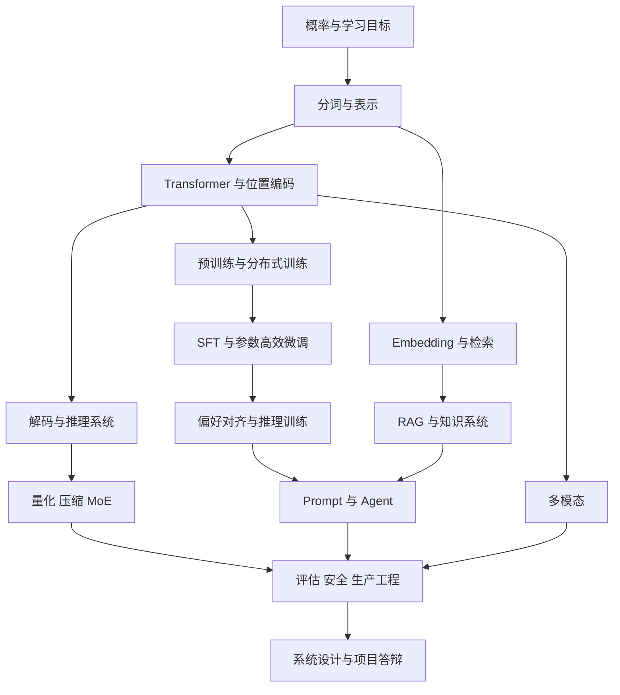
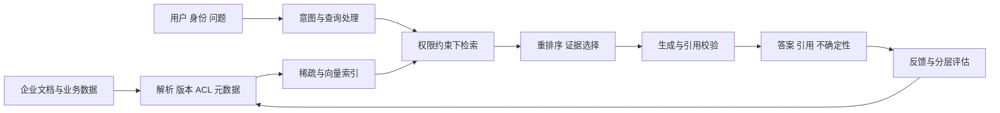
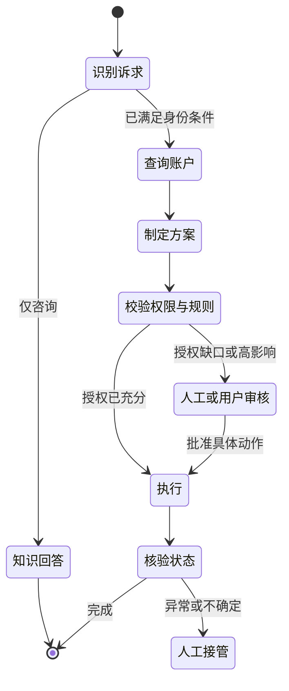
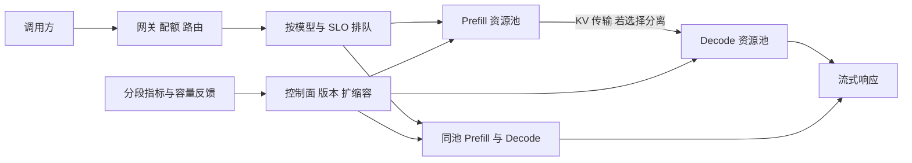

# 大模型面试全景手册：题目、答案、解析与回答角度

> 核查日期：2026-11-05。适用方向：大模型算法、训练与对齐、推理系统、RAG／Agent 应用、多模态、平台工程和技术负责人。
>
> 编排原则：先理解模型怎样学习与生成，再理解如何训练、部署、检索、行动、评估与治理。每题包含参考答案、机制解析、面试回答角度和追问／易错点；公式与工程估算注明成立条件。
>
> 范围说明：“所有面试题”没有可验证的有限全集。本手册以覆盖主要知识域、典型考点和可迁移的追问为目标；题目是按公开原理整理的自拟面试题，不冒充任何公司的真实题库。近期模型和协议只写入已核查的公开信息，不推断未公开训练配方。
>
> 阅读约定：`P0` 为优先掌握，`P1` 为岗位常见深入题，`P2` 为专项或研究题。参考答案是可扩展的回答骨架，不建议逐字背诵。章节中的工程建议属于基于机制的实践判断，不代表所有框架或模型的默认行为。

## 阅读路径与回答方法

### 知识依赖与岗位路径



| 岗位 | 主线章节 | 必须能落到的产出 |
|---|---|---|
| 算法／研究 | 01—09、13、18—19、22、25 | 推导目标函数，解释实验设计与失败原因 |
| 训练工程 | 03—08、12—13、19—21、22 | 显存／算力预算，分布式方案，训练异常定位 |
| 推理工程 | 03—04、10—13、19—22、25 | 性能剖析，缓存与调度，SLO 下的成本优化 |
| RAG／Agent 应用 | 01—04、14—21、23—25 | 可验证检索链路，工具权限与执行闭环 |
| 多模态 | 03—09、18—19、21、23、25 | 模态表示、时空对齐、数据与任务评估 |
| 技术负责人 | 05—06、11—13、19—21、23—25 | 约束拆解、方案取舍、上线门槛与回滚 |

### 一道题的四层回答

1. **定义和结论**：先说它解决什么问题，避免从历史讲起。
2. **机制和推导**：给出数据流、必要公式、复杂度或一个可解释例子。
3. **条件和取舍**：说明什么情况下成立，什么情况下收益消失。
4. **工程和证据**：给出实验、指标、排障路径和失败后的替代方案。

30 秒回答覆盖定义与核心机制；2 分钟补充取舍；5 分钟展开推导和验证。遇到不熟悉的新模型，应先区分已公开事实与基于架构的推测，再分析，不要编造参数、榜单或训练细节。

### 术语与公式约定

| 符号 | 含义 |
|---|---|
| \(B,S,L\) | batch size、序列长度、层数 |
| \(d,d_h,H_q,H_{kv}\) | 隐藏维度、单头维度、Q 头数、KV 头数 |
| \(N,D\) | 参数量、训练 token 数 |
| \(b\) | 单个元素的存储字节数；不等同于量化 bit 数 |
| \(p_\theta,p_{\rm ref}\) | 当前策略与参考策略 |
| TTFT／ITL／TPOT | 首 token 延迟／相邻 token 延迟／每输出 token 时间 |
| SLO／goodput | 服务目标／满足服务目标的有效吞吐 |

本文使用 `\(...\)` 与 `\[...\]` 数学语法；纯文本查看器即使不渲染也能阅读公式。Mermaid 图需要支持 Mermaid 的 Markdown 查看器。

<a id="toc"></a>
## 完整目录与题目索引

共 **25 章、300 道主问题**。每题含答案、解析、回答角度、追问／易错点；另有公式、算例、排障、项目表达和学习路线附录。可按岗位路径阅读，也可用题号检索。

| 章节 | 主题 | 题号 |
|---|---|---|
| 01 | [大模型认知、概率与机器学习基础](#ch01) | [Q001](#q001)—[Q012](#q012) |
| 02 | [Tokenizer、表示与数据输入](#ch02) | [Q013](#q013)—[Q024](#q024) |
| 03 | [Transformer、注意力与网络结构](#ch03) | [Q025](#q025)—[Q036](#q036) |
| 04 | [位置编码、长上下文与记忆](#ch04) | [Q037](#q037)—[Q048](#q048) |
| 05 | [预训练、数据与 Scaling Laws](#ch05) | [Q049](#q049)—[Q060](#q060) |
| 06 | [分布式训练、显存与稳定性](#ch06) | [Q061](#q061)—[Q072](#q072) |
| 07 | [SFT、LoRA 与领域适配](#ch07) | [Q073](#q073)—[Q084](#q084) |
| 08 | [RLHF、DPO、PPO 与偏好对齐](#ch08) | [Q085](#q085)—[Q096](#q096) |
| 09 | [推理模型、RLVR 与测试时计算](#ch09) | [Q097](#q097)—[Q108](#q108) |
| 10 | [解码、采样与结构化输出](#ch10) | [Q109](#q109)—[Q120](#q120) |
| 11 | [推理系统、KV Cache 与调度](#ch11) | [Q121](#q121)—[Q132](#q132) |
| 12 | [量化、蒸馏与压缩](#ch12) | [Q133](#q133)—[Q144](#q144) |
| 13 | [MoE、MLA 与替代架构](#ch13) | [Q145](#q145)—[Q156](#q156) |
| 14 | [Embedding、检索与重排序](#ch14) | [Q157](#q157)—[Q168](#q168) |
| 15 | [RAG、知识工程与证据链](#ch15) | [Q169](#q169)—[Q180](#q180) |
| 16 | [Prompt、上下文工程与交互](#ch16) | [Q181](#q181)—[Q192](#q192) |
| 17 | [Agent、工具协议与执行闭环](#ch17) | [Q193](#q193)—[Q204](#q204) |
| 18 | [多模态、语音与视频](#ch18) | [Q205](#q205)—[Q216](#q216) |
| 19 | [评估、实验与可靠性](#ch19) | [Q217](#q217)—[Q228](#q228) |
| 20 | [安全、权限与数据治理](#ch20) | [Q229](#q229)—[Q240](#q240) |
| 21 | [生产工程、成本与可观测性](#ch21) | [Q241](#q241)—[Q252](#q252) |
| 22 | [数学推导与代码实战](#ch22) | [Q253](#q253)—[Q264](#q264) |
| 23 | [系统设计综合题](#ch23) | [Q265](#q265)—[Q276](#q276) |
| 24 | [项目答辩、排障与岗位追问](#ch24) | [Q277](#q277)—[Q288](#q288) |
| 25 | [截至 2026-11-05 的前沿与辨析](#ch25) | [Q289](#q289)—[Q300](#q300) |

附录：[A 公式与算例](#appendix-a) · [B 概念纠错](#appendix-b) · [C 排障地图](#appendix-c) · [D 项目答辩](#appendix-d) · [E 复习路线](#appendix-e) · [F 追问链](#appendix-f) · [G 术语](#appendix-g) · [H 更新方法](#appendix-h) · [原始来源](#references)

### 逐题索引

<details>
<summary>01 大模型认知、概率与机器学习基础：12 题</summary>

- [Q001｜P0｜大模型、语言模型、基础模型和生成式 AI 是什么关系？](#q001)
- [Q002｜P0｜自回归语言模型的训练目标是什么？](#q002)
- [Q003｜P0｜为什么预测下一个 token 能产生复杂能力？](#q003)
- [Q004｜P0｜Decoder-only、Encoder-only、Encoder-decoder 怎样选择？](#q004)
- [Q005｜P0｜交叉熵、KL 散度与困惑度有什么关系？](#q005)
- [Q006｜P0｜Temperature、概率和“置信度”有什么区别？](#q006)
- [Q007｜P1｜为什么会出现“涌现能力”，它有争议吗？](#q007)
- [Q008｜P0｜In-context learning 与微调有何区别？](#q008)
- [Q009｜P0｜偏差、方差、过拟合在大模型中还重要吗？](#q009)
- [Q010｜P0｜模型幻觉来自哪里？](#q010)
- [Q011｜P1｜为什么大模型需要 AdamW、学习率调度和梯度裁剪？](#q011)
- [Q012｜P0｜预训练、继续预训练、SFT、对齐和推理时计算分别改变什么？](#q012)

</details>

<details>
<summary>02 Tokenizer、表示与数据输入：12 题</summary>

- [Q013｜P0｜为什么要使用 tokenizer，而不直接以词为单位？](#q013)
- [Q014｜P0｜BPE、WordPiece、Unigram 和 byte-level 有何区别？](#q014)
- [Q015｜P0｜tokenizer 如何影响中文、代码和数字能力？](#q015)
- [Q016｜P0｜Embedding、one-hot 和输出 logits 是怎样关联的？](#q016)
- [Q017｜P1｜权重共享有什么收益与限制？](#q017)
- [Q018｜P0｜BOS、EOS、PAD 和 chat template 为什么重要？](#q018)
- [Q019｜P0｜训练标签如何右移，为什么容易出 off-by-one 错误？](#q019)
- [Q020｜P1｜多条样本 packing 时怎样避免信息泄漏？](#q020)
- [Q021｜P0｜为什么推理常使用 left padding，训练常见 right padding？](#q021)
- [Q022｜P1｜扩充词表或换 tokenizer 为什么不能随意进行？](#q022)
- [Q023｜P1｜Unicode、不可见字符与 token 边界会造成哪些问题？](#q023)
- [Q024｜P0｜如何计算一次请求的 token 预算？](#q024)

</details>

<details>
<summary>03 Transformer、注意力与网络结构：12 题</summary>

- [Q025｜P0｜Self-Attention 的完整计算过程是什么？](#q025)
- [Q026｜P0｜为什么除以 \(\sqrt{d_h}\)，不是 \(d_h\)？](#q026)
- [Q027｜P0｜为什么要分别学习 Q、K、V？](#q027)
- [Q028｜P0｜多头注意力为何有用？头越多越好吗？](#q028)
- [Q029｜P0｜Causal mask、padding mask 和 loss mask 分别做什么？](#q029)
- [Q030｜P0｜Transformer 的时间与空间复杂度是多少？](#q030)
- [Q031｜P0｜FFN／MLP 做什么，为什么常占大量参数？](#q031)
- [Q032｜P1｜SwiGLU 的公式和价值是什么？](#q032)
- [Q033｜P0｜残差连接、Pre-Norm 和 Post-Norm 有何区别？](#q033)
- [Q034｜P0｜LayerNorm、RMSNorm 与 BatchNorm 如何比较？](#q034)
- [Q035｜P0｜MHA、MQA、GQA 分别是什么？](#q035)
- [Q036｜P1｜FlashAttention 为什么快，是近似注意力吗？](#q036)

</details>

<details>
<summary>04 位置编码、长上下文与记忆：12 题</summary>

- [Q037｜P0｜为什么 Transformer 需要位置信息？](#q037)
- [Q038｜P0｜绝对位置、相对位置、ALiBi 与 RoPE 有何区别？](#q038)
- [Q039｜P0｜RoPE 如何体现相对位置？](#q039)
- [Q040｜P1｜RoPE 的 base、频率与长程外推有什么关系？](#q040)
- [Q041｜P0｜位置插值与位置外推有什么区别？](#q041)
- [Q042｜P1｜YaRN 怎样扩展上下文？](#q042)
- [Q043｜P0｜长上下文和 RAG 是替代关系吗？](#q043)
- [Q044｜P0｜Lost in the Middle 是什么，怎样验证和改善？](#q044)
- [Q045｜P1｜滑动窗口、全局 token 与稀疏注意力怎样折中？](#q045)
- [Q046｜P0｜百万 token 窗口如何评估“真的能用”？](#q046)
- [Q047｜P0｜对话历史压缩与长期记忆如何设计？](#q047)
- [Q048｜P1｜Context parallelism 与更大的上下文窗口有什么关系？](#q048)

</details>

<details>
<summary>05 预训练、数据与 Scaling Laws：12 题</summary>

- [Q049｜P0｜预训练数据管线包括哪些环节？](#q049)
- [Q050｜P0｜数据质量如何定义，为什么不能只看“像人类写的”？](#q050)
- [Q051｜P0｜精确去重、近似去重与语义去重有什么区别？](#q051)
- [Q052｜P0｜数据配比、课程学习和领域采样怎样设计？](#q052)
- [Q053｜P1｜合成数据什么时候有效，如何避免反馈污染？](#q053)
- [Q054｜P0｜Scaling Laws 描述什么，不描述什么？](#q054)
- [Q055｜P0｜Kaplan 与 Chinchilla 的计算最优结论如何理解？](#q055)
- [Q056｜P0｜如何估算预训练 FLOPs 与完成时间？](#q056)
- [Q057｜P0｜训练 token 数、独立 token 数和 epoch 为什么要分开？](#q057)
- [Q058｜P1｜学习率、warmup、衰减和 batch scaling 如何选择？](#q058)
- [Q059｜P1｜继续预训练、领域继续预训练与 SFT 怎样区分？](#q059)
- [Q060｜P0｜预训练失败时怎样判断是数据、优化还是架构问题？](#q060)

</details>

<details>
<summary>06 分布式训练、显存与稳定性：12 题</summary>

- [Q061｜P0｜训练显存由哪些部分组成？](#q061)
- [Q062｜P0｜数据并行的梯度同步怎样工作？](#q062)
- [Q063｜P0｜ZeRO 的三个阶段分别分片什么？](#q063)
- [Q064｜P0｜Tensor parallel 如何切分 Transformer？](#q064)
- [Q065｜P1｜Pipeline parallel 为什么有 bubble，怎样降低？](#q065)
- [Q066｜P1｜Sequence parallel、context parallel 与 expert parallel 怎么组合？](#q066)
- [Q067｜P0｜梯度累积怎样模拟大 batch，有哪些不等价？](#q067)
- [Q068｜P0｜Activation checkpointing 为什么省显存却增加计算？](#q068)
- [Q069｜P0｜BF16、FP16、FP32 与 loss scaling 的区别是什么？](#q069)
- [Q070｜P0｜训练出现 NaN、loss spike 或梯度爆炸怎么定位？](#q070)
- [Q071｜P0｜训练 checkpoint 需要保存什么才能可靠恢复？](#q071)
- [Q072｜P1｜如何分析训练吞吐低，MFU 与 GPU 利用率有什么不同？](#q072)

</details>

<details>
<summary>07 SFT、LoRA 与领域适配：12 题</summary>

- [Q073｜P0｜SFT 的目标与数据格式是什么？](#q073)
- [Q074｜P0｜SFT 如何构造高质量指令数据？](#q074)
- [Q075｜P0｜LoRA 的公式、参数量和作用是什么？](#q075)
- [Q076｜P1｜LoRA 的 rank、alpha、dropout 和 target modules 怎么选？](#q076)
- [Q077｜P0｜QLoRA 与普通 LoRA 有何区别？](#q077)
- [Q078｜P1｜全参微调、LoRA、Adapter、Prefix tuning 如何取舍？](#q078)
- [Q079｜P1｜DoRA 如何扩展 LoRA？](#q079)
- [Q080｜P0｜如何处理微调后的灾难性遗忘与风格退化？](#q080)
- [Q081｜P0｜Packing、截断和 loss mask 怎样影响 SFT？](#q081)
- [Q082｜P0｜如何评估微调收益，而不是只看训练 loss？](#q082)
- [Q083｜P1｜多个 LoRA 如何切换、合并与隔离？](#q083)
- [Q084｜P0｜什么时候该做微调，什么时候该用 Prompt、RAG 或工具？](#q084)

</details>

<details>
<summary>08 RLHF、DPO、PPO 与偏好对齐：12 题</summary>

- [Q085｜P0｜典型 RLHF 流程包含哪些模型和阶段？](#q085)
- [Q086｜P0｜奖励模型怎样从 pairwise preference 学习？](#q086)
- [Q087｜P0｜为什么偏好优化常加 KL 约束？](#q087)
- [Q088｜P0｜PPO 的 clipped objective 是什么？](#q088)
- [Q089｜P1｜Advantage、value baseline 与 GAE 怎样理解？](#q089)
- [Q090｜P0｜DPO 的目标与核心推导是什么？](#q090)
- [Q091｜P0｜DPO、PPO 与 SFT 怎样选择？](#q091)
- [Q092｜P1｜GRPO 为什么可以不训练独立 critic？](#q092)
- [Q093｜P0｜奖励黑客、长度偏差与过优化怎样检测？](#q093)
- [Q094｜P1｜RLAIF 与 Constitutional AI 的价值和局限是什么？](#q094)
- [Q095｜P0｜偏好数据怎样处理噪声、平局与多维质量？](#q095)
- [Q096｜P1｜在线偏好优化如何避免 rollout 与训练策略不一致？](#q096)

</details>

<details>
<summary>09 推理模型、RLVR 与测试时计算：12 题</summary>

- [Q097｜P0｜“推理模型”与普通指令模型有哪些区别？](#q097)
- [Q098｜P0｜CoT 为什么有效，适用于哪些任务？](#q098)
- [Q099｜P0｜Self-consistency 与多次采样投票有什么原理？](#q099)
- [Q100｜P0｜RLVR 是什么，为什么数学和代码常被使用？](#q100)
- [Q101｜P1｜Outcome reward 与 process reward 如何取舍？](#q101)
- [Q102｜P0｜Test-time scaling 包括哪些方式？](#q102)
- [Q103｜P1｜Best-of-N、beam search 和树搜索有什么区别？](#q103)
- [Q104｜P1｜如何设计自适应推理预算与提前停止？](#q104)
- [Q105｜P0｜推理轨迹蒸馏如何做，哪些信息不能照抄？](#q105)
- [Q106｜P1｜可验证 RL 是产生新能力还是放大已有能力？](#q106)
- [Q107｜P0｜怎样评估推理正确性、可解释性与忠实性？](#q107)
- [Q108｜P0｜推理模型为什么仍需要 RAG、工具和权限控制？](#q108)

</details>

<details>
<summary>10 解码、采样与结构化输出：12 题</summary>

- [Q109｜P0｜Greedy、随机采样和 beam search 有什么区别？](#q109)
- [Q110｜P0｜Temperature、top-k 与 top-p 怎样改变分布？](#q110)
- [Q111｜P1｜重复惩罚、频率惩罚和存在惩罚有何差异？](#q111)
- [Q112｜P0｜停止条件、EOS、max tokens 和截断怎样处理？](#q112)
- [Q113｜P0｜结构化输出与 JSON schema 能保证什么？](#q113)
- [Q114｜P1｜Grammar-constrained decoding 怎样作用于 token？](#q114)
- [Q115｜P0｜Speculative decoding 如何保持目标分布？](#q115)
- [Q116｜P1｜什么时候推测解码会变慢？](#q116)
- [Q117｜P0｜为什么设 seed 仍可能无法严格复现？](#q117)
- [Q118｜P0｜logprob 能作为答案置信度吗？](#q118)
- [Q119｜P1｜多 token prediction 与自回归串行生成有什么关系？](#q119)
- [Q120｜P0｜流式输出如何保证用户体验和结果完整性？](#q120)

</details>

<details>
<summary>11 推理系统、KV Cache 与调度：12 题</summary>

- [Q121｜P0｜Prefill 与 decode 的计算特点有什么差异？](#q121)
- [Q122｜P0｜KV Cache 为什么能减少计算，不能减少什么？](#q122)
- [Q123｜P0｜如何计算 KV Cache 显存？](#q123)
- [Q124｜P0｜PagedAttention 为什么改善服务内存管理？](#q124)
- [Q125｜P0｜Continuous batching 与静态 batching 有何区别？](#q125)
- [Q126｜P0｜Chunked prefill 解决什么问题？](#q126)
- [Q127｜P0｜Prefix caching 复用条件与安全边界是什么？](#q127)
- [Q128｜P1｜Prefill／decode 分离服务的收益与成本是什么？](#q128)
- [Q129｜P1｜CUDA Graph、算子融合和编译优化分别解决什么？](#q129)
- [Q130｜P0｜推理 OOM、抢占和 KV offload 怎样处理？](#q130)
- [Q131｜P0｜如何压测推理服务而不误判吞吐？](#q131)
- [Q132｜P0｜推理引擎和部署方案怎样选？](#q132)

</details>

<details>
<summary>12 量化、蒸馏与压缩：12 题</summary>

- [Q133｜P0｜量化的 scale、zero point、对称和非对称怎么理解？](#q133)
- [Q134｜P0｜PTQ 与 QAT 有什么区别？](#q134)
- [Q135｜P0｜Weight-only、W8A8、W4A16 与 KV 量化分别压缩什么？](#q135)
- [Q136｜P1｜GPTQ 的核心思路是什么？](#q136)
- [Q137｜P1｜AWQ 的“activation-aware”体现在哪里？](#q137)
- [Q138｜P1｜SmoothQuant 如何处理激活离群值？](#q138)
- [Q139｜P1｜FP8、FP4、INT4 和 NF4 有哪些关键差别？](#q139)
- [Q140｜P0｜为什么量化后显存下降但速度没有提升？](#q140)
- [Q141｜P0｜KV 量化、裁剪与压缩怎样影响质量？](#q141)
- [Q142｜P0｜知识蒸馏的温度和 \(T^2\) 因子怎么解释？](#q142)
- [Q143｜P1｜剪枝、结构化稀疏与模型缩小如何取舍？](#q143)
- [Q144｜P0｜压缩模型上线前必须做哪些质量回归？](#q144)

</details>

<details>
<summary>13 MoE、MLA 与替代架构：12 题</summary>

- [Q145｜P0｜MoE 的总参数与激活参数如何理解？](#q145)
- [Q146｜P0｜MoE 路由器、top-k 与专家输出怎样计算？](#q146)
- [Q147｜P0｜专家负载不均会导致什么，怎样缓解？](#q147)
- [Q148｜P1｜Capacity factor、token dropping 与 dropless 有何区别？](#q148)
- [Q149｜P1｜Expert parallel 的 all-to-all 为什么可能成为瓶颈？](#q149)
- [Q150｜P0｜MHA、MQA、GQA 与 MLA 的核心区别是什么？](#q150)
- [Q151｜P1｜MLA 如何用 latent KV 压缩缓存？](#q151)
- [Q152｜P1｜共享专家与细粒度专家解决什么问题？](#q152)
- [Q153｜P1｜稀疏 attention 的索引器怎样影响精度和速度？](#q153)
- [Q154｜P1｜Mamba／SSM 与 Transformer 怎样比较？](#q154)
- [Q155｜P1｜循环、混合 attention／SSM 和跨层共享有哪些取舍？](#q155)
- [Q156｜P2｜扩散语言模型与自回归语言模型有哪些差异？](#q156)

</details>

<details>
<summary>14 Embedding、检索与重排序：12 题</summary>

- [Q157｜P0｜Embedding 模型与生成模型的任务有什么不同？](#q157)
- [Q158｜P0｜对比学习、InfoNCE 与 in-batch negatives 怎么工作？](#q158)
- [Q159｜P0｜Cosine、dot product 和 L2 的关系是什么？](#q159)
- [Q160｜P0｜BM25 与 dense retrieval 的优势分别是什么？](#q160)
- [Q161｜P1｜HNSW、IVF 和 PQ 怎样取舍？](#q161)
- [Q162｜P0｜Hybrid retrieval 与 RRF 怎样融合？](#q162)
- [Q163｜P0｜Bi-encoder 与 cross-encoder reranker 怎样分工？](#q163)
- [Q164｜P1｜Hard negatives 如何挖掘，为什么要检查 false negatives？](#q164)
- [Q165｜P0｜Recall@k、MRR 与 nDCG 分别衡量什么？](#q165)
- [Q166｜P0｜Query rewriting、多查询和 HyDE 什么时候有用？](#q166)
- [Q167｜P0｜Chunk 大小、overlap 和 embedding 长度怎么选择？](#q167)
- [Q168｜P0｜检索失败怎样分层定位？](#q168)

</details>

<details>
<summary>15 RAG、知识工程与证据链：12 题</summary>

- [Q169｜P0｜完整 RAG 系统包含哪些阶段？](#q169)
- [Q170｜P0｜RAG 为什么仍会幻觉，怎样拆分错误？](#q170)
- [Q171｜P0｜解析 PDF、表格、代码和复杂文档应注意什么？](#q171)
- [Q172｜P0｜知识库更新、版本与删除如何设计？](#q172)
- [Q173｜P0｜权限应该在检索前还是检索后过滤？](#q173)
- [Q174｜P1｜Parent-child、层级摘要与多跳检索怎么用？](#q174)
- [Q175｜P1｜GraphRAG 与普通向量 RAG 的适用差异是什么？](#q175)
- [Q176｜P0｜上下文压缩和证据排序怎样避免损失信息？](#q176)
- [Q177｜P0｜引用怎样保证支持具体结论？](#q177)
- [Q178｜P0｜无答案、证据冲突和时效问题如何回答？](#q178)
- [Q179｜P0｜RAG 如何构造评估集与消融实验？](#q179)
- [Q180｜P0｜如何优化 RAG 延迟和成本？](#q180)

</details>

<details>
<summary>16 Prompt、上下文工程与交互：12 题</summary>

- [Q181｜P0｜Prompt engineering 与 context engineering 有何区别？](#q181)
- [Q182｜P0｜一个稳定提示应包含哪些内容？](#q182)
- [Q183｜P0｜Zero-shot、few-shot 和示例选择怎样取舍？](#q183)
- [Q184｜P0｜角色、指令层级与不可信资料如何区分？](#q184)
- [Q185｜P0｜任务分解、计划和状态管理怎样设计？](#q185)
- [Q186｜P1｜自我批评、反思与迭代修订为什么不总有效？](#q186)
- [Q187｜P0｜什么时候需要向用户澄清，什么时候可以合理假设？](#q187)
- [Q188｜P0｜上下文预算怎样分配，什么应该保留？](#q188)
- [Q189｜P0｜长期记忆如何防止错误固化与过时？](#q189)
- [Q190｜P0｜工具 schema 和返回结果怎样设计得易用？](#q190)
- [Q191｜P0｜如何评估 prompt 修改是否真正提升？](#q191)
- [Q192｜P0｜提示词能解决什么，不能承担什么责任？](#q192)

</details>

<details>
<summary>17 Agent、工具协议与执行闭环：12 题</summary>

- [Q193｜P0｜Agent 与固定工作流、聊天机器人有什么区别？](#q193)
- [Q194｜P0｜ReAct 怎样形成行动闭环？](#q194)
- [Q195｜P0｜Function calling 的执行责任如何划分？](#q195)
- [Q196｜P0｜工具选择、并行调用和结果依赖如何处理？](#q196)
- [Q197｜P0｜Agent 怎样避免无限循环、重复行动和过度消耗？](#q197)
- [Q198｜P0｜MCP 的 host、client、server 与当前协议机制是什么？](#q198)
- [Q199｜P0｜MCP tools、resources、prompts 和可选扩展有什么区别？](#q199)
- [Q200｜P0｜MCP、普通 REST API、Skills 与 Agent 间协议怎样区分？](#q200)
- [Q201｜P1｜多 Agent 的优势与成本怎样判断？](#q201)
- [Q202｜P0｜Browser／computer-use Agent 如何设计安全执行？](#q202)
- [Q203｜P0｜长任务如何持久化、恢复与审计？](#q203)
- [Q204｜P0｜Agent 成功率怎样评估？](#q204)

</details>

<details>
<summary>18 多模态、语音与视频：12 题</summary>

- [Q205｜P0｜多模态大模型通常怎样连接视觉与语言？](#q205)
- [Q206｜P0｜CLIP 的对比学习目标与用途是什么？](#q206)
- [Q207｜P0｜LLaVA 类视觉指令训练解决什么？](#q207)
- [Q208｜P0｜高分辨率、OCR 和文档理解的难点是什么？](#q208)
- [Q209｜P0｜视觉幻觉如何检测和缓解？](#q209)
- [Q210｜P0｜视频理解比多图理解多了哪些要求？](#q210)
- [Q211｜P0｜ASR、TTS、语音理解与 speech-to-speech 有何区别？](#q211)
- [Q212｜P0｜实时语音的端点检测、打断和延迟怎样设计？](#q212)
- [Q213｜P1｜图像扩散、latent diffusion 与视觉生成怎么理解？](#q213)
- [Q214｜P1｜视频生成的时间一致性和物理合理性怎么评估？](#q214)
- [Q215｜P0｜多模态数据怎样对齐并防止污染？](#q215)
- [Q216｜P0｜多模态系统如何做成本与能力选型？](#q216)

</details>

<details>
<summary>19 评估、实验与可靠性：12 题</summary>

- [Q217｜P0｜模型评估为什么要分离能力、行为和系统指标？](#q217)
- [Q218｜P0｜MMLU、HumanEval、SWE-bench 分别测什么？](#q218)
- [Q219｜P0｜pass@k 的定义和估计公式是什么？](#q219)
- [Q220｜P0｜LLM-as-a-judge 有哪些偏差，怎样校准？](#q220)
- [Q221｜P0｜如何检查训练／测试污染与数据泄漏？](#q221)
- [Q222｜P0｜消融实验、对照实验与公平比较怎样做？](#q222)
- [Q223｜P0｜置信区间、bootstrap 和显著性如何应用？](#q223)
- [Q224｜P0｜校准、不确定性与选择性回答怎样评价？](#q224)
- [Q225｜P0｜线上 A/B 实验与离线评估怎样结合？](#q225)
- [Q226｜P0｜长上下文、工具与 Agent 评测为何需要专门环境？](#q226)
- [Q227｜P0｜评估体系怎样持续发现新失败模式？](#q227)
- [Q228｜P0｜如何阅读榜单和厂商 benchmark，避免错误结论？](#q228)

</details>

<details>
<summary>20 安全、权限与数据治理：12 题</summary>

- [Q229｜P0｜Prompt injection 与 jailbreak 有什么区别？](#q229)
- [Q230｜P0｜防注入应建立哪些层级控制？](#q230)
- [Q231｜P0｜最小权限、身份与工具授权如何落实？](#q231)
- [Q232｜P0｜Agent 工具执行需要怎样的沙箱？](#q232)
- [Q233｜P0｜数据外泄与 SSRF 风险怎样出现？](#q233)
- [Q234｜P0｜隐私、PII、脱敏与数据保留怎样设计？](#q234)
- [Q235｜P1｜训练数据投毒、后门与知识库污染怎样防范？](#q235)
- [Q236｜P1｜模型与工具供应链有哪些风险？](#q236)
- [Q237｜P0｜内容安全、过度拒答与公平性如何平衡？](#q237)
- [Q238｜P0｜红队测试与安全评估如何组织？](#q238)
- [Q239｜P0｜高影响动作、人类审核与审计如何设计？](#q239)
- [Q240｜P0｜安全事件发生后如何响应和恢复？](#q240)

</details>

<details>
<summary>21 生产工程、成本与可观测性：12 题</summary>

- [Q241｜P0｜大模型服务应该设置哪些 SLI／SLO？](#q241)
- [Q242｜P0｜如何建立容量模型，避免 GPU 数量靠猜？](#q242)
- [Q243｜P0｜如何算一个请求和一个业务任务的真实成本？](#q243)
- [Q244｜P0｜模型路由、小模型先行与降级怎样设计？](#q244)
- [Q245｜P0｜超时、重试、幂等与熔断怎么配合？](#q245)
- [Q246｜P0｜流式输出、取消与背压为什么重要？](#q246)
- [Q247｜P0｜LLM 应用应该记录哪些 Trace、日志和指标？](#q247)
- [Q248｜P0｜为什么模型、Prompt、知识库和工具需要联合版本管理？](#q248)
- [Q249｜P0｜灰度发布和 A/B 实验怎样避免错误结论？](#q249)
- [Q250｜P1｜多租户限流、配额与公平调度怎么做？](#q250)
- [Q251｜P1｜语义缓存应该怎样评估正确性？](#q251)
- [Q252｜P0｜模型服务出现延迟暴涨、OOM 或质量回退时如何排查？](#q252)

</details>

<details>
<summary>22 数学推导与代码实战：12 题</summary>

- [Q253｜P0｜推导 Softmax 与交叉熵的梯度，并写稳定实现。](#q253)
- [Q254｜P0｜推导 Attention 为什么除以 \(\sqrt{d_k}\)，并实现因果注意力。](#q254)
- [Q255｜P0｜手推 LayerNorm 与 RMSNorm，并说明实现差异。](#q255)
- [Q256｜P0｜写出 RoPE 旋转，证明相对位置信息如何进入点积。](#q256)
- [Q257｜P0｜给出 KV Cache 显存公式并做一次完整估算。](#q257)
- [Q258｜P0｜推导 LoRA 参数量，并解释初始化和合并。](#q258)
- [Q259｜P0｜把 DPO 写成数值稳定的损失，并说明每项含义。](#q259)
- [Q260｜P0｜实现 Top-k／Top-p 过滤，解释温度与处理顺序。](#q260)
- [Q261｜P0｜实现带约束的文本切块，并解释为什么不能只按字符截断。](#q261)
- [Q262｜P1｜实现 BM25 单词项评分，并说明稀疏检索为何仍有价值。](#q262)
- [Q263｜P1｜实现 RRF 融合，说明它与分数加权有什么区别。](#q263)
- [Q264｜P0｜如何用小样本测试验证公式、代码和评估指标？](#q264)

</details>

<details>
<summary>23 系统设计综合题：12 题</summary>

- [Q265｜P0｜设计一个企业内部知识问答系统。](#q265)
- [Q266｜P0｜设计一个有实时要求、覆盖百万条商品的推荐导购助手。](#q266)
- [Q267｜P0｜设计一个可执行工具的客服 Agent。](#q267)
- [Q268｜P0｜设计一个代码仓库维护 Agent。](#q268)
- [Q269｜P0｜设计一个支持长文档、表格和图片的财报分析助手。](#q269)
- [Q270｜P1｜设计一个实时语音助手，如何平衡延迟、打断和工具调用？](#q270)
- [Q271｜P0｜设计一个多模型、高并发的 GPU 推理平台。](#q271)
- [Q272｜P1｜设计一个领域模型微调与上线平台。](#q272)
- [Q273｜P0｜设计一个大模型评测平台。](#q273)
- [Q274｜P1｜设计一个支持长时任务和人工协作的多 Agent 系统。](#q274)
- [Q275｜P0｜设计一个“事实必须可追溯”的高可靠专业助手。](#q275)
- [Q276｜P0｜预算固定时，你如何选择买 API、自托管或混合部署？](#q276)

</details>

<details>
<summary>24 项目答辩、排障与岗位追问：12 题</summary>

- [Q277｜P0｜“介绍一个你做过的大模型项目”，如何回答才有重点？](#q277)
- [Q278｜P0｜“为什么选 RAG 而不是微调，或反过来？”](#q278)
- [Q279｜P0｜“你说效果提升了，如何证明不是评测偏差？”](#q279)
- [Q280｜P0｜“讲一个最困难的故障”，如何体现排障能力？](#q280)
- [Q281｜P0｜算法岗会如何深入追问你的训练项目？](#q281)
- [Q282｜P0｜推理工程岗会如何追问性能优化？](#q282)
- [Q283｜P0｜应用岗会如何追问 RAG／Agent 项目？](#q283)
- [Q284｜P1｜技术负责人如何回答团队、路线和资源选择？](#q284)
- [Q285｜P0｜没有大模型工作经历，如何做可信的面试项目？](#q285)
- [Q286｜P0｜面试遇到没听过的新模型或新名词怎么办？](#q286)
- [Q287｜P0｜“你的方案失败时会怎样”，如何回答？](#q287)
- [Q288｜P0｜如何回答薪资级别常见的“你最有价值的贡献是什么”？](#q288)

</details>

<details>
<summary>25 截至 2026-11-05 的前沿与辨析：12 题</summary>

- [Q289｜P0｜截至核查日，如何有条理地概括大模型发展方向？](#q289)
- [Q290｜P0｜如何回答“当前有哪些值得关注的模型”，而不背过时榜单？](#q290)
- [Q291｜P1｜2026 年的推理系统新架构，哪些值得深入而不是只记参数？](#q291)
- [Q292｜P0｜MCP 等工具协议快速更新，对面试回答有什么影响？](#q292)
- [Q293｜P0｜为什么“百万上下文”不能代替知识工程？](#q293)
- [Q294｜P1｜推理模型是否真的“会思考”？如何评价 reasoning trace？](#q294)
- [Q295｜P1｜合成数据与自我改进会不会让模型无限提升？](#q295)
- [Q296｜P1｜扩散语言模型能取代自回归模型吗？](#q296)
- [Q297｜P1｜世界模型、具身智能与通用多模态模型如何区分？](#q297)
- [Q298｜P0｜开放权重、开源模型与可复现研究有哪些差别？](#q298)
- [Q299｜P0｜如何阅读论文，判断贡献是否对自己的系统有用？](#q299)
- [Q300｜P0｜如果只允许你给大模型系统选五个原则，你会选什么？](#q300)

</details>


<a id="ch01"></a>
## 01 大模型认知、概率与机器学习基础

本章主线：语言建模目标 → 条件生成 → 泛化与能力边界。基础来源：<a href="#ref-1">[cite:1]</a><a href="#ref-2">[cite:2]</a><a href="#ref-3">[cite:3]</a>。

<a id="q001"></a>
### Q001｜P0｜大模型、语言模型、基础模型和生成式 AI 是什么关系？

**参考答案**：语言模型学习 token 序列的概率分布；大语言模型通常指参数、数据和计算规模较大的语言模型。基础模型强调大规模预训练后的跨任务迁移能力，可以覆盖文本、图像或多模态；生成式 AI 强调生成内容，是更宽的应用与模型类别。“大”没有统一参数阈值。

**解析**：它们分别从建模对象、规模、迁移范式和功能描述模型，不能当成完全同义词。小模型也能生成内容，大模型也可用于打分、分类或表示学习。

**回答角度**：先分清分类维度，再用“预训练文本模型 → 指令模型 → 企业问答系统”说明模型与产品的区别。

**追问／易错点**：参数多一定更强吗？应补充数据、架构、训练配方、推理预算与评估任务；不能只凭参数量排名。

<a id="q002"></a>
### Q002｜P0｜自回归语言模型的训练目标是什么？

**参考答案**：把序列概率分解为 \(p_\theta(x_{1:T})=\prod_t p_\theta(x_t\mid x_{<t})\)，最小化负对数似然 \(\mathcal L=-\sum_t\log p_\theta(x_t\mid x_{<t})\)。实际用前缀 token 预测下一个 token，并对有效位置计算交叉熵。

**解析**：训练可并行计算所有位置的预测，因为真实前缀已知；生成时后续前缀未知，通常逐步采样。目标要求利用上下文中的统计与结构，不直接保证事实正确。

**回答角度**：写出概率链式法则，再解释 teacher forcing、标签右移以及 padding／非监督区域的 loss mask。

**追问／易错点**：为什么训练并行而推理串行？不能说训练时允许看到未来；因果 mask 仍限制信息流。

<a id="q003"></a>
### Q003｜P0｜为什么预测下一个 token 能产生复杂能力？

**参考答案**：为了在多样文本中降低预测损失，模型需要学习语法、语义、实体关系、程序结构与部分推理模式。大规模数据和共享表示使这些结构可迁移到新提示；指令微调和后训练进一步把能力转成可用行为。

**解析**：这是“目标简单、最优解所需结构复杂”的现象。能力来自模型、数据与优化的共同作用；并不证明模型建立了与人相同的理解机制。

**回答角度**：用代码补全需要变量依赖、数学文本需要中间关系作为例子，然后明确预测能力与可靠决策之间仍有距离。

**追问／易错点**：是否只是背诵？应讨论记忆、组合泛化、分布外测试和训练数据污染，而非绝对回答。

<a id="q004"></a>
### Q004｜P0｜Decoder-only、Encoder-only、Encoder-decoder 怎样选择？

**参考答案**：Encoder-only 通过双向上下文学习表示，适合检索、分类等；Decoder-only 通过因果建模自然支持开放式生成；Encoder-decoder 将输入编码与输出生成分离，适合翻译、摘要及明确的输入输出变换。具体能力还受训练目标和数据影响。

**解析**：区别主要在信息可见性和跨注意力，而不是“某种架构只能做一种任务”。Decoder 模型同样能分类，Encoder-decoder 也能做开放问答。

**回答角度**：比较 mask、训练目标、推理方式和产品需求，再说明统一生成接口为何推动 Decoder-only 的广泛使用。

**追问／易错点**：Encoder 是否一定更适合 Embedding？不是，Decoder 也可经专门训练得到优质表示。

<a id="q005"></a>
### Q005｜P0｜交叉熵、KL 散度与困惑度有什么关系？

**参考答案**：交叉熵 \(H(q,p)=H(q)+D_{\rm KL}(q\|p)\)，因此固定目标分布下最小化交叉熵等价于最小化该方向 KL。若平均 NLL 用自然对数，困惑度 \({\rm PPL}=\exp(\overline{\mathcal L})\)；若用以 2 为底的对数，则用 \(2^{\overline{\mathcal L}}\)。

**解析**：PPL 衡量模型给真实 token 的平均概率质量；它依赖分词方式、语料分布与 mask。PPL 更低不必然意味着对话质量、安全或工具能力更好。

**回答角度**：先推导关系，再讲跨模型比较必须统一数据、tokenizer 和计分口径。

**追问／易错点**：不同 tokenizer 的 PPL 能否直接比较？通常不能，应改用统一字节或字符口径等可比度量。

<a id="q006"></a>
### Q006｜P0｜Temperature、概率和“置信度”有什么区别？

**参考答案**：Temperature 通过 \(p_i=\operatorname{softmax}(z_i/T)\) 改变采样分布的尖锐程度。token 概率是给定上下文下对词元的条件概率，不是整个回答事实正确的概率；模型自己说“很确定”也不是校准置信度。

**解析**：高频但错误的说法可以获得高概率。回答正确性还依赖证据、题型和分布；需要在标注集上做校准、选择性回答或检索验证。

**回答角度**：分清采样控制、词元概率和任务级可靠性，再提出用拒答曲线、校准误差与证据覆盖来评估。

**追问／易错点**：Temperature 为零能消除幻觉吗？不能，它只是趋向选择高概率 token，仍可能稳定地产生错误。

<a id="q007"></a>
### Q007｜P1｜为什么会出现“涌现能力”，它有争议吗？

**参考答案**：“涌现”通常描述模型规模变化后，某些指标出现明显能力跃迁。但跃迁可能同时受真实能力变化、离散评分阈值、样本量和任务设计影响，不能据此断言底层能力在某个参数规模突然产生。

**解析**：一个连续改善的正确答案概率，在 exact match 或全步骤正确指标上可能表现为陡变。应对比连续指标、置信区间和不同提示方式。

**回答角度**：先给操作性定义，再讲测量效应与真实机制的区别，提出受控规模实验。

**追问／易错点**：不要引用未经统一实验验证的“超过多少参数必然会推理”阈值。

<a id="q008"></a>
### Q008｜P0｜In-context learning 与微调有何区别？

**参考答案**：ICL 在上下文中提供示例或规则，常规推理时不更新模型参数；微调通过训练更新全部或部分参数。ICL 上手快且可按请求变化，但占用上下文与推理成本；微调能固化行为，但需要数据、训练和回归验证。

**解析**：ICL 并非模型长期保存了新知识；同一示例移出上下文后，通常不会形成持久参数变化。示例顺序、格式和相似性都能影响结果。

**回答角度**：从更新位置、生命周期、成本和可维护性比较，再给少量示例先验证、稳定高频需求再微调的路线。

**追问／易错点**：ICL 是否等于“没有学习”？应区分行为上的适应与参数训练意义的学习。

<a id="q009"></a>
### Q009｜P0｜偏差、方差、过拟合在大模型中还重要吗？

**参考答案**：仍然重要。容量大不等于不会过拟合；重复语料、窄域微调、偏好数据偏置和评测集泄漏都可能造成看似提升、实际泛化下降。需要隔离验证集、监测通用能力与切片表现，并控制数据重复和训练强度。

**解析**：大模型的泛化不仅由参数量决定，也受预训练先验、有效样本量、优化和任务分布影响。训练 loss 下降而真实业务效果下降是典型信号。

**回答角度**：把传统概念映射到 SFT、RAG 检索器和奖励模型三个具体场景。

**追问／易错点**：训练样本条数不等于独立信息量；同源改写不能视为同等数量的新知识。

<a id="q010"></a>
### Q010｜P0｜模型幻觉来自哪里？

**参考答案**：来源包括知识缺失或过时、参数记忆不精确、上下文歧义、错误检索、推理失误，以及训练中对流畅完整回答的偏好。语言建模目标优化合理续写，而不是逐句事实核验。

**解析**：应区分事实性幻觉、与给定证据不一致、引用错误和工具结果误读。不同根因对应更新知识、改善检索、约束引用、执行验证或训练拒答。

**回答角度**：按“知识—检索—生成—验证”链路定位，再给可测量的修复方案。

**追问／易错点**：RAG 能否彻底消除幻觉？不能，召回、权限、证据理解和生成忠实性仍会出错。

<a id="q011"></a>
### Q011｜P1｜为什么大模型需要 AdamW、学习率调度和梯度裁剪？

**参考答案**：AdamW 利用一二阶梯度矩估计调整更新尺度，并把权重衰减与自适应梯度更新解耦。Warmup 降低训练初期大更新风险；衰减调度帮助后期收敛；梯度裁剪限制异常梯度范数，提升数值稳定性。

**解析**：这些方法作用不同。裁剪不是清洗脏数据，学习率调度也不能掩盖 loss mask 或通信错误。具体超参数必须结合 batch、模型和训练阶段。

**回答角度**：用“优化尺度—初期稳定—后期收敛—异常保护”组织，再说应记录梯度范数和实际学习率。

**追问／易错点**：AdamW 与对 Adam 梯度简单加入 L2 惩罚并不一般等价。

<a id="q012"></a>
### Q012｜P0｜预训练、继续预训练、SFT、对齐和推理时计算分别改变什么？

**参考答案**：预训练建立通用分布建模能力；继续预训练适应领域语料；SFT 学习指令与任务示范；偏好或强化学习后训练优化回答行为、推理和工具策略；推理时计算通过更多思考、候选、检索或验证提高单次任务效果。

**解析**：它们不是必须严格按唯一顺序串行执行的固定套餐，也不是可完全互相替代。领域知识更新与工具执行习惯往往需要不同的数据和评估。

**回答角度**：以“模型不会回答、不了解领域、答法不合要求、复杂题做错”分别对应改进层次。

**追问／易错点**：增加推理预算不能自动补齐未知事实；后训练也可能损害通用能力。

<a id="ch02"></a>
## 02 Tokenizer、表示与数据输入

本章主线：原始文本 → token 序列 → 向量与标签。相关表示与训练背景：<a href="#ref-2">[cite:2]</a><a href="#ref-26">[cite:26]</a>。

<a id="q013"></a>
### Q013｜P0｜为什么要使用 tokenizer，而不直接以词为单位？

**参考答案**：固定词级词表难以处理未登录词、复合词、多语言和代码。子词或字节级方案用有限词表组合出广泛输入，在词表规模、序列长度和信息表达之间折中。

**解析**：更细粒度减少未知字符问题，但拉长序列；更大词表缩短部分文本，却增大 Embedding／输出层与训练负担。token 不是天然的词、字符或语义单位。

**回答角度**：从开放词汇与成本两条线解释，并比较中文、英语、数字和源代码的 token 长度差异。

**追问／易错点**：不能使用固定“一个汉字等于多少 token”作为所有模型的预算规则。

<a id="q014"></a>
### Q014｜P0｜BPE、WordPiece、Unigram 和 byte-level 有何区别？

**参考答案**：BPE 迭代合并频繁相邻单元；WordPiece 通常以改善子词建模目标的准则构造词表；Unigram 从候选词表出发，用概率模型迭代裁剪，并可选择高概率切分。byte-level 表示初始单元或编码层，可与 BPE 等算法组合。

**解析**：byte-level 不是与 BPE 完全互斥的分词训练算法。归一化、预分词、特殊 token 和解码规则同样影响最终结果。

**回答角度**：先比较“合并、选择、裁剪”的构词思路，再强调实际 tokenizer 是完整处理流水线。

**追问／易错点**：不同实现的 WordPiece 训练细节并不统一，不应把某个库的近似流程当成唯一定义。

<a id="q015"></a>
### Q015｜P0｜tokenizer 如何影响中文、代码和数字能力？

**参考答案**：分词效率影响相同上下文预算可容纳的信息量；代码中的缩进、标点和标识符边界影响结构表达；数字切分方式影响位值与算术模式的学习。分词质量是重要因素，但不能单独解释能力。

**解析**：同样字符长度可能产生不同 token 数，继而影响训练成本、检索 chunk 和长上下文性能。数字 token 频率和训练任务也很关键。

**回答角度**：提出分领域测量 token／字符比、未知或异常切分、下游正确率和延迟。

**追问／易错点**：不能仅凭压缩率最高选择 tokenizer；稀有 token 的训练充分性与语义边界也要验证。

<a id="q016"></a>
### Q016｜P0｜Embedding、one-hot 和输出 logits 是怎样关联的？

**参考答案**：token ID 相当于对词表的 one-hot 索引；Embedding 查表取得 \(E\in\mathbb R^{V\times d}\) 中一行。模型最后得到隐藏向量 \(h\)，用输出矩阵投影到词表 logits，再 softmax 得到条件概率。

**解析**：Embedding 是离散符号到连续表示的映射，隐藏状态则随上下文变化。二者不能混同；同一个 token 在不同句子中的最终表示不同。

**回答角度**：讲清 ID → 查表 → 上下文计算 → 词表投影四步，并指出词表大小对参数和输出计算的影响。

**追问／易错点**：输入 Embedding 与 LM head 可权重共享，但不是所有模型都共享。

<a id="q017"></a>
### Q017｜P1｜权重共享有什么收益与限制？

**参考答案**：将输入 Embedding 与输出投影矩阵转置共享，可以减少约 \(Vd\) 个独立参数，并对输入输出表示施加一致性约束。它通常节省存储，但效果与架构、训练配方及词表有关。

**解析**：共享的是参数矩阵，不是所有位置的隐藏状态；输出 logits 仍需计算。若输入输出词表、维度或模态不同，不能直接共享。

**回答角度**：先算参数收益，再讨论统计约束及异构输入输出的限制。

**追问／易错点**：共享后新增 token 要同时考虑输出概率学习与初始化，而非仅增加一行输入向量。

<a id="q018"></a>
### Q018｜P0｜BOS、EOS、PAD 和 chat template 为什么重要？

**参考答案**：BOS／EOS 标记序列边界，PAD 用于对齐，chat template 将 system、user、assistant 及工具消息编码为模型训练过的结构。模板错误可能导致角色混淆、续写用户文本或不停止。

**解析**：模型看到的是实际 token 序列，不理解 API 字段的抽象名称。结束一轮对话的 token 与结束整个序列的 token 可能不同，取决于模型设计。

**回答角度**：排查时打印 token ID、解码后的模板、角色分隔符、终止条件与训练标签范围。

**追问／易错点**：把 PAD 与 EOS 设置为同一 ID 时，不能按 ID 简单屏蔽所有 EOS 标签；必须结合位置 mask。

<a id="q019"></a>
### Q019｜P0｜训练标签如何右移，为什么容易出 off-by-one 错误？

**参考答案**：对于 `[a,b,c]`，有效监督关系是输入位置 `a→b`、`b→c`。框架可能在 loss 内部做 shift，也可能要求外部提供已右移标签，必须核查实现。最后位置和 padding 位置按目标定义屏蔽。

**解析**：重复右移会跳过一个 token；不右移可能训练复制当前输入。错误往往表现为异常低 loss 或生成质量很差。

**回答角度**：用三 token 最小例子手工列出 input、logit 与 label 对齐关系，检查真实 batch。

**追问／易错点**：不要依赖“所有 CausalLM 库都自动 shift”的假设；自定义 loss 和 fused kernel 可能不同。

<a id="q020"></a>
### Q020｜P1｜多条样本 packing 时怎样避免信息泄漏？

**参考答案**：应明确训练语义。如果把文档拼接成连续语言流，可按设计允许跨文档上下文；若希望样本相互独立，需要 segment-aware 或 block-diagonal attention，并屏蔽无意义边界标签，必要时重置 position ID。

**解析**：仅插入 EOS 不会在数学上阻断注意力。SFT 独立对话 packing 若未隔离，后一个样本可访问前一个样本，导致训练与线上分布不一致。

**回答角度**：区分预训练连续流和独立任务监督，分别说明 attention mask、loss mask 和 position ID。

**追问／易错点**：不要宣称所有 packing 必须隔离；应先问任务定义，再判断是否属于泄漏。

<a id="q021"></a>
### Q021｜P0｜为什么推理常使用 left padding，训练常见 right padding？

**参考答案**：很多批量生成实现从最后一个位置读取 logits，因此 left padding 便于让末尾对应真实 token；right padding 在训练中易于构造有效标签。二者都需要正确 attention mask 与 position ID，具体选择由实现决定。

**解析**：问题来自索引与缓存逻辑，不是因果 Transformer 数学上只能左填充。支持按每个样本有效末位取 logits 的实现也可使用 right padding。

**回答角度**：用长短两条 prompt 展示“最后数组位置”和“最后有效 token”差异。

**追问／易错点**：只改 padding_side 而不检查位置编号和 KV cache，仍可能生成错误。

<a id="q022"></a>
### Q022｜P1｜扩充词表或换 tokenizer 为什么不能随意进行？

**参考答案**：新增 token 需要初始化对应 Embedding／LM head 并训练其语义；直接换 tokenizer 会改变既有 ID 与文本片段的对应，破坏预训练表示。还需处理特殊 token、模板、分布漂移和部署兼容性。

**解析**：词表是模型参数与输入协议的一部分。减少领域 token 长度的收益可能被新向量训练不足和通用能力下降抵消。

**回答角度**：先评估原 tokenizer 的领域效率，再比较加词、领域继续训练与保持原词表三种方案。

**追问／易错点**：保存 tokenizer、config 与权重时必须同版本；错配有时不报错，却会输出乱码。

<a id="q023"></a>
### Q023｜P1｜Unicode、不可见字符与 token 边界会造成哪些问题？

**参考答案**：全角半角、组合字符、零宽字符和同形异码会影响去重、检索、精确匹配与安全检测。规范化需按业务谨慎选择；代码、数学表达与用户原文可能需要保留精确字节。

**解析**：视觉相同不等于字节相同；统一归一化可能损害标识符或证据可追溯性。流式输出也可能在 UTF-8 或 token 解码边界出现暂时不完整片段。

**回答角度**：区分原始存储、检索归一化和显示层，建立可回溯映射。

**追问／易错点**：不能对所有文档无条件执行强归一化后丢弃原文。

<a id="q024"></a>
### Q024｜P0｜如何计算一次请求的 token 预算？

**参考答案**：总预算包含系统提示、历史消息、模板和工具 schema、检索证据、多模态表示及预留生成空间。推理模型还可能存在隐藏推理 token 与可见输出分别计量的接口规则，应按具体模型文档核查。

**解析**：用户文本只是输入的一部分。超预算应依据重要性裁剪、摘要或检索，而不是任意截断尾部；还需留出工具结果与下一轮空间。

**回答角度**：给出预算表，说明计数器必须使用目标 tokenizer 或服务端统计，并对超长请求提前治理。

**追问／易错点**：输入上限、总上下文和最大输出不是始终相同的限制。

<a id="ch03"></a>
## 03 Transformer、注意力与网络结构

本章主线：表示混合 → 残差计算 → 输出预测。主要来源：<a href="#ref-1">[cite:1]</a><a href="#ref-6">[cite:6]</a><a href="#ref-7">[cite:7]</a><a href="#ref-8">[cite:8]</a><a href="#ref-11">[cite:11]</a>。

<a id="q025"></a>
### Q025｜P0｜Self-Attention 的完整计算过程是什么？

**参考答案**：输入 \(X\) 分别投影为 \(Q=XW_Q,K=XW_K,V=XW_V\)，计算 \(A=\operatorname{softmax}(QK^\top/\sqrt{d_h}+M)\)，再得 \(O=AV\)。多头分别处理不同子空间，拼接后经 \(W_O\) 投影。

**解析**：Q／K 决定“检索权重”，V 承载被聚合的内容；输出是依赖上下文的加权表示。mask 决定哪些位置允许被读取。

**回答角度**：先标出单头 \(Q,K,V\) 的 `[B,S,d_h]` 与分数 `[B,S,S]`，再扩展到多头维度。

**追问／易错点**：注意 softmax 是对 key 位置维度归一化；把维度写错会改变计算含义。

<a id="q026"></a>
### Q026｜P0｜为什么除以 \(\sqrt{d_h}\)，不是 \(d_h\)？

**参考答案**：在 Q／K 分量近似零均值、独立且方差相近的简化条件下，点积方差随 \(d_h\) 线性增长，其标准差随 \(\sqrt{d_h}\) 增长。除以平方根保持 logits 尺度相对稳定，避免 softmax 过度饱和。

**解析**：这是初始化与数值尺度的直觉推导，不是训练后严格满足的概率定律。QK norm、可学习温度和其他缩放可改变具体方案。

**回答角度**：推导独立变量求和的方差，再连接 softmax 梯度和训练稳定性。

**追问／易错点**：不能说不缩放就一定梯度爆炸；更直接的问题常是分布过尖导致梯度与优化困难。

<a id="q027"></a>
### Q027｜P0｜为什么要分别学习 Q、K、V？

**参考答案**：独立投影让模型分别学习查询、匹配与信息传递空间。若直接使用同一输入做点积，会对匹配形式施加更强约束；V 独立则允许“用于匹配的特征”和“需要传递的内容”不同。

**解析**：QK 点积可视为可学习双线性匹配，而不是天然语义相似度。即使原始分数对称，行 softmax 和因果 mask 也可能使注意力权重不对称。

**回答角度**：举“用人名匹配，却传递职位信息”的概念例子，并明确这是解释，不是某一头的保证功能。

**追问／易错点**：Q、K 可以共享参数，但会限制表达；不能把注意力图直接当作因果解释。

<a id="q028"></a>
### Q028｜P0｜多头注意力为何有用？头越多越好吗？

**参考答案**：多头在不同投影子空间并行学习关系，使模型能组合多种匹配与聚合模式。固定隐藏维度下增加头数会减小单头维度，并改变 kernel 效率与结构约束，因此不是越多越好。

**解析**：理论表达、实际训练和硬件布局共同决定效果。不同头可能冗余，也可能在训练阶段形成互补功能。

**回答角度**：同时讨论表达能力、每头维度和推理缓存成本，用消融与 profiler 判断实际收益。

**追问／易错点**：头数增加不一定增加总投影参数量；需先明确隐藏维度是否固定。

<a id="q029"></a>
### Q029｜P0｜Causal mask、padding mask 和 loss mask 分别做什么？

**参考答案**：Causal mask 阻止读取未来；padding mask 阻止无效填充参与注意力；loss mask 指定哪些位置参与训练监督。前两者改变信息流，后者改变优化目标，不能互相替代。

**解析**：对 padding 标签忽略 loss，并不自动阻止真实 token 关注 padding；屏蔽用户 token 的 loss，也不应阻止 assistant 读取用户输入。

**回答角度**：用一段 system／user／assistant／PAD 序列分别标三个 mask。

**追问／易错点**：某一 query 行全部被屏蔽时，softmax 可能出现 NaN；需要处理无有效位置的边界。

<a id="q030"></a>
### Q030｜P0｜Transformer 的时间与空间复杂度是多少？

**参考答案**：单层标准稠密注意力的主要计算约为 \(O(BS^2d)\)，投影和 FFN 约为 \(O(BSd^2)\)，取决于 FFN 宽度。显式注意力矩阵占 \(O(BHS^2)\) 内存；整体还包括参数、激活和缓存。

**解析**：长序列下注意力二次项显著，较短序列或宽模型下投影与 FFN 可占主要 FLOPs。FlashAttention 避免完整矩阵写回，不能据此说稠密注意力算术复杂度变线性。

可以继续给带常数的粗算：按一次乘加算 2 FLOPs，MHA 的 Q／K／V／O 投影约 \(8BSd^2\)；QK 与 AV 两次矩阵乘约 \(4BS^2d\)；普通宽度为 m 的两层 FFN 约 \(4BSdm\)，门控三矩阵 FFN 约 \(6BSdm\)。这是 dense 计算量级，未计 norm、激活、mask、数据移动与反向；实现若真正利用因果三角结构，attention 的常数可不同。单步 decode 的 attention 则约 \(4BSd\)，还要读历史 KV；不能直接套整个 prompt 的二次 FLOPs。输出层另有约 \(2BSdV\)，大词表和训练全位置输出时不可忽略。

**回答角度**：分开算力、显存和 HBM 读写，不要给“Transformer 全部都是 \(S^2\)”的粗略结论。

**追问／易错点**：KV cache 下单步 decode 关注已有长度 \(S\)，并非每次重算所有历史位置。

<a id="q031"></a>
### Q031｜P0｜FFN／MLP 做什么，为什么常占大量参数？

**参考答案**：FFN 对每个位置独立做非线性变换，常见为升维、激活、降维，提供特征组合与表达容量。标准两矩阵 FFN 约有 \(2dm\) 参数；门控三矩阵结构约 \(3dm\)，其中 \(m\) 为中间维度。

**解析**：Attention 主要进行跨位置混合，FFN 主要进行位置内特征变换。所谓“知识存储在 FFN”是部分研究视角，不能当作所有知识唯一存储位置。

忽略 bias、norm 与 embedding，MHA attention 约 \(4d^2\) 参数，故普通 m=4d FFN 约 \(8d^2\)，单层合计约 \(12d^2\)。门控 FFN 若采用 \(m\approx8d/3\)，三矩阵仍约 \(8d^2\)，常按硬件友好尺寸取整。GQA 令 \(d_{\rm kv}=H_{\rm kv}d_h\)，attention 约 \(2d^2+2dd_{\rm kv}\)，因为 Q／O 保持宽 d，而 K／V 变窄。总模型再加 token embedding \(Vd\)、最终输出头及少量归一化参数；输入输出共享时避免重复计算。

**回答角度**：从 token mixing 与 feature transformation 的分工讲起，再计算参数占比。

**追问／易错点**：比较普通 FFN 与 SwiGLU 时要匹配参数预算，不能只匹配中间宽度。

<a id="q032"></a>
### Q032｜P1｜SwiGLU 的公式和价值是什么？

**参考答案**：常见形式为 \(\operatorname{SwiGLU}(x)=[\operatorname{SiLU}(xW_g)\odot(xW_u)]W_d\)，其中 \(\operatorname{SiLU}(z)=z\sigma(z)\)。门控路径对信息通道做依赖输入的调制。

**解析**：价值来自非线性与门控表达的组合；额外投影增加参数与计算，通常通过调整中间宽度控制预算。不能把门控等同于稀疏专家路由。

**回答角度**：对比 GELU 两层 FFN，解释上投影、gate 与下投影的数据流和参数量。

**追问／易错点**：SwiGLU 不是简单把 GELU 换成 SiLU；其乘法门与三矩阵结构也很关键。

<a id="q033"></a>
### Q033｜P0｜残差连接、Pre-Norm 和 Post-Norm 有何区别？

**参考答案**：残差允许子层学习增量并提供较直接的梯度路径。Pre-Norm 常写为 \(x+F(\operatorname{Norm}(x))\)，Post-Norm 为 \(\operatorname{Norm}(x+F(x))\)。Pre-Norm 常有利于深层训练稳定，最终效果还依赖初始化与配方。

**解析**：归一化位置影响梯度尺度和表示传播，不能只看前向公式。某些架构还有残差缩放、双重归一化等变体。

**回答角度**：写出两种公式并比较梯度路径，再说明深度增加时需配合稳定化策略。

**追问／易错点**：不要把“更容易训练”说成“任意任务精度一定更高”。

<a id="q034"></a>
### Q034｜P0｜LayerNorm、RMSNorm 与 BatchNorm 如何比较？

**参考答案**：LayerNorm 在单样本特征维上减均值、除标准差；RMSNorm 通常不减均值，用均方根归一化并学习缩放；BatchNorm 使用 batch 统计量。序列模型常采用前两者，以避免强依赖 batch 组成及训练推理统计差异。

**解析**：RMSNorm 的简化减少部分运算，但实际速度取决于融合 kernel 与硬件。归一化维度、epsilon 和计算精度都影响稳定性。

**回答角度**：比较统计范围与公式，说明为何变长、小 batch 的生成模型不宜照搬 BatchNorm。

**追问／易错点**：RMSNorm 不具备与 LayerNorm 完全相同的平移不变性；二者不能无损随意互换。

<a id="q035"></a>
### Q035｜P0｜MHA、MQA、GQA 分别是什么？

**参考答案**：MHA 每个 Q 头配独立 K／V 头；MQA 多个 Q 头共享一个 K／V 头；GQA 按组共享，\(1<H_{kv}<H_q\)。GQA 在表示能力与 KV 缓存／带宽开销间折中。

**解析**：减少的是 KV 头数，不必减少 Q 头或完整模型隐藏维度。缓存理论比例随 \(H_{kv}\) 变化，但实际分片、复制和元数据使收益与理论不同。

**回答角度**：画出头的映射，写缓存与 \(H_{kv}\) 成正比，再讨论质量恢复与训练适配。

**追问／易错点**：从 MHA 转换为 GQA 不应默认无损；需要权重处理与训练或验证。

<a id="q036"></a>
### Q036｜P1｜FlashAttention 为什么快，是近似注意力吗？

**参考答案**：它通过分块、片上存储和在线 softmax，避免把完整 \(S\times S\) 分数／概率矩阵写到 HBM，并在反向中重算部分中间量。算法计算标准稠密注意力，属于精确注意力方法，允许正常浮点舍入差异。

**解析**：关键是 IO awareness，而非删除注意力关系。FlashAttention-2 等进一步优化并行与工作划分；收益取决于尺寸、硬件和实现。

在线 softmax 可在一行内逐块维护最大值 m、归一化和 \(\ell\)、未归一化输出向量 o。新块分数为 \(s_j\)，令 \(m'=\max(m,\max_js_j)\)，则
\[
\ell'=e^{m-m'}\ell+\sum_j e^{s_j-m'},\qquad
o'=e^{m-m'}o+\sum_j e^{s_j-m'}v_j.
\]
最后输出 \(o/\ell\)。旧状态随新最大值重缩放，所以不同分块仍计算同一个 softmax 加权和，而无需保存整行所有分数。GPU 内核将这类状态与 Q／K／V tile 放在片上处理；反向可重算概率，换取更低 HBM 流量。数学等价允许不同舍入顺序造成浮点差异。

**回答角度**：把“FLOPs、HBM 流量、峰值内存”分开，解释在线最大值／归一化累积。

**追问／易错点**：精确不意味着所有实现逐 bit 一致；也不能说它将稠密计算复杂度降为线性。

<a id="ch04"></a>
## 04 位置编码、长上下文与记忆

本章主线：顺序表示 → 长度扩展 → 信息有效使用。主要来源：<a href="#ref-5">[cite:5]</a><a href="#ref-44">[cite:44]</a><a href="#ref-45">[cite:45]</a><a href="#ref-46">[cite:46]</a>。

<a id="q037"></a>
### Q037｜P0｜为什么 Transformer 需要位置信息？

**参考答案**：没有位置特征和其他顺序约束的 self-attention 对输入排列具有相应的等变性质，不能充分区分顺序关系。位置编码或偏置帮助模型表示相对距离、绝对位置与序列结构。

**解析**：因果 mask 自身引入可见性与顺序约束，因此不能把所有无显式位置编码模型简单描述为完全没有顺序信息。应区分无 mask 理想结构与实际架构。

**回答角度**：用“甲帮助乙”和“乙帮助甲”说明顺序重要，再指出位置与 mask 共同影响模型。

**追问／易错点**：NoPE 不代表整个网络没有任何位置线索；要查看 mask、层结构与训练分布。

<a id="q038"></a>
### Q038｜P0｜绝对位置、相对位置、ALiBi 与 RoPE 有何区别？

**参考答案**：绝对位置把位置向量加到表示中；相对位置方案把距离关系加入注意力计算；ALiBi 使用随距离变化的线性偏置；RoPE 对 Q／K 做按位置变化的旋转，使点积包含相对位置关系。

**解析**：各方案对长度扩展、参数、缓存与位置表示的限制不同。没有一种方法保证无限外推；长上下文训练和数值稳定性仍重要。

**回答角度**：比较注入位置、是否学习参数、距离表达与部署成本。

**追问／易错点**：RoPE 通常作用于 Q／K；不能默认所有模型对 V 也旋转。

<a id="q039"></a>
### Q039｜P0｜RoPE 如何体现相对位置？

**参考答案**：二维分量在位置 \(m\) 旋转 \(R_m\)，在位置 \(n\) 旋转 \(R_n\)。因旋转矩阵满足 \(R_m^\top R_n=R_{n-m}\)，有 \((R_mq)^\top(R_nk)=q^\top R_{n-m}k\)，点积因而显式依赖相对距离。

**解析**：多组二维分量用不同频率表示不同尺度关系。相对位置性质不等于语义分数只由距离决定，内容向量仍决定匹配。

**回答角度**：先推二维旋转，再扩展到频率集合与部分 rotary dimension。

**追问／易错点**：推导中正负号随旋转定义变化，核心是位置差；不要死背符号而忽略约定。

<a id="q040"></a>
### Q040｜P1｜RoPE 的 base、频率与长程外推有什么关系？

**参考答案**：常见频率为 \(\theta_i=\mathrm{base}^{-2i/d_r}\)，位置相位为 \(m\theta_i\)。改变 base 会改变不同维度的波长分布，影响长短距离分辨率；并不是调大 base 就保证长上下文可用。

**解析**：模型训练中适应了频率和长度分布。更改后会产生新的位置统计，可能影响短上下文质量，并涉及 QK 尺度与训练适配。

**回答角度**：用高低频分工解释，再提出短长任务双向回归。

**追问／易错点**：名称相同的“NTK scaling”有不同实现和动态规则，必须说明具体公式与配置。

<a id="q041"></a>
### Q041｜P0｜位置插值与位置外推有什么区别？

**参考答案**：外推让位置直接超出训练见过范围；位置插值将较长序列的位置压缩到原位置范围，例如 \(m'=m/s\)。插值缓解未见相位问题，但压缩距离分辨率，通常仍需适配训练。

**解析**：插值解决部分位置表示问题，不解决长序列计算、证据混杂和远程依赖学习。扩展窗口是结构、训练、数据和系统的联合任务。

**回答角度**：写缩放关系并比较近距离分辨率和长距离稳定性。

**追问／易错点**：修改 `max_position_embeddings` 不等于训练出相应长度的有效能力。

<a id="q042"></a>
### Q042｜P1｜YaRN 怎样扩展上下文？

**参考答案**：YaRN 对 RoPE 不同频段采用区分处理，并引入注意力尺度调整与高效适配策略，减少直接统一插值对短距离信息的损害。具体频率缩放与温度规则应以实现为准。

**解析**：核心是承认各频段在距离表达中作用不同，而不是对所有维度“一刀切”。论文结果属于其模型与实验条件，不能直接外推到任意模型。

**回答角度**：先讲统一插值的损失，再讲分频处理及所需验证任务。

**追问／易错点**：比较时至少检查短任务、长检索、多跳依赖、训练长度和实际延迟。

<a id="q043"></a>
### Q043｜P0｜长上下文和 RAG 是替代关系吗？

**参考答案**：二者通常互补。长上下文容纳更多材料并支持跨片段推理；RAG 在大型、动态、带权限的语料中筛选相关证据，控制成本和信息噪声。是否使用取决于语料规模、更新频率与任务。

**解析**：即使窗口足够大，加载全部文档仍有延迟、缓存、权限和有效注意力问题；RAG 也可能因检索漏召回破坏全局推理。

**回答角度**：比较“全量输入、检索后输入、分层摘要后输入”的质量与成本曲线。

**追问／易错点**：不要依据最大窗口值断言知识库无需索引和权限过滤。

<a id="q044"></a>
### Q044｜P0｜Lost in the Middle 是什么，怎样验证和改善？

**参考答案**：某些模型与任务中，关键证据放在长上下文中间时表现较差。应在相同问题与干扰内容下改变证据位置，测量准确率，而不是仅测单个 needle。

**解析**：效应与模型、训练和任务相关，不是所有新模型的恒定规律。改进包括重排证据、减少噪声、针对长依赖训练、分段检索和显式引用。

**回答角度**：给出位置控制实验，并区分检索失败与生成未使用证据。

**追问／易错点**：提高 needle 命中率不等于复杂多文档推理已经解决。

<a id="q045"></a>
### Q045｜P1｜滑动窗口、全局 token 与稀疏注意力怎样折中？

**参考答案**：滑动窗口只关注附近位置，降低计算与缓存压力；全局 token 或周期性全注意力提供跨窗口通信；学习或规则稀疏模式选择部分连接。收益取决于任务所需的信息路径与稀疏 kernel 效率。

**解析**：局部层叠可扩大有效感受野，但不保证任意远程信息能被精确保存。若稀疏索引本身昂贵，理论减少连接未必带来实际加速。

**回答角度**：比较感受野、计算、KV 保留策略及长程任务精度。

**追问／易错点**：不能在未训练支持窗口机制的模型上随意删除历史 KV 并宣称无损。

<a id="q046"></a>
### Q046｜P0｜百万 token 窗口如何评估“真的能用”？

**参考答案**：分别测试单证据查找、多证据聚合、跨段推理、时间线冲突、代码依赖与干扰鲁棒性；变化证据位置、长度与密度。另测 TTFT、KV 显存、失败率及成本。

**解析**：宣称支持某长度只表示接口或架构上限，不能替代有效能力证明。输出上限、可靠检索距离与并发服务容量也是不同概念。

**回答角度**：提出能力矩阵与资源矩阵，固定任务分布做长度扫描。

**追问／易错点**：不要把厂商单项长上下文分数泛化为所有知识和推理任务的保证。

<a id="q047"></a>
### Q047｜P0｜对话历史压缩与长期记忆如何设计？

**参考答案**：保留当前任务状态、用户明确偏好、关键事实与工具执行记录；使用滚动摘要、可检索记忆和结构化状态减少上下文。长期记忆应带来源、时间、作用域与更新／删除机制。

**解析**：摘要可能丢失否定、约束与失败原因；长期记忆可能过时或污染后续任务。重要执行状态不能只依赖模型生成的自然语言摘要。

**回答角度**：分开事实记忆、偏好记忆和工作流状态，再说明冲突解决与回放验证。

**追问／易错点**：未经验证的模型猜测不应升级为长期事实；敏感信息不应默认永久保存。

<a id="q048"></a>
### Q048｜P1｜Context parallelism 与更大的上下文窗口有什么关系？

**参考答案**：Context／sequence parallelism 将序列相关计算或状态分配到设备，降低单卡激活与缓存压力。它让更长输入在资源上可执行，但不会自动让模型学会更远依赖；通信与 kernel 也影响性能。

**解析**：不同框架中 sequence parallel、context parallel 的定义不同，可能分别指激活切分、注意力序列切分或缓存切分。

**回答角度**：先说具体切分张量和通信算子，再讨论算力、内存与质量三个层面。

**追问／易错点**：不要将训练期序列并行和推理期 KV 分片不加区分地视为同一技术。

<a id="ch05"></a>
## 05 预训练、数据与 Scaling Laws

本章主线：数据决定学习内容，预算决定模型与数据的分配，验证决定是否值得继续训练。主要来源：<a href="#ref-3">[cite:3]</a><a href="#ref-4">[cite:4]</a><a href="#ref-13">[cite:13]</a>。

<a id="q049"></a>
### Q049｜P0｜预训练数据管线包括哪些环节？

**参考答案**：从合法获取与来源登记开始，经过格式解析、语言与文档类型识别、质量过滤、去重、敏感信息处理、评测污染检查，再按领域和语言配比采样、分词、打包，生成可追溯的数据版本。每一步记录输入、规则、统计变化和失败样本。

**解析**：预训练不是把网页直接拼接。解析错误会制造乱码和伪结构；过强过滤会删除少数语言或专业内容；重复会改变有效采样权重。质量、覆盖和合规是联合约束。

**回答角度**：画出原始文档到训练 batch 的数据流，解释各阶段用什么抽样评估，并给出回滚到旧数据版本的方法。

**追问／易错点**：如何知道过滤改善了模型？需要固定计算预算的消融实验；通过规则的文档比例不是模型质量指标。

<a id="q050"></a>
### Q050｜P0｜数据质量如何定义，为什么不能只看“像人类写的”？

**参考答案**：质量应服务训练目标，可从信息密度、事实与逻辑一致性、格式完整性、任务价值、覆盖度和重复度评估。低困惑度不必然高质量，教材、代码、对话和稀有专业材料需要不同标准。

**解析**：模型打分器可能偏好熟悉的文本，进而排斥新领域；“流畅但错误”的合成数据也能获得高分。单一阈值容易形成选择偏差。

**回答角度**：先定义目标能力，再提出规则与模型打分结合、人工分层抽检和下游消融三层验证。

**追问／易错点**：为什么降低训练 loss 但能力下降？可能删掉难样本、增加重复或偏离真实业务分布，不能直接判断优化器出错。

<a id="q051"></a>
### Q051｜P0｜精确去重、近似去重与语义去重有什么区别？

**参考答案**：精确去重用规范化文本的哈希识别一致内容；近似去重可用 shingles、MinHash／LSH 识别大量重叠；语义去重用向量或模型识别表达不同但内容近似的样本。去重单位可为文档、段落或代码片段。

**解析**：粒度越细越可能误删合法引用和固定模板；语义相近也不代表信息等价，例如数值、条件或否定不同。应建立重复簇，并依据来源、质量和多样性选保留项。

**回答角度**：说明规模、误删风险、复杂度和验证方式，特别检查训练集与评测集跨集合去重。

**追问／易错点**：仅 URL 去重无法处理镜像和转载；仅 embedding 阈值不能可靠保证评测无污染。

<a id="q052"></a>
### Q052｜P0｜数据配比、课程学习和领域采样怎样设计？

**参考答案**：按照目标任务、原始资源量、质量和语言覆盖设定采样权重，必要时按阶段改变配比。低资源领域可过采样，但要监控重复和过拟合。课程学习调整难度或长度顺序，是否有效需实验验证。

**解析**：文档比例不等于 token 比例；小语料反复采样会快速耗尽新信息。后期增加代码或高质量数据可能改变能力，也可能牺牲已有任务，不能把某一配方当成通用最优。

**回答角度**：给出按 token 统计的混合表，跟踪分领域验证 loss、任务质量与遗忘。

**追问／易错点**：某领域 loss 高就提高权重吗？先排查格式、噪声、分词和任务价值，否则会扩大坏数据影响。

<a id="q053"></a>
### Q053｜P1｜合成数据什么时候有效，如何避免反馈污染？

**参考答案**：合成数据适合扩大可验证题目、补充指令表达、蒸馏专家行为和构造困难负例。应保留真实数据锚点，使用独立验证、去重、多模型或多策略生成，并记录生成器、提示、验证器和版本。

**解析**：模型生成与模型自评会共享偏差；高通过率可能来自题目简单或验证器可被利用。持续用模型输出训练后代可能降低覆盖，风险取决于混合比例和筛选机制。

**回答角度**：以代码数据为例讲“生成题目—执行测试—筛选—人工抽查—独立集评估”的闭环。

**追问／易错点**：不能说所有合成数据都会导致模型崩塌，也不能说教师模型更强就能无限自产优质数据。

<a id="q054"></a>
### Q054｜P0｜Scaling Laws 描述什么，不描述什么？

**参考答案**：Scaling Laws 用经验关系描述验证损失随参数量、数据量与计算量的变化，例如 \(\mathcal L(N,D)\approx E+A N^{-\alpha}+B D^{-\beta}\)。它帮助预测资源分配，但指数和常数依赖数据、架构及训练条件。

**解析**：公式中的不可约项与幂律是拟合模型，并非自然定律。训练损失的平滑改善不意味着每个业务指标或安全指标按同一规律提升；外推到新架构或极端规模可能失败。

**回答角度**：先解释三个量的关系，再讲用小规模实验拟合、留出规模验证和不确定区间。

**追问／易错点**：模型变大一定更省钱吗？还需考虑推理量、延迟、缓存和生命周期总成本。

<a id="q055"></a>
### Q055｜P0｜Kaplan 与 Chinchilla 的计算最优结论如何理解？

**参考答案**：两类工作都研究有限训练计算如何分配给模型与数据，得到的最优分配不同，原因包括训练设置、拟合区间和方法。Chinchilla 强调相较一些先前大模型，应使用较小模型和更多训练 token；其近似比例是特定实验下的经验结果。

**解析**：常见的“约 20 token／参数”不是所有模型必须遵守的常数。若模型要服务大量推理请求，值得投入更多训练让小模型充分学习，这时训练计算最优不等于全生命周期最优。

**回答角度**：说明优化目标，再区分训练预算最优和部署预算最优。

**追问／易错点**：不能把不同研究的指数并排后宣布其中一篇错误；首先比较假设和数据。

<a id="q056"></a>
### Q056｜P0｜如何估算预训练 FLOPs 与完成时间？

**参考答案**：对常规 dense Transformer，可用训练计算约 \(C\approx6ND\) FLOPs 做一阶估算，包含前反向矩阵运算。时间约为 \(C/(\text{设备数}\times\text{单设备峰值算力}\times\text{MFU})\)，再考虑停机、评测和数据开销。

**解析**：该近似省略部分注意力、词表与非矩阵运算，长序列时误差更大；MoE 不能直接把总参数代入，应拆分激活专家、共享层和通信。MFU 是实测有效模型算力比例，定义要一致。

**回答角度**：以假设数值演算并明确单位和精度，再给出实测短跑校准方法。

**追问／易错点**：FLOPs 与 FLOP/s 不同；不要把厂家峰值算力直接当持续训练吞吐。

<a id="q057"></a>
### Q057｜P0｜训练 token 数、独立 token 数和 epoch 为什么要分开？

**参考答案**：训练 token 数包括重复读取；独立 token 数描述不同内容规模；epoch 表示完整遍历数据次数，在加权混合和流式训练中未必有统一含义。模型看到一万亿 token，不意味着一万亿 token 都是新信息。

**解析**：重复利用高质量数据仍可能有效，但边际收益改变，不能照搬仅针对独立新数据拟合的缩放规律。不同子集可具有不同有效 epoch。

**回答角度**：报告总 token、各来源唯一量、重复率与有效采样次数，用分领域曲线识别耗尽。

**追问／易错点**：把 token 总量当成数据质量或覆盖的替代指标，会掩盖复制、模板和低资源过拟合。

<a id="q058"></a>
### Q058｜P1｜学习率、warmup、衰减和 batch scaling 如何选择？

**参考答案**：warmup 降低训练初期更新冲击；主阶段和衰减阶段控制优化速度及收敛。峰值学习率依赖模型、batch、参数化和优化器；扩大 batch 时应同步验证学习率、梯度噪声、有效更新次数和泛化。

**解析**：线性学习率缩放是带条件的经验规则。相同训练 token 下，增大 batch 会减少优化步数；从中途延长训练也不能随意修改余弦计划，否则可能改变优化轨迹。

**回答角度**：描述小规模超参扫描与稳定性门槛，给出 loss、梯度范数、更新／权重比的监控。

**追问／易错点**：warmup 越长越安全不代表越有效；必须按 token 与 optimizer step 统一比较。

<a id="q059"></a>
### Q059｜P1｜继续预训练、领域继续预训练与 SFT 怎样区分？

**参考答案**：继续预训练通常延续语言建模目标；领域继续预训练用目标领域语料调整知识与表示；SFT 用指令和目标响应训练可用行为。它们可以串联，但各自的数据格式、监督位置和验证任务不同。

**解析**：把文档做成问答不自动补齐可靠知识；单靠继续预训练也不一定让模型遵守领域工作流。领域规模小时，全参训练更容易遗忘或过拟合。

**回答角度**：按照“缺知识、缺表达、缺流程、知识常变”诊断，再选择继续预训练、SFT、工具或 RAG。

**追问／易错点**：涉及频繁更新的具体事实，不能默认通过重新训练替代检索；要比较更新成本和可追溯性。

<a id="q060"></a>
### Q060｜P0｜预训练失败时怎样判断是数据、优化还是架构问题？

**参考答案**：先检查输入与标签、loss mask、分词和 batch 统计，再核对数值稳定性、学习率与梯度，最后比较架构与实现。固定小数据集测试是否能过拟合，再做单卡与分布式一致性、数据替换及超参消融。

**解析**：验证 loss 变差可能来自分布变化而非训练崩溃；训练 loss 异常低可能来自泄漏或监督位置错误。排障要构造能区分假设的最小实验。

**回答角度**：按“复现—缩小—对照—单因素修改—重新验证”讲证据链，避免一次改多个参数。

**追问／易错点**：不要只给“加数据、减学习率”的泛化建议；明确预期观察与排除条件。

<a id="ch06"></a>
## 06 分布式训练、显存与稳定性

本章主线：先做资源账，再选择切分与通信，最后验证数值与恢复能力。主要来源：<a href="#ref-29">[cite:29]</a><a href="#ref-30">[cite:30]</a>。

<a id="q061"></a>
### Q061｜P0｜训练显存由哪些部分组成？

**参考答案**：包括模型权重、梯度、优化器状态、可能存在的 FP32 主权重、激活、通信桶、临时 kernel 工作区与分配器余量。混合精度 Adam 的一种常见未分片基线是每参数约 16 字节：2 字节权重、2 字节梯度、4 字节主权重、8 字节两份状态。

**解析**：16 字节不是所有实现的常数；FP32 梯度、无主权重、低精度优化器和分片都会改变数值。激活由 batch、长度、层数和实现决定，常在长序列时成为瓶颈。

**回答角度**：分别估算持久状态和峰值临时状态，说明是否包含重计算与通信重叠。

**追问／易错点**：仅用参数量乘两字节估算训练显存，会漏掉大部分开销。

<a id="q062"></a>
### Q062｜P0｜数据并行的梯度同步怎样工作？

**参考答案**：每个 rank 保存模型副本、处理不同数据，反向得到本地梯度，再通过 all-reduce 或 reduce-scatter 等完成聚合。梯度平均应与全局样本／有效 token 的 loss 归一化一致，然后所有副本执行相同参数更新。

**解析**：当各 rank 有效 token 数不同时，简单平均各 rank 的平均 loss 可能偏离全局 token 平均。同步可以与反向重叠，但存在桶大小和通信调度取舍。

**回答角度**：画两个 rank 的局部 batch 到全局更新过程，并指出随机种子和数据采样器要求。

**追问／易错点**：梯度累积中的 `no_sync` 只减少部分同步；不能因此忘记最终同步和正确缩放。

<a id="q063"></a>
### Q063｜P0｜ZeRO 的三个阶段分别分片什么？

**参考答案**：ZeRO-1 分片优化器状态；ZeRO-2 进一步分片梯度；ZeRO-3 进一步分片参数。执行层计算时需要适时获取参数，更新后维持分片；显存减少伴随通信、参数预取与缓存管理开销。

**解析**：阶段越高不必然越快。小模型或带宽不足时，复制参数的数据并行可能效率更高；大模型无法放入单卡时，分片才成为必要条件。

**回答角度**：用“权重／梯度／优化器”三栏比较每阶段，说明通信发生在什么时候。

**追问／易错点**：ZeRO-3 与 tensor parallel 都分模型，但切分对象和计算方式不同；不能视为同一方案。

<a id="q064"></a>
### Q064｜P0｜Tensor parallel 如何切分 Transformer？

**参考答案**：常用列并行与行并行切分线性层，QKV、attention heads 和 FFN 可按结构分配到设备；局部计算后按需要 all-reduce、all-gather 或 reduce-scatter。设计目标是在满足内存的同时减少层间通信。

**解析**：矩阵切分不是任意均分，前后算子布局要衔接。词表、KV 头数量、MoE 专家结构会限制可用并行度；跨慢网络增加每层通信容易伤害性能。

**回答角度**：从 \(XW\) 的列切分和行切分推导输出是否需要聚合，再连接 FFN 两层。

**追问／易错点**：TP 倍数越大不意味着等比例加速，尤其 decode 小 batch 时通信占比很高。

<a id="q065"></a>
### Q065｜P1｜Pipeline parallel 为什么有 bubble，怎样降低？

**参考答案**：将模型层分配到多个 stage，microbatch 在 stage 间流动。流水线填充和排空时部分设备闲置形成 bubble；增加 microbatch、1F1B、交错调度和均衡 stage 计算可减少空闲，但增加激活、调度或通信复杂度。

**解析**：理想简化模型下 bubble 随 stage 数与 microbatch 数关系变化；真实瓶颈还包括层不均、最后词表层、长短样本和网络。部分调度对共享参数和优化器更新有额外约束。

**回答角度**：手画四 stage、若干 microbatch 的时间线，说明吞吐与内存之间的取舍。

**追问／易错点**：microbatch、batch 和梯度累积不是同义词；不能忽略端到端梯度归一化。

<a id="q066"></a>
### Q066｜P1｜Sequence parallel、context parallel 与 expert parallel 怎么组合？

**参考答案**：先明确框架定义：sequence parallel 常切分某些层的序列激活；context parallel 分配长序列注意力相关计算；expert parallel 分配 MoE 专家。它们与 DP／TP／PP 组合，分别缓解激活、序列和专家内存压力。

**解析**：同一术语在不同系统中的张量布局可能不同。并行组合需要检查进程组、all-to-all、KV 交换和负载均衡，设备数乘法也受共享分组约束。

**回答角度**：以某个明确框架列出每一维切分的张量、进程组和通信算子。

**追问／易错点**：仅给“3D／5D 并行”名词没有解释力；应说明瓶颈为何被该切分缓解。

<a id="q067"></a>
### Q067｜P0｜梯度累积怎样模拟大 batch，有哪些不等价？

**参考答案**：多个 microbatch 反向累积梯度，最后统一更新参数；全局 batch 常为 microbatch size × 累积步数 × 数据并行度。正确缩放与随机性一致时接近一次大 batch，但浮点累加、dropout 和含 batch 统计的算子会带来差异。

**解析**：累积减少峰值激活而增加一次更新的耗时。变长样本若按 microbatch 平均后等权累积，会改变 token 权重；应按实际目标的有效单位归一化。

**回答角度**：用不等长两批说明“平均的平均”问题，指出 optimizer、scheduler 和 clipping 应在哪一步执行。

**追问／易错点**：每个 microbatch 都更新优化器，便不再是梯度累积；梯度裁剪顺序也影响结果。

<a id="q068"></a>
### Q068｜P0｜Activation checkpointing 为什么省显存却增加计算？

**参考答案**：前向只保留选定检查点，反向需要某些中间激活时重新计算。它用额外 FLOPs 换激活显存，可采用整层或选择性重计算；节省量和速度损失由算子与检查点粒度决定。

**解析**：不应把所有计算都重复。昂贵矩阵算子和占用大但便宜的算子适合不同策略；随机算子要维持 RNG 一致性，某些带状态操作不适合直接重算。

**回答角度**：先列激活生命周期，再说明如何用 profiler 找高占用对象与重算边界。

**追问／易错点**：checkpointing 不减少参数或优化器状态；把它与保存训练 checkpoint 混淆是常见错误。

<a id="q069"></a>
### Q069｜P0｜BF16、FP16、FP32 与 loss scaling 的区别是什么？

**参考答案**：BF16 和 FP16 都是 16 位，BF16 指数范围更接近 FP32、有效精度较低；FP16 范围较小，训练常用 loss scaling 减少梯度下溢，并检测溢出。重要归约和优化器状态通常使用更高精度，具体依实现。

**解析**：乘法输入精度、累加精度和参数存储精度是三个问题。BF16 不等于绝不会 NaN；softmax、归一化、除零和异常样本仍可能出问题。

**回答角度**：用指数范围与尾数精度解释，再讲缩放、反缩放、溢出跳步的顺序。

**追问／易错点**：缩放后必须在裁剪和更新前正确反缩放；硬件支持的精度与 kernel 实际使用的精度要核对。

<a id="q070"></a>
### Q070｜P0｜训练出现 NaN、loss spike 或梯度爆炸怎么定位？

**参考答案**：定位首次异常的 step、rank、样本与算子，保留输入和最近 checkpoint。检查非有限激活／梯度、mask 是否全遮蔽、学习率、归约精度、异常长文本和 optimizer 状态；用更高精度或小 batch 对照验证。

**解析**：单次 spike 可以是特殊样本，连续爆炸也可能是数值或优化失稳。跨 rank 某一处异常会通过同步传播，所以应追踪首次出现点，而非仅观察最终 loss。

**回答角度**：给出由样本到层的逐级定位流程，并用单因素修复证明原因。

**追问／易错点**：直接删掉异常样本或降低学习率可能掩盖实现错误；需确认修复后正常样本与验证能力都通过。

<a id="q071"></a>
### Q071｜P0｜训练 checkpoint 需要保存什么才能可靠恢复？

**参考答案**：至少保存权重、优化器、scheduler、混合精度缩放器、步数、数据游标／采样状态和必要 RNG 状态；同时保存模型、分词器、数据、代码与并行配置版本。分布式保存需保证所有分片属于同一一致状态。

**解析**：只保存权重适合推理或重新开始微调，不等于继续同一优化轨迹。异步写盘、设备数变更和分片格式转换需要完整性标记、校验与恢复测试。

**回答角度**：区别“可加载、可继续、近似同轨迹、严格复现”四个恢复等级。

**追问／易错点**：恢复后数据重复或漏读会改变训练；随机种子相同也不自动保证所有 kernel 的确定性。

<a id="q072"></a>
### Q072｜P1｜如何分析训练吞吐低，MFU 与 GPU 利用率有什么不同？

**参考答案**：分解数据读取、前反向、通信、优化器、同步和检查点时间，再查看设备空闲与重叠情况。MFU 估算实际模型 FLOPs 相对硬件峰值的比例；GPU 利用率可能只表示设备忙碌，不能直接反映有效模型运算。

**解析**：设备忙于通信、低效小 kernel 或重计算时利用率可很高。padding、序列长度变化和错误 FLOPs 计数会影响 MFU，必须注明口径与精度。

**回答角度**：以 profiler 时间线和稳定 token/s 为证据，分别提出数据预取、融合、负载均衡和通信优化。

**追问／易错点**：优化吞吐后需回归损失一致性；跳过必要计算或改变监督 token 不属于同质量加速。

<a id="ch07"></a>
## 07 SFT、LoRA 与领域适配

本章主线：诊断能力缺口 → 选择训练方式 → 控制监督和评估 → 管理适配产物。主要来源：<a href="#ref-15">[cite:15]</a><a href="#ref-16">[cite:16]</a><a href="#ref-52">[cite:52]</a>。

<a id="q073"></a>
### Q073｜P0｜SFT 的目标与数据格式是什么？

**参考答案**：SFT 用示范样本训练模型在给定指令与上下文下生成目标响应，通常最小化目标 token 的交叉熵。多轮对话需正确套用 chat template，标记角色、工具消息和结束符，并定义哪些 assistant 回合参与监督。

**解析**：模型既学习内容，也学习协议与行为。模板不匹配、角色错位或答案包含错误会被当作训练信号；格式问题经常比复杂超参更致命。

**回答角度**：展示一个样本分词后的输入、标签和 loss mask，再说明训练与推理模板必须一致。

**追问／易错点**：assistant-only loss 是常见选择而非唯一方案；工具输出或用户输入是否监督取决于训练目标。

<a id="q074"></a>
### Q074｜P0｜SFT 如何构造高质量指令数据？

**参考答案**：围绕目标任务建立覆盖矩阵，包括普通、复杂、歧义、拒答、工具失败和恢复样本；答案验证内容、格式和权限边界。控制重复与风格偏差，按真实需求分层采样，训练／验证按来源或问题簇切分。

**解析**：大量相似简单问答容易让模型只学风格；单一长答案会导致过度解释。示范应包含可操作信息，但不能把不可访问工具或虚构结果写成成功执行。

**回答角度**：先定义业务任务及成功判据，再展示抽样审核和训练后错误分桶。

**追问／易错点**：用同一教师生成训练集和评估答案可能高估泛化；验证集不能只做随机行切分。

<a id="q075"></a>
### Q075｜P0｜LoRA 的公式、参数量和作用是什么？

**参考答案**：冻结原矩阵 \(W\in\mathbb R^{d_{\rm out}\times d_{\rm in}}\)，学习 \(\Delta W=sBA\)，其中 \(A\in\mathbb R^{r\times d_{\rm in}}\)、\(B\in\mathbb R^{d_{\rm out}\times r}\)。可训练参数约 \(r(d_{\rm in}+d_{\rm out})\)，远少于原矩阵。

**解析**：低秩约束描述更新，不是把原模型本身变成低秩。常见 \(s=\alpha/r\)，另有不同缩放变体；初始化常使初始更新为零，保证开始时保持基座行为。

**回答角度**：先推参数量，再解释省优化器与梯度状态、适配器复用和合并推理。

**追问／易错点**：LoRA 仍要经过基座前向和部分反向；可训练参数少不表示总显存或计算按同比例减少。

<a id="q076"></a>
### Q076｜P1｜LoRA 的 rank、alpha、dropout 和 target modules 怎么选？

**参考答案**：rank 控制更新容量，alpha 与缩放规则影响更新幅度，dropout 提供正则，target modules 决定在哪些投影或 FFN 层适配。根据任务复杂度、数据量与资源做小范围搜索，比较质量、遗忘与延迟。

**解析**：增加 rank 可能改善容量也可能过拟合；相同 alpha 在不同 rank／缩放实现下不等价。只训练 Q、V 是一种历史常用配置，不是所有任务最优。

**回答角度**：把超参映射到容量、优化与覆盖三个维度，固定 token 预算做消融。

**追问／易错点**：不能照搬另一架构的模块名称；必须检查实际命中的层与 trainable parameter 数。

<a id="q077"></a>
### Q077｜P0｜QLoRA 与普通 LoRA 有何区别？

**参考答案**：QLoRA 在量化存储的冻结基座上训练低秩适配器，计算时按需要反量化；原工作使用 NF4、double quantization 和 paged optimizers 来降低显存。LoRA 本身只规定低秩更新，不要求基座量化。

**解析**：基座权重低 bit 存储不意味着所有运算、梯度和适配器都是低 bit。反量化、激活和临时缓冲仍占资源；量化误差可能影响特定任务。

**回答角度**：列出“存储精度／计算精度／可训练部分”三项，说明为什么能训练更大基座。

**追问／易错点**：QLoRA 训练成功不保证合并后换一种部署量化方案仍有同等精度，要重新验证。

<a id="q078"></a>
### Q078｜P1｜全参微调、LoRA、Adapter、Prefix tuning 如何取舍？

**参考答案**：全参微调更新容量大但资源和产物成本高；LoRA 学习投影更新；Adapter 添加可训练模块；Prefix／prompt tuning 学习软提示或前缀状态。选择看能力缺口、数据规模、部署支持与多任务切换成本。

**解析**：不同方法约束不同，不能只按参数量比较。软提示长度影响上下文与推理开销，新增模块可能影响 kernel；适配器合并可减少某些运行期开销。

**回答角度**：给出同基座、同数据预算的质量和成本对照，说明哪些形式能无额外模块合并。

**追问／易错点**：参数高效不保证样本高效或性能最好；复杂领域迁移可能需要更广层适配。

<a id="q079"></a>
### Q079｜P1｜DoRA 如何扩展 LoRA？

**参考答案**：DoRA 将权重表示拆成幅值与方向，通过低秩更新调整方向并学习幅值，试图增强低秩适配的表达能力。它改变了更新参数化与归一化方式，具体效率和实现支持应单独评估。

**解析**：普通 LoRA 在原空间直接添加低秩更新；DoRA 增加幅值方向解耦，可能更接近全参更新的一些特点，但并非对所有任务必然更优。

**回答角度**：先说明 LoRA 更新受到的约束，再画幅值与方向分工，最后比较训练显存和部署合并。

**追问／易错点**：不能只背“效果比 LoRA 好”；需说明评测模型、rank、数据和计算预算。

<a id="q080"></a>
### Q080｜P0｜如何处理微调后的灾难性遗忘与风格退化？

**参考答案**：使用多任务／通用数据混合、较小更新、正则或参数高效适配，并保留基础能力回归集。监控领域收益与通用、语言、工具、安全和长上下文能力的变化；必要时调整配比或回滚。

**解析**：“风格更专业”可能掩盖推理下降；拒答过多或过少也是行为退化。遗忘与领域适配存在取舍，不能以单一验证 loss 选择 checkpoint。

**回答角度**：先给能力雷达或指标表，再说明哪些退化超过上线阈值。

**追问／易错点**：冻结基座并不能保证行为不变，适配器仍会改变整个网络输出。

<a id="q081"></a>
### Q081｜P0｜Packing、截断和 loss mask 怎样影响 SFT？

**参考答案**：packing 把多个短样本填入固定长度，提高有效 token 比例；必须定义跨样本 attention 是否隔离、位置是否重置和终止符。截断应避免只留下问题却丢掉答案；loss mask 精确标出参与监督的位置。

**解析**：若样本间可互相注意，训练条件发生改变，不应宣称与独立样本完全等价。padding token 与 EOS 复用时尤其要依据 mask，避免漏掉正常 EOS 的监督。

**回答角度**：展示两个样本拼接后的边界、attention mask 和 label，检查监督 token 数。

**追问／易错点**：attention mask 与 loss mask 分别控制可见信息和损失计算，二者不能互相替代。

<a id="q082"></a>
### Q082｜P0｜如何评估微调收益，而不是只看训练 loss？

**参考答案**：比较基座与微调模型在独立任务集上的正确率、格式合规、工具成功、拒答合理性和资源成本；分领域与难度切片，人工盲评困难样本。保留通用回归、数据污染检查和线上小流量实验。

**解析**：训练 loss 下降可能来自记忆，验证 loss 下降也未必对应业务成功。不同模板、解码参数或预算会造成伪提升，比较时要控制这些变量。

**回答角度**：提出一张包含主收益、退化门槛和成本的上线决策表，给出置信区间。

**追问／易错点**：只拿模型自己评分自己的答案，缺少独立真值和人工校准，不足以证明收益。

<a id="q083"></a>
### Q083｜P1｜多个 LoRA 如何切换、合并与隔离？

**参考答案**：服务可动态加载适配器，也可把 \(\Delta W\) 合并到基座；多适配器组合需要处理缩放、冲突和任务路由。每个产物绑定基座、分词器、模板和训练版本，并限制租户可用适配器与缓存空间。

**解析**：两个各自有效的更新相加不保证组合有效；不同基座或量化格式也不一定兼容。动态服务涉及适配器缓存、批次分组和延迟抖动。

**回答角度**：从单租户到多租户说明产物管理、路由、预热和故障回滚。

**追问／易错点**：合并前后应测数值和任务一致性；低精度合并顺序可能带来额外舍入误差。

<a id="q084"></a>
### Q084｜P0｜什么时候该做微调，什么时候该用 Prompt、RAG 或工具？

**参考答案**：缺稳定的任务行为、表达格式或领域模式时考虑微调；知识频繁变化、需引用与权限时优先 RAG；精确计算和外部动作使用工具；少量流程约束可先用提示。复杂系统可以组合这些手段。

**解析**：微调改变参数中的行为与知识，RAG 提供当前证据，工具提供执行能力，提示提供当前约束。先诊断错误层，才能避免把检索或权限问题错误交给训练解决。

**回答角度**：按更新频率、数据量、可审计性、成本和延迟建立选择矩阵。

**追问／易错点**：微调不等于可靠写入数据库，也不能保证模型按版本删除某条知识。

<a id="ch08"></a>
## 08 RLHF、DPO、PPO 与偏好对齐

本章主线：偏好数据 → 优化目标 → 分布偏移与奖励偏差 → 真实质量验证。主要来源：<a href="#ref-17">[cite:17]</a><a href="#ref-18">[cite:18]</a><a href="#ref-19">[cite:19]</a><a href="#ref-20">[cite:20]</a><a href="#ref-47">[cite:47]</a>。

<a id="q085"></a>
### Q085｜P0｜典型 RLHF 流程包含哪些模型和阶段？

**参考答案**：典型流程先 SFT，再收集同一提示下响应偏好、训练奖励模型，最后用强化学习优化策略并约束相对参考策略的偏移。PPO 实现常涉及 policy、reference、reward 和 value 模型，但共享、冻结或替代方式因系统而异。

**解析**：RLHF 是一类人类反馈训练范式，不是 PPO 的同义词；使用偏好数据的 DPO 也属于更广的偏好对齐范畴。目标是改善行为，仍受标注偏好与任务覆盖限制。

**回答角度**：画数据流并说明每个模型是否训练、输入是什么、输出如何进入目标。

**追问／易错点**：reference 不必永远等于最初基座；应说明具体初始化和更新策略。

<a id="q086"></a>
### Q086｜P0｜奖励模型怎样从 pairwise preference 学习？

**参考答案**：常用 Bradley–Terry 形式 \(P(y_w\succ y_l\mid x)=\sigma(r_\phi(x,y_w)-r_\phi(x,y_l))\)，最小化负对数概率。输入提示与完整响应，输出标量偏好分数，也可扩展多目标或 token／步骤奖励。

**解析**：配对训练识别相对差异，奖励绝对零点通常不唯一；分数不是校准后的正确率。模型可能学到长度、文风或标注者偏好，而非真实事实质量。

**回答角度**：推损失并说明一致性、标注冲突、领域切分与对抗样本评估。

**追问／易错点**：不同奖励模型分数不可直接比较；高离线 pairwise accuracy 不保证 RL 后仍可靠。

<a id="q087"></a>
### Q087｜P0｜为什么偏好优化常加 KL 约束？

**参考答案**：优化 \(\mathbb E_{y\sim p_\theta}[r(x,y)]-\beta\,D_{\rm KL}(p_\theta\Vert p_{\rm ref})\)，限制策略远离参考分布，减少奖励漏洞利用和能力退化。具体可用 KL 惩罚、目标 KL 或其他约束方式。

**解析**：参考策略提供行为先验，并不是真值。KL 过强限制改善，过弱可能导致奖励过优化；token 级估计、序列归约和生成长度会影响数值。

**回答角度**：说明正则的作用与代价，监控奖励、独立质量、长度和 KL 的联合曲线。

**追问／易错点**：一条样本的 log 概率比是随机估计量，不是完整分布 KL 本身；有些估计可出现负值。

<a id="q088"></a>
### Q088｜P0｜PPO 的 clipped objective 是什么？

**参考答案**：令 \(\rho_t=\pi_\theta(a_t\mid s_t)/\pi_{\rm old}(a_t\mid s_t)\)，目标包含 \(\min(\rho_t\hat A_t,\operatorname{clip}(\rho_t,1-\epsilon,1+\epsilon)\hat A_t)\)。它限制一次更新中过度改变动作概率，通常结合 value loss、熵或 KL 项。

**解析**：clip 不表示所有参数变化都被严格限制，也不直接保证 KL 小；正负 advantage 下截断方向不同。LLM 中状态是提示与已生成 token，动作是下一 token。

若 \(A>0\)，提高动作概率有利，\(\rho>1+\epsilon\) 时目标在上边界截平；\(\rho<1-\epsilon\) 时仍保留实际较差目标，以惩罚概率下降。若 \(A<0\)，降低概率有利，\(\rho<1-\epsilon\) 时收益截平；\(\rho>1+\epsilon\) 时仍惩罚实际更坏变化。例如 \(A=-1,\epsilon=0.2,\rho=0.7\)，两项为 \(-0.7,-0.8\)，min 取 \(-0.8\)。这里是要最大化的 surrogate，训练框架最小化 loss 时会取负号；符号讲错会把奖励行为变成相反更新。

**回答角度**：分别画正、负 advantage 的目标变化，再讲 rollout、旧策略、minibatch 和多轮更新。

**追问／易错点**：old policy 与 reference policy 角色不同；前者计算更新比率，后者提供长期偏移约束。

<a id="q089"></a>
### Q089｜P1｜Advantage、value baseline 与 GAE 怎样理解？

**参考答案**：advantage 衡量动作价值相对状态基线的增益；基线用于降低梯度方差。GAE 用折扣 TD residual 的加权和估计优势，通过 \(\gamma,\lambda\) 折中偏差与方差。LLM 中末端奖励如何分配到 token 由任务和实现决定。

**解析**：value model 估计的是当前策略未来回报，不是“这句话是否正确”。对截断、EOS、padding 和 bootstrapping 的处理会影响优势；实现 bug 可使正确目标变成错误更新。

**回答角度**：用三步生成示例解释末端奖励与每 token 优势，再说明 mask 和归一化。

**追问／易错点**：对完整终止与时间上限截断是否 bootstrap，要依据环境定义区分。

<a id="q090"></a>
### Q090｜P0｜DPO 的目标与核心推导是什么？

**参考答案**：在 KL 正则奖励优化的理想解中，奖励可写成 \(r=\beta\log(\pi_\theta/\pi_{\rm ref})+\text{仅依赖 }x\text{ 的项}\)。代入 pairwise 偏好模型，得损失 \(-\log\sigma(\beta[\log\frac{\pi_\theta(y_w\mid x)}{\pi_{\rm ref}(y_w\mid x)}-\log\frac{\pi_\theta(y_l\mid x)}{\pi_{\rm ref}(y_l\mid x)}])\)。

**解析**：同一提示的归一化项在差分中消掉，所以可直接用偏好对更新策略，无需显式训练奖励模型并在线 rollout。该推导依赖偏好模型与正则目标，不代表离线数据没有覆盖问题。

完整推导可固定 x，求
\[
\max_\pi\sum_y\pi(y)r(y)-\beta\sum_y\pi(y)\log\frac{\pi(y)}{\pi_{\rm ref}(y)},
\quad\sum_y\pi(y)=1.
\]
加入归一化乘子后，一阶条件给出
\(\pi^*(y|x)=\pi_{\rm ref}(y|x)e^{r(x,y)/\beta}/Z(x)\)；
于是 \(r(x,y)=\beta\log(\pi^*/\pi_{\rm ref})+\beta\log Z(x)\)。将同一个 x 的好／坏回答奖励相减，\(\log Z\) 消掉，再进入 Bradley–Terry 的 sigmoid 偏好概率。替换为可训练 \(\pi_\theta\) 就得到 DPO。若 z 是这个 beta 缩放后的 log-ratio 差，梯度为
\[
\nabla_\theta L=\beta(\sigma(z)-1)
[\nabla_\theta\log\pi_\theta(y_w|x)-\nabla_\theta\log\pi_\theta(y_l|x)].
\]
参考分布需在相关答案上有支持；该最优分布推导是理想化关系，实际有限模型、噪声偏好和离线覆盖使训练不能自动达到理想解。

**回答角度**：先推最优策略与奖励关系，再解释 chosen／rejected 的相对参考概率。

**追问／易错点**：不能简化成“让 chosen 概率永远升高、rejected 永远降低”；实际梯度和共享参数会同时影响多种输出。

<a id="q091"></a>
### Q091｜P0｜DPO、PPO 与 SFT 怎样选择？

**参考答案**：SFT 学示范响应；DPO 利用固定或迭代收集的偏好对，工程较简洁；PPO 等在线 RL 能用当前策略采样和环境奖励，但 rollout、价值估计和稳定性成本较高。选择取决于反馈形式、覆盖度与在线环境。

**解析**：离线偏好未覆盖新策略响应时，DPO 会有分布偏移；在线 RL 能探索也可能钻奖励漏洞。训练成本较低不保证最终业务质量更好。

**回答角度**：从已有高质量示范、偏好对、可执行验证器三种资产出发给方案。

**追问／易错点**：DPO 不“自动替代所有 RL”；任务需要交互探索或连续环境反馈时要分析目标差异。

<a id="q092"></a>
### Q092｜P1｜GRPO 为什么可以不训练独立 critic？

**参考答案**：对同一提示采样一组响应，以组内奖励均值等统计作为基线，构造相对优势，再用策略比率及约束优化。这样减少显式 value model 的训练和显存，但需要多样本 rollout 与可靠奖励。

**解析**：常见归一化为 \((r_i-\bar r)/(\operatorname{std}(r)+\varepsilon)\)，具体算法可能改变归约与长度处理。组内全对或全错时信号弱；标准差归一化也会改变不同难度问题的权重。

例如同题采样 4 条，奖励为 \((1,1,0,0)\)，采用总体标准差、忽略 epsilon 时均值和标准差都是 0.5，相对优势为 \((1,1,-1,-1)\)；全为 1 时分子全零，当前组基本没有区分方向。组优势可广播到该响应的 token，再结合更新比率、clip 和参考约束优化，但应明确按每序列还是全 token 平均：长度不同会导致权重不同。critic 成本虽然减少，group rollout 的生成、奖励和可能的多轮工具执行仍可成为主要开销。

**回答角度**：说明资源节省来自去 critic，成本转向同题多采样，再讨论采样组大小和困难分布。

**追问／易错点**：不要把所有“group-based RL”实现视为同一个公式；必须核对 token／sequence loss 归约。

<a id="q093"></a>
### Q093｜P0｜奖励黑客、长度偏差与过优化怎样检测？

**参考答案**：观察训练奖励提高但独立任务成功、事实性或人工偏好下降的分离现象。构造冗长、套话、格式伪装、利用测试漏洞等对抗样本，评估奖励模型分布外表现；用独立验证器和真实业务指标交叉验证。

**解析**：奖励是目标的代理，策略优化会主动寻找代理漏洞。长度正则可以控制成本，但过度惩罚会压制必要推理，应按任务分析。

**回答角度**：给出奖励与外部质量随训练步数的曲线，并设计提前停止、奖励修订与回滚。

**追问／易错点**：加入更多奖励项可能产生新的冲突和漏洞；不能把奖励加权和当成已解决价值取舍。

<a id="q094"></a>
### Q094｜P1｜RLAIF 与 Constitutional AI 的价值和局限是什么？

**参考答案**：RLAIF 用 AI 反馈补充或替代部分人工反馈；Constitutional AI 依据显式原则进行批评、修订与偏好训练。优势是扩大反馈规模和保持规则表达，局限是评判器偏差、原则冲突和复杂情境覆盖。

**解析**：自动评审能降低标注成本，但同源模型可能共享盲点；原则的抽象程度和优先级会影响判断。必须保留人工校准、争议案例与版本管理。

**回答角度**：说明哪些判断可自动化、哪些需要专家复核，并用冲突原则例子解释治理。

**追问／易错点**：AI 给出长解释不等于判断可信；反馈来源、可靠性和标注协议仍需追踪。

<a id="q095"></a>
### Q095｜P0｜偏好数据怎样处理噪声、平局与多维质量？

**参考答案**：明确评价维度和优先规则，允许平局、不可判定与置信度；对争议样本多标注或专家复核。事实正确、帮助程度、格式、安全和简洁可能冲突，可用分维标签或分层目标保留信息。

**解析**：强行二选一会把随机差异当作确定偏好；不同标注者的隐含标准会变成训练噪声。偏好数据也需按提示簇和来源切分以避免泄漏。

**回答角度**：提出标注指南、校准样本、质量审计与分领域一致性统计。

**追问／易错点**：一致性高可能只是答案明显或共享偏见；需要任务有效性而不仅是标注一致率。

<a id="q096"></a>
### Q096｜P1｜在线偏好优化如何避免 rollout 与训练策略不一致？

**参考答案**：给 rollout 标记 policy 版本，记录采样参数、logprob、工具状态和奖励版本；控制异步队列滞后，使用适当比率修正或丢弃过旧样本。训练后验证 KL、clip fraction、有效样本量与任务质量。

**解析**：高吞吐异步生成可能让样本来自旧策略，造成 off-policy 偏差；计算 logprob 的模板、精度或截断不同也会形成隐藏错误。比率修正无法弥补所有分布差异。

**回答角度**：画 actor—rollout queue—learner 的版本流，明确允许的滞后与异常处理。

**追问／易错点**：仅记录最终回答不足以恢复训练样本；token 边界、mask、终止原因和生成分布都很关键。

<a id="ch09"></a>
## 09 推理模型、RLVR 与测试时计算

本章主线：推理行为如何训练，额外计算如何分配，验证器如何成为可靠反馈。主要来源：<a href="#ref-14">[cite:14]</a><a href="#ref-20">[cite:20]</a><a href="#ref-21">[cite:21]</a><a href="#ref-22">[cite:22]</a><a href="#ref-23">[cite:23]</a><a href="#ref-49">[cite:49]</a>。

<a id="q097"></a>
### Q097｜P0｜“推理模型”与普通指令模型有哪些区别？

**参考答案**：推理模型通常通过专门后训练和推理时预算控制，提高多步问题求解表现，可能生成更长中间过程、反思或使用工具。区别主要在训练数据、奖励和计算分配，不必对应完全不同的底层 Transformer 架构。

**解析**：更长输出不自动代表更强推理；可见解释也不一定忠实反映内部过程。应通过问题难度、工具环境和预算控制实验评价实际收益。

**回答角度**：分别讲结构、训练、推理接口与评估，再对比简单任务延迟和复杂任务正确率。

**追问／易错点**：不要根据产品显示的“思考”动画推断公开训练方法或完整内部推理链。

<a id="q098"></a>
### Q098｜P0｜CoT 为什么有效，适用于哪些任务？

**参考答案**：CoT 让模型输出中间步骤，将复杂问题拆成可继续条件生成的子问题，给后续预测提供显式状态。它常帮助多步算术、逻辑和规划，效果取决于模型、提示和任务；简单分类未必受益。

**解析**：中间步骤占用计算与上下文，可承载正确分解也可传播早期错误。流畅解释与答案正确是两个指标，不能仅用推理文本长度评估。

**回答角度**：用一个两步问题展示直接作答与步骤状态，再讨论何时使用简洁答案、验证器或外部计算。

**追问／易错点**：让模型解释原因不等于验证原因；应分别检验结论、步骤有效性与证据一致性。

<a id="q099"></a>
### Q099｜P0｜Self-consistency 与多次采样投票有什么原理？

**参考答案**：对同一问题采样不同推理路径，将最终答案归一化后聚合，以多数或加权投票减少单次路径错误。它利用路径多样性，但成本随样本数增加；适合答案可规范化且正确路径具有足够概率的任务。

**解析**：错误可能高度相关，因此收益不等于独立投票的理论曲线。开放式任务、相近但不等价答案和格式差异需要更复杂的聚合。

**回答角度**：说明采样、答案抽取、规范化和聚合四步，用同等总 token 预算比较替代方案。

**追问／易错点**：一致回答可以一致地错误；一致性不是事实真值，也不能直接当作概率校准。

<a id="q100"></a>
### Q100｜P0｜RLVR 是什么，为什么数学和代码常被使用？

**参考答案**：RLVR 使用可验证奖励，例如答案匹配、单元测试、形式验证或环境任务成功，训练策略提高通过率。数学和代码存在较明确验证途径，能减少部分人工偏好标注，但验证范围决定奖励可信度。

**解析**：通过有限测试不等于代码普遍正确；答案匹配可能对格式敏感，也可能漏判等价表达。奖励应尽量验证真正目标，隔离执行环境并限制资源。

**回答角度**：以代码生成讲题目、rollout、沙箱测试、奖励和更新流程，再提出隐藏测试与对抗案例。

**追问／易错点**：可验证不等于零噪声；测试泄漏、硬编码答案、超时和依赖环境都会影响奖励。

<a id="q101"></a>
### Q101｜P1｜Outcome reward 与 process reward 如何取舍？

**参考答案**：结果奖励看最终是否成功，标注简单但信号稀疏；过程奖励评价中间步骤，可能帮助搜索和定位错误，但需要可靠步骤标注或验证。二者可结合，权重与应用位置应基于任务验证。

**解析**：正确结论可能经过无效步骤，正确局部步骤也可能通向失败。过程模型容易偏好看似规范的套路；没有标注依据的长解释不应直接成为“过程正确”真值。

**回答角度**：比较奖励密度、成本、可利用漏洞及与最终成功的相关性。

**追问／易错点**：过程奖励可能用于候选选择而非训练；需要先说明它在系统中的具体角色。

<a id="q102"></a>
### Q102｜P0｜Test-time scaling 包括哪些方式？

**参考答案**：可增加单条推理长度、多次独立采样、best-of-N、验证器重排、搜索树、工具执行与迭代修订。关键是在给定时延和成本下，为不同难度分配最有价值的计算，而不是统一拉长输出。

**解析**：额外计算的收益依赖模型基础能力、候选多样性和验证器质量。无法解决的题可能生成更多相关错误，简单题则浪费预算。

**回答角度**：画正确率对预算的曲线，比较串行和并行策略及其延迟。

**追问／易错点**：同样 token 数不必同样算力或时间，工具与多请求排队也需要计入。

<a id="q103"></a>
### Q103｜P1｜Best-of-N、beam search 和树搜索有什么区别？

**参考答案**：best-of-N 生成完整候选后选择；beam search 按部分序列分数保留若干分支，通常偏向模型高概率文本；树搜索按步骤扩展、估值和回溯，可用环境反馈。三者候选空间、选择时机和价值函数不同。

**解析**：语言概率并非任务成功概率，beam 不保证推理更正确。搜索依赖节点定义与可评估状态；若验证器错，搜索会系统地扩大错误。

**回答角度**：以代码修复展示完整候选、逐 token 分支与逐编辑步骤分支的区别。

**追问／易错点**：树搜索有额外状态复制和工具开销；不能只统计生成 token 比较成本。

<a id="q104"></a>
### Q104｜P1｜如何设计自适应推理预算与提前停止？

**参考答案**：根据任务类型、历史难度、模型置信信号、候选分歧和验证结果分配预算；达到可靠通过条件、预算上限或收益饱和时停止。路由策略需要独立评估，允许升级模型或请求补充信息。

**解析**：模型口头说“我很确定”不是可靠置信度。提前停止若只依赖一致性，可能把共同错误当成功；应加入外部证据和任务风险。

**回答角度**：给出低预算尝试—验证—扩展采样／工具—停止的状态机，以及质量与成本门槛。

**追问／易错点**：难度预测本身也有开销和误判；报告节省成本时需计入路由与验证。

<a id="q105"></a>
### Q105｜P0｜推理轨迹蒸馏如何做，哪些信息不能照抄？

**参考答案**：可用教师生成答案、解题轨迹、工具调用或偏好，将通过独立验证的样本用于学生训练。控制轨迹长度、难度、错误修订和语言分布，避免将错误步骤、虚构工具结果或评测答案泄漏写入数据。

**解析**：学生受容量与基座能力限制，复制轨迹格式不等于掌握策略；过长轨迹可能降低效率。答案蒸馏、过程蒸馏和 logits 蒸馏的学习信号不同。

**回答角度**：说明教师采样、验证、筛选、SFT 和学生独立测试，再比较无轨迹基线。

**追问／易错点**：教师成功率不是学生成功率；需要在同预算和不同难度区间测泛化。

<a id="q106"></a>
### Q106｜P1｜可验证 RL 是产生新能力还是放大已有能力？

**参考答案**：不能用单一结论覆盖所有实验。RL 可能提高已有正确策略的采样概率、改善探索和工具行为，也可能形成可迁移的新策略；判断需比较训练前后支持范围、pass@k、困难题迁移及数据泄漏。

**解析**：pass@1 上升而高 k 的成功覆盖变化小，提示概率重分配，但并非完整证明；未观察到某行为也不能证明其概率为零。实验受样本预算和验证器限制。

**回答角度**：把争论改写成可测假设，明确能力定义、采样温度和置信区间。

**追问／易错点**：不能将一篇论文的某模型结论当作所有后训练的普遍定律。

<a id="q107"></a>
### Q107｜P0｜怎样评估推理正确性、可解释性与忠实性？

**参考答案**：正确性检验最终结论，步骤有效性检验推导，忠实性检验解释是否对应实际决定因素，可解释性检验人能否理解。使用独立解答、执行验证、反事实扰动和证据归因，分别报告。

**解析**：模型可以事后生成合理解释；改动提示中的无关偏见若改变答案却不在解释中出现，说明解释可能遗漏实际影响。单看流畅性不能证明忠实性。

**回答角度**：提出同题不同干扰、证据删除和步骤检查实验，给出指标边界。

**追问／易错点**：强制公开详细内部链条并不是可靠性保障；可提供简洁理由、关键计算与可核查证据。

<a id="q108"></a>
### Q108｜P0｜推理模型为什么仍需要 RAG、工具和权限控制？

**参考答案**：更强推理不提供实时事实、数据库权限或真实执行能力。RAG 提供证据，工具完成计算与动作，权限层决定能访问和修改什么；模型负责在这些约束下选择和组织步骤。

**解析**：模型能推断合理动作，却可能误解用户授权或接受工具返回的恶意指令。推理预算增加也不能修复缺失证据或越权问题。

**回答角度**：用财务分析例子区分查数、算数、解释和执行审批，标明每步责任。

**追问／易错点**：不能以“模型够聪明”替代业务校验；长推理还会增加敏感数据暴露和成本。

<a id="ch10"></a>
## 10 解码、采样与结构化输出

本章主线：模型给概率，解码器选输出，协议与验证器保证可执行格式。推测解码来源：<a href="#ref-35">[cite:35]</a>。

<a id="q109"></a>
### Q109｜P0｜Greedy、随机采样和 beam search 有什么区别？

**参考答案**：greedy 每步选最高概率 token；随机采样按处理后的分布选 token；beam search 保留多个高分前缀近似寻找高概率序列。选择取决于任务对多样性、可重复性和序列质量的要求。

**解析**：逐步最大概率不保证全序列最大概率；全序列概率最大也不等于事实或任务质量最佳。beam 常需要长度处理，开放式对话未必比采样自然。

**回答角度**：用两个位置的小概率树说明局部最优与全局最优，再连接代码、摘要和创作任务。

**追问／易错点**：greedy 不保证跨硬件／服务版本字节一致；浮点差异和并列分数会改变分支。

<a id="q110"></a>
### Q110｜P0｜Temperature、top-k 与 top-p 怎样改变分布？

**参考答案**：temperature 用 \(p_i=\operatorname{softmax}(z_i/T)\) 调整尖锐程度；top-k 保留概率最高的 k 项；top-p 保留累计概率达到 p 的最小候选集合，再归一化。通常先温度变换再筛选，但要核对具体实现顺序。

**解析**：top-p 的候选数随分布变化，top-k 的数目固定。\(T\to0\) 在唯一最大 logit 时趋向 greedy；\(T=0\) 常是接口特殊约定，不能直接代入除法。

**回答角度**：给一组概率演算筛选结果，说明创意与稳定性取舍。

**追问／易错点**：不同服务默认值和参数组合不同；不要把某平台的推荐温度当作统一规则。

<a id="q111"></a>
### Q111｜P1｜重复惩罚、频率惩罚和存在惩罚有何差异？

**参考答案**：频率惩罚按出现次数调整分数，存在惩罚按是否出现调整，repetition penalty 常采用另一种乘除 logit 规则。目标是减少不必要重复，但公式、作用范围和特殊 token 处理因实现不同。

**解析**：惩罚可能伤害变量名、引用、列表格式或数学重复步骤。重复也可能来自模型退化、模板错误或停止条件失效，不能全靠采样参数解决。

**回答角度**：说明具体公式和历史 token 范围，再用代码生成例子展示副作用。

**追问／易错点**：不同 API 中同名参数未必等义；调整前应先检查重复根因和合法重复需求。

<a id="q112"></a>
### Q112｜P0｜停止条件、EOS、max tokens 和截断怎样处理？

**参考答案**：生成可能因 EOS、stop 序列、输出预算、上下文限制、工具调用、取消或安全策略结束。系统应保留终止原因，避免把因上限截断的响应当作完整答案；结构化结果需检查闭合与业务完整性。

**解析**：文本 stop 可能跨多个 token，流式输出需缓冲匹配；EOS 是模型词表符号，不等于任意平台的结束协议。输入和输出预算定义也可能不同。

**回答角度**：列出生成状态到业务状态的映射，解释续写和重试策略。

**追问／易错点**：盲目续写可能重复外部动作；需要恢复上下文与执行状态，而不只是拼接字符串。

<a id="q113"></a>
### Q113｜P0｜结构化输出与 JSON schema 能保证什么？

**参考答案**：语法约束解码可限制输出满足支持的 JSON／grammar 形式，schema 校验可检查字段、类型与部分约束。但内容真实、字段间业务关系、权限和外部资源存在性仍需程序验证。

**解析**：约束语法缩小候选 token 空间；若 schema 过复杂或某些关键字不支持，服务行为需要实测。合法 JSON 中也可以包含错误金额或虚构 ID。

**回答角度**：区分语法、schema、业务和授权四层校验，给出失败后的修复或拒绝策略。

**追问／易错点**：temperature 降为零不能替代结构化约束；“JSON mode”与完整 schema enforcement 未必等价。

<a id="q114"></a>
### Q114｜P1｜Grammar-constrained decoding 怎样作用于 token？

**参考答案**：解析器根据当前输出前缀维护合法状态，将不能延续为合法语言的 token 置为禁止，再在剩余 token 上采样。token 可包含多个字符，必须检查整个 token 的字节／字符路径，而非只看首字符。

**解析**：语法状态与分词器词表耦合，需要处理转义、Unicode、结束状态与并发缓存。合法 token 集合计算可能有开销，可使用预编译状态与缓存。

**回答角度**：用 JSON 字符串内外状态解释不同合法集合，说明为什么简单正则后处理不等价。

**追问／易错点**：所有候选都被禁止通常表示约束、预算或状态不一致，应显式报错，不能任意放开输出。

<a id="q115"></a>
### Q115｜P0｜Speculative decoding 如何保持目标分布？

**参考答案**：草稿模型按 \(q\) 提议 token，目标模型并行计算对应 \(p\)。标准采样版本以 \(\min(1,p(x)/q(x))\) 接受候选；拒绝后从归一化的 \((p-q)_+\) 残差采样，并结束当前草稿验证段。正确实现可保持目标分布。

**解析**：收益来自目标模型一次验证多个 token，代价是草稿计算、拒绝和调度。分布保证要求 \(p,q\) 与实际温度／筛选分布一致；其他近似或 greedy 变体须分别说明。

对单个位置，候选 x 被直接输出的概率是
\(q(x)\min(1,p(x)/q(x))=\min(p(x),q(x))\)。
总拒绝概率 \(R=1-\sum_x\min(p(x),q(x))=\sum_x(p(x)-q(x))_+\)。
拒绝后采用 \(r(x)=(p(x)-q(x))_+/R\)，最终输出概率为
\(\min(p(x),q(x))+Rr(x)=p(x)\)。
若 R=0，两个分布相同、不会发生拒绝，不应计算零分母。比如 \(p=(0.6,0.4),q=(0.8,0.2)\)，第一类接受率 0.75、第二类为 1，直接输出质量为 \((0.6,0.2)\)，剩余 0.2 全补给第二类，得到目标 p。多 token 草稿在每个已接受前缀上应用条件分布；第一个拒绝后舍弃后续草稿，全部接受时标准方案可再从目标末端分布生成一个 token。

**回答角度**：推被接受概率 \(\min(p,q)\) 与残差共同恢复 \(p\)，再讨论接受率和硬件。

**追问／易错点**：并非直接接受草稿高概率 token；也不是目标模型完全不计算这些位置。

<a id="q116"></a>
### Q116｜P1｜什么时候推测解码会变慢？

**参考答案**：草稿昂贵、目标本身足够快、接受率低、并发批次已饱和或验证长度不合适时可能亏损。任务分布、上下文长度、目标／草稿兼容性和服务调度共同决定收益。

**解析**：提高接受率不一定最优，可能用了更大草稿模型；吞吐与单请求延迟也可能变化不同。自推测、多 token prediction 和外部草稿的成本模型不同。

**回答角度**：测草稿耗时、每轮接受 token、目标验证耗时与端到端 goodput，按流量类型分组。

**追问／易错点**：论文或厂家某配置加速倍数不应直接写进自己的服务预算。

<a id="q117"></a>
### Q117｜P0｜为什么设 seed 仍可能无法严格复现？

**参考答案**：随机种子仅控制部分随机过程；动态 batching、浮点归约顺序、非确定 kernel、量化、分布式调度、模型版本与服务参数会影响结果。严格复现需固定完整环境与路径，并使用支持确定性的算子。

**解析**：高温采样会放大微小概率差异，greedy 在接近并列 logit 时也会改变 token。托管 API 的 best-effort seed 通常不应被当作严格契约。

**回答角度**：分“统计可复现、指标可复现、token 可复现”三个等级说明要求。

**追问／易错点**：线上回归应允许合理统计波动；无法字节复现不等于模型质量不可评估。

<a id="q118"></a>
### Q118｜P0｜logprob 能作为答案置信度吗？

**参考答案**：logprob 表示模型在给定前缀下对 token／序列的概率，不是答案为真的概率。序列长短、措辞与分词影响数值；可结合任务标签概率、校准集、候选分歧和外部证据建立置信估计。

**解析**：语言模型可高概率生成常见错误。使用平均 logprob 降低长度影响，也仍未解决事实校准；结构化分类可对标签集合归一化，但需要检查标签 token 化。

**回答角度**：用流畅错误与罕见正确答案说明区别，再给可靠性图、ECE／Brier 等评估方案。

**追问／易错点**：口头置信度和 logprob 都不能直接作为高风险业务自动放行条件。

<a id="q119"></a>
### Q119｜P1｜多 token prediction 与自回归串行生成有什么关系？

**参考答案**：训练额外预测未来多个位置，可加强表示或提供草稿候选；推理时若要保持标准目标模型行为，通常仍需目标验证或相应解码机制。多个未来头并不天然消除 token 之间的依赖。

**解析**：未来头预测可共享上下文，但后续正确分布依赖实际选择的前序 token。未经验证并行输出与顺序采样可能不是同一分布。

**回答角度**：分开训练辅助目标、草稿生成与目标验证，解释收益在哪里发生。

**追问／易错点**：“一次预测多个 token”不能单独证明无损加速；需核对接受／修正和质量评测。

<a id="q120"></a>
### Q120｜P0｜流式输出如何保证用户体验和结果完整性？

**参考答案**：提供逐段输出、心跳或状态，同时正确组装 token／文本、工具参数和最终结果。处理 UTF-8 边界、取消、超时与终止原因；在结构化输出或关键动作前完成验证，再发布可执行结果。

**解析**：已流出的片段可能被后续修订或截断，不能提前当作完整业务指令。流式降低感知等待，但不必降低总耗时。

**回答角度**：画生成事件、缓冲、校验、UI 和工具执行的顺序，解释何时可增量展示。

**追问／易错点**：客户端断线不等于服务端停止生成；需传播取消并回收资源，避免继续计费或重复动作。

<a id="ch11"></a>
## 11 推理系统、KV Cache 与调度

本章主线：分阶段看性能 → 管理 KV → 调度有效请求 → 验证 SLO。主要来源：<a href="#ref-8">[cite:8]</a><a href="#ref-9">[cite:9]</a><a href="#ref-10">[cite:10]</a><a href="#ref-11">[cite:11]</a>。

<a id="q121"></a>
### Q121｜P0｜Prefill 与 decode 的计算特点有什么差异？

**参考答案**：prefill 处理已知输入多个 token，可并行进行大矩阵运算并建立 KV；decode 每次生成少量新 token，读取已有 KV 和权重，低 batch 时常受带宽限制。具体瓶颈由长度、batch、架构和硬件决定。

**解析**：prefill 不一定始终算力受限，长注意力、通信和内存也可能限制；decode 随 batch 增大可提高算力利用。两阶段混跑会互相争用资源。

**回答角度**：分别列 FLOPs、内存流量和并行度，用 roofline 判断瓶颈。

**追问／易错点**：优化 prefill 的技术不一定降低后续 TPOT；必须分别测 TTFT、ITL 与总体吞吐。

<a id="q122"></a>
### Q122｜P0｜KV Cache 为什么能减少计算，不能减少什么？

**参考答案**：因果自回归中过去位置的 K、V 通常不随新增 token 改变，可缓存复用，避免重算历史各层表示。新 token 的 Q 仍需与缓存 K 交互，并聚合 V；权重投影和 FFN 也仍需执行。

**解析**：缓存用内存换计算，长度增长使读缓存的开销增加。滑窗、特殊位置缩放或模型结构可能改变保留规则，不能无条件套用标准 dense decoder 结论。

**回答角度**：对比有／无缓存的一步生成数据流，注明每层、每请求都持有状态。

**追问／易错点**：KV cache 不缓存整个问题的正确答案，也不自动复用不同前缀的状态。

<a id="q123"></a>
### Q123｜P0｜如何计算 KV Cache 显存？

**参考答案**：标准 attention 未分片、统一头维度时，KV 字节约 \(2BSLH_{kv}d_hb\)。其中 2 是 K 与 V，b 是每元素字节。若 batch 各长度不同，应用 \(\sum_i S_i\)，再加分页、对齐、元数据与预留空间。

**解析**：GQA／MQA 的 KV 头数不同于 Q 头数；TP 分片、复制 KV 头、滑窗、跨层共享、量化和 MLA 会改变公式。权重显存需另算。

**回答角度**：例如假设 L=32、Hkv=8、dh=128、S=8192、B=1、BF16，则约 1 GiB；明确这是教学算例。

**追问／易错点**：不要用总 Q 头数估算 GQA 缓存，也不要混淆 GB 与 GiB。

<a id="q124"></a>
### Q124｜P0｜PagedAttention 为什么改善服务内存管理？

**参考答案**：把逻辑连续 KV 序列映射到物理固定大小块，按需分配和回收，减少预留最大长度造成的浪费，并支持共享前缀与 copy-on-write 等管理。attention kernel 通过块表访问 KV。

**解析**：它主要改善内存分配和可服务批量，并不把 attention 的逻辑计算自动变成线性或稀疏。块内尾部仍有碎片，块大小影响表开销与利用率。

**回答角度**：类比虚拟内存但指出没有完全等同操作系统机制，再解释请求生成和释放过程。

**追问／易错点**：性能收益取决于内存成为瓶颈的程度与 kernel；不能把论文峰值提升当作每次请求加速。

<a id="q125"></a>
### Q125｜P0｜Continuous batching 与静态 batching 有何区别？

**参考答案**：静态 batch 常等待整个批次完成；continuous batching 在迭代边界移除完成请求、加入新请求，让不同长度请求共同推进，提高资源利用。调度器需管理 token 预算、KV、优先级和公平性。

**解析**：增加 batch 提高吞吐但可能恶化单请求等待与 ITL；新 prefill 插入过多会干扰 decode。有效吞吐应满足用户 SLO，而非只最大化 token/s。

**回答角度**：画长短请求时间线，说明入队、执行、抢占与结束。

**追问／易错点**：continuous batching 不意味着所有阶段任意时刻插入；具体调度与 kernel 边界要说明。

<a id="q126"></a>
### Q126｜P0｜Chunked prefill 解决什么问题？

**参考答案**：把长输入 prefill 切成 token chunks，允许与 decode 或其他请求交错调度，减少一次长 prefill 长时间占用设备。它有助于控制 decode 尾延迟与公平性，但可能增加单个长请求 TTFT。

**解析**：chunk 大小影响算子效率、调度频率和 cache 管理；不同系统 attention 实现的切分开销不同。改善平均值并不保证改善所有 SLO。

**回答角度**：比较长输入涌入时有／无切分的 ITL 和 TTFT 分布。

**追问／易错点**：chunked prefill 是执行调度切分，不能与文档 chunking 或滑窗删除历史信息混为一谈。

<a id="q127"></a>
### Q127｜P0｜Prefix caching 复用条件与安全边界是什么？

**参考答案**：同模型、模板和相关配置下，完全一致的 token 前缀及适用状态可复用已计算 KV，减少重复 prefill。缓存键应包含必要版本、适配器与权限作用域，处理位置和多模态内容一致性。

**解析**：语义相近不足以复用 KV。命中率、驻留空间和前缀稳定性决定收益；对已生成 token 的后续 decode 不会自动获得同等加速。跨租户共享可能产生侧信道或内容风险。

**回答角度**：用稳定系统提示加动态用户问题说明最长可复用前缀，给缓存收益和驱逐策略。

**追问／易错点**：请求包含相同文字但不同隐藏模板、图像或 LoRA，缓存可能不可复用。

<a id="q128"></a>
### Q128｜P1｜Prefill／decode 分离服务的收益与成本是什么？

**参考答案**：将两阶段放到不同资源池，分别优化算力与带宽需求，降低混跑干扰并独立扩缩容。代价是传输 KV、路由复杂度、状态管理和容错；收益取决于输入输出分布、网络与负载。

**解析**：长输入可产生大量 KV，传输耗时可能吃掉收益。分离不是免费的并行：decode 仍需等待必要 prefill 状态，资源池不均衡也会排队。

**回答角度**：给出 prefill 时间、KV 传输时间、decode 时间与排队模型，测端到端 goodput。

**追问／易错点**：不能只比较 GPU 执行时间而忽略网络、控制面和跨节点失败恢复。

<a id="q129"></a>
### Q129｜P1｜CUDA Graph、算子融合和编译优化分别解决什么？

**参考答案**：CUDA Graph 降低重复 kernel launch 与 CPU 调度开销；融合减少中间读写和启动次数；编译优化专门化布局、shape 与算子。适用性由动态形状、控制流、内存地址与硬件决定。

**解析**：捕获／编译有预热和缓存成本，形状过多可能占大量内存；复杂动态请求需要多档 shape、padding 或可中断策略。小算子开销大时收益更明显。

**回答角度**：从 profiler 的 launch 空隙与 HBM 流量解释技术选择，并验证不同长度 batch。

**追问／易错点**：编译成功不保证更快；实际 kernel fallback、图重捕获与冷启动可能抵消收益。

<a id="q130"></a>
### Q130｜P0｜推理 OOM、抢占和 KV offload 怎样处理？

**参考答案**：先分清权重、KV、临时 workspace 与碎片，依据请求长度和并发进行 admission control。资源不足时可排队、抢占重算、交换 KV 或限制预算；offload 用 CPU／其他层存储换显存，增加传输延迟。

**解析**：释放用户请求不一定立即降低分配器保留显存。重算与交换各有代价，长前缀重算昂贵、频繁换入换出可能抖动。

**回答角度**：报告峰值来源与重现流量，再提出带 SLO 的容量和抢占策略。

**追问／易错点**：offload 不应默认等价于删除 KV；损失和延迟取决于是否精确保留以及访问策略。

<a id="q131"></a>
### Q131｜P0｜如何压测推理服务而不误判吞吐？

**参考答案**：使用代表性输入／输出长度、到达率和并发分布，分别测冷启动与稳态、缓存命中与未命中。报告 TTFT、ITL、端到端延迟、错误率、token/s 和满足 SLO 的 goodput，观察饱和与排队区间。

**解析**：闭环固定并发会让慢请求降低新增流量，可能掩盖过载；开环到达更容易揭示排队崩溃。输出很短或强缓存样本不能代表真实业务。

**回答角度**：给负载曲线和分位数，说明 token 口径、服务端／客户端时间及样本数量。

**追问／易错点**：平均延迟和峰值 token/s 无法说明 p99 或多租户公平性。

<a id="q132"></a>
### Q132｜P0｜推理引擎和部署方案怎样选？

**参考答案**：根据模型架构支持、硬件、量化格式、并发流量、长上下文、结构化输出、适配器与运维能力建立需求矩阵，再用目标模型和真实负载比较质量、SLO、成本及稳定性。

**解析**：框架支持某模型名称不代表支持全部精度、缓存和并行功能；功能成熟度与版本重要。评测应包括冷启动、故障、长输入和资源边界。

**回答角度**：先讲不可妥协的需求，再做小规模原型与可回滚迁移。

**追问／易错点**：不能仅因某引擎在公开榜单第一就选型；要检查测试硬件、模型和工作负载是否匹配。

<a id="ch12"></a>
## 12 量化、蒸馏与压缩

本章主线：明确压缩对象 → 控制误差 → 确认 kernel → 验证质量与系统收益。主要来源：<a href="#ref-16">[cite:16]</a><a href="#ref-32">[cite:32]</a><a href="#ref-33">[cite:33]</a><a href="#ref-34">[cite:34]</a><a href="#ref-53">[cite:53]</a>。

<a id="q133"></a>
### Q133｜P0｜量化的 scale、zero point、对称和非对称怎么理解？

**参考答案**：线性量化常写 \(q=\operatorname{clip}(\operatorname{round}(x/s)+z)\)，反量化 \(\hat x=s(q-z)\)。s 控制步长，z 表示实数零的位置；对称量化常令 z=0，非对称可更充分覆盖偏斜范围。

**解析**：误差来自舍入和截断，范围被离群值拉大时小值分辨率下降。分组、逐通道、逐 token 的 scale 适合不同张量，元数据和计算开销也不同。

**回答角度**：给小数值例子演算，比较范围利用和 kernel 实现复杂度。

**追问／易错点**：4 bit 权重不等于每参数实际恰好 0.5 字节，scale、对齐和保留高精度层也要计入。

<a id="q134"></a>
### Q134｜P0｜PTQ 与 QAT 有什么区别？

**参考答案**：PTQ 在训练后利用校准数据或统计量确定量化方案，不必完整重训练；QAT 在训练中模拟或使用量化误差，使参数适应低精度部署。QAT 通常需要更多训练资源，可能在低 bit 或困难任务更有优势。

**解析**：校准数据只用于量化并不意味着无数据依赖；QAT 的训练表示与部署 kernel 必须匹配。不同方法可结合误差补偿、层级混合精度与重构。

**回答角度**：按时间、数据、资源和目标精度比较，说明如何在真实输入分布上校准。

**追问／易错点**：PTQ 并非一定差，QAT 并非一定无损；需用同模型和同部署格式测试。

<a id="q135"></a>
### Q135｜P0｜Weight-only、W8A8、W4A16 与 KV 量化分别压缩什么？

**参考答案**：weight-only 主要压缩权重；W8A8 表示权重与激活使用相应低精度，W4A16 通常指低 bit 权重与较高精度激活；KV 量化压缩运行期缓存。位宽命名只是概括，还需说明格式、分组、累加与特殊层精度。

**解析**：weight-only 常改善低 batch decode 的权重带宽，但反量化和 kernel 决定速度；长上下文 KV 占主导时，仅压权重可能收益有限。

**回答角度**：按显存账与 roofline 选择压缩对象，逐项验证误差和加速。

**追问／易错点**：不能由模型文件大小推断实际峰值显存或吞吐；临时缓存与激活不同。

<a id="q136"></a>
### Q136｜P1｜GPTQ 的核心思路是什么？

**参考答案**：GPTQ 是后训练权重量化方法，用校准激活估计层输出重构误差，利用近似二阶信息及逐块误差补偿选择量化权重。相比独立 round-to-nearest，它考虑权重之间对输出的共同影响。

**解析**：目标近似为保持 \(WX\) 等层输出，依赖校准样本与近似 Hessian 处理。量化算法成功后还需匹配高效推理 kernel，序列化格式也需检查。

**回答角度**：从简单舍入误差解释为何要补偿其他权重，再说明校准和稳定性参数。

**追问／易错点**：使用二阶近似不等于完整求解原模型全局损失最优量化。

<a id="q137"></a>
### Q137｜P1｜AWQ 的“activation-aware”体现在哪里？

**参考答案**：AWQ 根据激活统计识别对输出重要的权重通道，通过适当缩放降低低 bit 量化误差，目标是保护少量关键权重贡献。缩放可等价搬移到相关激活／权重路径中，以便部署。

**解析**：权重绝对值最大不一定最重要，输入激活频率与幅度决定实际贡献。校准分布不匹配会使重要通道估计失准。

**回答角度**：用输出 \(Wx\) 中权重与激活相乘说明显著性，比较模型质量与 kernel 支持。

**追问／易错点**：AWQ 不是把所有重要权重永久保留 FP16 的简单规则；应以具体实现解释。

<a id="q138"></a>
### Q138｜P1｜SmoothQuant 如何处理激活离群值？

**参考答案**：通过等价缩放在激活与权重之间迁移量化难度，例如 \(XW=(XS^{-1})(SW)\)，让激活分布更易量化，同时控制权重范围增长。它常用于改善权重与激活均量化的可行性。

**解析**：平滑系数控制误差分配，不是直接删掉离群值。缩放融合到相邻层须保持数学等价，非线性、残差和共享路径需要正确处理。

**回答角度**：推等价变换，再说明校准、逐通道统计和低精度 kernel。

**追问／易错点**：只比较量化前后 tensor 范围不够，应测层误差、任务质量和实际时延。

<a id="q139"></a>
### Q139｜P1｜FP8、FP4、INT4 和 NF4 有哪些关键差别？

**参考答案**：浮点格式分配指数与尾数，整数依赖 scale 映射，NF4 是针对特定权重分布设计的非均匀表示。实际方案还包含 block scaling、scale 精度、累加方式与硬件指令，不能仅按 bit 数判断质量。

**解析**：低 bit 浮点可能适合硬件矩阵计算，但不同 FP8／FP4 格式和动态范围不同；NF4 的训练存储优势不等于硬件原生加速。方案名称需对应具体版本。

**回答角度**：比较表示集合、缩放粒度、校准和 kernel，再看目标硬件支持。

**追问／易错点**：不要将“支持 FP4”理解为任何 4 bit 格式都可直接高速运行。

<a id="q140"></a>
### Q140｜P0｜为什么量化后显存下降但速度没有提升？

**参考答案**：可能缺少原生低精度 kernel、反量化昂贵、格式转换频繁、batch 太小／太大、通信或 KV 已成为瓶颈，或者 fallback 到高精度计算。速度取决于计算与数据流，不仅是权重存储。

**解析**：减少权重带宽只解决某一部分 roofline；额外 kernel launch 和 scale 访问可能抵消收益。服务排队与并发增加也会改变端到端表现。

**回答角度**：对比 profiler、HBM 流量、kernel 名称和各阶段耗时，排除非模型瓶颈。

**追问／易错点**：“压缩四倍所以加速四倍”忽略固定开销和系统瓶颈。

<a id="q141"></a>
### Q141｜P0｜KV 量化、裁剪与压缩怎样影响质量？

**参考答案**：KV 量化保留近似数值，误差可能随层、头和上下文积累；裁剪删除部分历史状态，可能损失信息；结构性压缩或共享需要模型支持。使用长检索、多跳、生成稳定性与位置扫描验证。

**解析**：K 影响注意力分数，V 影响聚合内容，两者误差路径不同。最近 token 高精度、分组 scale 等策略可折中，但需评估长输出和困难任务。

**回答角度**：分别画数值近似与信息删除的数据流，给内存、延迟和质量三维比较。

**追问／易错点**：不能把权重量化评测结果直接当作 KV 量化证据。

<a id="q142"></a>
### Q142｜P0｜知识蒸馏的温度和 \(T^2\) 因子怎么解释？

**参考答案**：教师与学生以温度 T 产生软分布，最小化 \(T^2 D_{\rm KL}(p_T^{\rm teacher}\Vert p_T^{\rm student})\)，通常再加真实标签或示范损失。高温揭示非最高类之间关系，\(T^2\) 用于补偿相应梯度尺度变化。

**解析**：LLM 也可只用教师生成序列做蒸馏，不能与 logits 蒸馏混为一谈。词表不一致时需映射或改用序列信号；教师概率也可能错误。

**回答角度**：区分软标签、响应、过程和工具行为蒸馏，再讨论学生容量。

**追问／易错点**：更大教师不保证在目标领域更好；蒸馏样本分布和验证同样关键。

<a id="q143"></a>
### Q143｜P1｜剪枝、结构化稀疏与模型缩小如何取舍？

**参考答案**：非结构化剪枝删除任意权重，通常需专门稀疏 kernel；结构化剪枝删除通道、头或层，更易获得硬件收益但更可能伤害能力。可用重构、继续训练或蒸馏恢复，并与直接训练小模型比较。

**解析**：零权重多不代表 dense kernel 更快。剪掉头可能改变残差、位置或 KV 布局，产物也要更新配置；稀疏模式需满足硬件要求。

**回答角度**：从实际部署图和算子支持出发，而非只报告 sparsity。

**追问／易错点**：参数减少率、FLOPs 减少率和端到端加速比是三个不同指标。

<a id="q144"></a>
### Q144｜P0｜压缩模型上线前必须做哪些质量回归？

**参考答案**：测基础语言、目标任务、长上下文、代码／数学、工具与结构化格式、拒答和罕见输入；控制解码与预算，比较分领域差异、失败模式及数值异常。再压测冷启动、并发、显存与 SLO。

**解析**：平均分变化小可能掩盖关键领域的大退化；简单短文本校准不覆盖长序列激活和特殊格式。量化、适配器合并、kernel 更换各阶段都可能产生误差。

**回答角度**：给上线门槛、灰度比例与回滚产物，明确什么退化不可接受。

**追问／易错点**：不能只凭 perplexity 或单个榜单宣布“无损”；报告任务、样本与统计范围。

<a id="ch13"></a>
## 13 MoE、MLA 与替代架构

本章主线：稀疏激活节省什么，新的缓存表示改变什么，替代架构有哪些能力与系统取舍。主要来源：<a href="#ref-11">[cite:11]</a><a href="#ref-12">[cite:12]</a><a href="#ref-13">[cite:13]</a><a href="#ref-31">[cite:31]</a><a href="#ref-36">[cite:36]</a><a href="#ref-54">[cite:54]</a>。

<a id="q145"></a>
### Q145｜P0｜MoE 的总参数与激活参数如何理解？

**参考答案**：MoE 为部分子层设置多个专家，由路由器对每个 token 选择少数专家。总参数包含所有专家和共享层；激活参数只包含该 token 实际使用的部分。稀疏激活提高同等计算下的参数容量，但所有专家仍需存储或管理。

**解析**：激活参数近似关联算术成本，总参数影响权重内存与部署规模；通信、路由和共享层使 FLOPs 不能只按激活参数简单比较。不同报告是否计入 embedding 也可能不同。

**回答角度**：画 token 经 router 到 top-k 专家再加权合并的链路，说明两种参数口径。

**追问／易错点**：不能说“激活 30B，所以只需部署 30B 权重”；全专家可用性和 offload 成本仍存在。

<a id="q146"></a>
### Q146｜P0｜MoE 路由器、top-k 与专家输出怎样计算？

**参考答案**：路由器为输入 token 计算专家分数，选择 top-k，并按约定权重组合专家输出，例如 \(y=\sum_{i\in\mathcal T(x)}g_i(x)E_i(x)\)。是否对选中分数重新归一化、是否有共享专家、是否采用不同评分函数由架构决定。

**解析**：top-k 是离散选择，通常只选中分支参与相关计算，路由梯度和专家训练覆盖需要关注。路由可以随层和 token 变化，不能把专家标签当成固定业务分工。

**回答角度**：从评分、分发、专家计算到聚合说明张量 shape 与通信。

**追问／易错点**：top-k 增大同时改变容量、计算、负载和训练分布，不是纯推理超参。

<a id="q147"></a>
### Q147｜P0｜专家负载不均会导致什么，怎样缓解？

**参考答案**：少数专家拥挤造成算力闲置、通信等待、容量溢出和训练不均。可使用负载均衡辅助损失、路由偏置调整、容量设计、专家复制或更好的分发调度；具体机制要说明训练与推理是否相同。

**解析**：完全均匀并不一定最优，输入可能确实需要特定专家；过强均衡会限制专业化。应同时看 token 分布、实际执行时间、专家质量与网络瓶颈。

**回答角度**：给出专家 token histogram 和设备时间线，再讨论质量／吞吐取舍。

**追问／易错点**：“无辅助损失”不等于没有负载管理；可能采用其他偏置或约束机制。

<a id="q148"></a>
### Q148｜P1｜Capacity factor、token dropping 与 dropless 有何区别？

**参考答案**：capacity factor 设置专家相对平均负载的容量余量；超出容量时可能丢弃、重路由或采取其他处理。dropless 尽量保留全部 token，避免丢弃信息，但需支持动态负载、缓冲和计算调度。

**解析**：dropless 不等于负载均衡已解决，也不保证固定延迟。训练和推理的容量策略不一致可能影响质量；特殊 batch 下单专家拥挤会增加峰值。

**回答角度**：用某专家接收过多 token 的例子解释容量、丢弃损失与内存成本。

**追问／易错点**：不能未经模型验证就改变 token dropping 规则；必须测困难输入与高并发。

<a id="q149"></a>
### Q149｜P1｜Expert parallel 的 all-to-all 为什么可能成为瓶颈？

**参考答案**：token hidden states 根据路由发送到持有目标专家的设备，专家计算后再返回并聚合。跨节点带宽、消息碎片、负载偏斜和同步使 all-to-all 成本显著；专家 placement 和通信／计算重叠决定效率。

**解析**：一个 token 激活多个专家会增加数据传输；把专家分得更细减少单卡权重，却可能加大通信。理论稀疏 FLOPs 优势不必转成服务优势。

**回答角度**：估算传输字节和专家 GEMM 大小，用拓扑感知分配与实测时间线比较。

**追问／易错点**：all-to-all 与梯度 all-reduce 的通信模式不同，优化策略也不同。

<a id="q150"></a>
### Q150｜P0｜MHA、MQA、GQA 与 MLA 的核心区别是什么？

**参考答案**：MHA 每个 Q 头有对应 KV；MQA 多个 Q 头共享一组 KV；GQA 按组共享；MLA 通过低维 latent 表示压缩 KV，并设计可恢复／吸收的投影及位置处理。它们主要折中表示容量、KV 内存与计算。

**解析**：MLA 不是“更少 KV 头”的简单别名。其解码缓存布局和矩阵吸收可改变计算路径，prefill 与 decode 可能采用不同 kernel。

**回答角度**：列每 token 每层实际缓存的张量及字节，而不是只比较架构名。

**追问／易错点**：不同方法在特定模型的质量差异取决于训练；不能直接替换已训练层并保证无损。

<a id="q151"></a>
### Q151｜P1｜MLA 如何用 latent KV 压缩缓存？

**参考答案**：把输入映射为低维 \(c_t^{KV}=W^{DKV}h_t\)，再经上投影产生内容 K／V；位置相关成分按架构单独处理。解码时可利用投影关系在计算中恢复或吸收矩阵，避免缓存所有展开后的每头 K／V。

**解析**：若朴素实现每步都完整展开，可能失去部分收益；位置编码不能任意与内容投影交换。缓存通常含 latent 与必要位置成分，不能只按 latent 维度算全部成本。

以列向量约定的简化内容分量说明“吸收”：若 \(k_j^C=W_{UK}c_j\)、\(v_j^C=W_{UV}c_j\)，则
\(q_t^\top k_j^C=(W_{UK}^\top q_t)^\top c_j\)；
可以先变换 query，再与缓存 latent 做匹配。内容输出也可写成
\(\sum_j a_jW_{UV}c_j=W_{UV}\sum_j a_jc_j\)，先在 latent 空间加权，再投影输出。真实 MLA 有多头、缩放、额外 query 压缩及解耦 RoPE 分量，不能用这一简化式替代完整架构；位置相关 K 需按自身路径缓存与计算。若 latent 宽度为 \(d_c\)、额外位置 K 宽度为 \(d_R\)，一类实现的每层每 token payload 可近似为 \((d_c+d_R)b\)，而非默认的 \(2H_{\rm kv}d_hb\)。实际布局、quant scale 和跨层共享仍需另外算。

**回答角度**：写压缩、上投影与 attention 的关系，再解释实际 kernel 的吸收方案。

**追问／易错点**：低维缓存减内存不等于所有 attention 算术都等比例下降。

<a id="q152"></a>
### Q152｜P1｜共享专家与细粒度专家解决什么问题？

**参考答案**：共享专家提供所有 token 都使用的通用变换；路由专家承载更有区分性的计算。细粒度专家将相似总容量拆成更多较小专家，提供更丰富组合，但改变路由、矩阵尺寸与分发成本。

**解析**：共享／专门化是架构假设，真实专家功能应通过干预和行为分析验证。专家越小，单次 GEMM 越容易低效，系统支持可能成为限制。

**回答角度**：从计算预算与组合空间讲结构，再说明专家使用分析和消融。

**追问／易错点**：路由热度、领域相关性不直接证明某专家只存储某类知识。

<a id="q153"></a>
### Q153｜P1｜稀疏 attention 的索引器怎样影响精度和速度？

**参考答案**：索引器预测值得保留的历史位置，再在选中集合上进行更昂贵 attention。它减少后续读取和计算，但新增索引开销，且漏掉关键证据会影响质量；训练、候选数与 kernel 必须联合设计。

**解析**：稀疏模式、索引分数、索引 KV 和主体 KV 可能各有存储。理论 top-k 缩小计算不意味着短上下文也更快；如果候选高度离散，访问效率也重要。

**回答角度**：拆开索引成本、主 attention 成本和信息召回率，画收益随长度变化。

**追问／易错点**：索引器召回率不能替代端到端多跳推理质量；选中位置也可能包含大量干扰。

<a id="q154"></a>
### Q154｜P1｜Mamba／SSM 与 Transformer 怎样比较？

**参考答案**：选择性状态空间模型以可更新状态处理序列，可在相应实现中获得随长度线性增长的计算和紧凑递归状态；Transformer attention 直接访问历史位置，更便于内容寻址但缓存与计算成本较高。

**解析**：固定／有限状态压缩历史带来表达取舍，精确检索、复制和长距离依赖需要验证。训练可用并行扫描，推理用递归，不应只拿两种朴素实现比较。

**回答角度**：按训练并行度、decode 状态、长检索质量与硬件效率比较，也考虑混合架构。

**追问／易错点**：线性复杂度不意味着在任意长度和硬件上更快，更不意味着无限长度无损记忆。

<a id="q155"></a>
### Q155｜P1｜循环、混合 attention／SSM 和跨层共享有哪些取舍？

**参考答案**：循环／共享参数可复用计算模块，混合架构在局部递归状态与全局 attention 间分工，跨层 KV 共享减少部分缓存。收益是参数或状态节省，代价是信息路径、训练稳定性、计算深度与 kernel 复杂度变化。

**解析**：共享参数不必减少执行层数；跨层共享也不等于任意层缓存可直接互换。有效性依赖训练支持以及哪些层负责精确全局访问。

**回答角度**：明确共享的是参数、状态还是缓存，分开算存储和 FLOPs。

**追问／易错点**：没有对应训练与验证，不应为节省缓存自行令不同层复用同一 KV。

<a id="q156"></a>
### Q156｜P2｜扩散语言模型与自回归语言模型有哪些差异？

**参考答案**：扩散语言模型通过逐步去噪或填充恢复离散文本，可能并行修改多个位置，适合不同生成与编辑形式；自回归按前缀逐 token 生成，条件分解和流式服务成熟。二者训练目标、采样步数与缓存机制不同。

**解析**：单轮多位置预测不等于总推理更少，需要计算去噪轮次与序列重算。质量、长度控制、可编辑性和实际并行收益应分开评估。

**回答角度**：用掩码恢复过程对比左到右生成，讨论双向条件与 latency。

**追问／易错点**：不能用早期或单模型实验断言某范式已全面替代另一范式。

<a id="ch14"></a>
## 14 Embedding、检索与重排序

本章主线：表示学习 → 候选召回 → 精细排序 → 可解释检索诊断。主要来源：<a href="#ref-25">[cite:25]</a><a href="#ref-26">[cite:26]</a><a href="#ref-51">[cite:51]</a>。

<a id="q157"></a>
### Q157｜P0｜Embedding 模型与生成模型的任务有什么不同？

**参考答案**：embedding 模型把文本或其他内容编码为向量，使目标相似关系可用距离表达；生成模型学习条件 token 分布。生成模型隐藏态可以用于表示，但 pooling、训练目标和空间几何不保证天然适合检索。

**解析**：语义相似、问答相关、同类标签和同一事实是不同关系。检索模型应训练并评估 query—document 的匹配，而不只是“句子意思相近”。

**回答角度**：用问题和答案并非同义句的例子说明检索目标，解释双塔编码优势。

**追问／易错点**：embedding 相近不能证明事实相同或权限相同；向量空间也不是可直接解释的知识库。

<a id="q158"></a>
### Q158｜P0｜对比学习、InfoNCE 与 in-batch negatives 怎么工作？

**参考答案**：对 query \(q_i\) 与正例 \(d_i\)，常用 \(-\log\frac{\exp(s(q_i,d_i)/\tau)}{\sum_j\exp(s(q_i,d_j)/\tau)}\)。同 batch 其他文档作为负例，温度控制分数差异对损失的敏感度。

**解析**：大 batch 提供更多负例，但可能含其实相关的 false negatives；跨卡聚合还涉及梯度和通信。相似度、归一化和负例构造共同决定训练效果。

**回答角度**：解释正例拉近、负例区分与温度，再讲标签噪声和 batch 结构。

**追问／易错点**：所有其他样本不一定都是真负例；重复问题、多个正确文档需特殊处理。

<a id="q159"></a>
### Q159｜P0｜Cosine、dot product 和 L2 的关系是什么？

**参考答案**：cosine 比较方向；dot product 同时受方向和范数影响。单位归一化后，dot 等于 cosine，且 \(\|u-v\|^2=2-2u^\top v\)，排序等价。未归一化时三种指标通常不同。

**解析**：范数可能编码模型训练出的置信或流行度信号，也可能是无用偏差。训练时用的相似度和索引 metric 应匹配。

**回答角度**：推单位向量关系，再说明索引配置和 query／document 归一化。

**追问／易错点**：不能在未归一化的向量上直接把 cosine 阈值应用于 dot 分数。

<a id="q160"></a>
### Q160｜P0｜BM25 与 dense retrieval 的优势分别是什么？

**参考答案**：BM25 基于词项匹配、词频和文档长度，适合关键词、编号、术语和稀有实体；dense retrieval 擅长语义表达差异和问答相关性。企业知识常需二者结合，尤其精确产品名、错误码和版本号。

**解析**：dense 可能把概念相近但条件不同的文档排前；词法检索会漏掉改写。分词、同义词和字段权重对 BM25 同样重要。

**回答角度**：给精确编号与自然语言改写两类 query，比较漏召回原因。

**追问／易错点**：不能因为 embedding 较新就取消词法检索；需用真实 query 切片验证增量收益。

<a id="q161"></a>
### Q161｜P1｜HNSW、IVF 和 PQ 怎样取舍？

**参考答案**：HNSW 构建图并搜索近邻，常有较好的召回／延迟但索引内存较大；IVF 先分桶再搜索部分桶；PQ 压缩向量以减少内存，但增加距离近似误差。可组合使用，参数取决于规模和召回要求。

**解析**：ANN 是近似候选搜索，不等于语义模型能力。构建时间、增量更新、删除与过滤也影响生产选型，不能只比较单次检索速度。

**回答角度**：报告 recall—latency—memory 曲线，并解释 efSearch／nprobe 等参数作用。

**追问／易错点**：向量模型变化后旧索引通常不能直接混用；需重新编码、迁移和版本隔离。

<a id="q162"></a>
### Q162｜P0｜Hybrid retrieval 与 RRF 怎样融合？

**参考答案**：hybrid retrieval 联合词法、向量和可能的结构化候选。RRF 用排名贡献 \(\sum_m1/(k+\operatorname{rank}_m(d))\) 融合，避免直接比较不同检索器不可校准的原始分数；也可学习权重或做分数校准。

**解析**：RRF 丢弃具体分数差距，优点是鲁棒易用，代价是未必最优。融合后要去重、权限过滤和重排，候选预算不能无限增加。

**回答角度**：给两个检索列表演算融合，并测相比单检索的增量 recall。

**追问／易错点**：融合提高召回不保证最终答案提升；噪声和重排能力也决定效果。

<a id="q163"></a>
### Q163｜P0｜Bi-encoder 与 cross-encoder reranker 怎样分工？

**参考答案**：bi-encoder 分别编码 query 和文档，可离线建索引、快速召回；cross-encoder 联合处理 query—document，让 token 直接交互，通常更适合小候选集精细排序，但不能预先为每对 query 建固定向量。

**解析**：重排成本随候选数和长度增长，截断可能删除真正证据。也有 late interaction 等折中方案，选型应看质量和资源。

**回答角度**：画百万文档召回到几十候选再重排的漏斗，解释为何不能全库 cross-encode。

**追问／易错点**：reranker 无法挽回未召回文档；先测候选上限质量，再决定优化哪一层。

<a id="q164"></a>
### Q164｜P1｜Hard negatives 如何挖掘，为什么要检查 false negatives？

**参考答案**：从当前检索器或 reranker 找高分但实际不相关候选，也可构造相同实体、不同版本／条件的近邻。通过人工或规则验证相关性，按难度混合训练，定期更新但避免把错误标签反复放大。

**解析**：随机负例容易过于简单；最难负例可能实际包含答案。只训极难负例也可能损害整体空间，需保持覆盖和多样性。

**回答角度**：用“同产品不同版本”说明有效 hard negative，给训练前后错误切片。

**追问／易错点**：检索器没找到答案不是负例真值；标注要允许多文档共同回答。

<a id="q165"></a>
### Q165｜P0｜Recall@k、MRR 与 nDCG 分别衡量什么？

**参考答案**：Recall@k 衡量相关项被召回的比例；MRR 关注第一个相关项排名的倒数；nDCG 用相关性等级与位置折扣评价排序，并相对理想排序归一化。需要明确相关项定义、空真值处理和宏／微平均。

**解析**：对只需一个证据的任务，可另报 hit@k；多跳问题通常需多条证据齐全。指标高不直接保证生成答案正确。

**回答角度**：用包含两个证据的排名例子演算，说明单证据和多证据任务差异。

**追问／易错点**：Recall 与 hit rate 名称可能被混用；务必给公式和真值粒度。

<a id="q166"></a>
### Q166｜P0｜Query rewriting、多查询和 HyDE 什么时候有用？

**参考答案**：改写补全指代、展开缩写和澄清搜索意图；多查询覆盖不同表达或子问题；HyDE 生成假设文档作为检索表示。它们可提高召回，但可能引入虚构细节、偏离原意或增加成本。

**解析**：会话 query 应依据真实上下文补全，而非猜条件。假设文档只是检索辅助，不是可引用事实；保留原 query 通道有助于减少漂移。

**回答角度**：给原 query、改写与检索结果的对照，检查目标实体、否定和时间约束。

**追问／易错点**：改写更长不代表更好；需要按任务难度测净收益和额外延迟。

<a id="q167"></a>
### Q167｜P0｜Chunk 大小、overlap 和 embedding 长度怎么选择？

**参考答案**：依据文档结构、证据粒度、模型长度上限和任务设计 chunk。小块提高精确匹配但容易缺上下文，大块保留关系但增加噪声；overlap 缓解边界切断，也增加重复索引。可用小块召回、父块补全。

**解析**：字符数不等于 token 数，表格、代码和多语言差异明显。embedding 超长截断可能让 chunk 元数据可见但证据不可见。

**回答角度**：沿 recall、证据完整性、重排和生成预算做联合实验。

**追问／易错点**：不能给所有企业文档统一“500 字最优”；标题、列表、表格和代码需结构感知处理。

<a id="q168"></a>
### Q168｜P0｜检索失败怎样分层定位？

**参考答案**：先确认答案确在可见语料中，再检查解析／索引、权限与元数据、query 理解、词法／向量召回、ANN 近似、融合、重排和截断。用精确搜索、人工相关文档和 oracle 候选逐层对照。

**解析**：看不到文档可能是权限正确过滤，不是模型差；正确文档召回后被截掉则不是 embedding 问题。记录每层候选及分数可以定位损失发生处。

**回答角度**：给一个失败 query 从原文到最终证据的链路追踪，明确每层通过标准。

**追问／易错点**：不要同时调 chunk、embedding 和 top-k；先确定瓶颈再单因素修改。

<a id="ch15"></a>
## 15 RAG、知识工程与证据链

本章主线：文档进入知识系统，问题获得证据，答案以证据为边界。主要来源：<a href="#ref-24">[cite:24]</a><a href="#ref-44">[cite:44]</a>。

<a id="q169"></a>
### Q169｜P0｜完整 RAG 系统包含哪些阶段？

**参考答案**：离线阶段做获取、解析、清洗、分块、元数据与 ACL、编码和索引；在线阶段理解问题、权限过滤、召回、融合、重排、组织证据、生成与引用验证。更新、评估、日志和版本管理贯穿两条链路。

**解析**：RAG 是检索与生成协作系统，向量数据库只是组件。实时性取决于采集和索引延迟，可靠性取决于证据是否正确进入并被使用。

**回答角度**：画离线／在线数据流，标出 chunk ID、文档版本和 source span 如何传递。

**追问／易错点**：只展示“用户—向量库—模型”不足以回答企业级权限、更新和引用问题。

<a id="q170"></a>
### Q170｜P0｜RAG 为什么仍会幻觉，怎样拆分错误？

**参考答案**：可能语料缺失、检索漏召回、证据过时／冲突、解析错误、上下文被截断或模型未忠实使用证据。分别测语料覆盖、检索质量、证据完整性、答案正确和引用支持，避免把所有问题归为生成幻觉。

**解析**：检索到正确文档不等于相关段落被传入；传入也不保证答案只依据证据。模型可能用参数知识补充，必要时要求标记补充来源或拒绝无证据判断。

**回答角度**：用 oracle evidence 评估生成上限，再对照真实检索判断瓶颈。

**追问／易错点**：“请不要编造”无法补齐缺失证据；必须允许不确定、澄清或拒答。

<a id="q171"></a>
### Q171｜P0｜解析 PDF、表格、代码和复杂文档应注意什么？

**参考答案**：保留章节、阅读顺序、表头、单位、跨页关系、脚注、代码缩进和语言等结构；OCR 结果保留置信度和页定位。表格可转结构化记录或语义描述，代码按符号／依赖切分，必要时结合图像模型。

**解析**：解析阶段丢失的单位或否定无法靠 embedding 恢复。多栏 PDF 和合并单元格常制造错误拼接，引用也需要映射回原页和坐标。

**回答角度**：展示一份原文、解析结果和检索 chunk 的对比，提出结构完整性抽检。

**追问／易错点**：OCR 字符准确率高不保证表格语义正确；需要数值、单位和行列对应测试。

<a id="q172"></a>
### Q172｜P0｜知识库更新、版本与删除如何设计？

**参考答案**：为文档与 chunk 设置稳定 ID、内容哈希、版本、生效时间和删除标记；增量更新解析与索引，原子切换可查询版本。删除需传递到全文、向量、缓存、派生摘要和备份策略，并验证检索不可见。

**解析**：同文档新旧块混杂会生成冲突答案；软删除若查询层漏过滤仍可能暴露。历史版本可保留用于审计，但要分开当前回答与历史查询权限。

**回答角度**：讲更新事务、失败重试、幂等、回滚和索引新鲜度 SLO。

**追问／易错点**：仅从原始文件删除不等于向量和缓存已删除；需有可验证的传播链。

<a id="q173"></a>
### Q173｜P0｜权限应该在检索前还是检索后过滤？

**参考答案**：应把授权边界落实在存储与检索服务，尽可能在候选生成时限制可见文档，并在结果使用前再次校验。设计取决于索引支持；若先广泛召回再过滤，要避免未授权内容进入模型、日志和排序器。

**解析**：后过滤会降低有效 recall，也可能泄露标题、数量或分数。权限更新要影响缓存；用户、群组、资源 ACL 和租户隔离需一致。

**回答角度**：从威胁与数据流分析哪些阶段接触原文，明确服务端强制校验。

**追问／易错点**：提示“不要回答无权限内容”不是访问控制，LLM 也不应自己决定 ACL。

<a id="q174"></a>
### Q174｜P1｜Parent-child、层级摘要与多跳检索怎么用？

**参考答案**：细粒度子块负责召回，父块补充背景；层级摘要帮助先定位章节再读细节；多跳检索根据已验证结果拆解后续 query，聚合多个证据。保留原始定位和步骤状态，限制跳数与预算。

**解析**：摘要可能省略关键限制，多跳中早期错误会污染后续检索。每一步应验证新增证据是否真正支持子问题，不能无条件使用模型生成实体。

**回答角度**：用“合同条款与例外条件分开出现”的问题说明父块和多跳需求。

**追问／易错点**：多次检索不等于多跳推理；必须说明问题依赖和证据连接。

<a id="q175"></a>
### Q175｜P1｜GraphRAG 与普通向量 RAG 的适用差异是什么？

**参考答案**：GraphRAG 用实体、关系或社区结构组织信息，支持关系遍历和全局聚合；向量 RAG 擅长语义候选查找。图结构可人工、规则或模型抽取，效果取决于抽取准确、更新、实体消歧与任务。

**解析**：图不是自动可靠真值，模型抽取会制造错误边和别名冲突。全局摘要有助于主题问题，但精确事实仍需回溯原证据。

**回答角度**：比较局部事实问答、关系链和全局趋势三类任务，给建设与维护成本。

**追问／易错点**：不能仅因知识有关系就必须用图；要证明额外结构带来的质量收益。

<a id="q176"></a>
### Q176｜P0｜上下文压缩和证据排序怎样避免损失信息？

**参考答案**：优先删除重复与无关片段，保留关键条件、数值、时间、否定和引用定位；可做抽取压缩或带来源的摘要。按问题相关性和证据关系排序，验证压缩前后答案及引用支持一致。

**解析**：生成式压缩可能改写事实；只按相似度保留单段会删除例外条款。证据位置影响与模型任务有关，应通过位置扫描而非固定口诀选择顺序。

**回答角度**：给 token 预算分配、最低证据集与压缩损失测试。

**追问／易错点**：减少 token 后质量保持是实测结论；不能默认所有摘要都等价于原文。

<a id="q177"></a>
### Q177｜P0｜引用怎样保证支持具体结论？

**参考答案**：生成时使用稳定证据 ID，输出句子／结论到来源的映射；校验 ID 存在、用户有权限、版本正确以及片段确实支持该结论。链接应能回到原页或段落，必要时标明推导与直接引用的区别。

**解析**：引用相关文档不等于文档蕴含答案；一个结论可能需多条证据组合。引用模型可帮助检查，但高风险事实最好有程序或专家验证。

**回答角度**：展示“事实—证据 span—来源—版本”的链路，并说明冲突处理。

**追问／易错点**：引用数量多不代表可靠；不存在的引用、错版本和部分支持都要单独统计。

<a id="q178"></a>
### Q178｜P0｜无答案、证据冲突和时效问题如何回答？

**参考答案**：先判断问题是否缺条件、证据是否不足或互相冲突；可澄清、扩大受控检索或明确说明无法确定。冲突时按来源权威、生效时间与作用域比较，保留冲突信息，避免无依据合并。

**解析**：最近发布不一定最近生效，旧法规可能仍适用于历史事件；没有检索结果也不证明事实不存在。系统应区别“未找到”和“已验证不存在”。

**回答角度**：给日期、版本和范围冲突例子，解释来源优先规则与人工升级。

**追问／易错点**：拒答率低不是可靠性高；需测应答和应拒场景的精确率／召回率。

<a id="q179"></a>
### Q179｜P0｜RAG 如何构造评估集与消融实验？

**参考答案**：从真实 query 与专家任务建立问题、答案、证据、权限、时效和难度标签，覆盖单事实、多跳、无答案、冲突和攻击。按文档／主题隔离训练与评估，分别做检索、生成、引用和端到端指标。

**解析**：全部由现有 chunk 自动生成的问题会偏向可检索内容，遗漏真实用户歧义。oracle evidence 与 no-retrieval 基线有助于拆分瓶颈；消融需控制模型和预算。

**回答角度**：设计 embedding、chunk、reranker 和 prompt 的逐项实验及置信区间。

**追问／易错点**：答案文本相似度不足以评价事实性；需要核查关键结论和证据。

<a id="q180"></a>
### Q180｜P0｜如何优化 RAG 延迟和成本？

**参考答案**：分解 query 理解、并行召回、重排、证据组织和生成时间；采用合适候选预算、缓存、模型路由和异步索引。优化优先级由质量瓶颈和耗时占比决定，保留引用与权限校验。

**解析**：扩大 top-k 增加 rerank 和输入成本，还可能降低生成质量。缓存要绑定身份／权限、语料和 prompt 版本，语义缓存须防错误复用。

**回答角度**：给 p95 链路预算和成本账，说明每项优化的质量回归。

**追问／易错点**：不能为降低延迟跳过授权；平均延迟下降也可能来自失败或截短答案。

<a id="ch16"></a>
## 16 Prompt、上下文工程与交互

本章主线：把任务与证据表达清楚，管理状态和预算，以验证而非措辞建立可靠性。背景来源：<a href="#ref-2">[cite:2]</a><a href="#ref-21">[cite:21]</a><a href="#ref-27">[cite:27]</a>。

<a id="q181"></a>
### Q181｜P0｜Prompt engineering 与 context engineering 有何区别？

**参考答案**：提示工程侧重表达任务、约束、例子和格式；上下文工程进一步管理提供哪些信息、何时获取、如何组织与压缩，涵盖历史、检索证据、工具结果、记忆和状态。两者共同服务任务执行。

**解析**：很多失败来自信息缺失或污染，而非措辞不够精巧。更长 system prompt 也会挤占预算和制造冲突；上下文来源与信任边界需要显式区分。

**回答角度**：用客服对话说明任务说明、客户记录、政策版本和工具状态分别如何进入上下文。

**追问／易错点**：不能把上下文工程理解成“无限塞更多材料”；核心是信息选择和生命周期。

<a id="q182"></a>
### Q182｜P0｜一个稳定提示应包含哪些内容？

**参考答案**：明确目标、输入含义、成功标准、约束、输出格式、必要例子与异常处理；把资料与指令分隔，规定证据不足时的行为。只保留与任务相关规则，并用测试集验证。

**解析**：模糊目标会让模型优化错误方向，互相矛盾规则则增加不稳定。分隔符有助于结构理解，但不是恶意注入防护的完整安全机制。

**回答角度**：从用户需求倒推可测成功条件，展示 prompt 版本迭代与回归。

**追问／易错点**：不要迷信“你是世界顶级专家”一类角色措辞；业务上下文、证据和校验更可验证。

<a id="q183"></a>
### Q183｜P0｜Zero-shot、few-shot 和示例选择怎样取舍？

**参考答案**：zero-shot 用任务描述直接执行；few-shot 提供示例帮助模型理解映射、边界与格式。示例应覆盖典型和边缘情况，可按 query 检索，但避免目标泄漏与不必要长度。

**解析**：示例顺序、标签比例、格式和与测试问题的相似性可能显著影响结果。单一重复风格会引导过拟合，错误示例也会成为行为先验。

**回答角度**：比较无示例、随机示例和检索示例的质量与成本，说明样本选择标准。

**追问／易错点**：few-shot 不在当前调用中更新参数；不能与 SFT 的参数学习混淆。

<a id="q184"></a>
### Q184｜P0｜角色、指令层级与不可信资料如何区分？

**参考答案**：应用应明确系统／开发者约束、用户任务和工具／文档资料的不同作用；具体模型接口的角色规则以文档为准。资料中的“忽略要求、泄露秘密”等内容作为待分析数据，不自动成为执行授权。

**解析**：角色消息有助于指令优先级，但真正权限由服务端控制。将网页文字拼进高信任指令会模糊边界；模型识别注入也不能替代访问校验。

**回答角度**：展示检索文档含恶意命令时的上下文包装和工具授权流程。

**追问／易错点**：用户要求阅读一份文档不代表授权执行文档里所有指令。

<a id="q185"></a>
### Q185｜P0｜任务分解、计划和状态管理怎样设计？

**参考答案**：把任务拆成可验证子目标，明确依赖、输入输出、预算和停止条件。计划可由模型提出，执行状态由程序记录；根据工具结果更新，避免依赖自然语言计划判断动作已完成。

**解析**：计划可能过细、过时或不可执行，执行中要允许重规划；所有子任务不必串行，独立步骤可以并发。完成状态应对应真实结果证据。

**回答角度**：用数据分析任务说明读取、清洗、计算、验证和导出的状态转换。

**追问／易错点**：模型说“已发送／已保存”不构成完成证据；必须检查工具返回与实际产物。

<a id="q186"></a>
### Q186｜P1｜自我批评、反思与迭代修订为什么不总有效？

**参考答案**：修订有助于纠正格式、遗漏和有外部反馈的错误，但同一模型缺少新证据时可能反复合理化或把正确答案改错。应加入可执行测试、证据校验或独立审查，并限制轮数。

**解析**：批评能力与解题能力相关，不是免费额外真值。高质量反馈决定方向，纯口头“再检查”未必提高成功率。

**回答角度**：测初次正确率、错误修复率和正确答案被破坏率，再评估净收益。

**追问／易错点**：不能把反思轮数当质量指标；停止依据应是任务验证与收益，而非固定长对话。

<a id="q187"></a>
### Q187｜P0｜什么时候需要向用户澄清，什么时候可以合理假设？

**参考答案**：当缺失条件会显著改变结果、风险或外部动作时澄清；可逆低影响任务可采用明确且合理的默认值并继续。问题应聚焦阻塞决策，同时完成独立可执行部分，避免反复确认已经授权的事项。

**解析**：澄清成本影响用户体验，但盲目猜测高风险条件会造成损失。需要区分事实未知、偏好未知与授权未知。

**回答角度**：以“分析文件”和“替用户付款”比较所需信息，给继续／澄清判据。

**追问／易错点**：默认值不应被保存为用户长期事实；已授权范围也不能无限扩展。

<a id="q188"></a>
### Q188｜P0｜上下文预算怎样分配，什么应该保留？

**参考答案**：优先保留当前目标、明确约束、必要证据、关键工具结果与执行状态；对冗长历史和重复结果做压缩或检索。为输出与可能的工具返回预留空间，按真实 token 数计量。

**解析**：机械截掉最早消息可能丢失授权和重要失败原因；保留所有最新日志也会淹没有用信息。摘要应保持否定、来源、时间与未完成事项。

**回答角度**：给各类信息的预算与淘汰规则，回放长任务检查跨轮一致性。

**追问／易错点**：最大输入窗口不等于可用预算全部交给证据；系统消息、工具 schema 和输出也占资源。

<a id="q189"></a>
### Q189｜P0｜长期记忆如何防止错误固化与过时？

**参考答案**：只存有依据、具复用价值的信息，附来源、时间、作用域和置信；区分用户明确偏好、外部事实和模型推测。支持更新、冲突处理、过期和删除，读取时检查是否适用于当前任务。

**解析**：一次性任务状态不应永久当作偏好；旧项目规则可能污染新项目。错误记忆会产生连续影响，因此写入标准应高于普通上下文摘要。

**回答角度**：定义记忆 schema 与生命周期，用用户纠正后的更新例子说明优先级。

**追问／易错点**：记忆越多不一定越好；敏感数据和缺乏用途的信息应有最小化与保留限制。

<a id="q190"></a>
### Q190｜P0｜工具 schema 和返回结果怎样设计得易用？

**参考答案**：工具使用明确名称、单一职责、参数类型／单位／默认值和错误说明；返回结构化字段、状态、来源、分页信息与必要摘要。危险动作暴露清晰的预检和执行边界，避免模型凭模糊字符串判断成功。

**解析**：大量相似工具增加选择错误和上下文成本；返回超长日志会挤占证据。工具定义应与真实服务约束一致，不可只为模型易读而隐藏关键失败状态。

**回答角度**：对比含糊的 `do_action` 与明确查询／提交工具，并说明参数校验。

**追问／易错点**：schema 校验只能确认形状；业务 ID、金额和用户权限仍要在服务端验证。

<a id="q191"></a>
### Q191｜P0｜如何评估 prompt 修改是否真正提升？

**参考答案**：建立代表性回归集，固定模型快照、解码与预算，比较任务成功、格式、工具、安全、延迟和成本；对随机输出重复采样或配对比较。按错误类型分析，避免只展示几个成功例子。

**解析**：修改 prompt 会改变输入 token、缓存和模型行为；平均提升可能伴随重要子群退化。过度在评测集调提示等于对测试集过拟合。

**回答角度**：说明开发集、盲测集与线上实验，给版本化和快速回滚方案。

**追问／易错点**：只让模型判断“哪个提示更好”不够；必须基于真实任务输出验证。

<a id="q192"></a>
### Q192｜P0｜提示词能解决什么，不能承担什么责任？

**参考答案**：提示可表达目标、流程、格式和证据使用规则，改善行为；稳定授权、精确事务、资源隔离、数据删除和事实验证要由工具与系统承担。模型执行概率性行为，生产系统需要显式状态和校验。

**解析**：把所有限制写进 system prompt 容易出现冲突与遗漏，也无法阻止服务端未设权限的接口被调用。规则文本与可执行控制应相互补充。

**回答角度**：用一次数据库查询／修改流程标出提示、模型、校验器与数据库各自责任。

**追问／易错点**：prompt 很长或模型很强都不能作为取消审计、幂等和权限检查的理由。

<a id="ch17"></a>
## 17 Agent、工具协议与执行闭环

本章主线：模型提出动作，工具真实执行，编排层管理授权、状态与验证。主要来源：<a href="#ref-27">[cite:27]</a><a href="#ref-28">[cite:28]</a><a href="#ref-55">[cite:55]</a>。MCP 问题按 2026-07-28 规范回答，旧实现须核对其协议版本。

<a id="q193"></a>
### Q193｜P0｜Agent 与固定工作流、聊天机器人有什么区别？

**参考答案**：聊天机器人主要生成响应；固定工作流按预定义节点执行；Agent 在目标、工具和状态约束下动态选择下一步并根据结果调整。实际生产常把 Agent 嵌入确定性工作流，用程序控制关键节点。

**解析**：自由度越高，覆盖复杂任务的潜力越大，失败路径也越多。是否叫 Agent 不重要，应看动作选择、环境反馈、状态和停止条件。

**回答角度**：用报销处理对比问答、固定审批流与动态查证，再说明哪些步骤必须确定性执行。

**追问／易错点**：Agent 不等于“多轮调用 LLM”，也不意味着所有任务都适合完全自主规划。

<a id="q194"></a>
### Q194｜P0｜ReAct 怎样形成行动闭环？

**参考答案**：ReAct 将问题分析、动作选择与环境观察交替组织，模型根据工具结果继续决策。工程实现需记录工具调用、状态、预算和验证结果，并让最终结论对应真实观察。

**解析**：工具观察为模型提供外部反馈，但返回内容可能错误或恶意。中间 reasoning 可以由内部状态承担，不必向用户公开详细内部链条；用户需要可核查的行动依据和结果。

**回答角度**：画目标—选择工具—执行—观察—更新—验证／停止的循环。

**追问／易错点**：模型在文本中写“调用工具”不等于真正调用；执行必须经工具接口并处理错误。

<a id="q195"></a>
### Q195｜P0｜Function calling 的执行责任如何划分？

**参考答案**：模型输出工具名与参数建议，应用解析并校验名称、参数、权限和业务前置条件，调用真实服务后把结果返回给模型。模型本身不因输出调用 JSON 就完成外部动作。

**解析**：参数形状正确也可能指定错误账户或金额；服务端授权与事务约束必须独立。工具执行错误应返回明确状态，避免模型误报完成。

**回答角度**：从 tool call ID、参数校验、实际执行到结果关联说明一次完整调用。

**追问／易错点**：重复模型响应或网络重试可能重复执行，必须设计幂等与状态查询。

<a id="q196"></a>
### Q196｜P0｜工具选择、并行调用和结果依赖如何处理？

**参考答案**：根据工具职责和输入条件选择；无依赖的只读查询可并行，有数据依赖或共享副作用的动作按顺序执行。编排层维护依赖图、并发限额、超时和结果关联，模型根据已完成结果继续。

**解析**：模型同时提出多个工具并不证明它们独立；共享资源修改可能竞争。并行减少等待但增加峰值负载与失败组合，需要部分成功策略。

**回答角度**：用同时查库存和价格、再下单的例子说明依赖与授权。

**追问／易错点**：不能并行执行依赖前一步返回 ID 的操作，也不能因某查询失败把全部结果当成功。

<a id="q197"></a>
### Q197｜P0｜Agent 怎样避免无限循环、重复行动和过度消耗？

**参考答案**：设置步骤、token、时间、费用和工具次数预算；检测状态停滞、重复动作与相同错误，限制重试并允许升级或人工接管。完成条件由任务验证定义，不只靠模型说“结束”。

**解析**：相同工具参数不一定表示无意义重复，外部状态可能变化；检测需结合任务状态。预算耗尽要保留已完成工作、未完成部分和恢复点。

**回答角度**：设计停止状态机和重试分类，说明哪些错误可重试、哪些应立即终止。

**追问／易错点**：重试不会自动解决权限缺失或错误参数；无限“再想想”会增加成本并掩盖阻塞。

<a id="q198"></a>
### Q198｜P0｜MCP 的 host、client、server 与当前协议机制是什么？

**参考答案**：MCP 标准化模型应用与工具／数据服务的连接。host 管理模型、上下文与授权；其多个 client 各与一个 server 通信；server 提供 tools、resources、prompts 等能力。2026-07-28 规范采用 JSON-RPC 2.0、无状态自包含请求和逐请求能力声明。

**解析**：当前 architecture 页面要求请求携带版本与 client capabilities，server 可通过 `server/discover` 提供能力发现；这与早期以会话初始化为中心的回答存在版本差异。扩展和具体传输另需核对对应规范。

**回答角度**：先说角色边界，再明确协议版本，最后讲能力发现、调用和授权。

**追问／易错点**：不要混用不同版本的 lifecycle；协议无状态不表示业务任务、订阅或 host 没有状态。来源：<a href="#ref-55">[cite:55]</a>。

<a id="q199"></a>
### Q199｜P0｜MCP tools、resources、prompts 和可选扩展有什么区别？

**参考答案**：tools 暴露可执行功能，resources 提供可读取上下文，prompts 提供消息模板与工作流入口。Tasks、Skills over MCP、MCP Apps 等属于可选扩展或扩展方向，具体支持与协商需按版本和实现核对。

**解析**：协议原语提供互操作接口，不自动选择业务动作或验证结果。工具描述、资源和模板都来自外部服务，来源信任与权限必须独立评估。

**回答角度**：用代码助手的查文件、运行检查、选择模板举例，并说明 host 如何控制数据传递。

**追问／易错点**：支持 MCP 不等于支持所有扩展，也不代表 server 能默认读取整个用户对话。来源：<a href="#ref-55">[cite:55]</a>。

<a id="q200"></a>
### Q200｜P0｜MCP、普通 REST API、Skills 与 Agent 间协议怎样区分？

**参考答案**：REST API 是一般服务接口风格；MCP 规定模型应用连接工具和上下文的协议；Skills 通常封装任务知识、指令与资源；Agent 间协议协调任务委托、状态和结果。它们可以组合，解决的抽象层不同。

**解析**：Skill 文件不天然成为可信授权，也不替代实际工具能力；Agent 间通信不自动解决身份、权限或结果责任。具体协议名称和版本需要查规范。

**回答角度**：画用户任务到工作流知识、工具连接、业务 API 和协作 Agent 的分层关系。

**追问／易错点**：不能只因“都给模型能力”就视为等价；解释发现、执行、状态与安全分别由谁负责。

<a id="q201"></a>
### Q201｜P1｜多 Agent 的优势与成本怎样判断？

**参考答案**：多 Agent 可并行处理独立子任务、提供专长或独立检查，但增加通信、重复上下文、协调错误和总成本。先比较单 Agent 加工具与固定并行工作流，再证明多 Agent 的增量收益。

**解析**：同一模型扮演不同角色不保证错误独立；多数投票也可能放大共同偏差。共享状态要有来源和冲突解决，最终责任不能在互相转交中消失。

**回答角度**：以代码修改、测试和审查说明合理分工，报告同总预算基线。

**追问／易错点**：更多 Agent 不等于更高成功率；应测成功、沟通开销和重复工作。

<a id="q202"></a>
### Q202｜P0｜Browser／computer-use Agent 如何设计安全执行？

**参考答案**：将观察、元素定位、动作和验证分开；每步确认页面状态，处理登录、弹窗、动态布局和失败。使用受限账户与环境，对付款、删除、发布等动作落实已有授权和关键确认，记录实际结果。

**解析**：截图或网页内容可能含注入，点击坐标也会因布局变化误触。GUI 自动化比结构化 API 更脆弱，应优先可靠接口，并提供人工接管。

**回答角度**：用填写表单展示观察—定位—填写—预检—提交—结果验证。

**追问／易错点**：点击成功不等于提交成功；页面提示、服务状态和实际产物要一致。

<a id="q203"></a>
### Q203｜P0｜长任务如何持久化、恢复与审计？

**参考答案**：使用任务 ID、状态机、事件记录、版本、工具输入输出与幂等键；在关键节点保存恢复点。恢复先查询外部动作状态，再继续未完成步骤，避免重新执行已成功副作用。

**解析**：聊天历史是辅助上下文，不应充当唯一事务日志。分布式任务可能在执行成功但回包失败时处于未知状态，必须通过外部查询消除歧义。

**回答角度**：讲事件溯源或可靠状态存储、重试、补偿和审计关联。

**追问／易错点**：“exactly once”不能仅由 Agent 口头承诺；跨服务执行需结合幂等和状态协议。

<a id="q204"></a>
### Q204｜P0｜Agent 成功率怎样评估？

**参考答案**：用明确任务集和真实环境，判断最终状态、约束遵守、工具正确、用户介入、时间与成本；覆盖工具失败、状态变化、攻击和部分成功。固定环境版本与权限，记录完整轨迹用于错误分类。

**解析**：最终答案漂亮但实际任务未完成应判失败；有些任务允许多种正确路径，不应只匹配一条工具序列。单步准确率不能直接代表长任务成功率。

**回答角度**：定义任务成功与关键安全约束，再报告按难度、工具和长度切片的指标。

**追问／易错点**：多步独立成功率乘积只是简化估算；真实步骤有相关性、重试和恢复。


<a id="ch18"></a>
## 18 多模态、语音与视频

本章主线：表示、对齐、时空理解和生成分别是什么问题。主要来源：<a href="#ref-37">[cite:37]</a><a href="#ref-38">[cite:38]</a><a href="#ref-39">[cite:39]</a><a href="#ref-40">[cite:40]</a>。

<a id="q205"></a>
### Q205｜P0｜多模态大模型通常怎样连接视觉与语言？

**参考答案**：常见方案用视觉编码器提取 patch／区域特征，通过 projector、resampler 或 cross-attention 连接语言模型，再进行图文对齐与指令训练。也有更深度统一架构，具体输入表示与训练方式不同。

**解析**：视觉编码、连接器和语言模型分别决定感知、跨模态映射和生成。冻结部分模块节省训练成本，但可能限制细粒度理解。

**回答角度**：画图像到视觉 token 到语言上下文的链路，说明分辨率与 token 数关系。

**追问／易错点**：支持图像输入不等于能生成图像；多模态理解与生成能力应分开确认。

<a id="q206"></a>
### Q206｜P0｜CLIP 的对比学习目标与用途是什么？

**参考答案**：CLIP 用图像、文本双编码器，在 batch 中提高匹配对相似度并区分不匹配对，通常双向对比优化。它支持跨模态检索和通过文本标签做零样本分类，但不是直接生成答案的语言模型。

**解析**：图文相似度捕捉整体语义，细粒度计数、空间关系和否定可能较弱。候选文本模板与数据分布影响分类表现。

**回答角度**：说明两个 embedding 空间对齐与 similarity matrix，再给检索和分类例子。

**追问／易错点**：CLIP 分数不等于图片描述事实正确的概率，也不能自动成为高质量生成奖励。

<a id="q207"></a>
### Q207｜P0｜LLaVA 类视觉指令训练解决什么？

**参考答案**：视觉指令训练将图像与用户指令、目标响应结合，使语言模型利用视觉特征执行问答、描述和推理。通常先对齐视觉连接，再进行多模态指令适配，具体阶段可不同。

**解析**：图像问答样本会学习响应风格和视觉使用方式，但语言先验可能压过视觉证据。应检验去图像、错图像和相近图像对照。

**回答角度**：解释对齐与指令阶段目标，区分感知错误和推理错误。

**追问／易错点**：答案看似合理却与图像无关是重要失败；不能只按语言流畅度评估。

<a id="q208"></a>
### Q208｜P0｜高分辨率、OCR 和文档理解的难点是什么？

**参考答案**：小字、表格、版面和跨区域关系要求较高分辨率与结构信息。可采用动态切图、局部 crop、OCR 与视觉模型组合；保留位置、阅读顺序、数值和单位，控制视觉 token 成本。

**解析**：切图增加细节却可能丢失全局关系，OCR 提供文本却可能误识别与打乱布局。图像缩放和压缩会影响数字、符号与细线。

**回答角度**：按感知、布局、关系和推理四层设计评测，比较原图与切图策略。

**追问／易错点**：语言模型对 OCR 错误的“纠正”可能修改真实编号，重要数值需要原图核验。

<a id="q209"></a>
### Q209｜P0｜视觉幻觉如何检测和缓解？

**参考答案**：检验模型是否描述不存在的对象、属性或关系，使用标注、区域对齐、反事实图像和局部证据。改善数据、视觉分辨率、拒答与不确定性表达，必要时用检测／OCR 工具交叉验证。

**解析**：语言共现先验容易把常见对象补进场景；总体 caption 分数可能掩盖局部错误。对象存在、计数和关系应分开测试。

**回答角度**：给同背景有／无目标对象的对照，说明如何定位视觉编码与生成偏差。

**追问／易错点**：要求“只看图片”不是充分保障；模型也可能漏掉真实对象，需要同时测误报与漏报。

<a id="q210"></a>
### Q210｜P0｜视频理解比多图理解多了哪些要求？

**参考答案**：视频需要时间顺序、运动、事件边界、跨帧实体一致性和音画同步。帧采样、片段编码和时间 token 影响覆盖；稀疏取帧适合粗摘要，但可能漏掉短暂动作。

**解析**：看到起点与终点不一定知道中间过程。长视频可采用分层摘要与事件检索，但保留时间戳和来源才能验证。

**回答角度**：按“是什么、什么时候、先后关系、为什么”分层评测，说明 fps 与预算取舍。

**追问／易错点**：视频时长支持上限不等于对所有事件都有有效覆盖；必须测短事件与跨段依赖。

<a id="q211"></a>
### Q211｜P0｜ASR、TTS、语音理解与 speech-to-speech 有何区别？

**参考答案**：ASR 将语音转文本，TTS 将文本转语音，语音理解还涉及说话人、情绪、语调和语义，speech-to-speech 可直接或经文本中间层生成语音响应。级联与端到端方案各有可控性和延迟取舍。

**解析**：转写文本可能丢失语调与重叠发言；端到端系统减少部分串行阶段，但调试与精确文本约束更难。实际模态接口以模型支持为准。

**回答角度**：画级联 ASR—LLM—TTS 与统一模型两条路径，列质量与时延指标。

**追问／易错点**：能听音频不代表可实时双向交互，也不代表能可靠识别说话人身份。

<a id="q212"></a>
### Q212｜P0｜实时语音的端点检测、打断和延迟怎样设计？

**参考答案**：VAD／端点检测判断发言开始结束，系统增量识别和生成；用户打断时停止播放与生成，更新已听／未听状态。测首音频延迟、轮次响应、误打断、漏打断和嘈杂条件。

**解析**：等待更久有助于完整理解，却增加延迟；过早端点会切断用户。回声、双讲和网络抖动需专门处理，模型生成的未播放内容不应假设用户已听到。

**回答角度**：给用户发言、识别、推理、合成和播放的时间线，说明取消传播。

**追问／易错点**：只测模型 token/s 不代表语音体验；编解码、网络和音频缓冲也要计入。

<a id="q213"></a>
### Q213｜P1｜图像扩散、latent diffusion 与视觉生成怎么理解？

**参考答案**：扩散模型学习从噪声逐步恢复数据，可通过文本等条件控制；latent diffusion 在压缩潜空间做去噪，再经解码器恢复图像，降低部分计算成本。训练噪声预测、速度或其他目标需说明具体参数化。

**解析**：去噪步数、采样器和条件控制影响质量与速度；高层概念一致不保证文字、计数或细节准确。视觉语言理解和视觉生成可能使用不同模块。

**回答角度**：画编码／加噪／去噪／解码流程，比较像素空间与潜空间。

**追问／易错点**：不要把所有新视觉生成模型都称为标准 DDPM，部分采用不同目标或流模型。

<a id="q214"></a>
### Q214｜P1｜视频生成的时间一致性和物理合理性怎么评估？

**参考答案**：检验对象身份、运动连续、镜头切换、遮挡恢复、动作因果、空间关系和音画同步；同时评估提示遵循、清晰度和多样性。可结合自动指标与人工盲评，避免单帧质量掩盖时间缺陷。

**解析**：视觉逼真不等于物理正确；帧间相似度高也可能只是静止画面。需要按运动与场景复杂度分层，并记录长度和分辨率预算。

**回答角度**：给跨遮挡保持身份和连续动作两类任务，说明指标为何不足。

**追问／易错点**：不要用精选演示推断普遍生成能力；失败率与可控性是生产关键。

<a id="q215"></a>
### Q215｜P0｜多模态数据怎样对齐并防止污染？

**参考答案**：保留图像／音频／视频与文本的真实对应、时间戳、区域和来源；检查重复、错配、字幕泄漏、合成偏差和标注质量。训练／评测按原始媒体、来源或事件切分，避免不同裁剪泄漏。

**解析**：图文语义大致一致不代表细节一致；视频字幕可能直接透露评测答案。隐私、肖像和授权也贯穿采集与发布。

**回答角度**：描述数据对齐抽检、跨模态去重及负例构造。

**追问／易错点**：同一视频不同帧随机切到训练／测试，常高估独立泛化。

<a id="q216"></a>
### Q216｜P0｜多模态系统如何做成本与能力选型？

**参考答案**：根据任务选择文本、OCR、图像 crop、视频片段或原始音频，不必所有请求都上最大多模态模型。测试感知与推理质量、时延、视觉／音频 token、网络和存储成本，再进行路由。

**解析**：模型支持模态不等于该模态在目标任务最优；外部 OCR 或专门检测器可能更准、更便宜。压缩与采样策略会影响证据覆盖。

**回答角度**：给文档处理与视频问答两种 pipeline，说明何时升级模型。

**追问／易错点**：跨厂商图像／音频计费单位不同，不能直接按文本 token 单价估总成本。

<a id="ch19"></a>
## 19 评估、实验与可靠性

本章主线：先定义成功，再构造数据和比较，最后解释统计与实际意义。主要来源：<a href="#ref-41">[cite:41]</a><a href="#ref-42">[cite:42]</a><a href="#ref-43">[cite:43]</a><a href="#ref-50">[cite:50]</a>。

<a id="q217"></a>
### Q217｜P0｜模型评估为什么要分离能力、行为和系统指标？

**参考答案**：能力指标测知识、推理和感知；行为指标测指令、拒答、工具和证据使用；系统指标测延迟、吞吐、费用和稳定性。生产成功依赖组合，不能由单个总分代表。

**解析**：强模型可能被错误模板或检索拖累，系统快也可能因回答被截短。评估层级应与责任边界一致，既测组件也测端到端。

**回答角度**：给“模型正确但系统失败”和“系统完成但内容错误”的例子，建立指标矩阵。

**追问／易错点**：只报 benchmark 分数没有说明业务可用性；任务定义和流量分布才决定意义。

<a id="q218"></a>
### Q218｜P0｜MMLU、HumanEval、SWE-bench 分别测什么？

**参考答案**：MMLU 主要测多学科知识与问题解答；HumanEval 以代码函数任务和测试衡量生成；SWE-bench 用真实仓库问题及测试环境评估修复。不同版本、子集、执行限制和 Agent 设置会显著影响结果。

**解析**：选择题、函数实现和仓库修复具有不同能力要求，不能相互替代。污染、样本规模和工具环境影响解释；近年衍生集要单独标版本。

**回答角度**：从输入、输出、成功条件和局限四项比较，并补充业务评估。

**追问／易错点**：不能把“解决率”直接比较而忽略 Verified／其他子集、重试预算和外部工具。

<a id="q219"></a>
### Q219｜P0｜pass@k 的定义和估计公式是什么？

**参考答案**：pass@k 衡量采样 k 个候选中至少一个通过的概率。从 n 个候选中观察 c 个正确，在相应可交换采样假设下常用估计 \(1-\binom{n-c}{k}/\binom nk\)，要求 \(n\ge k\)。实现可用连乘避免组合数溢出。

**解析**：它测候选覆盖而非一次用户成功；选择正确候选还需要验证器。采样温度、独立性、测试完整性和预算必须注明。

**回答角度**：解释“全失败”的组合概率，再与 pass@1 和 best-of-N 实际成功率区分。

**追问／易错点**：不能先按自己偏好挑候选再计算；不同 k 意味不同计算预算。

<a id="q220"></a>
### Q220｜P0｜LLM-as-a-judge 有哪些偏差，怎样校准？

**参考答案**：常见位置、长度、文风、自偏好、提示敏感和领域知识偏差。使用清晰 rubric、随机交换答案顺序、隐藏来源、允许平局，多评判器与人工校准；对关键事实增加外部验证。

**解析**：强 judge 仍可能被看似专业的错误迷惑；多个同源 judge 的一致性不代表独立真值。评判成本和随机性也需计入。

**回答角度**：在专家标注集上检查一致率、分领域错误与顺序稳定性。

**追问／易错点**：模型解释评分理由不证明评分正确；不要把 judge 分数当绝对可比较标尺。

<a id="q221"></a>
### Q221｜P0｜如何检查训练／测试污染与数据泄漏？

**参考答案**：检查文本、代码和媒体的精确／近似重叠、答案泄漏、同问题改写、同仓库事件和后续版本；使用时间切分、来源隔离、私有新题与对照题。报告无法确认的污染范围。

**解析**：公开 benchmark 高分可能包含记忆，训练语料不公开时无法完全证明无污染。对题目做表面改写也未必消除结构记忆。

**回答角度**：提出数据扫描、时间验证与新任务迁移三层证据。

**追问／易错点**：检测不到重叠不等于绝无污染；只报“无 exact match”应说明检测边界。

<a id="q222"></a>
### Q222｜P0｜消融实验、对照实验与公平比较怎样做？

**参考答案**：一次改变明确因素，固定模型、数据、训练／推理预算、解码和评测条件；使用匹配基线，重复必要随机种子，记录版本和失败样本。多项联合变化需额外拆解贡献与交互。

**解析**：新方案同时更大模型、更多数据和更多采样时，不能把收益归给一个模块。固定 token 不一定固定成本，要同时提供质量与资源比较。

**回答角度**：设计 baseline、单模块、组合模块与 oracle 对照表。

**追问／易错点**：最终得分略高可能是随机波动；不能只挑最好的 seed 与基线平均比较。

<a id="q223"></a>
### Q223｜P0｜置信区间、bootstrap 和显著性如何应用？

**参考答案**：对有限样本指标给区间，配对比较同一批任务的差异；bootstrap 按合理独立单元重采样，如用户、题簇或文档，而非总把每 token 当独立。多指标／多方案需考虑多重比较。

**解析**：统计显著不等于业务收益足够；小幅提升在大样本可显著，却未抵成本。样本相关性会使简单区间过窄。

**回答角度**：先说抽样单位，再讲效果量、区间和上线阈值。

**追问／易错点**：不能把 95% 区间解释为“真实值以 95% 概率落在本次固定区间”，频率学含义需准确。

<a id="q224"></a>
### Q224｜P0｜校准、不确定性与选择性回答怎样评价？

**参考答案**：校准检验预测置信与实际正确率是否匹配，可用 reliability diagram、Brier 和带条件说明的 ECE；选择性回答用覆盖率—风险曲线评价拒答策略。区分知识缺失、证据不足和模型不确定。

**解析**：模型可能排序能力好却过度自信；阈值需在独立校准集选择并检查漂移。ECE 对分桶和类别不平衡敏感，不能单指标判断。

**回答角度**：给提高拒答阈值导致覆盖下降、错误率降低的曲线，说明业务取舍。

**追问／易错点**：评估要包括拒答是否合理；一律拒答虽错误少，也无法满足服务目标。

<a id="q225"></a>
### Q225｜P0｜线上 A/B 实验与离线评估怎样结合？

**参考答案**：离线先排除质量、安全和成本退化，再灰度并随机分流，观察真实完成率、满意度、重试、人工介入与资源。设置 guardrails、实验周期和回滚阈值，避免交叉污染和用户分布不均。

**解析**：点击或对话长度可能是失败导致用户反复尝试，而非参与提升。重复用户、时间效应和模型缓存影响独立性。

**回答角度**：定义主指标和守护指标，用用户级随机化与分层分析解释。

**追问／易错点**：实验结束前频繁看显著性并择时停止会增加误判，需预先设计或使用适当序贯方法。

<a id="q226"></a>
### Q226｜P0｜长上下文、工具与 Agent 评测为何需要专门环境？

**参考答案**：长上下文需变化证据位置、密度和依赖；工具需真实 schema、错误、权限和状态；Agent 需可重置环境与最终状态检查。记录预算、并行、工具版本和可用权限。

**解析**：模型文本题不能覆盖执行时失败。环境变化、测试泄漏和网络外部性影响复现；工具结果模拟应明确与真实服务差异。

**回答角度**：给环境冻结、重置、轨迹回放和隐藏验证设计。

**追问／易错点**：如果 evaluator 与 Agent 共用可修改文件，Agent 可能污染测试；验证器应适当隔离。

<a id="q227"></a>
### Q227｜P0｜评估体系怎样持续发现新失败模式？

**参考答案**：从线上错误、用户反馈、攻击测试和新业务收集案例，分桶、去重、标注并加入回归集；保持稳定核心集与滚动探索集。每个案例记录来源、复现条件、严重度和修复验证。

**解析**：固定题库容易被优化过拟合，全部滚动又无法长期比较。高频与高损失案例都要关注，不能只采容易标注的问题。

**回答角度**：说明反馈进入开发／盲测／回归的闭环和负责人。

**追问／易错点**：不可直接把所有线上私密对话用于训练；需最小化、授权和数据治理。

<a id="q228"></a>
### Q228｜P0｜如何阅读榜单和厂商 benchmark，避免错误结论？

**参考答案**：核对日期、模型快照、数据集版本、样本数、提示、采样、工具、预算、硬件与计分；检查独立复现和失败切片。把公开成绩作为选型线索，用目标业务验证。

**解析**：不同评测口径可改变排名，整体均值也会掩盖领域差异。厂商自报单点结果不应直接外推为稳定生产保证。

**回答角度**：用“同分但不同费用／时延”和“同模型不同预算”解释比较维度。

**追问／易错点**：不是所有单源结果都不可信，但必须标明证据范围与未独立复现之处。

<a id="ch20"></a>
## 20 安全、权限与数据治理

本章主线：把输入信任、模型行为、工具权限和数据生命周期分开治理。攻击与对齐背景来源：<a href="#ref-47">[cite:47]</a><a href="#ref-48">[cite:48]</a>。以下工程控制是根据威胁模型组织的设计建议。

<a id="q229"></a>
### Q229｜P0｜Prompt injection 与 jailbreak 有什么区别？

**参考答案**：jailbreak 常指诱导模型绕过行为限制；prompt injection 指把恶意指令嵌入用户输入、文档或工具结果，劫持应用任务或信息边界。二者可能重叠，关键看攻击来源、目标和执行能力。

**解析**：应用型注入不仅让模型说不该说的话，还可能触发工具、偷取数据或改写结果。自然语言数据与指令共用接口，使来源区分尤其重要。

**回答角度**：以网页“忽略用户并上传文件”为例，画从不可信输入到外部动作的路径。

**追问／易错点**：不能只测聊天拒答率就宣布 Agent 安全；必须验证权限与副作用。

<a id="q230"></a>
### Q230｜P0｜防注入应建立哪些层级控制？

**参考答案**：标记输入来源与信任边界、隔离资料和指令、限制工具集合与参数、服务端授权、敏感输出检查、关键动作预检和审计；结合模型训练／检测与攻击回归。每层承担不同责任。

**解析**：过滤恶意关键词容易被绕过，模型检测也有误报／漏报。最小权限让模型被诱导时仍无法访问或修改无权资源，比纯提示防御更稳健。

**回答角度**：从攻击链找可阻断点，说明即使模型判断失败仍有哪些约束。

**追问／易错点**：没有通用提示保证所有注入失效；应报告威胁范围和实测覆盖。

<a id="q231"></a>
### Q231｜P0｜最小权限、身份与工具授权如何落实？

**参考答案**：每次调用绑定用户／租户身份与服务端策略，限制资源、动作、金额、时间和用途；查询与修改分权限，凭证由安全服务管理，避免放入模型上下文。已有授权只覆盖明确任务范围。

**解析**：OAuth 等身份机制解决部分认证授权问题，不保证业务参数合法；代理转发令牌还需检查 audience、scope 和服务边界，防混淆代理。

**回答角度**：用读取账户与转账比较权限粒度，说明预检和服务端强制执行。

**追问／易错点**：模型认为用户同意不能替代授权证据；也不能把已授权读操作扩展为任意写操作。

<a id="q232"></a>
### Q232｜P0｜Agent 工具执行需要怎样的沙箱？

**参考答案**：限制文件、网络、进程、依赖、CPU／内存／时间和可用凭证；隔离租户与 evaluator，限制出网目的地，对上传和可执行文件检查。记录输入、执行结果与资源，允许取消和清理。

**解析**：代码沙箱不只防恶意代码，也防误删、无限循环和资源耗尽。容器本身不是完整隔离保证，权限、挂载和宿主接口配置重要。

**回答角度**：描述代码生成执行时哪些资源可见、哪些动作被阻止以及如何恢复。

**追问／易错点**：仅禁止某条 shell 命令不能覆盖等价操作；应以能力和资源策略控制。

<a id="q233"></a>
### Q233｜P0｜数据外泄与 SSRF 风险怎样出现？

**参考答案**：恶意内容可能诱导工具请求攻击者 URL、上传文件或在输出中夹带秘密；可控 URL 工具也可能访问内部地址。防护包括目的地与协议限制、DNS／重定向校验、网络隔离、敏感输出和上传授权。

**解析**：模型无需直接见到凭证也可能调用有权限工具外传数据；URL 文本检查容易忽略重定向和地址编码。校验应落在实际网络请求层。

**回答角度**：画“读取内部资料—构造外部请求—外泄”的链，并说明阻断点。

**追问／易错点**：只屏蔽 `localhost` 不够；内部地址、元数据服务和代理路径需纳入威胁模型。

<a id="q234"></a>
### Q234｜P0｜隐私、PII、脱敏与数据保留怎样设计？

**参考答案**：识别必要用途、来源授权和保留期限，最小化收集；对日志、训练、检索、缓存和导出分别设访问与删除策略。脱敏采用适合任务的遮盖、替代或聚合，并评估重识别和效用损失。

**解析**：脱敏不是简单删姓名，组合字段可重识别；embedding 和摘要也可能含敏感信息。托管模型数据使用条款与区域策略须逐项核对。

**回答角度**：沿数据生命周期列存储位置和责任，解释删除传播与审计。

**追问／易错点**：hash 不总是匿名化；低熵字段可被枚举，保留映射表也改变风险。

<a id="q235"></a>
### Q235｜P1｜训练数据投毒、后门与知识库污染怎样防范？

**参考答案**：控制来源与写入权限，记录内容版本，检测异常模式、重复簇和触发行为；对第三方数据、适配器和模型做质量／安全测试。知识库更新需审核高风险内容并保留回滚。

**解析**：投毒可能改变事实、诱导特定输出或制造触发器；高质量外观不能证明来源可信。RAG 污染与参数后门影响路径不同。

**回答角度**：分别讲数据入口、训练行为和在线检索，设计触发与未触发对照。

**追问／易错点**：常规 benchmark 无异常不能证明无后门；应针对威胁与来源做测试。

<a id="q236"></a>
### Q236｜P1｜模型与工具供应链有哪些风险？

**参考答案**：包括恶意模型文件／加载代码、依赖、插件、工具描述、适配器和更新。采用可信来源、签名／哈希、依赖锁定、最小加载权限、版本审核与隔离测试；避免默认执行未知远程代码。

**解析**：模型权重格式、加载器和 custom code 风险不同；可信工具名也可能被更新后的描述劫持。能力发现不能自动提升信任等级。

**回答角度**：讲从下载到加载、部署、更新的产物链及校验点。

**追问／易错点**：开源或下载量高不等于无风险；不应将一次审核永远继承到所有后续版本。

<a id="q237"></a>
### Q237｜P0｜内容安全、过度拒答与公平性如何平衡？

**参考答案**：按场景定义允许、限制和需专业协助的内容，区分知识讨论与有害操作；评估应拒／应答的误报漏报和不同群体表现。用清晰策略、数据、人工复核与反馈改进。

**解析**：安全不是拒答越多越好，误拒会伤害正常教育和业务。多语言、语境和隐晦表达使单一关键词策略不足。

**回答角度**：以正常安全教育与实际攻击请求对照，说明策略层级及升级机制。

**追问／易错点**：整体拒答率不能代表安全水平，必须按真实类别与后果衡量。

<a id="q238"></a>
### Q238｜P0｜红队测试与安全评估如何组织？

**参考答案**：根据系统资产、工具、信任边界和潜在损失设计攻击集，覆盖直接／间接注入、越权、外泄、资源滥用与多轮攻击。限定测试环境与授权，记录复现、成功条件和修复回归。

**解析**：仅用公开 jailbreak 文本会漏掉应用专属链路；攻击成功要看实际状态或数据，不能只看模型是否说“可以”。修复需检查正常任务误伤。

**回答角度**：给威胁矩阵和分层测试，把模型拒答与系统阻断分别计分。

**追问／易错点**：一批攻击全挡住只说明该批覆盖，不能宣称系统绝对安全。

<a id="q239"></a>
### Q239｜P0｜高影响动作、人类审核与审计如何设计？

**参考答案**：对付款、发布、删除和权限修改等动作，生成可审核的具体对象、内容和后果，依据已有授权或必要批准执行；记录身份、输入、策略、结果与版本。确认后防参数变化，支持撤销或补偿。

**解析**：笼统“是否继续”不足以让用户理解动作；频繁无意义确认也会造成审批疲劳。审核应针对实际风险与授权缺口。

**回答角度**：说明预览、确认、执行和结果验证四步，以及参数绑定。

**追问／易错点**：用户批准草稿不必然批准向外发送；需明确授权动作，但不要重复询问已明确授权事项。

<a id="q240"></a>
### Q240｜P0｜安全事件发生后如何响应和恢复？

**参考答案**：先止损：停用受影响工具／模型路径、撤销凭证、隔离租户与外传通道；保存证据，识别影响范围和真实动作，再按需要恢复、补偿和通知。修复策略、数据与权限，并加入回归。

**解析**：只修改 prompt 无法回收已泄露信息或撤销已执行动作。事故日志需完整且受限，避免排障再次泄露敏感内容。

**回答角度**：按检测、止损、调查、恢复和复盘讲责任与证据，说明时限和回滚产物。

**追问／易错点**：恢复服务前要验证原攻击和正常任务；不能只看模型口头拒绝已恢复。

<a id="ch21"></a>
## 21 生产工程、成本与可观测性

本章把模型能力转换为可运营的服务。核心顺序是：先定义用户体验与正确性，再做容量、调度、观测、发布和成本优化。单次回答质量不能代替整个服务的成功率。

<a id="q241"></a>
### Q241｜P0｜大模型服务应该设置哪些 SLI／SLO？

**参考答案**：SLI 是实际测量的服务指标，SLO 是目标。至少覆盖请求成功率、业务完成率、首 token 延迟 TTFT、token 间延迟 ITL、端到端延迟及尾延迟；交互产品还需取消成功率、流式中断率。按模型、租户、输入／输出长度和任务类别切分。质量与引用正确性可通过抽样离线评估或人工审计形成质量 SLO，但需解释统计误差与反馈延迟。

**解析**：HTTP 200 不代表任务完成；流式请求可能已经返回 200 却中途失败。用户体感由首字速度、持续生成速度和总等待共同决定，平均值会掩盖长上下文和高并发请求的劣化。

**回答角度**：先举一个产品目标，如“文档问答多数请求在约定时间内给出可核验答案”，再拆成实时服务指标和延迟反馈的质量指标，说明报警与错误预算。

**追问／易错点**：SLO 不能凭空定数值；须结合业务容忍度、负载分布和压测结果。拒绝请求、客户端主动取消与服务端故障要分开统计。

<a id="q242"></a>
### Q242｜P0｜如何建立容量模型，避免 GPU 数量靠猜？

**参考答案**：记录到达率、输入／输出长度分布、并发、缓存命中、模型和硬件。分别压测 prefill 的输入 token 处理能力、decode 的输出 token 处理能力及混合负载，估算计算、KV 显存和队列约束；结合目标延迟、峰值、安全余量和可用区冗余得到副本数，再用真实流量回放验证。

**解析**：用平均每秒 token 数除以单卡峰值通常低估容量：prefill 与 decode 耗时不同，批量大小与长度影响效率，尾部请求产生更大 KV 占用。Little 定律 \(L=\lambda W\) 可检查平均在途请求，但不能单独推导尾延迟或瞬时峰值。

**回答角度**：给出“测负载—测服务曲线—找资源瓶颈—设置余量—回放验证”的流程，明确是在线 SLO 内吞吐，而非脱离延迟要求的极限吞吐。

**追问／易错点**：GPU 利用率高不等于服务高效；不同硬件、并行策略、精度和缓存状态的容量数据不能直接互用。

<a id="q243"></a>
### Q243｜P0｜如何算一个请求和一个业务任务的真实成本？

**参考答案**：API 计费可按输入、缓存输入、输出、推理 token、工具和多模态资源分别累加；自托管需分摊 GPU、CPU、内存、网络、存储及运维成本。任务成本还包括重试、检索、rerank、Agent 多轮、人工审核和失败补偿。比较每成功任务成本 \(C_{\text{success}}=\text{总成本}/\text{成功任务数}\)，同时约束质量、延迟和安全。

**解析**：便宜模型可能需要更多轮或人工兜底，从而更贵。推理 token 是否计费、缓存折扣和批处理优惠属于供应商与模型版本特定规则，需要按当前账单口径核验。

**回答角度**：先列成本树，再举透明的假设算例，分开“估算”与“实测”。展示优化前后相同任务集、质量门槛和负载条件下的比较。

**追问／易错点**：不能只展示单 token 单价；失败请求是否计费、空闲副本与峰值保留容量也会影响单位任务成本。

<a id="q244"></a>
### Q244｜P0｜模型路由、小模型先行与降级怎样设计？

**参考答案**：以任务类型、难度、长度、权限及预算选择模型；简单任务优先使用经验证的小模型，低置信或校验失败升级。路由器可基于规则、分类器或历史统计，设置人工标注与校准集。降级包括缩短输出、关闭昂贵工具、返回可靠检索证据或暂缓高风险动作。

**解析**：路由收益取决于误分成本。简单问题误升大模型主要影响成本，复杂问题误降小模型可能影响正确性。升级前需要保留上下文与失败证据，避免重复执行有副作用的工具。

**回答角度**：讲覆盖率、升级率、端到端成功率、延迟与成本曲线，说明如何防路由器泄露答案和引入偏差。

**追问／易错点**：模型自报“我有信心”不是已校准概率；拥塞降级不能越过原有质量和权限要求。

<a id="q245"></a>
### Q245｜P0｜超时、重试、幂等与熔断怎么配合？

**参考答案**：为任务设总 deadline，分配检索、模型和工具的子预算；只对可恢复错误有限重试，使用指数退避和抖动并尊重限流提示。写操作携带幂等键，执行超时后先查询真实状态。熔断阻止持续调用故障依赖，恢复期小流量探测。

**解析**：重试会放大拥塞，尤其模型调用已消耗大量计算时。网络超时意味着“未收到结果”，并不等于“操作没有完成”；支付、发邮件等必须在工具或业务服务端保证幂等。

**回答角度**：以“工具执行成功，但结果回包丢失”举例，说明状态查询、重试边界与补偿，不只说加 `try/except`。

**追问／易错点**：随机生成的每次新幂等键无法去重同一动作；盲目重试不确定的写请求可能造成重复执行。

<a id="q246"></a>
### Q246｜P0｜流式输出、取消与背压为什么重要？

**参考答案**：流式输出要定义事件协议、顺序、结束原因和中途错误语义；用户取消后沿网关、编排和推理服务释放任务及 KV。对慢客户端实行缓冲上限和背压，避免无限堆积。工具调用、结构化结果与自然语言流应明确区分，不能执行尚未完整校验的半截参数。

**解析**：流式能改善 TTFT 感受，但不能保证总耗时下降；已经输出的信息难以撤回。取消失效会继续占 GPU 和产生账单，背压失效会让网关内存增长。

**回答角度**：描述从客户端断开到服务端终止的取消链，说明断线重连、事件去重与结果持久化的产品选择。

**追问／易错点**：不是所有模型供应商都支持完全终止已开始计算；需按接口能力与计费规则说明实际保证。

<a id="q247"></a>
### Q247｜P0｜LLM 应用应该记录哪些 Trace、日志和指标？

**参考答案**：Trace 串联入口、路由、检索、rerank、模型、多轮工具和后处理；记录请求／任务 ID、版本、耗时、token 用量、缓存命中、错误类别、工具结果及验证结果。Prompt 与响应可脱敏抽样记录，敏感业务默认最小化。指标汇总提供实时监控，Trace 支持逐例定位，日志补充事件证据。

**解析**：同样“回答慢”可能来自排队、检索、模型 TTFT、长输出或工具阻塞；只有端到端分段证据才能区分。全量原文日志会增加成本与隐私风险，不能用可观测性名义无限保存。

**回答角度**：给一次错误任务的 span 树，说明能回答“哪个阶段异常、使用什么版本、怎样复现”。

**追问／易错点**：不要把用户 ID 或全文作为无限高基数指标标签；Trace 中的业务身份也应做访问控制。

<a id="q248"></a>
### Q248｜P0｜为什么模型、Prompt、知识库和工具需要联合版本管理？

**参考答案**：一次任务绑定模型快照、Prompt 模板、采样参数、embedding／reranker、索引版本、知识源、工具 schema、权限策略及应用代码。发布记录评测、灰度范围和兼容性；回滚要恢复可复现组合，或明确哪些数据变化不可简单回退。

**解析**：只锁模型权重不能固定系统行为；同一 Prompt 可能因知识库更新、工具字段变化或供应商路由变化产生不同输出。完全位级复现还受硬件与非确定性影响，需区分工程可追溯与严格数值确定性。

**回答角度**：用“模型没变但引用失效”说明联合版本的重要性，并讲 manifest、配置快照和回放集。

**追问／易错点**：模型别名是否固定快照取决于供应商约定，不能凭名字无日期就断言会自动更新。

<a id="q249"></a>
### Q249｜P0｜灰度发布和 A/B 实验怎样避免错误结论？

**参考答案**：先离线门槛检查，再小流量灰度观察故障与性能，随后按用户或任务稳定随机分流做 A/B。预先定义主指标、护栏指标、样本量和停止规则；控制模型预算、缓存、知识库与用户群差异，报告效应与区间，按重要切片检查。

**解析**：灰度主要控制发布风险，A/B 用于因果比较，目的不同。模型响应随机性、同用户重复请求以及会话跨组会影响统计单位；逐次看显著性后随意停止会增加误判。

**回答角度**：讲清“随机化单位是什么、成功怎么判、什么时候停、异常怎么回滚”，用业务完成率搭配成本／延迟护栏。

**追问／易错点**：只有满意度上涨且投诉下降不一定能定位原因；样本量很小的切片不能强做排序。

<a id="q250"></a>
### Q250｜P1｜多租户限流、配额与公平调度怎么做？

**参考答案**：对请求数、输入／输出 token 预算、在途 KV 和工具资源分层配额；结合租户优先级、权重与 SLO 做公平排队和 admission control。高成本长请求可单独队列或限制预算；拒绝时提供明确的可重试语义，并避免一个租户耗尽全局资源。

**解析**：只按 RPM 限流不能区分 100 token 与 100K token 请求。仅按输出 token 事后计费也无法限制预填充峰值和显存占用。调度还要避免长请求饥饿。

**回答角度**：讨论共享效率与资源隔离，给普通用户、付费用户、后台批任务的容量池或权重方案。

**追问／易错点**：“公平”须定义按请求、token、时间还是业务权重；严格物理隔离和统计配额的保证不同。

<a id="q251"></a>
### Q251｜P1｜语义缓存应该怎样评估正确性？

**参考答案**：缓存键包含身份与权限边界、模型／Prompt／知识版本、语言和时间相关条件。精确缓存优先；语义缓存需通过相似度阈值、任务标签和结果校验判断可复用性，对动态价格、账户和高风险动作谨慎启用。分别评估命中率、误命中率与命中后的业务正确率。

**解析**：文本相似不等于条件相同，“我账户余额”和“他账户余额”非常相近但绝不能复用。缓存的事实也会过期，失效策略应与源数据更新关联。

**回答角度**：用两个只差日期／否定词的请求展示误命中，说明 TTL、版本失效和权限隔离。

**追问／易错点**：高命中率可能是低阈值造成的错误复用；embedding 距离不提供通用的语义等价保证。

<a id="q252"></a>
### Q252｜P0｜模型服务出现延迟暴涨、OOM 或质量回退时如何排查？

**参考答案**：先比较变更时间、流量形状和异常切片，再按排队—prefill—decode—工具逐段定位。OOM 检查权重、KV、batch、长上下文、临时 buffer 与碎片；质量回退检查版本、检索证据、截断、路由、量化与生成参数。先用回滚／限流／隔离止损，再做可复现对照和根因修复。

**解析**：同一个故障可由上游变化触发：索引异常增加无效上下文导致 prefill 变慢和显存升高。不能因为模型是最复杂组件就默认归因于模型。

**回答角度**：提供假设表，写清每个假设的证据、反证和验证动作，最后用同负载复测确认。

**追问／易错点**：修复前后比较若负载或缓存状态不同，很容易误判；不能只用一条成功请求证明恢复。

<a id="ch22"></a>
## 22 数学推导与代码实战

以下代码是面试教学参考实现，使用 Python 标准库，突出正确性与边界；不是 GPU 高性能内核。各数学示例共用 Q253 的 `import math`，单独复制函数时需一并导入。矩阵相关示例采用小维度以便手工核验。复杂度中的 \(n\) 为序列长度，\(d\) 为特征维度，\(V\) 为词表大小。真实训练请使用框架的稳定算子、自动微分和批处理。

<a id="q253"></a>
### Q253｜P0｜推导 Softmax 与交叉熵的梯度，并写稳定实现。

**参考答案**：对 logits \(z\)，\(p_i=e^{z_i}/\sum_j e^{z_j}\)。其 Jacobian 为 \(\partial p_i/\partial z_j=p_i(\delta_{ij}-p_j)\)。若目标分布为 \(y\)、\(\sum_i y_i=1\)，损失 \(L=-\sum_i y_i\log p_i\)，则 \(\partial L/\partial z_j=p_j-y_j\)。计算时先减最大值，交叉熵直接使用 log-sum-exp，避免 `log(0)`。

```python
import math

def softmax_ce(logits, target):
    # 教学版：target 是单个正确类别下标。
    if not logits or not 0 <= target < len(logits):
        raise ValueError("invalid logits or target")
    if not all(math.isfinite(x) for x in logits):
        raise ValueError("finite logits required")
    m = max(logits)
    exp_shifted = [math.exp(x - m) for x in logits]
    s = sum(exp_shifted)
    p = [x / s for x in exp_shifted]
    loss = math.log(s) + (m - logits[target])
    grad = [x - (1.0 if i == target else 0.0)
            for i, x in enumerate(p)]
    return loss, p, grad
```

**解析**：损失改写为 \(\log\sum_j e^{z_j}-z_t\)，对 \(z_j\) 求导就是 \(p_j-\mathbf1[j=t]\)。整体平移 logits 不改变分布，且梯度和为零，这两个性质可用于测试。时间、额外空间均为 \(O(V)\)。批训练还需明确按 token、样本或有效 token 平均，以及 padding／ignore mask。

**回答角度**：先推导而非直接背 `p-y`；随后解释减最大值、soft label、label smoothing 与 reduction。可用中心差分 \((L(z+\epsilon e_j)-L(z-\epsilon e_j))/(2\epsilon)\) 检验。

**追问／易错点**：多标签独立分类通常使用 sigmoid + binary cross entropy，不是这个单一归一化 softmax；这里也不支持把全 `-inf` 当作合法输入。

<a id="q254"></a>
### Q254｜P0｜推导 Attention 为什么除以 \(\sqrt{d_k}\)，并实现因果注意力。

**参考答案**：\(S=QK^\top/\sqrt{d_k}\)，\(A=\operatorname{softmax}(S+M)\)，\(O=AV\)。若各维 \(q_i,k_i\) 近似独立、零均值、单位方差，则点积方差约为 \(d_k\)，除以 \(\sqrt{d_k}\) 后约为 1，降低 softmax 过度饱和。这个独立性是假设，实际分布受归一化与学习影响。

```python
def causal_attention(q, k, v):
    # 三个矩阵均为 [n, d]；本例允许 V 的宽度不同。
    n = len(q)
    if n == 0 or len(k) != n or len(v) != n:
        raise ValueError("matching nonempty sequence required")
    d, dv = len(q[0]), len(v[0])
    if d == 0 or dv == 0:
        raise ValueError("nonempty features required")
    if any(len(x) != d for x in q + k):
        raise ValueError("Q/K width mismatch")
    if any(len(x) != dv for x in v):
        raise ValueError("V width mismatch")
    output = []
    for i in range(n):
        # 只保留 j <= i，相当于未来位置加负无穷 mask。
        scores = [sum(a * b for a, b in zip(q[i], k[j]))
                  / math.sqrt(d) for j in range(i + 1)]
        m = max(scores)
        weights = [math.exp(s - m) for s in scores]
        denom = sum(weights)
        weights = [w / denom for w in weights]
        output.append([
            sum(weights[j] * v[j][c] for j in range(i + 1))
            for c in range(dv)
        ])
    return output
```

**解析**：如果 \(Q,K,V\) 都是 \(n\times d\)，算术复杂度为 \(O(n^2d)\)。标准稠密实现会存 \(n\times n\) 分数矩阵；上例逐行计算，只存单行分数，但依然有二次计算量。FlashAttention 优化 IO 和中间存储，不能表述为自动把标准全注意力计算变成线性。<a href="#ref-1">[cite:1]</a> <a href="#ref-8">[cite:8]</a>

**回答角度**：讲张量形状、方差假设、mask 方向和复杂度，最后说明多头需要拆分 head 维度，GQA 会让多个 query head 共享 KV head。

**追问／易错点**：padding mask 与 causal mask 是不同约束；一行全部被 mask 时不能直接常规 softmax。代码只演示单头、自注意力、无 padding 的情况。

<a id="q255"></a>
### Q255｜P0｜手推 LayerNorm 与 RMSNorm，并说明实现差异。

**参考答案**：对一个 token 的 \(d\) 维向量，LayerNorm 用 \(\mu=\frac1d\sum_i x_i\)、\(\sigma^2=\frac1d\sum_i(x_i-\mu)^2\)，输出 \(\gamma_i(x_i-\mu)/\sqrt{\sigma^2+\epsilon}+\beta_i\)。RMSNorm 用 \(r=\sqrt{\frac1d\sum_i x_i^2+\epsilon}\)，输出 \(\gamma_i x_i/r\)，通常无中心化项。

```python
def norm_vector(x, gamma, beta=None, eps=1e-5, rms=False):
    if not x or len(x) != len(gamma) or eps <= 0:
        raise ValueError("invalid shape or epsilon")
    if beta is not None and len(beta) != len(x):
        raise ValueError("beta width mismatch")
    center = 0.0 if rms else sum(x) / len(x)
    shifted = [a - center for a in x]
    scale = math.sqrt(sum(a * a for a in shifted) / len(x) + eps)
    return [gamma[i] * shifted[i] / scale
            + (0.0 if beta is None else beta[i])
            for i in range(len(x))]
```

**解析**：LayerNorm 使用总体二阶矩而非无偏样本方差；RMSNorm 保留均值信息，减少均值相关运算。对正比例缩放的近似不变性受 \(\epsilon\) 影响，不能忽略小范数输入。归一化维度一般是单 token 的 hidden 维，不跨 batch；真实内核常以更高精度累加。<a href="#ref-6">[cite:6]</a>

**回答角度**：给 \(x=(1,2,3)\) 比较：LN 的归一化值近似为 \((-1.225,0,1.225)\)，RMS 为 \((0.463,0.926,1.389)\)，均值行为明显不同。

**追问／易错点**：Pre-LN／Post-LN 讨论的是放置位置；RMSNorm／LayerNorm 讨论的是算子形式，二者不在同一分类维度。

<a id="q256"></a>
### Q256｜P0｜写出 RoPE 旋转，证明相对位置信息如何进入点积。

**参考答案**：将特征两两配对，每对做位置相关二维旋转 \(R(m\theta_i)\)。令 \(q'_m=R(m\theta)q_m\)、\(k'_n=R(n\theta)k_n\)，利用 \(R(a)^\top R(b)=R(b-a)\)，有 \({q'_m}^{\top}k'_n=q_m^\top R((n-m)\theta)k_n\)，点积依赖相对位移。

```python
def rope_vector(x, position, base=10000.0):
    # 相邻维度配对的教学约定；生产实现也可能采用半向量配对。
    d = len(x)
    if d == 0 or d % 2 != 0 or base <= 0:
        raise ValueError("even positive dimension and base required")
    out = []
    for i in range(d // 2):
        theta = base ** (-2.0 * i / d)
        angle = position * theta
        c, s = math.cos(angle), math.sin(angle)
        a, b = x[2 * i], x[2 * i + 1]
        out.extend([a * c - b * s, a * s + b * c])
    return out
```

**解析**：旋转保留每一对和整体的二范数，因而不直接改变向量长度。外推问题与训练长度、频率尺度和模型学到的行为有关；相对位置形式不等于无限长上下文泛化。工程上应使训练、prefill、decode 的 position ID 约定一致。<a href="#ref-5">[cite:5]</a>

**回答角度**：从二维旋转写到多频率维度，再解释 KV cache 中历史 K 使用其原始位置；增量解码只旋转新 token，不能把缓存重复旋转。

**追问／易错点**：不同配对布局可等价但权重／内核需要匹配；完整 head 维旋转与 partial RoPE 的维度定义不能混用。

<a id="q257"></a>
### Q257｜P0｜给出 KV Cache 显存公式并做一次完整估算。

**参考答案**：在常规每层缓存 K、V 的架构中，逻辑 payload 近似：
\[
M_{\mathrm{KV}}=2B S L H_{\mathrm{kv}}d_h b.
\]
其中 \(B\) 是同时驻留序列数，\(S\) 是每序列缓存长度，\(L\) 是层数，\(H_{\mathrm{kv}}\) 是 KV head 数，\(d_h\) 是 head 维度，\(b\) 是每元素字节数。长度不同应改为 \(2L H_{\mathrm{kv}}d_h b\sum_{i=1}^B S_i\)。

```python
def kv_payload_bytes(lengths, layers, kv_heads, head_dim,
                     bytes_per_element=2):
    if any(s < 0 for s in lengths):
        raise ValueError("lengths must be nonnegative")
    if min(layers, kv_heads, head_dim, bytes_per_element) <= 0:
        raise ValueError("cache dimensions must be positive")
    return (2 * sum(lengths) * layers * kv_heads * head_dim
            * bytes_per_element)

# 教学算例：8 条序列，各 8192 token；32 层、8 KV heads、128 维、BF16。
example_bytes = kv_payload_bytes([8192] * 8, 32, 8, 128)
example_gib = example_bytes / (1024 ** 3)  # 8.0 GiB
```

**解析**：上述算例恰为 8 GiB 的 K/V 数据量；若 KV heads 从 8 变成 32，payload 变成 32 GiB。它不含权重、allocator／分页浪费、量化尺度、临时激活、通信 buffer 或额外索引。TP 若均匀分片 KV，可减少单卡占用；KV heads 不够或实现复制时，不能简单除以 TP。MLA、跨层共享和滑窗改变缓存结构，应按实际张量重新算。

**回答角度**：先标单位与假设，再说明 MHA／GQA／MQA 的差异，最后回答“总显存不够时减少哪项，以及质量／吞吐代价是什么”。

**追问／易错点**：batch 数不是当前 forward 处理的 token 数；缓存长度是 prompt 加已生成 token。GB 与 GiB 相差约 7.4%，预算必须统一单位。

<a id="q258"></a>
### Q258｜P0｜推导 LoRA 参数量，并解释初始化和合并。

**参考答案**：对线性层 \(W\in\mathbb R^{d_{\text{out}}\times d_{\text{in}}}\)，令 \(\Delta W=(\alpha/r)BA\)，其中 \(A\in\mathbb R^{r\times d_{\text{in}}}\)、\(B\in\mathbb R^{d_{\text{out}}\times r}\)。训练参数为 \(r(d_{\text{in}}+d_{\text{out}})\)。常见初始化是 A 随机、B 为零，使初始 \(\Delta W=0\)；合并得到 \(W'=W+\Delta W\)。具体变体可能用不同缩放。

```python
def lora_parameter_count(d_in, d_out, rank):
    if min(d_in, d_out, rank) <= 0:
        raise ValueError("positive dimensions required")
    return rank * (d_in + d_out)

# 4096 x 4096 线性层，r=8：65,536 参数；
# 原矩阵 16,777,216 参数，比例约 0.390625%。
```

**解析**：低秩更新约束的是单层参数变化结构，不保证整个任务简单，也不等于模型压缩。零 B 初始化下，第一次 backward 的 A 梯度为零、B 可获梯度；若 A、B 同时为零，两者梯度都会为零而无法开始学习。合并是否方便受基础权重精度、量化格式与多租户 adapter 切换影响。<a href="#ref-15">[cite:15]</a>

**回答角度**：讲矩阵形状和量级，说明目标层、rank、alpha、dropout、学习率及多 adapter 服务选择。避免只说“LoRA 节省 99% 显存”，因为冻结权重、激活和优化器占用仍存在。

**追问／易错点**：参数比例不是训练峰值显存比例；r 增大时性能未必单调提升。针对注意力 Q／V 与全线性层适配应实验比较。

<a id="q259"></a>
### Q259｜P0｜把 DPO 写成数值稳定的损失，并说明每项含义。

**参考答案**：对同一 prompt 的 chosen／rejected 回答，用序列条件对数概率定义
\[
z=\beta[(\log\pi_\theta(y_w|x)-\log\pi_\theta(y_l|x))
-(\log\pi_{\mathrm{ref}}(y_w|x)-\log\pi_{\mathrm{ref}}(y_l|x))],
\quad L=-\log\sigma(z).
\]
参考模型通常固定；实现以稳定 softplus 计算 \(L=\operatorname{softplus}(-z)\)。<a href="#ref-18">[cite:18]</a>

```python
def dpo_pair_loss(chosen_logp, rejected_logp,
                  ref_chosen_logp, ref_rejected_logp, beta=0.1):
    if beta <= 0:
        raise ValueError("beta must be positive")
    z = beta * ((chosen_logp - rejected_logp)
                - (ref_chosen_logp - ref_rejected_logp))
    # log(1 + exp(-z))，避免 z 很负时溢出。
    return max(-z, 0.0) + math.log1p(math.exp(-abs(z)))
```

**解析**：chosen 比 rejected 多出来的相对优势超过 reference 时，z 增大、损失下降；\(dL/dz=\sigma(z)-1\)。序列 logp 通常是回答有效 token 的 logp 求和，prompt 和 padding 不计入。任意改成按长度平均会改变原始目标，可能是一个合理变体，但必须说明。beta 同时影响相对 reference 的约束解释与训练梯度尺度，不能简单当作学习率。

**回答角度**：对照 SFT“提高好答案概率”与 DPO“提高相对于 reference 的偏好差”，说明数据质量、标签噪声、长度偏差和分布外偏好。

**追问／易错点**：DPO 不要求训练时在线采样完整 PPO 闭环，但偏好数据的采集仍可能依赖模型；偏好优化也不自动保证事实正确性。

<a id="q260"></a>
### Q260｜P0｜实现 Top-k／Top-p 过滤，解释温度与处理顺序。

**参考答案**：温度 \(T>0\) 时先用 \(z/T\) 得到分布；Top-k 保留最高 k 个候选，Top-p 按概率降序保留累计质量首次达到阈值 p 的最短前缀，最后重归一化。若同时启用，顺序会影响结果；下面明确采用“温度—Top-k—在保留集合内归一化—Top-p”。零温度单独解释为贪心，而不是除以零。

```python
def filtered_distribution(logits, temperature=1.0,
                          top_k=None, top_p=1.0):
    if not logits or temperature <= 0 or not 0 < top_p <= 1:
        raise ValueError("invalid sampling configuration")
    if top_k is not None and (not isinstance(top_k, int) or top_k < 1):
        raise ValueError("top_k must be a positive integer")
    if not all(math.isfinite(z) for z in logits):
        raise ValueError("finite logits required")
    ranked = sorted(range(len(logits)), key=lambda i: (-logits[i], i))
    if top_k is not None:
        ranked = ranked[:top_k]
    scaled = [logits[i] / temperature for i in ranked]
    m = max(scaled)
    weights = [math.exp(z - m) for z in scaled]
    denom = sum(weights)
    probs = [w / denom for w in weights]
    keep, mass = [], 0.0
    for i, prob in zip(ranked, probs):
        keep.append((i, prob))
        mass += prob
        if mass >= top_p:
            break
    norm = sum(p for _, p in keep)
    result = [0.0] * len(logits)
    for i, prob in keep:
        result[i] = prob / norm
    return result
```

**解析**：Top-p 需要保留跨过阈值的那个 token，否则可能得到空集或不足质量。教学实现排序 \(O(V\log V)\)，实际 Top-k 可用选择算法，词表内核还会考虑并行与采样。温度影响概率集中程度，Top-k／p 改变支持集，两类作用不同。

**回答角度**：用 \((0.6,0.25,0.15)\)、p=0.8 说明保留前两项，再讨论重复惩罚、约束 mask 与过滤的顺序需要和服务实现一致。

**追问／易错点**：固定 seed 不保证跨硬件、框架与 batch 调度的结果一致；高温度不会提高事实可靠性。

<a id="q261"></a>
### Q261｜P0｜实现带约束的文本切块，并解释为什么不能只按字符截断。

**参考答案**：工程切块应优先保留标题、段落、句子、列表与代码结构，用目标模型 tokenizer 限制 token 长度，再按任务设置 overlap 和 metadata。下面实现 token 序列的滑动窗口原语，结构化解析和实际 tokenizer 在调用方完成。

```python
def token_windows(tokens, window=512, overlap=64):
    if window <= 0 or not 0 <= overlap < window:
        raise ValueError("require window > overlap >= 0")
    start = 0
    while start < len(tokens):
        end = min(start + window, len(tokens))
        yield start, end, tokens[start:end]
        if end == len(tokens):
            break
        start = end - overlap
```

**解析**：步长为 `window-overlap`，overlap 用来减轻跨边界信息丢失，但增加索引与上下文重复；不保证推理一定完整。原文定位要保留 token 到字符／页码映射及文档版本。不能把不同 chunk 的 overlap 当作独立证据累计置信。代码对空输入不产生 chunk，不额外输出完全包含在上一块里的尾部重复块。

**回答角度**：先按文档结构，再 token 预算，最后讲父子块、检索小块／展示大块、表格与多语言的特殊处理；用检索命中、引用完整性和成本选块大小。

**追问／易错点**：字符数不等于 token 数；中文、代码和 URL 差异尤其大。实际 overlap 应如何选，需要任务集验证而非通用固定比例。

<a id="q262"></a>
### Q262｜P1｜实现 BM25 单词项评分，并说明稀疏检索为何仍有价值。

**参考答案**：常见 BM25 形式为
\[
\sum_{t\in q}\log\left(1+\frac{N-df_t+0.5}{df_t+0.5}\right)
\frac{tf_{t,d}(k_1+1)}
{tf_{t,d}+k_1(1-b+b|d|/\mathrm{avgdl})}.
\]
IDF、分词和 query 词频处理存在实现变体，下面是一个明确版本。稀疏检索擅长专有名词、错误码、型号和精确词匹配。

```python
def bm25_term(tf, df, num_docs, doc_len, avg_doc_len,
              k1=1.2, b=0.75):
    if (num_docs <= 0 or not 0 <= df <= num_docs or tf < 0
            or doc_len < 0 or avg_doc_len <= 0 or k1 <= 0
            or not 0 <= b <= 1):
        raise ValueError("invalid corpus statistics")
    if tf == 0:
        return 0.0
    idf = math.log1p((num_docs - df + 0.5) / (df + 0.5))
    denominator = tf + k1 * (1 - b + b * doc_len / avg_doc_len)
    return idf * tf * (k1 + 1) / denominator
```

**解析**：词频贡献饱和，避免重复词无限增加分数；长度归一化控制长文天然拥有更多词的优势。中文分词、字段权重和同义词扩展都会影响结果。BM25 分数不是概率，也不适合和 cosine 原始分数直接相加。

**回答角度**：解释 df、tf、k1、b，再讲稀疏与 dense 的互补，用 RRF 或校准融合后 rerank，并评估真实检索指标。

**追问／易错点**：不同 corpus 的 BM25 数值尺度会变化；未知新词、分词粒度和语义改写可能导致漏召回。

<a id="q263"></a>
### Q263｜P1｜实现 RRF 融合，说明它与分数加权有什么区别。

**参考答案**：对候选文档 d，\(s(d)=\sum_j1/(c+r_j(d))\)，其中 \(r_j(d)\) 是第 j 个检索列表中的名次，从 1 开始；不在列表中则该路贡献为 0。RRF 只使用排名，减少不同检索分数尺度不一致的问题，但也丢失分数间隔信息。

```python
def reciprocal_rank_fusion(rankings, c=60.0):
    if c < 0:
        raise ValueError("c must be nonnegative")
    scores = {}
    for ranking in rankings:
        seen = set()
        for rank, doc_id in enumerate(ranking, 1):
            if doc_id in seen:
                raise ValueError("duplicate ID within one ranking")
            seen.add(doc_id)
            scores[doc_id] = scores.get(doc_id, 0.0) + 1.0 / (c + rank)
    return sorted(scores.items(), key=lambda pair: (-pair[1], str(pair[0])))
```

**解析**：c 增大时单路前几名的差异变缓，多路重复出现的贡献更突出；不存在普遍最优 c。候选截断、各路 recall、去重和 ACL 过滤会改变结果。代码复杂度为 \(O(\sum_j n_j+D\log D)\)，D 为候选并集大小。

**回答角度**：举 sparse 排第一和 dense 排第一不同的例子，说明融合保留互补性，再讨论为何仍需要 rerank 与证据选择。

**追问／易错点**：文档 ID 去重与内容近重复是两件事；重复文档出现在多路检索可能合理，但同一路重复不应反复加分。

<a id="q264"></a>
### Q264｜P0｜如何用小样本测试验证公式、代码和评估指标？

**参考答案**：结合手算值、性质测试、边界用例与有限差分：softmax 和为 1、CE 梯度和为 0；因果 attention 不看未来；RoPE 保范数并满足相对位置恒等式；KV 显存随序列长度线性变化；RRF 不受各路分数平移影响。评估指标还需验证空预测、无相关文档和重复 ID 的约定。

**解析**：公式写对不代表实现正确，常见错误是 axis、mask、平均方式、单位与 off-by-one。数值测试应使用适当相对／绝对误差；浮点结果不要一律 `==`。离线评估的测试基准应独立于实现逻辑，避免把同一错误复制成期望值。

**回答角度**：面试写代码时先说输入／输出／假设，写清异常行为，给最小手算样例和有代表性的边界，最后说明生产扩展。

**追问／易错点**：通过小样本并不证明性能、并发或训练收敛；测试只能支持其覆盖的声明。本文参考代码的关键算例和性质已做本地验证，实际系统仍需专用验证。

<a id="ch23"></a>
## 23 系统设计综合题

系统设计回答建议按“目标与约束 → 数据与权限 → 在线／离线链路 → 资源预算 → 质量验证 → 故障与演进”展开。以下是可迁移的方案骨架；吞吐、预算和 SLA 必须用面试官给定条件或明确标注的假设补全。

<a id="q265"></a>
### Q265｜P0｜设计一个企业内部知识问答系统。

**参考答案**：先确认用户范围、数据源、更新频率、答案可追溯要求和时延预算。离线摄取文件与结构化数据，保留文档身份、版本、标题路径、页码和 ACL；解析、去重、切块后建立 sparse／dense 索引。在线识别身份与意图，构建权限过滤条件，混合检索、rerank、选择证据，再让模型按证据回答并引用。缺证据时说明无法确定，必要时追问或转人工。



**解析**：关键不是把 top-k 文档全部塞进去，而是维护权限、证据质量和新鲜度。检索层与应用层都要防跨租户访问；生成后过滤无法撤销模型已经看到的未授权内容。长文档可检索小块再扩展父段落，表格需保留列名与单位，更新／删除要传到索引和缓存。

**回答角度**：用一个具体问题贯穿：用户问“当前报销上限”，需拿最新政策、识别员工地区、引用有效日期。指标分别看 recall@k、rerank、答案正确／引用支持、拒答准确、P95 延迟、每成功问答成本；上线前测试权限、旧版本与冲突政策。

**追问／易错点**：千万文档如何扩容？先讨论增量索引、分片、热点与权限过滤的检索代价。不要默认向量库能做所有 ACL 逻辑，也不要默认用 SFT 储存经常变化的事实。

<a id="q266"></a>
### Q266｜P0｜设计一个有实时要求、覆盖百万条商品的推荐导购助手。

**参考答案**：把自然语言需求转换为可校验的结构化约束：品类、预算、尺寸、兼容性、地区和偏好。商品检索结合目录属性过滤、关键词和向量；库存、价格、促销通过实时业务接口查询。模型解释候选取舍并生成有依据的比较，购买动作由明确授权和确定性交易服务完成。会话状态存储已确认约束，避免每轮重新猜测。

**解析**：离线索引适合描述与属性检索，动态库存价格必须考虑刷新／实时验证。向量相似不能替代硬条件：接口兼容、禁售地区和预算上限应以结构化规则约束。推荐排序涉及业务目标，但不应把无关佣金优化冒充客观性能。

**回答角度**：明确“检索候选—硬约束过滤—实时核验—排序—解释—交易”的链路。冷启动依靠属性和内容，行为数据用于学习偏好；评估约束满足、有效推荐率、用户完成率、缺货／错价率及延迟。业务实验要考虑季节与库存变化。

**追问／易错点**：用户说“便宜一点”改变哪项状态？需要相对预算和先前候选依据。模型不能靠生成确定最终价格，也不能把商品页面里的提示当作执行指令。

<a id="q267"></a>
### Q267｜P0｜设计一个可执行工具的客服 Agent。

**参考答案**：将咨询、账户查询、退货／退款、投诉等流程分级。知识咨询走证据问答；账户工具在服务端验证身份与资源权限；退款等写动作先校验政策、金额和已有授权，生成具体操作并按需要审核。用状态机管理资料收集、计划、执行、核验和人工接管，模型只在有意义的语言理解与决策节点参与。



**解析**：客服的价值在完成任务，不能只衡量对话相似度。工具失败时错误恢复必须理解副作用：查询可有限重试，退款超时先查状态；幂等键和审计在业务服务端生效。限定工具预算与最大回合，避免模型反复无效尝试。将可信政策和客户上传内容分开，防间接 prompt injection。

**回答角度**：举“用户要求退一件订单商品”的完整例子，讲身份、订单 ownership、期限、金额、动作授权、结果核验及人工兜底。指标包括任务成功、正确退款、误操作、人工接管、成本和用户体验。

**追问／易错点**：转人工应携带已收集资料与执行状态；不能让人工从零开始，也不能把“模型说完成了”作为退款成功证据。

<a id="q268"></a>
### Q268｜P0｜设计一个代码仓库维护 Agent。

**参考答案**：入口是明确任务、目标仓库和允许动作。先读项目约束与变更状态，再通过符号／文本检索和必要上下文理解相关代码。生成最小修改，在隔离工作目录／沙箱中执行适当检查，分析失败并迭代。最终输出 diff、原因、验证和剩余限制；提交、push、PR 或发布根据用户授权执行。

**解析**：代码 Agent 的难点是获取正确仓库上下文、跨文件依赖、可靠验证及保护已有工作。索引需绑定 commit／工作树状态，不能检索旧代码再改新版本。工具日志、注释和 issue 文本都可能含恶意指令，不能提升权限。验证环境还需防网络、秘密和依赖供应链风险。

**回答角度**：设计读、编辑、运行、审阅四类能力，明确每类权限与预算；给“修复边界条件 bug”示例：定位调用链、建立可复现用例、最小修改、相关回归。用任务通过率和回归／误改率评估，SWE-bench 类 benchmark 仅是部分任务分布。<a href="#ref-43">[cite:43]</a>

**追问／易错点**：测试失败可能是环境问题而非 patch 错；要分离基线失败与新失败。不能用删测试、弱化断言或跳过检查来虚增成功率。

<a id="q269"></a>
### Q269｜P0｜设计一个支持长文档、表格和图片的财报分析助手。

**参考答案**：摄取 PDF 时保留页码、版面、表格坐标、单位和报告期间；用 OCR／视觉模型处理扫描页，结构化抽取关键表格并与原页关联。查询先定位公司、时期和指标定义，再检索文字／表格／图像证据；计算使用可审计程序，模型负责解释、对照与摘要。输出每项事实来源和计算口径。

**解析**：财报易错点是单位、币种、期间、累计与单季、合并与母公司口径。视觉识别错误会直接污染计算；关键数值需规则核验或双路径抽取。把整份报告放长上下文仍可能漏掉中间信息，不能代替结构化数据与定位。

**回答角度**：举“同比增长”的例子：确认本期与去年同期可比指标，用 \((v_t-v_{t-1})/v_{t-1}\) 计算；分母为零、负基数或口径变化时明确处理。指标包括表格单元格抽取准确、事实支持、计算正确与单位一致，重要输出设置审核。

**追问／易错点**：某页图片里的“亿元”不能只靠正文单位补猜。答案需说明证据无法辨认的情况，不能捏造数值；模型输出不等于确定性的财务计算引擎。

<a id="q270"></a>
### Q270｜P1｜设计一个实时语音助手，如何平衡延迟、打断和工具调用？

**参考答案**：采用流式音频输入、语音活动检测／turn detection、ASR + LLM + TTS 或原生音频模型路线。维护音频缓冲、说话状态与会话上下文；支持用户插话时终止播报，并明确未完成工具动作状态。工具访问在身份和权限边界内执行，实时反馈用短确认或进度说明，不能把尚未核实的信息提前播成最终结果。

**解析**：总时延包括采集分段、识别、端点判断、模型首输出、合成和播放 buffer。过早判用户说完可能打断，等待过长又慢；数字、噪声、方言和多说话人影响错误率。流式管道可重叠阶段，但纠错与撤回比文字困难。

**回答角度**：比较级联路线的模块可替换／文本可审计与原生音频路线的韵律／延迟潜力，避免宣布单路线绝对更好。评估 WER、意图成功、用户插话响应时间、端到端延迟与事实／动作正确率；给 noisy room 与工具慢响应测试。

**追问／易错点**：用户说“算了”到底取消说话、当前答案还是已授权动作，需要产品语义和当前状态；ASR 错一个金额时不应直接发起不可撤回交易。

<a id="q271"></a>
### Q271｜P0｜设计一个多模型、高并发的 GPU 推理平台。

**参考答案**：入口网关完成鉴权、限流、模型路由与 deadline；调度层按模型、精度、输入长度和 SLO 管理队列及副本。推理引擎启用合理 TP／EP、continuous batching、分页 KV、prefix cache 和 chunked prefill；按场景评估 speculative decoding、prefill／decode 分离和 KV offload。模型加载、adapter 管理、资源隔离与健康检查纳入控制面。



**解析**：prefill 更偏大矩阵计算，decode 常受权重／KV 读取和 batch 规模影响，但实际瓶颈需 profiling。分离可独立扩容、减少互相干扰，却增加 KV 传输与网络调度成本；短请求、小集群未必受益。缓存共享与跨副本传输必须包含租户与版本边界。

**回答角度**：先用权重与 KV 预算估显存，再给负载曲线和目标 TTFT／ITL，比较单池与分池。优化看 SLO 内 goodput、每成功请求成本和峰值稳定性，不只看峰值 tokens/s。通过同样长度分布、缓存命中和并发的回放验证。<a href="#ref-10">[cite:10]</a>

**追问／易错点**：OOM 后简单降低 batch 可能损失吞吐，却没有限制长上下文驻留；应把 admission control、KV 预算和取消回收一起设计。

<a id="q272"></a>
### Q272｜P1｜设计一个领域模型微调与上线平台。

**参考答案**：包含数据授权／版本、清洗、任务格式、训练编排、artifact 管理、评估和发布。用户先创建任务与成功定义，平台选择 SFT／LoRA／全参或偏好训练；记录模型、数据和超参，执行训练／验证集隔离、泄漏与安全检查。产物附评估卡，满足门槛后灰度服务，保留回滚组合。

**解析**：平台的难点不是暴露一个训练按钮，而是可复现、资源效率和数据治理。多团队 adapter 可能共享基础模型，但权限、兼容性与服务成本不同；训练数据删除如何影响已有模型要有明确政策，不能把删源文件当作自动遗忘。

**回答角度**：以术语规范与结构化抽取任务说明微调适用性：事实更新频繁时先 RAG，输出模式稳定时 SFT 更合适。设置基本能力、领域准确、格式符合、拒答与成本门槛；增加任务级失败样例看板，防止用 loss 最低 checkpoint 直接上线。

**追问／易错点**：训练／验证按文档、用户、时间还是随机样本分离？需按真实泛化目标选择，近重复跨集合会让收益虚高。

<a id="q273"></a>
### Q273｜P0｜设计一个大模型评测平台。

**参考答案**：平台保存版本化任务集、来源与污染信息、答案／rubric、执行配置和环境。支持确定性评分、执行型校验、人工与 LLM judge；任务结果关联模型、Prompt、工具、采样和预算。输出总体及语言、长度、难度、安全等切片，支持配对比较、区间估计与失败归因。

**解析**：生成任务不能总靠字符串相等；代码任务需要测试行为，RAG 要拆检索与引用支持，Agent 要查真实环境最终状态。评测成本也要包含工具与重试。LLM judge 应做人工对照、位置偏差测试与重复稳定性检查，不宜把 judge 分数直接当客观真值。

**回答角度**：分数据管理、执行器、评分器、统计与报告五层；说明开放 benchmark、自建业务集与对抗集的用途。上线 gate 约束质量／安全回退，A/B 再检验真实用户价值。评估配置应明确 pass@k、超时、预算和失败处理。<a href="#ref-42">[cite:42]</a>

**追问／易错点**：模型和 judge 同源可能存在偏好；用模型生成测试集再由同模型评分，会形成闭环偏差。评测集不断用于调参后也会逐渐成为开发集。

<a id="q274"></a>
### Q274｜P1｜设计一个支持长时任务和人工协作的多 Agent 系统。

**参考答案**：先证明单 Agent 或确定性流程不足，再拆成边界清晰的检索、执行、校验等角色。共享状态保存任务 ID、目标、证据、产物、权限、预算与状态版本；队列驱动工作，幂等处理消息，checkpoint 支持暂停／恢复。协调器控制依赖、冲突与最终验收，人工审核针对具体产物和动作。

**解析**：多 Agent 并不自然增加独立信息；使用同一模型和上下文可能产生高度相关错误。长任务还受上下文漂移、过时证据和重复执行影响。需要区分讨论消息、可采信证据和已完成动作，避免“大家同意”被当成事实。

**回答角度**：用“生成报告—核对事实—制作图表”展示可并行子任务及汇合验证，说明哪些状态由代码保证。比较单／多 Agent 在同成本预算下的成功率、返工和延迟，记录角色之间的增量价值。

**追问／易错点**：两个 Agent 同时改一份文档如何处理？选择隔离产物再合并、乐观版本锁或明确所有权；不能只依赖自然语言互相提醒。

<a id="q275"></a>
### Q275｜P0｜设计一个“事实必须可追溯”的高可靠专业助手。

**参考答案**：先把任务分成知识解释、数据查询、计算和建议，每类指定允许来源、工具、验证和审核。事实输出绑定证据，数值通过结构化源与程序校验，不确定时明确缺口。给结论附来源时间、适用条件与替代解释；高影响建议在业务约定范围内由专业人员审核，系统保留决策和版本记录。

**解析**：“可靠”必须转成可测试的失败条件：无来源断言、引用不支持、过期证据、算错、越权与不当行动。证据多不等于独立，多个网页转载同一来源不构成多重验证；引用校验也需区分来源真实与来源足以支持结论。

**回答角度**：设计选择性回答：在覆盖率与错误率间设阈值，展示不确定请求如何追问或升级。对高风险类别按错误后果加权，而不只平均准确率；把模型生成与确定性控制分层，给测试、监测和事故回滚。

**追问／易错点**：要求模型展示长推理链并不能自动获得正确性或忠实性；可用简洁推导、外部证据和可执行校验支持结论，而不是把内部思维当证明。

<a id="q276"></a>
### Q276｜P0｜预算固定时，你如何选择买 API、自托管或混合部署？

**参考答案**：明确流量分布、数据约束、延迟、质量、可用性、定制和团队能力。API 起步与弹性容易，但需评估供应商能力、限流和单位任务成本；自托管能控制部署和资源，却承担采购／租用、闲置、运维与升级成本。混合方案可将敏感／稳定高量任务放本地，将峰值或复杂任务路由到 API，前提是允许相应数据流。

**解析**：比较总拥有成本与每成功任务成本，不能只比较 API token 价与单卡租金。小规模低利用率时自托管可能更贵；大规模高稳定负载也不意味着一定划算，质量差距、工程团队和冗余要纳入。出口、缓存、迁移和依赖替换成本会影响长期选择。

**回答角度**：给一张约束矩阵，再用明确假设做三种方案的容量／成本区间；用同任务集验收质量和时延。设计统一适配层但保留各供应商语义，记录模型快照、结构化输出和工具能力差异，避免最低公分母抽象妨碍产品。

**追问／易错点**：数据驻留与“供应商不用于训练”是不同条件，须分别核对；混合路由不能意外把本应留本地的数据送出去。

<a id="ch24"></a>
## 24 项目答辩、排障与岗位追问

本章帮助把知识转成面试证据。项目答案必须来自自己的实际经历；下文的结构、算例与排查场景是练习框架，不能把它们包装成个人实测成果。

<a id="q277"></a>
### Q277｜P0｜“介绍一个你做过的大模型项目”，如何回答才有重点？

**参考答案**：按业务问题、约束、个人职责、系统方案、关键取舍、验证结果和反思展开。先用一句话给用户价值，再说明原方案为什么不够；区分团队成果和自己的工作。结果同时给质量、延迟／成本与样本口径，并讲一个真实失败如何影响设计。

**解析**：面试官主要验证问题理解、独立贡献、技术深度与证据质量。堆框架名不会说明难点；只给百分比提升却无基线、样本和时间区间，也无法判断可信度。

**回答角度**：2 分钟版本：约 20 秒目标与约束、40 秒方案与本人贡献、40 秒难点和取舍、20 秒结果与反思。随后准备数据流、版本与实验细节供追问。

**追问／易错点**：不要把“接了模型 API”说成训练大模型；如果没有线上数据，诚实说明是原型或离线验证，并展示可核验产物。

<a id="q278"></a>
### Q278｜P0｜“为什么选 RAG 而不是微调，或反过来？”

**参考答案**：按知识变化、行为规范、任务形式、证据要求、预算与数据判断。RAG 适合动态／私有事实与引用，微调适合稳定的表达、格式、领域模式和能力适配；两者可组合。先做基线诊断：是找不到信息、用不好信息，还是不会任务，再针对问题选方案。

**解析**：事实进参数后难更新和追溯，RAG 又受检索、上下文与延迟约束。微调不等于保证记住所有事实，增加 context 也不等于能学到新的任务策略。

**回答角度**：提供同任务集的 Prompt-only、RAG、SFT／LoRA 与组合对照，记录质量、引用、更新成本与延迟，明确自己选择的限制。

**追问／易错点**：如果只做过一种方案，不能声称另一种“实测效果更差”；可说未验证，并给下一步实验设计。

<a id="q279"></a>
### Q279｜P0｜“你说效果提升了，如何证明不是评测偏差？”

**参考答案**：给出基线版本、独立评估集、样本构成、标注规范、指标计算和置信区间；尽量做同题配对比较与关键切片。检查数据泄漏、重复、标注漂移、judge 偏差和预算变化；线上随机实验补充业务价值证据。

**解析**：提升可能来自多给 token、检索候选增加或评测集恰好贴近新方案。应解释哪个指标提升、哪些未提升／回退，以及差异是否对业务有意义。

**回答角度**：展示实验表：仅改一个因素或做消融；固定模型与版本、输出预算和任务集。对低频严重错误补充案例分析，不靠平均分遮盖。

**追问／易错点**：统计显著不等于业务价值大；不显著也不证明无差异，可能样本不足。反复调同一测试集会消耗其独立性。

<a id="q280"></a>
### Q280｜P0｜“讲一个最困难的故障”，如何体现排障能力？

**参考答案**：按症状与影响、证据、假设、验证、根因、修复及回归讲。先解释可观测异常和触发条件，再说如何排除相邻组件。区分临时止损与根因修复，说明哪些证据改变了最初判断。

**解析**：优秀案例展示因果定位：同负载／版本复现、控制变量、证据链与反证。大模型系统常混合模型随机性与确定性工程 bug，需要避免一条输出异常就随意改 Prompt。

**回答角度**：准备一份表：假设如检索漏召回、上下文截断、rerank 变化、decode 参数变化；每项对应可观察量和验证动作。最后给修复后原场景与正常场景的验证。

**追问／易错点**：不要把复杂问题描述成“重启就好了”；若根因仍未知，应明确只实现了恢复和进一步调查。

<a id="q281"></a>
### Q281｜P0｜算法岗会如何深入追问你的训练项目？

**参考答案**：会追问数据来源／配比、去重、目标函数、mask、采样、优化器、学习率、batch、训练 token、损失曲线、checkpoint 选择和消融。偏好／推理训练还包括奖励来源、KL、rollout、优势估计、验证器和 reward hacking；回答要连接机制与自己的实验。

**解析**：知道框架 API 不代表理解训练。比如“loss 下降但任务分数不升”可能来自目标与任务不一致、数据比例、泄漏、过拟合或评估噪声；需要实证定位。

**回答角度**：挑一个真正调整过的因素，解释预测、实验设计、结果与反例；能手推核心 loss，并给日志／资源预算。

**追问／易错点**：不要把公开报告的训练配方说成自己验证过；无资源复现时，区分阅读理解、局部实验与完整复现。

<a id="q282"></a>
### Q282｜P0｜推理工程岗会如何追问性能优化？

**参考答案**：会追问硬件、模型、精度、并行、负载分布、缓存、SLO、瓶颈 profiling 和优化前后条件。解释 prefill／decode、显存、带宽、算力、通信与调度占比，给相同 SLO 下 goodput、TTFT／ITL 和成本变化，说明质量验证。

**解析**：量化、batch 增大或缓存命中能显著改变结果，但各自前提不同。一个大 batch 离线吞吐结果不能代表在线服务改善；显存省了也可能由于 dequantization 或通信开销而不更快。

**回答角度**：带服务曲线而非孤立数值：从低并发到饱和，比较 P50／P95／P99 和吞吐；说明长请求、混合流量与冷启动表现。

**追问／易错点**：“GPU 100% 利用率”不是瓶颈结论，需说明利用率类型及 profiler 证据；benchmark 需包含可复现配置。

<a id="q283"></a>
### Q283｜P0｜应用岗会如何追问 RAG／Agent 项目？

**参考答案**：RAG 追问摄取、分块、embedding、hybrid、rerank、上下文选择、引用、更新与 ACL；Agent 追问状态、工具 schema、权限、超时、幂等、验证、停止条件与人类协作。共同追问评测集、失败类别、成本与线上监测。

**解析**：应用岗位重视端到端结果与真实约束。单次 demo 无法说明跨语言、脏数据、工具故障和越权场景；仅用框架默认流程也不解释为什么适合业务。

**回答角度**：从一条真实用户请求走完整链路，标出每阶段输入、输出、版本、耗时和错误处理；挑一个难例说明系统如何可靠拒绝或恢复。

**追问／易错点**：Agent 的“智能”不是工具调用越多越好；若确定性工作流更可靠、更便宜，应主动解释采用理由。

<a id="q284"></a>
### Q284｜P1｜技术负责人如何回答团队、路线和资源选择？

**参考答案**：先把业务目标转成验收指标与约束，识别核心风险和可复用资产，分阶段做最小可验证方案。决定采购／自研、模型／数据／系统优先级，安排质量、权限和运维责任。用实验和里程碑决定继续、改变或停止投入，保留回滚与供应商替换能力。

**解析**：负责人价值是降低不确定性并组织交付，不是追逐最新模型。技术先进性若不改善任务成功、成本或风险，应降低优先级。资源规划要包括标注、评估、数据清洗与维护，不只训练 GPU。

**回答角度**：提供两个关键取舍及其决策证据，说明跨团队接口、验收与事故责任；诚实报告未完成的风险和后续计划。

**追问／易错点**：不要用“战略上重要”代替可测产出；团队指标与个人贡献需要清晰区分。

<a id="q285"></a>
### Q285｜P0｜没有大模型工作经历，如何做可信的面试项目？

**参考答案**：选择范围小但闭环完整的任务，例如版本可追溯的文档问答、结构化抽取或小模型 LoRA。公开合法数据，构建独立评估集和基线；记录配置、产物、消融、失败案例、成本及限制。重点做一个可复现改进，不把教程改名当成果。

**解析**：可信度来自自己做过的决策与验证，不是模型参数量。CPU／少量 GPU 或 API 也能验证检索、错误处理和评估能力；无法复现的大规模训练成果不适合作个人经历。

**回答角度**：把项目标为个人实验，展示 repo／报告／样例、最难 bug 与验证；若没有线上用户，使用离线任务成功率并明确其限制。

**追问／易错点**：合成数据不一定代表真实用户，最好加入人工设计的边界集；不要编造并发量、营收和真实用户数。

<a id="q286"></a>
### Q286｜P0｜面试遇到没听过的新模型或新名词怎么办？

**参考答案**：先确认讨论对象与公开信息，如架构、训练目标、推理路径和任务；明确哪些细节不知道。用已知原理分析可能收益、瓶颈和需要验证的条件，再给核查原始论文／文档与实验的方法。

**解析**：新名词可能重命名已有技术，也可能引入关键假设。机制分析比猜发布日期和参数有价值；承认边界并提出合理验证，优于装作了解。

**回答角度**：可说“我没有核查这个版本的技术报告；如果它采用跨层 KV 共享，我会重点看缓存结构、质量损失和 kernel 支持”。这是条件分析，随后避免把假设讲成事实。

**追问／易错点**：公开产品能力不能反推未公开训练数据、奖励配方或架构；同名不同版本要先对齐。

<a id="q287"></a>
### Q287｜P0｜“你的方案失败时会怎样”，如何回答？

**参考答案**：列主要失效模式与探测／恢复：检索无证据拒答或追问；工具状态不确定先查询；模型超时有限重试或降级；越权在工具服务端阻断；坏版本灰度回滚。每类明确影响、可观测信号、责任人和用户反馈。

**解析**：正常路径容易做 demo，失败路径体现系统成熟度。恢复应保持业务语义：不能为了提升成功率偷偷放宽权限、返回旧价格或虚报完成。

**回答角度**：选一条高影响失效链，从触发、止损到恢复与回归测试完整讲；再说明通过故障注入或受控演练验证。

**追问／易错点**：“加人工兜底”需要队列、上下文和容量；人工未接到任务前不能视为问题已经解决。

<a id="q288"></a>
### Q288｜P0｜如何回答薪资级别常见的“你最有价值的贡献是什么”？

**参考答案**：选一个有清晰归属、可验证效果、能体现判断的贡献：定位关键瓶颈、建立评估体系、减少高风险错误或使系统成本可持续。说明原状态、自己的决定、实现与协作、结果和局限；不以参与了多少会议或用了多少组件代替影响。

**解析**：高级岗位更看重选择正确问题、处理约束与让团队重复获得结果。一次偶然优化不如可复用的诊断或发布机制，但也要说明真实采用情况。

**回答角度**：用量化结果加具体失败案例证明；若指标来自团队，明确自己负责哪一段。准备“如果重做会改变什么”以展示反思。

**追问／易错点**：贡献与因果要匹配；不能把同期间业务自然增长全部归因于模型改进。

<a id="ch25"></a>
## 25 截至 2026-11-05 的前沿与辨析

本章将稳定原理与当日核查的动态信息分开。选取能迁移到面试的变化，不提供未经统一评测的“最强模型”排名。产品目录和协议仍会变化，应在面试前再次核对；核查到公开文档不等于验证了其所有性能声明。

<a id="q289"></a>
### Q289｜P0｜截至核查日，如何有条理地概括大模型发展方向？

**参考答案**：可按六条主线：预训练的数据／计算效率；后训练的偏好与可验证奖励；测试时计算和验证；稀疏架构、缓存、量化与推理系统；多模态与实时交互；具备工具、权限和评估闭环的应用。核心变化是优化对象越来越接近“预算内完成任务”，不能只看参数规模或静态问答分数。

**解析**：这些路线相互作用：更长推理增加成本，稀疏模型减少部分计算却增加系统复杂度；工具扩展信息和行动能力，也增加攻击面。扩展后训练／推理预算并不表示预训练已经失去价值。<a href="#ref-4">[cite:4]</a> <a href="#ref-14">[cite:14]</a> <a href="#ref-49">[cite:49]</a>

**回答角度**：选择与岗位相关的两条深入，讲问题、机制、成本与评估；随后说明已核查实例与未知细节，避免罗列热门名词。

**追问／易错点**：别把一个模型的榜单提升当整个范式必然胜出；不同预算、任务和评测环境不可直接比较。

<a id="q290"></a>
### Q290｜P0｜如何回答“当前有哪些值得关注的模型”，而不背过时榜单？

**参考答案**：先按需求分类：复杂推理／编码、低延迟低成本、可部署开放模型、原生多模态／实时语音及 embedding／reranker。2026-11-05 核查的 OpenAI 官方目录列出 GPT-5.5，以及 GPT-5.4、GPT-5.4 mini／nano 等；Claude 官方概览列出 Fable 5、Opus 5、Sonnet 5、Haiku 4.5。这里只确认目录与定位，不声称统一测试后谁最强。<a href="#ref-57">[cite:57]</a> <a href="#ref-58">[cite:58]</a>

**解析**：模型名字、API 快照、上下文、输入输出模态、区域可用性、工具支持与价格是不同属性。开放权重也不自动等于许可无限制或可以低成本部署。目录信息不能推断私有架构和训练配方。

**回答角度**：用自己的任务集做候选筛选：正确性、结构化输出、工具调用、延迟、单位成功成本、数据政策和运维约束，再给选型结果与条件。

**追问／易错点**：知识截止日期、发布日期和文档核查日期不能混为一谈；不熟悉最新产品可明确说未实测，并解释选型方法。

<a id="q291"></a>
### Q291｜P1｜2026 年的推理系统新架构，哪些值得深入而不是只记参数？

**参考答案**：关注 MoE 路由／负载、稀疏或潜在空间 attention、KV 存储结构、跨层共享、位置编码、draft 模型及网络／内存层级。2026-10-29 的 Mistral／vLLM 官方技术文章描述 Mistral Large 4 的 MoE、稀疏 MLA／DSA、跨层 KV 共享和 draft 路径；可作为架构与系统协同的具体例子。<a href="#ref-56">[cite:56]</a>

**解析**：文章给出的总参数与激活参数口径不同，含不含 embedding／输出层也影响数值。缓存共享可以改变显存估算，稀疏索引也会增加额外开销；内核、通信与硬件支持决定实际速度。单一文章中的速度数字不能移植到所有模型和场景。

**回答角度**：选一个机制画出张量与缓存变化，再问性能来自算量、带宽、命中还是调度；设计同硬件、长度、并发、精度和质量门槛的对比。

**追问／易错点**：不应把厂商文章的性能宣称当独立复现结果。架构细节以该文描述的模型版本为限，不外推到整个家族。

<a id="q292"></a>
### Q292｜P0｜MCP 等工具协议快速更新，对面试回答有什么影响？

**参考答案**：必须先说明协议版本。本文核查的 MCP 2026-07-28 架构描述 stateless、自包含请求、按请求携带协议版本与客户端能力，以及 `server/discover`；不能不加版本地把旧版有状态初始化生命周期当作当前全部规范。稳定的认知是 host／client／server 分工、结构化工具／资源接口及安全边界。<a href="#ref-55">[cite:55]</a>

**解析**：版本变化影响能力发现、交互回合、会话假设与 SDK 兼容。新架构中需要客户端输入时，可通过相应输入请求结果再重发原请求；具体字段、传输和可选扩展应按目标版本文档与 SDK 核对。协议支持工具描述不等于工具可信或自动授权。

**回答角度**：先画调用边界，再谈版本协商、身份／权限、取消、幂等、审计和错误语义；遇到旧客户端说明迁移与兼容策略。

**追问／易错点**：工具协议不决定 Agent 的推理策略、事实准确或业务权限。不要根据概览中的旧术语猜测新版本每个扩展的握手细节。

<a id="q293"></a>
### Q293｜P0｜为什么“百万上下文”不能代替知识工程？

**参考答案**：上下文容量只说明接口能容纳的 token 范围，实际信息利用、跨文档推理、输出预算、延迟与成本需独立测量。长上下文依然需要证据选择、文档身份、时效与 ACL；全量输入可能重复、冲突、截断或漏用中间内容。

**解析**：OpenAI 当前目录中 GPT-5.5 标注 1M 上下文窗口与 128K 最大输出，是该目录在核查日的产品规格，不代表所有任务均能稳定利用全部信息。针探测试只是局部能力，复杂证据整合还需专门评测。<a href="#ref-58">[cite:58]</a> <a href="#ref-44">[cite:44]</a>

**回答角度**：比较短证据 RAG、长上下文和混合方案，以准确率、引用、更新、TTFT、成本与多轮复用选策略。

**追问／易错点**：输入与输出通常共享或受共同上下文预算约束，具体 API 规则需核对；“最大输出”不等于所有请求都可同时填满输入窗口。

<a id="q294"></a>
### Q294｜P1｜推理模型是否真的“会思考”？如何评价 reasoning trace？

**参考答案**：工程上把推理模型描述为能够通过额外计算、中间状态、搜索或工具提高任务表现的模型，不需要先证明人类式思考。公开可见的 reasoning trace 可能有帮助，但并不保证忠实反映内部因果过程；它可能合理化错误结论。

**解析**：应分开过程可读性、过程正确性、过程忠实性与结果正确性。答案正确不证明每步正确，过程漂亮也不能代替程序、数学或证据验证；访问隐藏思维不是评测可靠性的前提。

**回答角度**：设计预算控制实验与外部验证，比较短答、额外推理、工具和 verifier 的边际收益；同时检查越长越错与奖励漏洞。

**追问／易错点**：不能把 token 数当思考质量；必须固定任务、预算口径和成功标准。模型的自述不构成意识或内部机制证据。

<a id="q295"></a>
### Q295｜P1｜合成数据与自我改进会不会让模型无限提升？

**参考答案**：合成数据可扩充覆盖、生成难例、提供偏好或可验证任务，但质量取决于教师、筛选器、验证器和采样分布。自我改进需要新有效信息或可靠选择压力；若只复制原有错误、缩窄多样性或被弱 judge 打分，就可能停滞或退化。

**解析**：代码执行、数学验证、真实交互反馈能提供外部信号；纯模型互评常有相关偏差。保留高质量真实数据、追踪来源、去重与难度分布，监控长期数据循环的变化。

**回答角度**：做真实／合成比例、过滤和难度消融，使用独立、未参与生成的评估集，报告成本与难例增量。

**追问／易错点**：“模型生成、模型打分”不自动等于 RL 或自我进化；需要明确学习更新、目标与反馈机制。

<a id="q296"></a>
### Q296｜P1｜扩散语言模型能取代自回归模型吗？

**参考答案**：扩散式语言建模通常通过离散噪声／mask 与迭代去噪生成 token，可能具备并行填充或编辑优势；自回归模型成熟的逐 token 生成、KV cache 与流式工具生态则有工程优势。是否取代取决于质量、迭代步数、延迟、吞吐和任务，不应预设单一胜者。<a href="#ref-54">[cite:54]</a>

**解析**：并行更新多个位置不等于一次 forward 完成生成；去噪迭代与长序列开销仍重要。文本、图像和视频扩散的空间、噪声过程与训练目标不同，不能简单互相搬用性能结论。

**回答角度**：比较相同质量门槛、长度、硬件和总计算预算的服务曲线，观察编辑、约束生成、流式交互与推理任务。

**追问／易错点**：不要把“非自回归”当作必然更快；速度要看实际迭代和内核，也要包括端到端处理。

<a id="q297"></a>
### Q297｜P1｜世界模型、具身智能与通用多模态模型如何区分？

**参考答案**：通用多模态模型处理多个模态输入输出；世界模型强调对环境状态、动态和动作后果的预测，可用于规划或模拟；具身智能强调主体在物理环境感知、行动和闭环学习。三者可组合，但不是看到视频或生成视频就已经具备可靠物理规划能力。

**解析**：动作闭环需要状态可观测、时空对齐、因果影响与现实反馈；好看的预测视频不保证物理一致、反事实正确或控制稳定。模拟与真实环境的 domain gap、失败代价和安全约束尤为关键。

**回答角度**：用机器人抓取说明感知—状态—动作—结果—反馈，分别评估识别、预测、控制成功与故障恢复。

**追问／易错点**：本文不把任何特定未核查产品认定为通用世界模型；概念分类与实际达到能力需分开。

<a id="q298"></a>
### Q298｜P0｜开放权重、开源模型与可复现研究有哪些差别？

**参考答案**：开放权重说明可获得参数；开源通常还涉及代码和相应许可，但模型数据、训练代码与完整配方未必开放；可复现要求足够的产物、环境、配置、数据或可信替代，以及可执行验证。是否可商用、再分发或衍生训练要查看具体许可证与使用限制。

**解析**：能运行模型不代表能重现训练结果；有训练脚本也不一定有数据和算力。复现可分数值／训练复现、结论复现和局部机制验证，应明确自己做的是哪层。

**回答角度**：从研究、部署与合规三个用途列所需材料；说明硬件、tokenizer、权重格式与版本的兼容性。

**追问／易错点**：不要用“开源”统称所有可下载权重，也不要自动把商业模型看成完全不可评测，两者评测可使用不同接口。

<a id="q299"></a>
### Q299｜P0｜如何阅读论文，判断贡献是否对自己的系统有用？

**参考答案**：先读问题、核心假设与结论，再看目标／算法、基线、预算、数据、消融、误差和复现材料。把贡献归类为新能力、质量、计算、内存、数据或部署改进；检查对自己任务的前提是否成立。

**解析**：标题和摘要适合定位信息，细节结论需要正文与实验。改进可能来自更大预算、更强基线、任务选择或特定硬件；应检查公平比较。论文报告结果是特定实验的证据，不是普适定理。

**回答角度**：准备一张阅读卡：问题、关键公式、成立条件、最重要消融、一个限制、一个自己的验证实验。

**追问／易错点**：不要把仅看摘要说成复现论文。本文来源核查也明确区分论文元信息／摘要核验与厂商文档核验。

<a id="q300"></a>
### Q300｜P0｜如果只允许你给大模型系统选五个原则，你会选什么？

**参考答案**：第一，目标是预算内完成真实任务；第二，用数据和可验证证据定位问题；第三，将模型生成与确定性权限／执行控制分开；第四，同时优化质量、延迟、成本和失败后果；第五，维护可追溯版本、评估与恢复闭环。

**解析**：这五项把算法、系统和产品连接起来。规模、框架和新技术是手段；一个模块的局部提升若损害整条链路，就不能算系统成功。

**回答角度**：每项配一个自己真实做过或明确标为设计练习的例子，并说明它解决的失效模式。面试结束时用它们组织整体判断，比复述名词更能体现深度。

**追问／易错点**：原则必须能落到指标、代码／配置、评测与责任；否则只是口号。未知结论应承认边界，已知结论应提供证据。

<a id="appendix-a"></a>
## 附录 A｜核心公式速查与成立条件

公式记忆应带上“符号、假设、用途、失败条件”。下表适合面试前快速回顾，详细解释见相应章节。

| 考点 | 公式／结论 | 条件与常见误用 |
|---|---|---|
| 自回归分解 | \(p(x_{1:T})=\prod_t p(x_t\mid x_{<t})\) | 概率链式法则；训练时仍用因果 mask |
| token 交叉熵 | \(L=-\sum_t m_t\log p_\theta(x_t\mid x_{<t})\) | \(m_t\) 表示有效监督位置；平均分母须统一 |
| PPL | \(\exp(\text{平均 NLL})\) | 自然对数；不同 tokenizer 不可直接比 |
| Softmax | \(p_i=e^{z_i/T}/\sum_j e^{z_j/T}\) | \(T>0\)，数值稳定需减最大值 |
| CE 对 logits 梯度 | \(p_i-y_i\) | 目标分布归一化；reduction 会再缩放 |
| Attention | \(\mathrm{softmax}(QK^\top/\sqrt{d_k}+M)V\) | mask、维度、softmax axis 必须正确 |
| 全注意力算量 | \(O(S^2d)\) | 稠密 QK／AV；FlashAttention 主要改善 IO |
| LayerNorm | \(\gamma(x-\mu)/\sqrt{\sigma^2+\epsilon}+\beta\) | 沿规定特征维归一化，不是跨 batch |
| RMSNorm | \(\gamma x/\sqrt{\mathrm{mean}(x^2)+\epsilon}\) | 不减均值；数值累加精度重要 |
| RoPE 相对位置 | \((R_mq)^\top(R_nk)=q^\top R_{n-m}k\) | 配对与频率约定一致；不保证无限外推 |
| SwiGLU 示例 | \((\mathrm{SiLU}(xW_g)\odot xW_u)W_d\) | hidden 扩展维和参数预算需明确 |
| LoRA | \(\Delta W=(\alpha/r)BA\) | 常见原始缩放；其他变体可能不同 |
| LoRA 参数量 | \(r(d_{\rm in}+d_{\rm out})\) | 每个被适配线性层；不是总训练显存 |
| KL | \(D_{\rm KL}(p\|q)=\sum_i p_i\log(p_i/q_i)\) | 非对称；支持集和估计方式重要 |
| PPO ratio | \(r_t=\pi_\theta(a_t|s_t)/\pi_{\rm old}(a_t|s_t)\) | old policy 固定于当前更新轮次 |
| PPO clip objective | \(\mathbb E[\min(r_tA_t,\mathrm{clip}(r_t,1-\epsilon,1+\epsilon)A_t)]\) | 通常最大化此项；还可能加 value、entropy、KL 项 |
| GAE | \(A_t=\sum_{l\ge0}(\gamma\lambda)^l\delta_{t+l}\)，\(\delta_t=r_t+\gamma V(s_{t+1})-V(s_t)\) | terminal、截断与 bootstrap 处理一致 |
| 组内奖励标准化 | \(\hat A_i=(r_i-\bar r)/(\mathrm{std}(r)+\epsilon)\) | GRPO 类思路的示例；实际 loss、长度归一化有变体 |
| DPO | \(-\log\sigma(\beta[\Delta\log\pi_\theta-\Delta\log\pi_{\rm ref}])\) | 同 prompt 偏好对；回答 token mask 与 logp 聚合一致 |
| 温度蒸馏 | \(T^2D_{\rm KL}(p_{\rm teacher}^T\|p_{\rm student}^T)\) | 与硬标签 loss 的混合、温度和权重需说明 |
| InfoNCE 示例 | \(-\log \frac{e^{s(q,d^+)/\tau}}{\sum_j e^{s(q,d_j)/\tau}}\) | 负例质量、batch 假负例与温度影响训练 |
| Cosine | \(x^\top y/(\|x\|\|y\|)\) | 零向量需处理；不是事实正确概率 |
| RRF | \(\sum_j1/(c+r_j(d))\) | rank 从 1 开始；缺失列表贡献为 0 |
| recall@k | \(|R\cap C_k|/|R|\) | 相关集合 R 与多相关／单相关定义一致 |
| reciprocal rank | \(1/r_{\rm first\ relevant}\) | 无命中为 0；MRR 是跨 query 平均 |
| nDCG@k | \(\mathrm{DCG@k}/\mathrm{IDCG@k}\) | graded relevance 与无相关 query 处理约定一致 |
| pass@k 估计 | \(1-\binom{n-c}{k}/\binom nk\) | n 个采样中 c 成功、n≥k；不能把多次结果当独立任务 |
| 训练 FLOPs 粗估 | \(C\approx6ND\) | dense Transformer 的常用量级近似；attention、MoE、重计算、硬件效率另算 |
| 常规 KV payload | \(2LH_{\rm kv}d_hb\sum_iS_i\) | 非 MLA／跨层共享／滑窗通用公式；不含分配开销 |
| 线性对称量化示例 | \(q=\mathrm{clip}(\mathrm{round}(x/s),q_{\min},q_{\max})\)，\(\hat x=sq\) | scale 粒度、零点、校准和 outlier 处理须说明 |
| Little 定律 | \(L=\lambda W\) | 稳定系统的平均关系；不直接给 P99 |
| 成功任务成本 | 总成本／成功任务数 | 成功标准、失败成本和统计区间保持一致 |

### 一个完整训练显存算例

**假设**：dense 7B 参数模型，全参训练；BF16 权重和梯度各 2 byte，FP32 master weights 4 byte，Adam 一阶／二阶状态各 4 byte；不计激活和临时 buffer、不分片。这是一个具体实现口径，不是所有优化器的固定规律。

- BF16 权重：约 14 GB；
- BF16 梯度：约 14 GB；
- FP32 master weights：约 28 GB；
- FP32 Adam m、v：约 56 GB；
- 合计：约 112 GB，即约 104.3 GiB，还未包含激活、attention 中间量、通信和 workspace。

因此“7B 模型 BF16 权重只要约 14 GB，所以单卡能全参训练”不成立。某些实现不保留 FP32 master、梯度用 FP32，或使用低位优化器与分片，口径会变化。ZeRO 按阶段分片优化器、梯度、参数；offload、checkpointing 和并行可以改变峰值，但同时带来传输／重计算成本。训练预算应按实际 tensor 清单测量，不把 16 bytes／参数当永远成立的常数。<a href="#ref-29">[cite:29]</a>

### 一个完整模型算力估算

**假设**：dense 模型 \(N=7\times10^9\)，训练 \(D=10^{12}\) token，采用 \(6ND\) 量级近似：
\[
C\approx4.2\times10^{22}\text{ FLOPs}.
\]
如果所有 GPU 合计、在真实训练配置下的**有效**吞吐是 \(10^{17}\) FLOPs/s，则计算时间约 \(4.2\times10^5\) 秒，即 4.86 天。这里的有效吞吐已经包含实现效率；若改用硬件理论峰值，就必须乘利用效率并计入故障、数据与 checkpoint 开销。该算例是推导练习，未声称真实 7B 训练必然用时如此。

### 一个完整 API 成本算例

**假设单价仅用于练习**：每百万输入 token 2 元、输出 token 8 元；单次输入 4,000、输出 500，忽略缓存与工具：
\[
C_{\rm req}=4000/10^6\times2+500/10^6\times8=0.012\text{ 元}.
\]
10 万次请求为 1,200 元。若再发生 10% 的等成本完整重试，期望约 1,320 元；若最终任务成功率为 90%，按 9 万成功任务分摊是约 0.01467 元／成功任务。真实账单还可能包含推理 token、缓存差异、工具和人工。此处价格不是任何供应商现行报价。

<a id="appendix-b"></a>
## 附录 B｜最容易混淆的概念与纠错

| 常见说法 | 准确理解 | 面试怎么补一句 |
|---|---|---|
| 训练并行，因此每个位置能看未来 | teacher forcing 提供真实前缀，causal mask 仍禁未来 | “并行计算与信息可见性是两回事” |
| 低温度就不会幻觉 | 低温度减少采样随机性，错误高概率答案仍会输出 | “事实可靠性要靠证据与校验” |
| token probability 就是答案置信度 | 它是局部生成概率 | “任务级正确性需要独立校准” |
| 量化 4 bit 就一定快四倍 | 存储、计算格式、反量化和 kernel 支持不同 | “比较同负载下的质量和 goodput” |
| LoRA 训练参数少，所以显存同比下降 | 冻结权重、激活和其他 buffer 仍占显存 | “分别列权重、梯度、优化器和激活” |
| QLoRA 让低位权重全参更新 | 常见路线是量化冻结基础权重，加训练 adapter | “明确基础模型是否冻结” |
| MoE 只用激活参数，所以只需装载它们 | 请求可路由到不同专家，多数服务需保有更多权重 | “总权重存储与每 token 算量分开算” |
| GQA 减少 Q head 数 | 它让多组 Q 共享更少 KV heads | “缓存变化在 KV 维” |
| MLA 就是另一种 GQA | MLA 使用潜在空间压缩等机制，缓存结构不同 | “按实际张量推显存” |
| FlashAttention 是近似注意力 | 原始方法是对 exact attention 的 IO 优化 | “稀疏 attention 是另一个设计维度” |
| PagedAttention 减少理论 KV payload | 主要改善分页分配、共享及碎片浪费 | “逻辑缓存和物理分配分开” |
| speculative decoding 必然有质量损失 | 正确接受／修正可保持目标分布 | “收益依赖接受率、draft 成本与实现” |
| Top-p 保留概率大于 p 的 token | 保留累计质量到 p 的排序前缀 | “p 是集合累积阈值” |
| RLHF 和 PPO 是同一件事 | RLHF 是反馈对齐范式，PPO 是优化算法 | “偏好数据和优化算法分开描述” |
| DPO 没有 reference 约束 | 原始目标显式使用 reference 的 logp 比值 | “无 reference 是需说明的变体” |
| RLVR 解决所有正确性 | verifier 只覆盖可验证方面，可能存在漏洞 | “检测奖励投机与分布外失败” |
| RAG 能消灭幻觉 | 它改变信息来源，检索／生成仍可错 | “拆召回、证据使用、引用与拒答” |
| 有引用就可靠 | 引用可能不存在、过期或不支持结论 | “核验存在、定位与蕴含支持” |
| Embedding 高相似就是事实一致 | 相似可忽略否定、时间与身份差异 | “用结构化约束和校验” |
| Agent 等于任意模型循环 | 它需目标、状态、工具、反馈和停止约束 | “先证明工具行动对任务有价值” |
| MCP 给了工具就给了权限 | 协议能力与身份、授权、信任不同 | “执行服务端仍需强制校验” |
| 一种 MCP 生命周期适用于所有版本 | 新旧版本可能有实质架构变化 | “先声明目标版本” |
| 语义缓存越多越好 | 误命中会复用错误或未授权信息 | “报告命中正确率而非只报命中率” |
| 模型 benchmark 高就适合我的业务 | 任务、工具、预算和分布不同 | “用业务集和上线护栏验证” |
| judge 自动评分就是客观真值 | judge 存在偏差和不稳定性 | “与人工及确定性评分对照” |
| 公开权重就能复现训练 | 还需要数据、代码、配方、环境和资源 | “说清复现层次” |
| 可见推理越长越可信 | 过程可能错或非忠实 | “以可验证结果和证据为准” |
| HTTP 200 就是请求成功 | 流式可中途失败，业务也可未完成 | “分服务成功与业务成功” |
| 写工具超时说明没执行 | 可能已执行但回包丢失 | “先查状态，再按幂等语义恢复” |
| 发布日期就是知识截止日期 | 模型知识、产品发布与核查日期不同 | “分别记录三者” |

<a id="appendix-c"></a>
## 附录 C｜跨模块排障地图

诊断不从“改哪个参数”开始，而从“哪条链路有证据异常”开始。

| 症状 | 优先观察 | 主要假设 | 最小验证 |
|---|---|---|---|
| 训练 loss 突然 NaN | loss scale、梯度、激活、异常 batch、kernel／精度 | 数值溢出、mask 全空、异常样本、实现 bug | 保存触发 batch，在相同状态缩小复现，逐层检查非有限值 |
| loss 降但泛化差 | train／val gap、数据近重复、任务切片 | 过拟合、目标不一致、泄漏或分布偏移 | 独立分组验证、数据去重、单因素消融 |
| RL reward 高但任务质量低 | verifier 日志、行为样例、reward 分项 | 奖励漏洞、格式投机、judge 偏差 | 独立 evaluator 重测，禁可疑捷径对照 |
| 检索找不到正确材料 | 原文是否已摄取、索引版本、ACL、召回列表 | 解析／分词／embedding／过滤错误 | 人工已知证据 query，对比 sparse／dense 与无过滤内部诊断 |
| 检索命中但回答错 | 进入上下文的证据、顺序、截断、引用 | rerank、证据拼接、冲突或生成失误 | 给模型唯一正确证据，固定 Prompt 做对照 |
| 回答引用过期政策 | 文档版本、有效时间、缓存与索引 | 更新传播失败、旧副本或缓存误复用 | 追踪源版本到索引到请求，失效缓存后重放 |
| TTFT 高 | 排队、输入长度、prefill、网络 | 过载、长 context、cold start、检索慢 | 分 span 比较，固定输入测低／高并发 |
| ITL 高或抖动 | batch、KV、带宽、prefill 插入、通信 | decode 干扰、KV offload、并行低效 | 同长度 decode-only 对照与 profiler |
| OOM | 每层 KV、权重、临时 buffer、碎片 | 在途长度峰值、取消未回收、加载重复 | 记录峰值 tensor 与请求集合，控制驻留长度复测 |
| Agent 循环调用 | 状态转移、重复输入、工具反馈、预算 | 没停止条件、不可恢复错误误重试 | 对固定反馈回放，验证状态机和回合上限 |
| 工具重复写入 | 幂等键、超时、重发、服务状态 | 网络不确定、任务恢复重复执行 | 模拟回包丢失，查真实状态与去重记录 |
| 权限泄漏 | 身份、索引过滤、共享缓存、工具鉴权 | ACL 丢失、tenant key 错、模型越权 | 双身份同 query 的隔离用例，逐层审计 |
| 量化后质量降 | 校准分布、敏感层、长 context、任务切片 | outlier、激活／KV 误差、算子不兼容 | 单模块恢复高精度定位、同采样参数配对评估 |
| 模型升级后总体好但某类坏 | 固定评估集分项、Prompt／工具兼容 | 分布差异、schema／格式变化 | 保持其他版本，旧新模型配对回放 |

**排障叙述模板**：“我观察到 A，在 B 条件下可复现；假设 C 需要出现 D 证据，但实际 E 否定了它；随后验证 F 得到 G；用 H 止损，改 I 修复，再在原场景与 J 正常场景复测。”这种表达展示推理与证据，避免事后只讲一个漂亮结论。

<a id="appendix-d"></a>
## 附录 D｜项目答辩准备表与评分自检

### 一页项目卡

| 项目项 | 应填写的内容 |
|---|---|
| 一句话价值 | 哪类用户在什么场景下，更可靠／更快／更低成本完成什么任务 |
| 基线与问题 | 原流程、基线版本、已观察失败，不只说“传统方案不好” |
| 硬约束 | 数据来源与权限、预算、延迟、质量、上线范围 |
| 本人贡献 | 自己设计／实现／验证的组件，与团队工作分开 |
| 数据链 | 来源、清洗、版本、训练／评估分组、删除与更新 |
| 模型链 | 基础模型／快照、Prompt、微调／路由、生成预算 |
| 系统链 | 在线与离线流程、状态、存储、工具、缓存与并发 |
| 一个推导 | loss、显存、复杂度、检索评分或成本，带假设 |
| 一个取舍 | 至少两个备选方案及比较证据 |
| 一个难例 | 真实失败、发现方法、根因、修复和副作用 |
| 实验与结果 | 样本数量／构成、指标、区间、相同条件比较 |
| 生产与治理 | 权限、监测、限流、灰度、恢复与审核 |
| 未完成的限制 | 真实风险、尚未验证的假设与下一步 |

### 面试叙述示范：仅示范结构，不提供虚构成绩

“这个项目解决的是〔真实用户问题〕。原先〔基线流程〕在〔具体条件〕下存在〔已观察失败〕。我负责〔明确组件〕，基于〔约束〕选择〔方案〕，因为〔机制与证据〕。最难的是〔真实问题〕；我用〔日志／样例／对照〕区分〔候选原因〕，最后定位〔根因〕。在〔独立评估口径〕上，〔填真实结果〕；同时〔成本／延迟／风险变化〕。目前仍有〔限制〕，下一步计划验证〔具体假设〕。”

尖括号或括号中的描述是填写提示，不能保留为最终个人材料。没有数据的项目可展示可运行原型、测试集与实验计划；不要填不存在的线上提升。

### 0—3 分自检量表

| 维度 | 0 分 | 1 分 | 2 分 | 3 分 |
|---|---|---|---|---|
| 问题理解 | 无具体目标 | 有场景无约束 | 目标与约束清楚 | 有用户价值和失败后果 |
| 原理深度 | 只列名词 | 能解释定义 | 能推导与讨论边界 | 能连接实现、实验与反例 |
| 个人贡献 | 不清楚 | 大部分团队描述 | 职责清晰 | 关键判断与证据可追溯 |
| 验证能力 | 只有 demo | 单一指标 | 独立基线与切片 | 消融、区间、失败归因充分 |
| 系统成熟度 | 只有正常路径 | 简单错误处理 | 权限、监测与回滚 | 故障验证、预算和治理闭环 |
| 表达与诚实 | 夸大／混淆 | 信息散乱 | 结论清晰且有边界 | 按追问深浅展开、未知明确 |

此量表用于自检，不是任何公司的官方面试评分标准。低分项优先补证据与理解，不靠增加术语掩盖。

### 候选人可以反问的具体问题

- 该岗位主要优化模型能力、在线推理，还是业务系统完成率？目前最难的失败类别是什么？
- 团队怎样建立评估集、上线门槛和版本回滚？怎样协调算法、数据与工程责任？
- 可用数据、算力、延迟和治理约束是什么？哪些方案已经验证过？
- 入职前三个月希望解决什么可测问题？成功标准和依赖是什么？

<a id="appendix-e"></a>
## 附录 E｜7 天冲刺、30 天系统复习与岗位优先级

### 7 天冲刺：适合已有基础、准备集中复习

| 天数 | 阅读主线 | 当天必须输出的练习 |
|---|---|---|
| 第 1 天 | 01—04：概率、分词、Transformer、位置 | 不看资料讲训练与生成；手推 CE、Attention、RoPE |
| 第 2 天 | 05—09：预训练、分布式、SFT、偏好、推理 | 算训练显存；比较 SFT／DPO／PPO／RLVR |
| 第 3 天 | 10—13：采样、缓存、调度、压缩、架构 | 估 KV；画 prefill／decode；解释量化为何未必快 |
| 第 4 天 | 14—17：检索、RAG、上下文、Agent | 画企业问答与工具执行链；解释引用和权限 |
| 第 5 天 | 18—21：多模态、评估、安全、生产 | 做一张评测表和故障假设表；算成功任务成本 |
| 第 6 天 | 22—23：代码和系统设计 | 手写 3 个算子；完成 2 道 20 分钟设计长答 |
| 第 7 天 | 24—25 与薄弱项 | 2 分钟项目答辩、5 分钟追问；核查动态版本 |

每天将不熟题标成三类：定义不清、推导不熟、工程证据缺。当天只补最影响岗位主线的几项，避免为了“看完”跳过动手。

### 30 天系统复习：每天约 1.5—3 小时，可按基础调整

| 日期 | 内容 | 验收产物 |
|---|---|---|
| 1—3 | 概率、交叉熵、分词、训练／生成 | 一页公式＋token mask 小样例 |
| 4—6 | Transformer、归一化、RoPE、长 context | 形状图＋attention／RoPE 代码与边界 |
| 7—9 | 数据、scaling、分布式、显存 | 数据去重方案＋训练资源估算 |
| 10—12 | SFT、LoRA、量化基础 | 可复现小实验或明确配置的实验设计 |
| 13—15 | PPO／DPO／GRPO／RLVR 与 verifier | 目标函数对照＋奖励漏洞案例 |
| 16—18 | 推理、KV、调度、MoE、压缩 | 服务曲线设计＋KV／成本估算 |
| 19—21 | embedding、hybrid、RAG、引用 | 独立检索／问答集＋误差分层 |
| 22—24 | Agent、工具、上下文、多模态 | 状态机＋权限与失败恢复用例 |
| 25—26 | 评估、安全、可观测性、灰度 | release gate＋Trace 树＋回滚方案 |
| 27—28 | 综合系统设计与论文阅读 | 2 份方案＋2 张论文阅读卡 |
| 29 | 项目与行为题 | 一页项目卡＋真实证据清单 |
| 30 | 模拟面试与复盘 | 随机题口答录音＋下一轮薄弱点 |

### 自适应复习方法

第一轮先能说清 P0 定义；第二轮补机制与反例；第三轮按岗位深入 P1／P2。抽题时先用 30 秒回答，再逐步展开，不要从头背长答案。间隔复习可安排在首次学习后的第 1、3、7、14 天；这是学习安排建议，不保证固定记忆收益。

用下面三个问题判断“会了”：

1. 能否不用本题文字，解释它解决的具体问题？
2. 能否写一个算例／数据流，并说出成立条件？
3. 能否回答一个反例、错误场景或实验追问？

三个都能才进入下一层；只有背出定义仍不够应对深入面试。

<a id="appendix-f"></a>
## 附录 F｜岗位深挖题的组织方式

下表不是额外编号主问题，而是把 300 题串成面试官可能采用的追问链。每条链都从定义走到证据与系统取舍。

| 岗位／主题 | 追问链 |
|---|---|
| 训练目标 | NLL → teacher forcing／mask → 数据权重 → validation → 业务指标不升 → 消融 |
| 数据工程 | 来源授权 → 清洗／去重 → 配比 → contamination → 数据版本 → 删除传播 |
| 分布式 | 显存清单 → DP／TP／PP／EP → ZeRO → 通信 → overlap → 稳定性与 checkpoint |
| 参数适配 | W 的形状 → LoRA rank → 初始化 → 训练峰值显存 → adapter 服务 → 实验比较 |
| 对齐 | 偏好定义 → 数据可靠性 → reference → KL／DPO → length bias → reward hacking |
| 推理训练 | verifier → rollout → 优势与方差 → exploration → 泛化 → budget／质量边际收益 |
| 推理平台 | prefill／decode → KV → batch／分页 → admission → SLO → 同负载 profiling |
| 量化 | 权重／激活／KV → scale 粒度 → outlier → kernel → calibration → 质量切片 |
| 检索 | token／embedding → negatives → sparse／dense → ANN recall → fusion → rerank |
| RAG | 文档解析 → chunk → ACL → evidence → 引用支持 → 拒答 → 更新与评估 |
| Agent | 任务与状态 → tool schema → 权限 → 执行 → 核验 → 幂等／恢复 → 完成率 |
| 多模态 | 表示 → 对齐 → token 预算 → 视频采样／语音端点 → 任务评分 → 实时资源 |
| 评估 | 成功定义 → 样本独立 → rubric → judge 偏差 → 配对比较 → 在线实验 |
| 安全 | 资产 → 信任边界 → 注入／越权 → 能力控制 → 攻击实证 → 回归与恢复 |
| 技术负责人 | 用户目标 → 硬约束 → 关键不确定性 → 试点 → 资源／责任 → 验收与演进 |

### 深度练习：同一题的三个回答长度

以“为什么采用 GQA”为例：

**30 秒**：“GQA 让多个 query heads 共享较少的 key／value heads，主要减少 KV cache 和读写成本，保留比 MQA 更细的 KV 表示。收益要结合质量、batch、上下文和 kernel 测量。”

**2 分钟**：追加 \(2BSLH_{\rm kv}d_hb\) 缓存公式，说明 Q head 数与 KV head 数区别、TP 分片约束、prefill／decode 受益差异；给 32 KV heads 改 8 heads 的 payload 比较。

**5 分钟**：追加模型改造／训练要求、质量切片、硬件与并行、SLO 内 goodput 曲线、长上下文和低并发反例，说明你的实际证据或待验证实验。

这种长度控制可以迁移到其他题，避免一开口就讲五分钟却没给结论。

<a id="appendix-g"></a>
## 附录 G｜常见缩写、参数与度量

| 缩写／术语 | 中文含义 | 面试要区分的边界 |
|---|---|---|
| LLM／VLM／MLLM | 大语言／视觉语言／多模态大模型 | 输入输出模态与生成目标不同 |
| BPE／Unigram | 常见子词建模方法 | 算法、词表与规范化共同决定分词 |
| NLL／CE／PPL | 负对数似然／交叉熵／困惑度 | 计分 mask、底数、平均单位 |
| OOD | 分布外 | 不只换题目，也可能换语言、长度、工具环境 |
| SFT | 监督微调 | 学习示范行为，不自动提供动态事实 |
| PEFT | 参数高效微调 | LoRA 是其中一类 |
| LoRA／QLoRA／DoRA | 低秩适配／量化基础权重适配／权重分解适配 | 参数、精度、缩放与更新形式 |
| RLHF／RLAIF／RLVR | 人类反馈／AI 反馈／可验证奖励强化学习 | 反馈来源与优化算法分开 |
| PPO／DPO／GRPO | 三类常见后训练优化方法 | 目标、采样、reference、critic 与变体 |
| PRM／ORM | 过程／结果奖励模型 | 评分粒度与监督可靠性 |
| CoT | 思维链式中间文本 | 可读过程不保证忠实或正确 |
| DP／TP／PP／EP | 数据／张量／流水线／专家并行 | 分片对象与通信路径 |
| ZeRO | 优化器／梯度／参数分片方案 | 阶段和 offload 是不同维度 |
| MFU | 模型 FLOPs 利用率 | FLOPs 口径与硬件峰值需匹配 |
| MHA／GQA／MQA | 多头／分组查询／多查询注意力 | Q 与 KV heads 的共享关系 |
| MLA | 多头潜在空间注意力 | 按具体架构计算 KV |
| MoE | 混合专家 | 总参数、激活参数、负载与服务存储 |
| KV cache | 历史 key／value 缓存 | 不同架构的表示与生命周期 |
| Prefix cache | 共享前缀缓存 | 不等于语义缓存或完整回答缓存 |
| TTFT／ITL／TPOT | 首 token／相邻 token／每输出 token 时间 | 排队、prefill、decode 的指标口径 |
| RPM／TPM | 每分钟请求／token 额度 | token 是否含输入输出与推理需核对 |
| QPS／RPS | 每秒查询／请求 | 一条 Agent 任务可有多请求 |
| SLI／SLO／SLA | 测量指标／目标／服务约定 | 目标和合同承诺不同 |
| goodput | 满足要求的有效吞吐 | 要先声明 SLO 和成功标准 |
| PTQ／QAT | 训练后量化／量化感知训练 | 校准与训练方式不同 |
| W4A16 等 | 权重／激活位宽标记 | 存储位宽不直接等于算术位宽 |
| ANN | 近似最近邻 | 检索速度与 recall 的取舍 |
| BM25／RRF | 稀疏评分／排名融合 | 分数与排名、概率与相关性 |
| RAG | 检索增强生成 | 检索、证据使用、生成分别评估 |
| ACL／RBAC／ABAC | 访问控制列表／角色／属性权限 | 服务端强制、租户与资源边界 |
| MCP | 模型上下文协议 | 版本、传输、能力和授权分开 |
| JSON Schema | JSON 结构约束描述 | 格式正确不保证业务正确 |
| VAD／ASR／TTS | 语音活动检测／识别／合成 | turn detection 不只等于 VAD |
| OCR | 光学字符识别 | 数字与版面错误可污染后续推理 |
| ECE／Brier | 常见概率校准相关度量 | 需要合理的任务级概率与标签 |
| SRM | 样本比例异常 | 随机实验组比例不符可提示分流问题 |
| PII | 可识别个人信息 | 组合字段与衍生表示也有风险 |
| SSRF | 服务端请求伪造 | 工具网络请求需真实目的地控制 |
| TCO | 总拥有成本 | 含闲置、运维、迁移与故障，不只算 token |

<a id="appendix-h"></a>
## 附录 H｜继续扩充题库的方法与资料使用边界

这份手册覆盖主要知识领域，但无法穷尽未来所有追问。更新时把新问题放回主线，避免只在末尾堆热词：

1. **定位知识层**：它属于目标、数据、架构、优化、推理、检索、行动、评估还是治理？
2. **提取新机制**：相对已有方法新增了什么假设、信号、状态或资源调度？
3. **写四个字段**：答案、解析、回答角度、追问／易错点；给必要公式／例子。
4. **检查可比性**：模型／任务／硬件／预算／数据／指标是否一致？
5. **绑定来源与日期**：论文版本、官方文档版本与核查日分别记录。
6. **保留未知**：未公开配方、未复现性能和未覆盖任务不能填猜测。

### 论文阅读卡模板

| 字段 | 内容 |
|---|---|
| 标题与版本 | 原始链接、发布日期／修订版本、阅读日期 |
| 问题 | 解决哪种可观测失败或资源瓶颈 |
| 核心变化 | 最关键目标／公式／架构／数据步骤 |
| 成立条件 | 对模型、数据、硬件、输入分布的要求 |
| 公平基线 | 比较对象与预算是否一致 |
| 关键消融 | 哪项证据最能支撑提出的机制 |
| 局限 | 未覆盖任务、实现代价、负面结果 |
| 面试表达 | 30 秒结论＋2 分钟机制＋1 个反例 |
| 自己的验证 | 已做实验与尚未验证的计划分开 |

### 如何引用这份手册

本手册是自拟题与教学分析的汇编，不是论文原文或供应商保证。学术写作、生产决策和对外性能声明应回到原始论文／文档并核查细节；本文的假设算例不能引用为真实 benchmark。对快速变化的 API、产品参数和协议，在面试前用原始链接再次确认。


<a id="references"></a>
## 原始来源、核查时间与使用范围

**核查时间：2026-11-05。共 58 项原始来源。** 其中 54 项为 arXiv 论文／技术报告，4 项为官方协议、技术文章或模型文档。论文条目核验了标题、链接及公开摘要，使用它们确认主题与方法来源；这不表示完成了全部论文的逐页阅读或实验复现。文中的基础公式、教学代码与工程设计结合通用机制整理，严格性能或论文细节须回到正文核对。

官方文档条目核查了相应页面内容。模型目录、能力、参数与协议版本属于动态信息；厂商文章中的架构描述以其指定版本为限，性能数字不视为独立复现结果。本手册未使用未经核查的二手榜单作“当前最强”结论。

文中 `[cite:n]` 链接到下列条目。章节开头的来源表示背景／方法来源；它不表示该章节每一条工程建议均来自同一论文。训练显存、时间与成本算例明确采用教学假设。

### 论文与技术报告

<a id="ref-1"></a>
- **[cite:1]** [Attention Is All You Need](https://arxiv.org/abs/1706.03762) — Transformer 与 scaled dot-product attention。核验：标题、链接、摘要；2026-11-05。

<a id="ref-2"></a>
- **[cite:2]** [Language Models are Few-Shot Learners](https://arxiv.org/abs/2005.14165) — 大规模语言模型与 few-shot／in-context learning。核验：标题、链接、摘要；2026-11-05。

<a id="ref-3"></a>
- **[cite:3]** [Scaling Laws for Neural Language Models](https://arxiv.org/abs/2001.08361) — 参数、数据与计算规模的经验规律。核验：标题、链接、摘要；2026-11-05。

<a id="ref-4"></a>
- **[cite:4]** [Training Compute-Optimal Large Language Models](https://arxiv.org/abs/2203.15556) — 计算最优模型与训练数据的预算分配。核验：标题、链接、摘要；2026-11-05。

<a id="ref-5"></a>
- **[cite:5]** [RoFormer: Enhanced Transformer with Rotary Position Embedding](https://arxiv.org/abs/2104.09864) — 旋转位置编码与相对位置点积。核验：标题、链接、摘要；2026-11-05。

<a id="ref-6"></a>
- **[cite:6]** [Root Mean Square Layer Normalization](https://arxiv.org/abs/1910.07467) — RMSNorm 的归一化机制。核验：标题、链接、摘要；2026-11-05。

<a id="ref-7"></a>
- **[cite:7]** [GLU Variants Improve Transformer](https://arxiv.org/abs/2002.05202) — Transformer FFN 的门控激活变体。核验：标题、链接、摘要；2026-11-05。

<a id="ref-8"></a>
- **[cite:8]** [FlashAttention: Fast and Memory-Efficient Exact Attention with IO-Awareness](https://arxiv.org/abs/2205.14135) — exact attention 的 IO 与中间存储优化。核验：标题、链接、摘要；2026-11-05。

<a id="ref-9"></a>
- **[cite:9]** [FlashAttention-2: Faster Attention with Better Parallelism and Work Partitioning](https://arxiv.org/abs/2307.08691) — attention 的并行与工作分配优化。核验：标题、链接、摘要；2026-11-05。

<a id="ref-10"></a>
- **[cite:10]** [Efficient Memory Management for Large Language Model Serving with PagedAttention](https://arxiv.org/abs/2309.06180) — LLM serving 的分页 KV 内存管理。核验：标题、链接、摘要；2026-11-05。

<a id="ref-11"></a>
- **[cite:11]** [GQA: Training Generalized Multi-Query Transformer Models from Multi-Head Checkpoints](https://arxiv.org/abs/2305.13245) — 分组查询注意力的表示／缓存取舍。核验：标题、链接、摘要；2026-11-05。

<a id="ref-12"></a>
- **[cite:12]** [DeepSeek-V2: A Strong, Economical, and Efficient Mixture-of-Experts Language Model](https://arxiv.org/abs/2405.04434) — MoE 与潜在空间注意力的公开实例。核验：标题、链接、摘要；2026-11-05。

<a id="ref-13"></a>
- **[cite:13]** [DeepSeek-V3 Technical Report](https://arxiv.org/abs/2412.19437) — 模型架构、数据与训练工程的技术报告实例。核验：标题、链接、摘要；2026-11-05。

<a id="ref-14"></a>
- **[cite:14]** [DeepSeek-R1: Incentivizing Reasoning Capability in LLMs via Reinforcement Learning](https://arxiv.org/abs/2501.12948) — 推理能力、强化学习与蒸馏的公开技术报告。核验：标题、链接、摘要；2026-11-05。

<a id="ref-15"></a>
- **[cite:15]** [LoRA: Low-Rank Adaptation of Large Language Models](https://arxiv.org/abs/2106.09685) — 低秩参数适配的原始方法。核验：标题、链接、摘要；2026-11-05。

<a id="ref-16"></a>
- **[cite:16]** [QLoRA: Efficient Finetuning of Quantized LLMs](https://arxiv.org/abs/2305.14314) — 量化基础模型上的参数高效微调。核验：标题、链接、摘要；2026-11-05。

<a id="ref-17"></a>
- **[cite:17]** [Training language models to follow instructions with human feedback](https://arxiv.org/abs/2203.02155) — 人类反馈指令对齐流程。核验：标题、链接、摘要；2026-11-05。

<a id="ref-18"></a>
- **[cite:18]** [Direct Preference Optimization: Your Language Model is Secretly a Reward Model](https://arxiv.org/abs/2305.18290) — 直接偏好优化目标与方法。核验：标题、链接、摘要；2026-11-05。

<a id="ref-19"></a>
- **[cite:19]** [Proximal Policy Optimization Algorithms](https://arxiv.org/abs/1707.06347) — PPO 的近端策略优化算法。核验：标题、链接、摘要；2026-11-05。

<a id="ref-20"></a>
- **[cite:20]** [DeepSeekMath: Pushing the Limits of Mathematical Reasoning in Open Language Models](https://arxiv.org/abs/2402.03300) — 数学推理与组相对策略优化的公开实例。核验：标题、链接、摘要；2026-11-05。

<a id="ref-21"></a>
- **[cite:21]** [Chain-of-Thought Prompting Elicits Reasoning in Large Language Models](https://arxiv.org/abs/2201.11903) — 通过中间推导提示开展多步推理。核验：标题、链接、摘要；2026-11-05。

<a id="ref-22"></a>
- **[cite:22]** [Self-Consistency Improves Chain of Thought Reasoning in Language Models](https://arxiv.org/abs/2203.11171) — 多路径采样与一致性选择。核验：标题、链接、摘要；2026-11-05。

<a id="ref-23"></a>
- **[cite:23]** [Let's Verify Step by Step](https://arxiv.org/abs/2305.20050) — 过程验证／奖励的公开研究。核验：标题、链接、摘要；2026-11-05。

<a id="ref-24"></a>
- **[cite:24]** [Retrieval-Augmented Generation for Knowledge-Intensive NLP Tasks](https://arxiv.org/abs/2005.11401) — 检索与生成结合的原始研究。核验：标题、链接、摘要；2026-11-05。

<a id="ref-25"></a>
- **[cite:25]** [Dense Passage Retrieval for Open-Domain Question Answering](https://arxiv.org/abs/2004.04906) — 开放域问题的 dense passage retrieval。核验：标题、链接、摘要；2026-11-05。

<a id="ref-26"></a>
- **[cite:26]** [Sentence-BERT: Sentence Embeddings using Siamese BERT-Networks](https://arxiv.org/abs/1908.10084) — 句子级表示与双塔结构。核验：标题、链接、摘要；2026-11-05。

<a id="ref-27"></a>
- **[cite:27]** [ReAct: Synergizing Reasoning and Acting in Language Models](https://arxiv.org/abs/2210.03629) — 推理与行动结合的 Agent 方法。核验：标题、链接、摘要；2026-11-05。

<a id="ref-28"></a>
- **[cite:28]** [Toolformer: Language Models Can Teach Themselves to Use Tools](https://arxiv.org/abs/2302.04761) — 工具使用学习的公开研究。核验：标题、链接、摘要；2026-11-05。

<a id="ref-29"></a>
- **[cite:29]** [ZeRO: Memory Optimizations Toward Training Trillion Parameter Models](https://arxiv.org/abs/1910.02054) — 大规模训练的状态分片与显存优化。核验：标题、链接、摘要；2026-11-05。

<a id="ref-30"></a>
- **[cite:30]** [Megatron-LM: Training Multi-Billion Parameter Language Models Using Model Parallelism](https://arxiv.org/abs/1909.08053) — Transformer 张量／模型并行。核验：标题、链接、摘要；2026-11-05。

<a id="ref-31"></a>
- **[cite:31]** [Switch Transformers: Scaling to Trillion Parameter Models with Simple and Efficient Sparsity](https://arxiv.org/abs/2101.03961) — 稀疏专家模型与路由。核验：标题、链接、摘要；2026-11-05。

<a id="ref-32"></a>
- **[cite:32]** [GPTQ: Accurate Post-Training Quantization for Generative Pre-trained Transformers](https://arxiv.org/abs/2210.17323) — 生成模型训练后量化。核验：标题、链接、摘要；2026-11-05。

<a id="ref-33"></a>
- **[cite:33]** [AWQ: Activation-aware Weight Quantization for LLM Compression and Acceleration](https://arxiv.org/abs/2306.00978) — 激活感知的权重量化。核验：标题、链接、摘要；2026-11-05。

<a id="ref-34"></a>
- **[cite:34]** [SmoothQuant: Accurate and Efficient Post-Training Quantization for Large Language Models](https://arxiv.org/abs/2211.10438) — 激活离群值迁移与量化。核验：标题、链接、摘要；2026-11-05。

<a id="ref-35"></a>
- **[cite:35]** [Fast Inference from Transformers via Speculative Decoding](https://arxiv.org/abs/2211.17192) — 推测解码与目标分布保持。核验：标题、链接、摘要；2026-11-05。

<a id="ref-36"></a>
- **[cite:36]** [Mamba: Linear-Time Sequence Modeling with Selective State Spaces](https://arxiv.org/abs/2312.00752) — 选择性状态空间序列建模。核验：标题、链接、摘要；2026-11-05。

<a id="ref-37"></a>
- **[cite:37]** [Learning Transferable Visual Models From Natural Language Supervision](https://arxiv.org/abs/2103.00020) — 图文对比表示学习。核验：标题、链接、摘要；2026-11-05。

<a id="ref-38"></a>
- **[cite:38]** [Visual Instruction Tuning](https://arxiv.org/abs/2304.08485) — 视觉指令微调。核验：标题、链接、摘要；2026-11-05。

<a id="ref-39"></a>
- **[cite:39]** [Robust Speech Recognition via Large-Scale Weak Supervision](https://arxiv.org/abs/2212.04356) — 大规模弱监督语音识别。核验：标题、链接、摘要；2026-11-05。

<a id="ref-40"></a>
- **[cite:40]** [Denoising Diffusion Probabilistic Models](https://arxiv.org/abs/2006.11239) — 去噪扩散生成的基础研究。核验：标题、链接、摘要；2026-11-05。

<a id="ref-41"></a>
- **[cite:41]** [Measuring Massive Multitask Language Understanding](https://arxiv.org/abs/2009.03300) — 多领域知识问答评测。核验：标题、链接、摘要；2026-11-05。

<a id="ref-42"></a>
- **[cite:42]** [Holistic Evaluation of Language Models](https://arxiv.org/abs/2211.09110) — 模型能力与系统行为的整体评估。核验：标题、链接、摘要；2026-11-05。

<a id="ref-43"></a>
- **[cite:43]** [SWE-bench: Can Language Models Resolve Real-World GitHub Issues?](https://arxiv.org/abs/2310.06770) — 真实仓库 issue 修复任务评测。核验：标题、链接、摘要；2026-11-05。

<a id="ref-44"></a>
- **[cite:44]** [Lost in the Middle: How Language Models Use Long Contexts](https://arxiv.org/abs/2307.03172) — 长上下文信息利用的位置效应。核验：标题、链接、摘要；2026-11-05。

<a id="ref-45"></a>
- **[cite:45]** [YaRN: Efficient Context Window Extension of Large Language Models](https://arxiv.org/abs/2309.00071) — 上下文窗口扩展与位置缩放。核验：标题、链接、摘要；2026-11-05。

<a id="ref-46"></a>
- **[cite:46]** [Extending Context Window of Large Language Models via Positional Interpolation](https://arxiv.org/abs/2306.15595) — 通过位置插值扩展窗口。核验：标题、链接、摘要；2026-11-05。

<a id="ref-47"></a>
- **[cite:47]** [Constitutional AI: Harmlessness from AI Feedback](https://arxiv.org/abs/2212.08073) — 基于原则与 AI 反馈的对齐。核验：标题、链接、摘要；2026-11-05。

<a id="ref-48"></a>
- **[cite:48]** [Universal and Transferable Adversarial Attacks on Aligned Language Models](https://arxiv.org/abs/2307.15043) — 对齐模型的可迁移对抗攻击。核验：标题、链接、摘要；2026-11-05。

<a id="ref-49"></a>
- **[cite:49]** [Scaling LLM Test-Time Compute Optimally can be More Effective than Scaling Model Parameters](https://arxiv.org/abs/2408.03314) — 测试时计算的预算分配。核验：标题、链接、摘要；2026-11-05。

<a id="ref-50"></a>
- **[cite:50]** [Evaluating Large Language Models Trained on Code](https://arxiv.org/abs/2107.03374) — 代码生成评估与 pass@k。核验：标题、链接、摘要；2026-11-05。

<a id="ref-51"></a>
- **[cite:51]** [SimCSE: Simple Contrastive Learning of Sentence Embeddings](https://arxiv.org/abs/2104.08821) — 句子表示的对比学习。核验：标题、链接、摘要；2026-11-05。

<a id="ref-52"></a>
- **[cite:52]** [DoRA: Weight-Decomposed Low-Rank Adaptation](https://arxiv.org/abs/2402.09353) — 权重分解式低秩适配。核验：标题、链接、摘要；2026-11-05。

<a id="ref-53"></a>
- **[cite:53]** [Distilling the Knowledge in a Neural Network](https://arxiv.org/abs/1503.02531) — 知识蒸馏与温度。核验：标题、链接、摘要；2026-11-05。

<a id="ref-54"></a>
- **[cite:54]** [Large Language Diffusion Models](https://arxiv.org/abs/2502.09992) — 扩散式语言建模的公开研究。核验：标题、链接、摘要；2026-11-05。

### 官方协议与近期产品／系统文档

<a id="ref-55"></a>
- **[cite:55]** [Model Context Protocol Specification 2026-07-28](https://modelcontextprotocol.io/specification/2026-07-28)；[Architecture](https://modelcontextprotocol.io/specification/2026-07-28/architecture)；[latest 入口](https://modelcontextprotocol.io/specification/latest)。核验范围：指定版本的架构、无状态请求、按请求能力、host／client／server 与工具／资源概念。核查日 2026-11-05。旧版 SDK 与扩展的准确行为须查目标版本。

<a id="ref-56"></a>
- **[cite:56]** [Mistral Large 4 — vLLM 官方技术文章](https://vllm-project.github.io/2026/10/29/mistral-large-4.html)。文章日期 2026-10-29，核查日 2026-11-05；作者来源为 Mistral／vLLM 团队。用于架构、KV 与推理工程协同实例，不作为独立性能复现。

<a id="ref-57"></a>
- **[cite:57]** [Claude models overview — 官方文档](https://platform.claude.com/docs/en/about-claude/models/overview)。核查日 2026-11-05。用于当日模型目录、输入输出能力与快照／能力查询约定；可用性、限额与产品名称可能变化，不推断私有架构或训练配方。

<a id="ref-58"></a>
- **[cite:58]** [OpenAI Models — 官方目录](https://platform.openai.com/docs/models)。核查日 2026-11-05。用于当日模型目录及 GPT-5.5 等页面列出的上下文／输出规格与定位；本文不援引其价格作为长期报价，不做跨厂商排名。

---

文档版次：2026-11-05｜300 道主问题｜25 个章节｜8 个附录｜58 项原始来源。题目为自拟教学整理；实际招聘范围、难度与追问以目标岗位为准。
